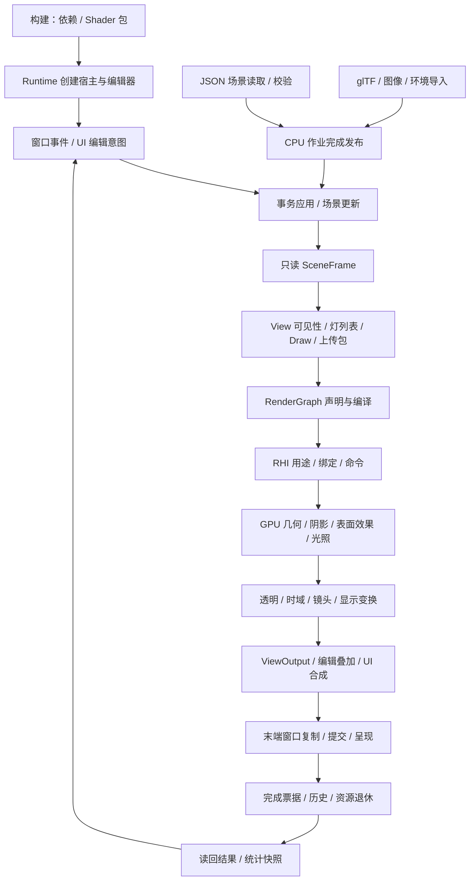
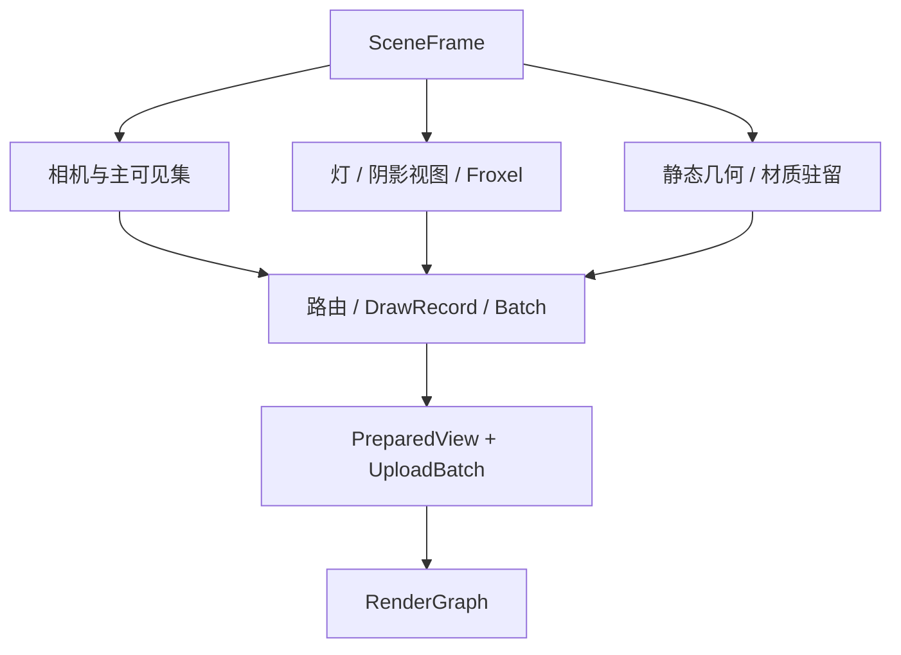
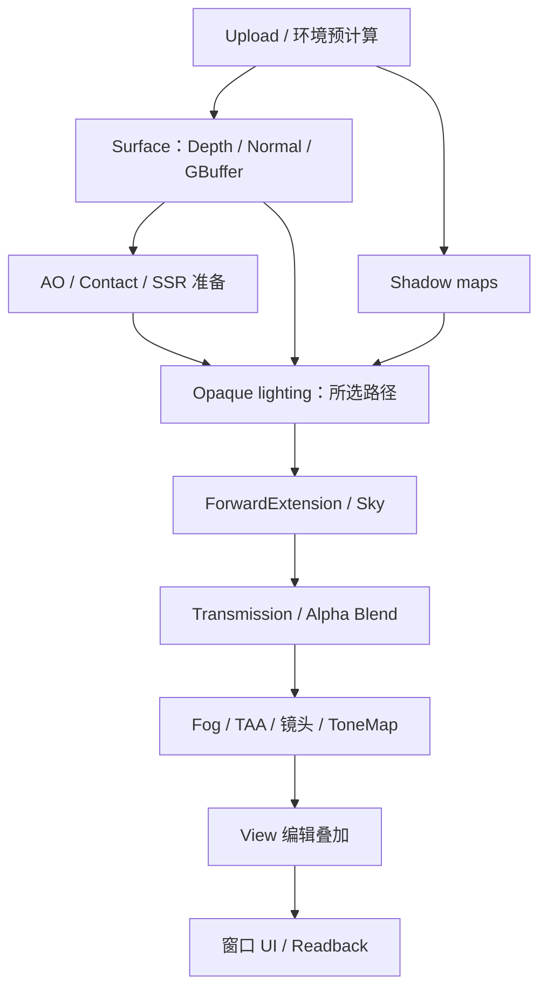
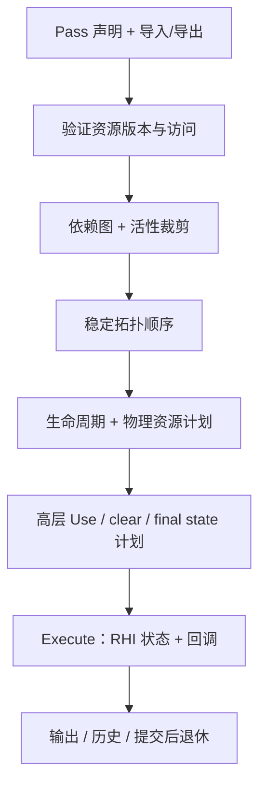
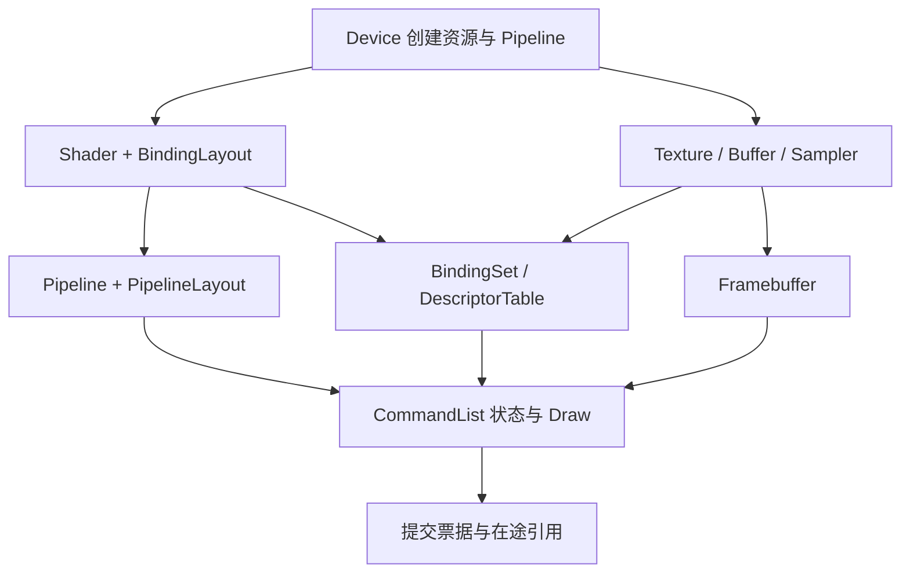

# Physara 系统架构：从应用输入到像素输出

> 本文规定 Physara 的技术路线、模块职责、流水线合同和实现约束。通用开发行为与编码风格见 [AGENTS.md](../AGENTS.md)。本文中的接口、类型和伪代码是待实现的设计合同，不表示仓库已具有相同 API。
>
> 大纲中的“阶段”是数据在一次运行/一帧中的生产消费阶段，不是开发里程碑。CPU 先构造计划，再沿 RHI 发出命令；GPU 异步执行后文定义的各 Pass。OpenGL 即时列表使录制与原生发射交错，并不意味着构图时就绘制或 CPU 等待每个 GPU 阶段完成。

## 阅读入口

- [0. 整体架构、数据流与工程覆盖](#overview)
- [1. 构建资源并启动运行环境](#stage-1)
  - [1.1 CMake、ThirdParty 与构建依赖](#build)
  - [1.2 Core：后续阶段共同使用的最小机制](#core)
  - [1.3 Shader 构建：先生成合同，再形成编译包](#shader-build)
  - [1.4 Runtime 单入口与长期对象装配](#runtime)
  - [1.5 Platform 创建窗口、context 与 RHI Device](#platform-start)
- [2. 接收窗口输入与编辑意图](#stage-2)
  - [2.1 窗口事件、输入快照与坐标单位](#input)
  - [2.2 EditorSession、面板与 UI 输入解释](#editor-input)
  - [2.3 领域命令、撤销与应用边界](#edits)
  - [2.4 视口输入、相机/Gizmo 与拾取请求](#viewport-input)
- [3. 导入、校验并发布标准资产](#stage-3)
  - [3.1 AssetManager 与标准数据合同](#asset-types)
  - [3.2 glTF 解码与资产校验](#asset-import)
  - [3.3 纹理、环境与编辑器资源的语义](#asset-images)
  - [3.4 JSON 场景、模型实例与文件读写](#asset-persistence)
- [4. 更新场景与物理参数](#stage-4)
  - [4.1 Scene、层级与增量变换](#scene)
  - [4.2 静态内容版本与编辑失效](#static-content)
  - [4.3 相机投影、物理镜头与曝光输入](#camera)
  - [4.4 材质、灯光与环境的物理创作参数](#physical-inputs)
- [5. 冻结场景并形成 CPU 渲染工作集](#stage-5)
  - [5.1 RenderEngine、Renderer、View 与帧槽](#frame-state)
  - [5.2 SceneFrame：从 ECS 到连续只读快照](#prepare)
  - [5.3 View 相机、裁剪与可见工作集](#view-preparation)
  - [5.4 灯列表、阴影计划与环境准备](#light-preparation)
  - [5.5 GPU 驻留、材质绑定与上传包](#gpu-residency)
  - [5.6 材质路由、DrawRecord、排序与 Batch](#draws)
  - [5.7 Pipeline 准备、热重载与路径切换事务](#plan-readiness)
- [6. 声明渲染子图并编译整帧执行计划](#stage-6)
  - [6.1 三路径子图与完整 Pass 生产消费](#paths)
  - [6.2 图资源版本、Pass 数据与权限](#graph)
  - [6.3 依赖、活性、拓扑与物理计划](#graph-compile)
  - [6.4 资源池、跨帧输入与外部输出](#graph-resources)
- [7. 把执行计划翻译为 RHI 与原生命令](#stage-7)
  - [7.1 NVRHI 公共层的移植与命名边界](#rhi)
  - [7.2 Device、资源、绑定、Pipeline 与 Validation](#rhi-objects)
  - [7.3 OpenGL 资源与 Shader/Pipeline lowering](#opengl)
  - [7.4 UploadBatch、volatile 常量与 push constants](#uploads)
  - [7.5 图执行器、访问用途与单一同步发射者](#barriers)
  - [7.6 即时 CommandList、状态缓存与真实 Draw](#command-execution)
  - [7.7 能力与不支持项的可见合同](#capabilities)
  - [7.8 同一合同下的 Vulkan 接入位置](#vulkan)
- [8. GPU 执行几何、表面与物理光照](#stage-8)
  - [8.1 GLSL 模块架构与薄 Pass 入口](#shader-runtime)
  - [8.2 静态几何与 Depth/Normal/GBuffer](#geometry)
  - [8.3 生成阴影并形成可查询可见性](#shadows)
  - [8.4 AO、接触阴影与前帧辐亮度 SSR](#surface-effects)
  - [8.5 MaterialInputs 到 PixelParams 的统一物理模型](#materials)
  - [8.6 方向/局部灯、阴影与 IBL 的统一聚合](#lighting)
  - [8.7 Forward、Forward+ 与 Deferred 如何消费同一模型](#opaque-shading)
  - [8.8 天空背景、透明覆盖与物理透射](#transparency)
- [9. 完成时域、镜头与显示变换](#stage-9)
  - [9.1 相机重投影、曝光与历史有效性](#temporal-contract)
  - [9.2 TAA 重投影、裁剪与累积](#taa)
  - [9.3 DoF、Bloom 与镜头效果](#lens-effects)
  - [9.4 ToneMap、ColorGrading、FXAA 与 ViewOutput](#display-output)
- [10. 合成编辑器画面并提交窗口呈现](#stage-10)
  - [10.1 编辑叠加、视口输出与本帧纹理解析](#editor-output)
  - [10.2 ImGui RHI Renderer 与纹理协议](#imgui-renderer)
  - [10.3 Platform 末端复制、提交与窗口呈现](#present)
- [11. 消费完成结果、退休资源并退出](#stage-11)
  - [11.1 RHI 在途引用与原生删除](#retirement)
  - [11.2 FrameSlot 复用与 View 历史提交](#history-commit)
  - [11.3 Event/Timer、截图与异步拾取](#readbacks)
  - [11.4 统计快照、缓存预算与诊断面板](#diagnostics)
  - [11.5 取消、失败与完整关闭](#shutdown)
- [12. 验证、测量与变更闭环](#stage-12)
  - [12.1 按合同验证行为](#tests)
  - [12.2 运行时测量与性能报告](#benchmark)
  - [12.3 Docs、Reference 与 OpenSpec 的唯一归属](#project-docs)
  - [12.4 新增能力仍保持一条完整链](#feature-closure)
- [固定源码与官方规范](#sources)

<a id="overview"></a>
## 0. 整体架构、数据流与工程覆盖

Physara 是轻量、现代、带场景编辑器的物理渲染器，目标是以清楚可验证的渲染算法表现真实的静态风景、物体和光照。运行时直接启动带编辑器的完整程序。模型资产采用标准 glTF 2.0 / GLB，保存在 Assets/Models；编辑器场景使用 Assets/Scenes 下的 JSON 文件，引用模型并保存实体、层级、实例覆盖和场景配置。同时存在 Forward、Forward+、Deferred 三条可切换路径。项目不实现动画播放、骨骼、Morph、动态物体或顶点变形系统，也不建设游戏逻辑、脚本平台、任意材质图或自研窗口/UI 工具包。编辑器可以修改静态物体和相机；内容编辑后的时域历史处理见 [4.2](#static-content)，不因此引入动态对象运动管线。

RHI 采用 NVRHI 的公共接口、Common/Validation、绑定、状态与提交寿命模型，进行 Physara 命名移植；OpenGL 是初始实现，Vulkan 按同一谱系接入。Renderer 采用 Filament 的长期资源/帧编排/View、CPU 准备、FrameGraph 与物理着色思路。OpenGL 适配和三路径子图是本项目设计，不能描述成上游已有实现。[N01] [N02] [F01] [F02]

### 0.1 全流程数据走向



UI 有两个不同位置：帧开始时生成编辑意图与布局，帧末端作为 ViewOutput 的 GPU 消费者。资产导入也不在绘制时同步读取文件，而是通过版本化 CPU 结果进入帧边界。图中的箭头表示合同和依赖，不要求 GPU 阻塞等待 CPU 每个节点。

### 0.2 核心状态与跨阶段合同

| 数据/对象 | 权威所有者 | 主要生产 → 消费 | 寿命/变化规则 |
|---|---|---|---|
| WindowState、HostFrameInput | Platform::DeviceHost | 原生事件 → Editor/Runtime | 每次 poll 封存；事件视图不跨下一次 poll |
| CPU 资产/内容版本 | AssetManager | 导入作业 → Scene/RenderEngine | 不可变发布，handle 与内容 revision 分离 |
| Scene/编辑事务 | Scene / EditorSession | 控件/领域命令 → SceneFrame | 静态内容事务统一应用，不含 RHI 对象 |
| RenderEngine | Runtime 组合入口 | 资产版本 → GPU 驻留、Shader/PSO/资源池 | 长期渲染资源；不拥有 UI 状态 |
| Renderer | Runtime 组合入口 | PreparedView → 全帧图 | 负责编排，不再保存全局目标副本 |
| View | 渲染侧 View registry | 相机/请求 → PreparedView/输出/历史 | 每个视口独立 requested/effective 配置 |
| SceneFrame、PreparedView、DrawRecord | FrameSlot | Scene → 图与命令 | 只读帧内数据；提交完成后复用 |
| UploadBatch | FrameSlot / GPU cache | 脏 CPU 数据 → 图中的上传任务 | 数据至少活到即时复制/记录合同满足 |
| GraphId、编译图 | 当前 RenderGraph | 资源声明 → RHI 执行 | 仅当前图代有效，不能跨帧保存在 UI |
| PresentationFrame | DeviceHost；Runtime 临时持有 | acquire → 窗口呈现 | token 不进入 Engine；原生退出独立管理 |
| SubmissionId / 完成值 | RHI Device | Execute → 回收/查询 | 真实完成值，不等于 CPU 帧号或呈现完成 |
| UiTextureId | Editor UI registry | 面板 → 本帧 UI 绑定 | 稳定 ID+generation；本帧才解析图输出 |

### 0.3 工程组织

下列列出需要实现的职责目录，不预建空功能。生成物只写 build 树。Runtime 只有一个产品入口 Main.cpp，直接启动带编辑器的渲染器。Shader 处理、资产校验和测量归入实际消费这些能力的模块，不设置独立 Tools 模块。

```text
Physara/
    AGENTS.md
    CMakeLists.txt
    RHI/
        CMakeLists.txt
        RHI.hpp, Resource.hpp, Containers.hpp, Utils.hpp, Validation.hpp, OpenGL.hpp
        Common/
        Validation/
        OpenGL/
    Platform/
        CMakeLists.txt
        DeviceHost.hpp, DeviceHost.cpp, Input.hpp, GlfwAccess.hpp
        GlfwWindow.cpp, GlfwInput.cpp, OpenGLDeviceHost.cpp
        InputState.hpp, InputState.cpp
    Engine/
        CMakeLists.txt
        Core/
        Asset/
        Scene/
        Shader/
            Interface/
        Renderer/
            Prepare/
            Draw/
            Materials/
            Lighting/
            RenderGraph/
            Passes/
            Paths/
            PostProcess/
    Editor/
        CMakeLists.txt
        Session/
        Commands/
        Panels/
        Viewport/
        ImGui/
        Diagnostics/
    Runtime/
        CMakeLists.txt
        Main.cpp
    Assets/
        Scenes/, Models/, Textures/, Environments/, Editor/
    Shaders/
        Common/, Geometry/, Material/, BRDF/, Lighting/, Shadow/
        ScreenSpace/, PostProcess/, UI/, Passes/
    ThirdParty/
        CMakeLists.txt
    Docs/
        Build.md
        Architecture.md
        Developments.md
        Reference/
    openspec/
        config.yaml
        specs/
        changes/
```

将来的 RHI/Vulkan.hpp、RHI/Vulkan/ 与 Platform/VulkanDeviceHost.cpp 在后端落地时按 [7.8](#vulkan) 添加；其公共合同现在就保留，目录不靠空占位体现设计。Docs/Performance/ 仅在有长期基准/特性报告时建立。没有独立 ADR 目录，决策理由随 OpenSpec design 归档。

### 0.4 目录到流程单元的覆盖

| 工程职责 | 主要流程位置 | 设计与实现合同 |
|---|---|---|
| 根/各模块 CMakeLists、ThirdParty | [1.1](#build) | 单向 target、必要生成依赖、固定版本与许可 |
| Engine/Core | [1.2](#core)、[11.4](#diagnostics) | identity、arena、作业发布、文件/计时/诊断基础 |
| Engine/Shader/Interface、Engine/Shader | [1.3](#shader-build) | 生成 ABI、编译包、反射与依赖 |
| Runtime/Main.cpp | [1.4](#runtime)、[0.6](#frame-flow)、[11.5](#shutdown) | 唯一组合入口、主循环与关闭顺序 |
| Platform/DeviceHost、GlfwWindow、GlfwInput、InputState | [1.5](#platform-start)、[2.1](#input)、[10.3](#present)、[11.5](#shutdown) | 创建、输入、呈现与原生资源退出 |
| Platform/Input、GlfwAccess | [2.1](#input)、[2.2](#editor-input) | 只读事件及受限 GLFW/ImGui 互操作 |
| Editor/Session、Panels | [2.2](#editor-input) | 只读展示、布局与领域请求 |
| Editor/Commands | [2.3](#edits) | 编辑事务、Undo/Redo、版本与脏标记 |
| Editor/Viewport | [2.4](#viewport-input)、[10.1](#editor-output)、[11.3](#readbacks) | 相机/Gizmo、输出、异步拾取 |
| Engine/Asset | [3.1—3.3](#stage-3) | glTF/图像/环境的校验和 CPU 资产发布 |
| Assets/Models、Scenes；Engine/Scene、Editor/Session | [3.1](#asset-types)、[3.4](#asset-persistence) | 标准模型资产、JSON 场景与实例读写 |
| Assets/Textures、Environments、Editor | [3.3](#asset-images) | 纹理语义、HDR 校准、图标冷路径 |
| Engine/Scene | [4.1—4.4](#stage-4) | 静态层级、物理创作参数、文档/内容版本 |
| Engine/Renderer/Prepare | [5.1—5.4](#stage-5) | 场景快照、View、可见性、阴影/灯列表 |
| Engine/Renderer/Materials | [5.5](#gpu-residency)、[5.6](#draws) | GPU 材质驻留、绑定和路由；不复制 BRDF |
| Engine/Renderer/Lighting | [5.4](#light-preparation)、[8.3](#shadows)、[8.6](#lighting) | CPU 灯/阴影视图与 GPU 求值合同 |
| Engine/Renderer/Draw | [5.6](#draws) | 完整排序、Batch、实例与 indirect 数据 |
| Engine/Renderer/Paths | [6.1](#paths)、[5.7](#plan-readiness) | 两阶段不透明策略与帧边界切换 |
| Engine/Renderer/RenderGraph | [6.2—6.4](#graph)、[7.5](#barriers) | 版本、依赖、活性、物理计划和执行 |
| Engine/Renderer/Passes | [6.1](#paths)、[8](#stage-8) | 类型化 Pass 组装；不拥有另一套 Scene/目标 |
| Engine/Renderer/PostProcess | [9](#stage-9) | 后处理子图、参数、历史及输出 |
| RHI 公共头/Common/Validation | [7.1—7.2](#rhi)、[7.5](#barriers)、[11.1](#retirement) | NVRHI 契约、状态与生命周期 |
| RHI/OpenGL | [7.3—7.7](#opengl)、[10.3](#present) | 绑定 lowering、上传、同步、即时命令和窗口末端互操作 |
| Shaders/Common、Geometry | [8.1—8.2](#shader-runtime) | 数学/采样/几何与共享顶点路径 |
| Shaders/Material、BRDF、Lighting、Shadow | [8.3—8.7](#stage-8) | 统一的物理求值库 |
| Shaders/ScreenSpace | [8.4](#surface-effects) | AO/接触阴影/SSR 的前置依赖 |
| Shaders/PostProcess | [9](#stage-9) | 时域、镜头、色彩与显示 |
| Shaders/UI、Passes；Editor/ImGui | [8.1](#shader-runtime)、[10.2](#imgui-renderer) | 薄入口、UI Shader、RHI 绘制与纹理协议 |
| Editor/Diagnostics | [11.4](#diagnostics) | CPU/GPU/图/资源只读快照与节流展示 |
| 各功能模块的验证 | [12.1](#tests) | 按实际合同选择行为、原生读回与图像检查 |
| Runtime、Renderer/Core 统计接口 | [12.2](#benchmark) | 同一渲染流程内的固定输入测量 |
| Docs、Reference、openspec | [12.3](#project-docs) | 当前架构、参考依据、行为与决策历史 |

### 0.5 依赖与全局约定

| Target | 允许依赖 | 禁止依赖 |
|---|---|---|
| PhysaraCore | 必要标准/数学/日志基础 | RHI、GLFW、ImGui、Scene |
| PhysaraRHI | 标准库、上游 Common/Validation | Core 业务类型、Platform、Engine、Editor |
| PhysaraOpenGL | RHI、GL loader、SPIRV-Cross GLSL | Platform、Scene、Editor |
| PhysaraPlatform | Core、RHI；GLFW/所选后端为私有依赖 | Renderer、Scene、ImGui、主循环 |
| PhysaraAsset / PhysaraScene | Core、解码库 / Core、Asset、entt | RHI、Platform、Renderer、Editor |
| PhysaraShader | Core、RHI、编译/反射库、已编译包 | Platform、Editor、资产导入器 |
| RenderGraph | Core、RHI | Platform、Editor、资产导入器 |
| PhysaraRenderer | Scene、Asset、Shader、RenderGraph、RHI | Platform、GLFW、Editor |
| PhysaraEditor | Scene、Asset、Renderer、Platform 的值/窄入口、JSON、ImGui/ImGuizmo | 原生 GL/Vulkan、RHI 后端实现 |
| Physara（Runtime） | Platform、Renderer、Editor | 另写一份渲染算法 |

所有 Engine targets 均不依赖 Platform。Editor 仅私有 GLFW 平台适配文件可包含 GLFW 与 GlfwAccess。原生设备/呈现实现可以使用 RHI 后端工厂，但公共 RHI 不创建窗口/Input/ImGui。Core 的日志/文件/作业是基础机制，不成为任意服务指针注册表。

<a id="conventions"></a>
#### 坐标、颜色和身份

| 项 | 统一语义 |
|---|---|
| 场景 | 米、右手系、+Y 向上；相机局部看向 -Z |
| 矩阵 | 列主序、列向量；命名 clipFromWorld 等 |
| 主视图 NDC | z∈[0,1]；Reverse-Z 近平面 1、远处趋于 0 |
| 主透视 | 渲染可用无限远 Reverse-Z；裁剪使用稳定有限范围 |
| 清除/比较 | 主深度 clear=0，Greater/GreaterEqual 按 Pass 协议 |
| 阴影深度 | 独立 ShadowDepthConvention；默认常规 0→1，clear=1、Less |
| 纹理逻辑坐标 | 左上为 (0,0)；NDC→UV 为 (0.5x+0.5, 0.5-0.5y) |
| GL | glClipControl(GL_UPPER_LEFT, GL_ZERO_TO_ONE)，原生绕序由后端适配 |
| Vulkan | 对接上游负高度 viewport 与 NVRHI raster 语义 |
| 图像行序 | CPU 导入、读回和保存按统一逻辑行序；不各处随意 flip |

主相机 Reverse-Z 不自动传播到阴影。任何深度重建、Hi-Z reduction、clear、比较和 resolve 都读取对应 convention，不能以一个全局“反向深度”宏替代所有语义。

模型默认 CCW；负 determinant 影响 winding/tangent handedness。公共 RasterState 保持 NVRHI 的目标空间语义，由 GL/Vulkan 各自映射，不让 MeshLoader 改顶点顺序补偿 API 差异。[K03]

应建立同一个非对称测试图验证：四角文字/颜色、深度梯度、正反面、scissor、屏幕拾取、截图和呈现。最终窗口适配只能位于呈现边界，不在每个 Pass 植入 UV 翻转。

```text
物理/材质输入
    → 线性着色
    → 乘当前 preExposure 的 SceneHDR
    → 时域/镜头/HDR 效果
    → ToneMap：display-linear
    → UI 在线性域合成
    → sRGB 输出编码
```

- 颜色纹理由 SRGB 格式解码；normal、ORM、深度、AO、DFG 为线性数据。
- 光照、IBL、自发光与屏幕反射/折射使用一致的预曝光域；历史记录其 preExposure。
- ViewOutput 的采样语义为 display-linear；默认可用 RGBA8_SRGB 存储，写入时编码、采样时自动解码。最终 sRGB 附件通过后端格式/写入状态编码一次，不能混淆存储编码与计算域。
- UI 顶点配色按 sRGB 创作值解码到线性；字体 alpha 是覆盖率；颜色图标由 SRGB 纹理格式处理。
- HDR 截图标记其曝光/色彩域；默认 EXR 输出去预曝光的 scene-linear 数据，PNG 为显示编码。
- 不把 glTF 的标准 emissive factor/strength 改造成一套材质私有“亮度影响因子”。

时间以秒传入，CPU 帧号与 GPU submission ID 分开。实体 handle、AssetId、MaterialGpuIndex、GraphId、UITextureId 和原生对象名是不同身份；禁止互相 reinterpret_cast。

能力在 Device 初始化和 Pipeline 创建阶段验证：格式、样本、UBO/SSBO 数量、纹理/image 单元、对齐、尺寸、indirect 等。GLSL 绑定按实际活动资源紧凑分配，不硬编码全项目必须具备 24 个 SSBO binding。

ResolvedFramePlan 保留 requested/effective 配置和原因。基础路径不依赖 ARB_bindless_texture；不能把某家扩展当成 GL 4.6 必然能力。高级可选 profile 只有完成对应 native conformance 后才对 UI 宣称支持。

着色工作原色固定为 linear Rec.709/D65；glTF 颜色纹理解码到该线性域。使用 Filament ToneMapper 等内部采用不同工作原色的算法时，在 ColorGrading 适配边界成对转换，不在各个材质/光照函数里各自转换。显示输出的目标为 SDR sRGB；其他输出 profile 需完整定义后再启用。

<a id="frame-flow"></a>
### 0.6 唯一的主循环合同

```cpp
int main()
{
    InitializeApplication();                         // 阶段 1；完整所有权见 1.4
    while (running && !host.HasFatalGraphicsError())
    {
        auto input = host.PollEvents();              // 2：同时更新 UI 平台 backend 的输入
        PublishCompletedCpuJobs();                  // 3：检查身份/版本后发布
        ConsumeReadyReadbacksAndStats();             // 11：只取已完成结果
        if (!ResolveCloseRequest(input.window)) break;
        if (!input.window.Renderable())
        {
            device.RunGarbageCollection();
            host.WaitForEvents(IdleWakeSeconds);
            continue;
        }

        auto acquiredSlot = frameSlots.AcquireAvailableSlot();
        if (!acquiredSlot.Ready()) break;            // 完成查询失败不得重置仍在途的槽
        FrameSlot& slot = acquiredSlot.TakeSlot();
        auto acquired = host.BeginPresentation(slot.Index);
        if (!acquired.Ready())
        {
            HandlePresentationStatus(acquired.Status);
            frameSlots.ReleaseUnsubmitted(slot);
            continue;
        }
        auto presentation = acquired.TakeFrame();

        editor.BeginFrame(input);                   // 2：NewFrame、面板、布局、请求
        editor.BuildPanelsAndViewportRequests();
        editor.FinalizeDrawData();                  // ImGui::Render；稳定逻辑 token
        ApplyEditorTransactions();                  // 4：修改权威状态
        scene.UpdateDirtyTransforms();              // 静态场景只在编辑后更新
        auto sceneFrame = ExtractSceneFrame(scene, slot);
        auto viewWork = PrepareViewWork(sceneFrame, requests, slot);
        auto assetEvents = assets.TakePublishedChanges();
        host.BeginPreparationGraphicsDiagnostics();
        auto gpuScene = PrepareGpuResidencyAndUploadBatch(sceneFrame, assetEvents, slot);
        auto prepared = BuildDrawListsAndResolvePrograms(viewWork, gpuScene, slot);
        auto sceneUploads = NoSceneUploads();
        if (prepared.Valid())
        {
            AppendViewInstanceAndIndirectUploads(prepared, gpuScene.uploads, slot);
            sceneUploads = SealOwnedSceneUploadBatch(gpuScene.uploads);
        }
        if (!prepared.Valid() || !sceneUploads.Valid() || !host.PreparationGraphicsSucceeded())
        {
            prepared = NoSceneWorkWithDiagnostic();  // 保留脏数据，UI 可显示准备失败/Pending
            sceneUploads = NoSceneUploads();
        }
        if (host.HasFatalGraphicsError())
        {
            AbandonActiveFrameForFatal(presentation, slot);
            break;
        }

        RenderGraph graph(slot.Arena);
        auto target = graph.ImportTexture(presentation.target.texture,
            {presentation.target.entryState, presentation.target.finalState});
        AddUploadPasses(graph, sceneUploads);        // 场景生产者完成后才封存；UI 独立声明上传
        auto outputs = renderer.BuildFrame(graph, prepared);
        editor.BindFrameOutputs(outputs);           // 当前图的绑定，不保存到跨帧 token 中
        target = editor.AddOverlayAndUiPasses(graph, outputs, target); // 返回写入后的图版本
        AddRequestedReadbackPasses(graph, outputs, target);
        if (host.HasFatalGraphicsError())
        {
            AbandonActiveFrameForFatal(presentation, slot);
            break;                                  // UI/读回准备也可能创建资源并报告 Fatal
        }
        graph.MarkOutput(target);
        auto compiled = graph.Compile();
        if (!compiled.Valid())
        {
            ReportGraphErrorForNextUi();
            compiled = BuildSafeUiOnlyFrameUsingLastValidOutputs(editor, presentation, slot);
            outputs = NoSceneOutputs();             // 原场景图未执行，不提交其历史
            if (host.HasFatalGraphicsError())
            {
                AbandonActiveFrameForFatal(presentation, slot);
                break;                              // 不在失败的原生环境上继续打开列表
            }
            if (!compiled.Valid())
            {
                host.CancelPresentation(presentation);
                frameSlots.ReleaseUnsubmitted(slot); // 尚未发出场景原生命令
                continue;
            }
        }

        host.BeginExecutionGraphicsDiagnostics();    // 执行作用域不能清除准备阶段的结果
        commandList.Open();
        bool graphSucceeded = compiled.Execute(commandList); // first-use 创建也可能失败
        commandList.Close();
        if (host.HasFatalGraphicsError())
        {
            AbandonActiveFrameForFatal(presentation, slot);
            break;
        }
        bool frameSucceeded = graphSucceeded && host.FrameGraphicsSucceeded();
        host.PrepareSubmission(presentation, frameSucceeded); // 失败目标只走取消，不复制无效颜色
        if (host.HasFatalGraphicsError())
        {
            AbandonActiveFrameForFatal(presentation, slot);
            break;
        }
        auto ticket = device.ExecuteCommandList(commandList);
        if (host.HasFatalGraphicsError() || !ticket)
        {
            AbandonActiveFrameForFatal(presentation, slot);
            break;                                  // 不发布历史，不把失败编号记作完成票据
        }
        frameSlots.MarkSubmitted(slot, ticket);     // 已发工作无论画面有效性都必须保活
        frameSucceeded = frameSucceeded && host.FrameGraphicsSucceeded();
        if (!frameSucceeded)
        {
            FailReadbacksFromThisExecution();
            outputs = NoSceneOutputs();             // 普通 Error 不冒充本次场景渲染成功
        }
        else
        {
            CommitExecutedUploadBatches(compiled, ticket); // 只确认实际执行并有效提交的上传
        }
        CommitViewHistories(outputs, ticket);
        HandlePresentationStatus(host.Present(presentation, ticket));
        host.ApplyDeferredRequests(editor.TakeHostRequests());
        device.RunGarbageCollection();
    }
    ShutdownApplication();                           // 阶段 11
    return 0;
}
```

Platform 拥有的既有 RHI MessageCallback 适配器在设备存活期间有效：Fatal 锁存“停止新渲染”，普通 Error 在对应准备/执行作用域标记失败，不能靠日志字符串判断。Fatal 严重度不等于设备已经丢失；后端在掌握原生结果的边界另行记录 context/device 是否仍可用，供退出适配使用，不新增公共 RHI 错误接口。准备失败不发布计划，之后开始执行诊断也不能将它清除为成功；未就绪的 View 按已有合同保留旧输出或明确 Pending。执行失败即使已取得真实 ticket，也只用它保护在途资源，不推进该次 Scene/View 历史、上传完成版本或成功读回。普通 Error 不一概升级为 Fatal。

上例只在编图失败且尚未发原生命令时直接释放未提交帧槽。即时 GL 已发出部分工作时必须形成完成票据再退休；若 fence 本身失败，则保留未获票据的全部引用，进入受控退出，不能直接 ReleaseUnsubmitted。Vulkan 已 acquire 的 image 也不能丢 token。PrepareSubmission/Present 对失败帧走宿主取消协议，不读取未生成的 PresentColor；详细协议见 [11.5](#shutdown)。等待帧槽与驱动 PresentWait 单独计量，普通 Pass、统计、拾取不主动阻塞 GPU。

<a id="stage-1"></a>
## 1. 构建资源并启动运行环境

本阶段把源代码、标准依赖和 Shader 描述变成可启动的宿主及可消费资源。输出是完整拥有的运行对象，不是已经绘制的画面。

<a id="build"></a>
### 1.1 CMake、ThirdParty 与构建依赖

| 输入 | 输出 | 状态/实现归属 | 下一消费者 |
|---|---|---|---|
| 第一方源码、固定第三方源码、Shader/schema 输入 | 产品程序、生成 ABI 与 Shader 包 | 根/各模块 CMakeLists.txt | Runtime / ShaderLibrary |

项目使用 C++20 与 target 级 CMake。构建逻辑只写在根与模块 CMakeLists.txt 中：根文件声明产品选项和子目录，各模块文件管理自己的源码、公开依赖与私有实现。使用普通 configure/build 命令，不增加独立配置脚本、依赖校验层或开发工具安装入口。文件中的中文注释解释 target 职责、依赖可见性及必要的特殊处理。

| 依赖 | 所属用途 | 不向外泄漏的内容 |
|---|---|---|
| GLFW、GL loader | Platform、RHI/OpenGL | Engine 的公开头 |
| entt、glm、日志库 | Scene / Core | ECS registry 不直接交给 UI 控件 |
| glTF/图像解码、MikkTSpace | Asset | 解码器内部对象 |
| JSON 库 | Editor/Session 的场景文件读写 | 不成为领域组件或 Renderer 的公开数据类型 |
| glslang、SPIRV-Tools、SPIRV-Cross | Engine/Shader 编译 / GL lowering | UI 与 Scene |
| Dear ImGui docking、ImGuizmo | Editor | Engine、公共 RHI |
| NVRHI 参考快照 | 公共层移植与将来的 Vulkan 来源 | 不同时链接一份原版和重命名版 RHI |

ThirdParty 保留实际需要的上游源码、头文件和许可证。头文件库直接提供 include 路径，需要编译的源码随工程配置生成库，输出放在 build 树。版本/commit、来源、许可和必要裁剪说明统一记录在 [ThirdParty/README.md](../ThirdParty/README.md)，不另设配置清单或逐文件哈希清单。GLAD 使用固定版本生成的 loader 源码，普通构建不运行生成器。NVRHI 仅供源码参考，不加入 CMake target、include 或链接。新依赖在实际使用它的模块落地时引入。

```cmake
add_subdirectory(ThirdParty)
add_subdirectory(RHI)
add_subdirectory(Platform)
add_subdirectory(Engine)
add_subdirectory(Editor)
add_subdirectory(Runtime)
```

子目录加入顺序不替代真实 target 依赖。Engine/Shader 的必要生成步骤使用 OUTPUT/DEPENDS，include 变化也进入依赖；所有输出进入 build/Generated 与 build/ShaderCache。普通入口示意：

```sh
cmake -S . -B build
cmake --build build --config Debug
cmake --build build --config Release
```

上例适用于多配置生成器。使用单配置生成器时，为 Debug/Release 分别配置 build/debug、build/release 并指定 CMAKE_BUILD_TYPE，然后运行对应构建；不能以单配置 build 目录的两次 --config 调用冒充两种构建均已验证。

**实现规范**

- 第一方警告与诊断选项只施加在第一方 target；Debug/Release 和诊断开关独立。
- 不编译机器绝对资产路径作为唯一根；Runtime 从启动配置/可执行资源目录解析。
- 产品入口始终是 Runtime/Main.cpp，不以额外程序演示不同路径或重复资产、Shader 和渲染逻辑。

<a id="core"></a>
### 1.2 Core：后续阶段共同使用的最小机制

| 输入 | 输出 | 状态/实现归属 | 下一消费者 |
|---|---|---|---|
| 对象创建、CPU 请求、文件与时间 | 类型化身份、帧内存、版本化作业结果、基础诊断 | Engine/Core | 所有 CPU 阶段 |

Core 不装配 Renderer，也不提供全局服务定位器。它提供以下可独立验证的机制：

| 单元 | 数据与逻辑 | 必须明确的退出条件 |
|---|---|---|
| Handle/Identity | index+generation、类型不互换、槽复用递增代 | 跨异步请求重新核对 generation |
| FrameArena | 连续块、对齐分配、高水位、容量复用 | 对应 FrameSlot 完成后 Reset |
| Jobs | 有界任务队列、取消、request/source/target identity | 发布或丢弃结果后释放 payload；关闭前 join |
| IO/Paths | 受控资源根、文件读取、规范化与变更通知 | watcher 停止，不能回调已销毁目标 |
| Diagnostics | 日志、断言、CPU scope timer、数值标签 | 限频与容量；输出不反向依赖 Editor |

```cpp
PublishCompletedJob(result)
{
    if (result.cancelled || !Matches(result.target, result.generation, result.sourceVersion))
        return DiscardOwnedPayload(result);
    PublishAtFrameBoundary(result); // Scene/资产/GPU 侧的具体发布由对应 owner 执行
}

```

FrameSlot 的完成检查归 Runtime/Renderer：在 RHI 确认其最后提交完成后才调用 Core arena 的 Reset。Core 只提供内存机制，不调用 Device，也不保存图形完成票据。

字符串、文件路径和错误详情停留在冷路径；帧内引用使用 handle、数值标签与连续数组。共享基础算法只保留一份，但不建立一个收集全部数学和业务杂项的 Utils 大文件。

**实现规范**

- Jobs 只调度 CPU 工作；原生 GL 创建/删除不得从 worker 发出。
- Arena 不能跨实际完成值复用；异步任务不能捕获 arena 中的短命对象。
- Core 文件/计时/日志设施不携带 RHI、Platform 或 ImGui 类型。

<a id="shader-build"></a>
### 1.3 Shader 构建：先生成合同，再形成编译包

| 输入 | 输出 | 状态/实现归属 | 下一消费者 |
|---|---|---|---|
| Engine/Shader/Interface、Shaders、合法变体 | C++/GLSL ABI、反射、SPIR-V 包、源映射 | Engine/Shader 及其 CMake 生成步骤 | Pipeline 准备 / RHI lowering |

```cpp
// 结构化示意，不规定最终采用 YAML 还是受限声明文件。
Struct("PerView", Layout::Std140)
    .Mat4("clipFromWorld")
    .Mat4("previousClipFromWorld")
    .Vec4("cameraPositionPreExposure")
    .UVec4("viewFlagsFrameIndex");

BindingSet("PerView", set = 0)
    .ConstantBuffer(slot = 0, "PerView")
    .StructuredBuffer(slot = 0, "LightData")
    .Texture(slot = 0, "ShadowArray")
    .Sampler(slot = 0, "ShadowCompare");
```

生成：C++ 数据结构/offsetof/static_assert、canonical GLSL、BindingLayoutDesc、反射预期与 ABI hash。GPU 数据可使用明确 align 的 scalar/vector/matrix/array，不假定 std140 与 std430 天然完全相同；生成器按所选规则计算，并与编译结果核对。

逻辑集合按频率分四组：

| set | 内容 | 更新 |
|---:|---|---|
| 0 PerView | Camera、灯、Froxel、阴影、IBL | View/帧 |
| 1 PerRenderable | 静态 Object/Instance tables | 场景编辑变化 |
| 2 PerMaterial | Material table、材质 Texture/Sampler | 材质或绑定变化 |
| 3 PerPass | SSAO/SSR/GBuffer/后处理输入、私有常量 | Pass |

每个 set 内沿 NVRHI 的 b/t/s/u 命名空间解释 slot；canonical Vulkan binding 使用上游 offset 约定，GL 由 PipelineBindingPlan 展平。不能把逻辑 set=2 等价为 GL binding 加一个未经能力验证的大常数。

```cpp
ShaderPackage BuildShader(program, variant, interfaceSchema)
{
    source = PreprocessIncludesAndGeneratedInterfaces(program, variant);
    spirv = GlslangCompileForDeclaredVulkanProfile(source);
    SpirvValidate(spirv);
    reflection = Reflect(spirv);
    VerifySchemaOffsetsBindingsAndStageIO(reflection);
    return {spirv, reflection, sourceMap, contentHash, abiHash, compilerFingerprint};
}
```

Shader package cache key 包含所有 include 内容、schema、合法 variant、编译器/选项和 target profile。GL native program binary cache 另外包括 vendor/renderer/driver、native binding plan 与源 hash；失效时重编译，不跨驱动盲用。

Canonical IR 的基础 profile 限于可 lowering 到 GL 4.6 的公共子集；subpass input、descriptor indexing 等 Vulkan 专属能力不在基础 Shader 中暗用。编译 flags、clip/instance builtin lowering 与布局规则固定在 Engine/Shader 的编译配置，禁止临时文本替换 SPIR-V/GLSL 来掩盖不兼容。

Shader 编译与反射由 Engine/Shader 集中实现；构建时需要的 ABI/资源生成由该模块的 CMake 声明输入、输出和依赖，热重载复用同一套编译规则。生成步骤不链接依赖其输出的 Renderer，避免循环依赖；不为这些步骤建立独立 Tools 模块或第二套业务入口。GL 的 SPIRV-Cross lowering 与 Program link 留在明确的 backend Pipeline 创建阶段。

**实现规范**

- 编译与生成由 Engine/Shader 管理，重型编译器不进入面板，生成步骤不反向依赖 Renderer。
- C++ offset/size、SPIR-V 反射、stage IO 与 binding 同时核对；生成物不手改、不提交源码副本。
- Shader 编译阶段只生成 canonical IR；GL program link/绑定合并在后端准备 Pipeline 时完成，见 7.3。

<a id="runtime"></a>
### 1.4 Runtime 单入口与长期对象装配

| 输入 | 输出 | 状态/实现归属 | 下一消费者 |
|---|---|---|---|
| 启动参数、资源根与设备选择 | 宿主、资产/场景、RenderEngine、Renderer、View、EditorSession | Runtime/Main.cpp | 主循环 |

Main.cpp 是唯一产品启动点：创建设备、渲染器和编辑器，然后运行 [0.6](#frame-flow) 的主循环。不在 Runtime 再建立一套材质、图或 UI Renderer。长逻辑由对应模块拥有，Main 只组织进入/退出顺序。

```cpp
InitializeApplication()
{
    config = ReadStartupConfiguration();
    core = CreateCoreServices(config);             // 明确对象，不是全局可变服务表
    host.Create(config.host);                     // Platform 拥有原生环境和 RHI Device
    device = host.GetDevice();
    assets = CreateAssetManager(core.io, core.jobs);
    scene = CreateScene();
    renderEngine = CreateRenderEngine(device, shaderPackages, config.budgets);
    renderer = CreateRenderer(renderEngine);
    views = CreateViewRegistry(renderEngine);
    editor = CreateEditorSession(scene, assets, views, device);
    editor.InitializeGlfwPlatformAdapter(BorrowGlfwWindow(host));
    frameSlots = CreateFrameSlots(config.maxFramesInFlight);
}
```

启动时直接创建空的内存 Scene 并展示编辑器。主 View 默认使用导航相机，不为了空场景自动创建 Camera 实体或加载空 glTF。UI Program、字体与基本合成资源必须先初始化成功；失败属于启动失败。场景 Shader、模型和环境的准备则显示 Pending/失败，不能阻止已就绪的编辑器操作。没有上一有效 ViewOutput 时，Viewport 清屏并显示明确的空场景/准备状态，不伪造 1×1 场景输出。

指定 *.scene.json 时通过 EditorSession 的场景打开流程恢复。不要同步阻塞主循环等待用户文件导入完成，也不把“首帧没准备好”伪装为已加载。

**实现规范**

- 没有独立的无编辑器产品入口；三路径由同一 View 请求切换。
- 原生窗口借用只传给 Editor 私有平台适配，不进入 Scene/Renderer。
- FrameSlots、后台作业和各 owner 的销毁顺序必须与 11.5 一致。

<a id="platform-start"></a>
### 1.5 Platform 创建窗口、context 与 RHI Device

| 输入 | 输出 | 状态/实现归属 | 下一消费者 |
|---|---|---|---|
| HostDesc、GL 4.6 profile、初始窗口/显示设置 | 有效 context、RHI Device、能力与窗口状态 | Platform/DeviceHost、GlfwWindow、OpenGLDeviceHost | 输入采集、GPU 准备与窗口呈现 |

Platform 保留为小型独立静态库，封闭 OS/原生设备寿命。它不拥有主循环、Scene、View、Pass 列表或 ImGui。公开有状态入口只有 DeviceHost，其他是数据合同；不建立 IWindow/IInput/通用 Application 的转发层级。

| 实现位置 | 真实状态与责任 |
|---|---|
| DeviceHost.hpp/.cpp | 生命周期、线程断言、平台请求与错误状态 |
| GlfwWindow.cpp | GLFW 初始化、窗口/context 建立和原生生命周期退出 |
| GlfwInput.cpp | 原生输入回调、窗口事实观察、事件泵与请求适配 |
| InputState.hpp/.cpp | DeviceHost 私有输入状态、双事件缓冲和只读发布，不调用原生 API |
| OpenGLDeviceHost.cpp | context、RHI GL 工厂、PresentColor、窗口交换 |
| Input.hpp | WindowState、HostFrameInput、事件与请求值类型 |
| GlfwAccess.hpp | 只供私有 UI 适配借用类型化 GLFWwindow* |

```cpp
DeviceHost::Create(desc)
{
    InitializeGlfwOnMainThread();
    CreateWindowAndInstallPlatformCallbacks(desc); // 进程初版只支持一个 DeviceHost
    if (desc.backend == OpenGL)
    {
        MakeContextCurrent();
        LoadRequiredGlEntryPoints();
        CheckActualContextVersionAndWindowEncoding();
        CreateRhiDeviceFromCurrentContext();
        ApplySwapInterval(desc.vsync);
    }
    else
    {
        return UnsupportedBackend; // Vulkan 按 7.8 接入后才启用，不能空成功
    }
    return Ready; // 任一步失败都退出已创建对象，不返回半初始化宿主
}
```

GL context 必须先有效且 current，再加载入口和创建 RHI Device；不再由 Window、RHI 和 Editor 分别接管一次 context。[K16] 窗口图标等 CPU 图像由 Runtime 冷路径准备并以像素数据传入，Platform 不知道 Assets 路径，不链接资产导入器。

GLFW 初始化/事件/窗口创建销毁按其主线程限制执行；Physara 将首发 context 和 RHI 操作也固定在该线程。进程初始只支持一个 DeviceHost，GLFW 初始化/终止成对负责；隐藏真实 GL context 的测试也复用它。[K13]

**实现规范**

- 创建失败逐步逆序释放，不向调用方暴露半初始化 Device；实际能力不足明确失败。
- DeviceHost 可以通过后端工厂构建设备，公共 RHI 不反向依赖 Platform。
- 这里不执行场景绘制；每帧 acquire/resize 见 5.1，输入见 2.1，present 见 10.3，退出见 11.5。

<a id="stage-2"></a>
## 2. 接收窗口输入与编辑意图

平台事件只描述发生了什么，编辑器将它解释为领域命令、View 请求和平台请求。本阶段不发场景 Draw；它输出下一阶段可以一次应用的意图，以及帧末 UI 使用的 DrawData。

<a id="input"></a>
### 2.1 窗口事件、输入快照与坐标单位

| 输入 | 输出 | 状态/实现归属 | 下一消费者 |
|---|---|---|---|
| GLFW 回调、窗口焦点/尺寸/鼠标状态 | HostFrameInput、WindowState、平台请求结果 | Platform/Input.hpp、私有 InputState、GlfwInput.cpp | Editor 输入路由 / Runtime |

```cpp
struct WindowState
{
    WindowExtent clientSizeLogical;
    WindowExtent framebufferSizePixels;
    ContentScale contentScale;
    bool focused;
    bool iconified;
    bool closeRequested;
    uint64_t metricsRevision;
    bool Renderable() const; // 非最小化且 framebuffer 宽高均大于零
};
struct HostFrameInput
{
    uint64_t sequence;
    WindowState window;
    InputSnapshot state;
    std::span<const InputEvent> events;
};
```

输入分为机制与策略：Platform 收集原始事实，Editor 的 ActionRouter/ViewportController 决定它们应触发文本编辑、Gizmo、快捷键还是相机。Engine 不轮询全局 Input 单例。

```cpp
OnKeyCallback(key, action, modifiers)
{
    pendingEvents.Push(KeyEvent{key, action, modifiers});
    if (key == Key::Unknown)
    {
        return; // 原生键先映射到合法逻辑枚举；Unknown 不索引数组，文本仍由字符事件接收。
    }
    if (action == Press)
    {
        pendingState.down[key] = true;
        pendingState.pressed[key] = true;
    }
    else if (action == Release)
    {
        pendingState.down[key] = false;
        pendingState.released[key] = true;
    }
    // Repeat 是独立事件，不伪装成每帧首次 Press；字符由 Unicode callback 提供。
}

PollEvents()
{
    glfwPollEvents();
    // 自上次发布以来累积的事件全部封存；不能在 poll 前清掉已到达的回调。
    HostFrameInput frame = PublishPendingInputAndWindowState();
    ResetPublishedEdgesAndDeltas();    // 保留 held 状态，交换复用事件缓冲
    return frame;
}
```

同一批次先按下后松开时，pressed 与 released 可以同时为真，有序 events 仍完整表达顺序。失焦时释放 held/capture、清除运动 delta，恢复焦点或切换光标模式后的第一份相对位移从零开始，避免相机跳变。回调只更新累积器；不创建 GPU 资源、不导入资产、不调用面板。

事件队列预留并复用容量；连续位置/尺寸通知可合并，按键边沿和文本不能静默丢失。异常超限必须可诊断并恢复 held/capture 状态。文件 drop 的路径是独立拥有的冷路径 payload，不让下一帧覆盖掉异步导入正在读取的字符。

| 数值 | 使用位置 | 不变量 |
|---|---|---|
| clientSizeLogical / 光标位置 | UI 布局、命中和拖动 | 同一窗口逻辑坐标系 |
| framebufferSizePixels | 窗口呈现附件、viewport/scissor | 实际像素，零尺寸禁止创建目标 |
| contentScale | 字体 atlas 与 UI 缩放选择 | 不假设等于 framebuffer/client 比例 |
| View render extent | 单个离屏视口及 render scale | 由编辑器布局提出请求、View 解析 |

GLFW 的窗口尺寸和 framebuffer 尺寸是不同单位，跨屏时可能只改变后者；不能把初始创建尺寸当成永久像素尺寸。[K14] UI 使用实际 framebuffer/client 比例；拾取用鼠标在 View 内容矩形中的归一化位置映射到有效 View 像素，不再额外乘一次全局 DPI。

resize/content-scale 回调只递增 metricsRevision 并合并最新状态。在下一次 BeginPresentation 的帧边界更新全窗口目标；旧目标按最后访问 ticket 退休。View 输出 resize 由 View 自己处理：调整面板尺寸不重建窗口呈现系统，不改变尺寸的菜单打开也不触发所有 View 失效。

最小化或 framebuffer=0 时不 Acquire、构图或提交正常帧，不创建 1×1 伪目标掩盖状态，也不无条件 WaitForIdle。Runtime 继续处理关闭和 CPU 作业，并使用事件等待或有限超时休眠；后台完成可唤醒它。恢复后更新时间基准，只有 extent/配置真正变化的 View 重建输出及历史。[K15]

**实现规范**

- 按键、字符、滚轮等有序事实发布一次；span 到下一次 poll 为止，跨线程使用必须自持 payload。
- WindowState 不包含 Scene/View。帧缓冲像素、窗口逻辑坐标和内容缩放分别保存。
- 尺寸回调只更新 revision；零尺寸不创建伪目标，重建在下一次 BeginPresentation 发生。

<a id="editor-input"></a>
### 2.2 EditorSession、面板与 UI 输入解释

| 输入 | 输出 | 状态/实现归属 | 下一消费者 |
|---|---|---|---|
| HostFrameInput、只读领域快照、上帧完成统计 | 布局、领域意图、HostRequest、ImGui DrawData | Editor/Session、Panels；ImGui 私有平台适配 | 事务应用 / View 请求 / UI 图末端 |

采用 Dear ImGui docking 及其 GLFW platform backend，RHI renderer 参考 Donut 的资源/批次做法。Docking 是同一原生窗口里的布局；初始关闭 OS multi-viewports，避免额外 context/SwapChain 管理侵入轻量基线。[U01] [U02] [U03]

参考快照中的 ImGui 已有 1.92+ 的纹理 create/update/destroy 协议；生产依赖必须锁定经验证的 docking 发布版本，不能把 WIP 分支当浮动依赖。Donut 的适配示例也不能自动代替所选 ImGui 版本的完整 backend 协议。

UI 平台适配使用官方 ImGui GLFW backend 的 callback chaining：先安装 Platform 回调，再以 install_callbacks=true 初始化 ImGui backend；后者保存并调用原回调。退出时先 Shutdown UI backend 以恢复原回调，再销毁窗口。禁止初始化后重新覆盖回调或 GLFW user pointer；Platform user pointer 只指向稳定的 DeviceHost 私有状态。[U05]

因此同一次 GLFW 事件会更新 ImGui IO 与平台快照，不能再把快照中的按键/字符重复 Add*Event 给 ImGui。所有事件先交给 UI；Editor 在 NewFrame/布局与交互状态明确后统一决定业务输入去向。文本、模态控件、活动 Gizmo 与已捕获相机操作的优先级由 Editor 集中处理，不能把前一帧 WantCaptureMouse 当成当前帧唯一判据，也不能在每个面板各消费一次滚轮。

| 编辑器对象 | 自己拥有 | 消费合同 |
|---|---|---|
| EditorSession | 选择、Undo/Redo、面板布局、工作区设置、UI token registry | Scene/资产/View 的窄服务与只读快照 |
| Panels | 折叠/过滤/滚动等展示状态 | 读取快照、提交字段级命令 |
| ActionRouter | ActionId、作用域、快捷键、enabled 条件 | UI 当前捕获、模态/Gizmo/相机状态 |
| ViewportController | ViewId、内容矩形、操控模式、拾取请求身份 | 相机/视口请求，不直接创建 RHI 目标 |

| 面板 | 功能 | 性能组织 |
|---|---|---|
| Hierarchy | 选择、层级、创建/删除、重命名 | revision 驱动树数据、列表裁剪 |
| Inspector | TRS、实例材质/纹理覆盖、灯、相机 | 注册的组件编辑函数；修改发事务 |
| Viewport | 输出、相机、Gizmo、网格、拾取 | 每 View 控制器，无整 Scene 副本 |
| Renderer | requested/effective 路径、AA、阴影、效果 | 只改权威设置/请求，显示能力原因 |
| Content Browser | glTF/纹理/环境、缩略图、加载状态 | 异步目录快照、节流刷新 |
| Log | 可过滤有限环形日志 | ImGuiListClipper、固定容量 |
| Stats / GPU | CPU/GPU、draw/batch、上传、灯/Froxel | 读不可变环形快照，不阻塞 query |
| RenderGraph | Pass、裁剪、资源版本、Use/生存期 | 请求时生成 debug snapshot |
| Resources | 预算、驻留估计、view 预览 | 有界 registry，明确估计口径 |
| 统计面板中的测量操作 | 场景/路径/画质固定的采样 | 复用 Runtime/Renderer 流程和统计快照 |

隐藏/折叠面板不构建不可见行、不访问文件系统、不格式化全部日志。文本统计可 4 Hz 刷新，曲线读固定环；GPU 结果可能落后，标明对应帧，不把过期时间标为“本帧”。

菜单/快捷键统一注册为 ActionId，附带适用输入范围、enabled 条件和领域命令；不由每个面板各监听一遍全局按键。文本编辑、Gizmo、相机捕获的优先级集中判定。

最小操作集包括新建/打开/保存 JSON 场景、导入 glTF 模型及取消导入、Undo/Redo、复制/删除/聚焦实体、相机模式、布局恢复、截图和 debug view。新建场景直接创建空的内存 Scene，首次保存才产生 *.scene.json。内置图元使用标准 glTF 模型资源，不建立另一套常驻私有模型格式。需要性能比较时，在现有统计面板或 Runtime 启动参数中增加固定输入的测量操作。

资源预览若需要显示 depth、整数、array/cubemap 的子资源，先添加类型化 Preview pass 转换为 UI 可采样颜色，并保留它的图依赖。截图请求明确 SceneHDR、ViewOutput 或含 UI 的 FrameOutput；对应 Copy 节点位于正确生产者之后。

```cpp
EditorSession::BeginFrame(input)
{
    imguiPlatform.NewFrame(); // 官方 GLFW backend；事件已通过 callback 进入 IO
    ImGui::NewFrame();
    RefreshChangedDomainSnapshots();
    actions.BeginRouting(input, activeModal, textInput, gizmoState);
}
BuildPanelsAndViewportRequests()
{
    for (panel : registeredPanels)
        if (panel.Visible()) panel.Draw(readOnlySnapshots, commandSink);
    viewportController.ResolveInputAndRequests(actions, viewportRect);
}
FinalizeDrawData()
{
    ImGui::Render();
    drawData = ImGui::GetDrawData(); // 存活到当前帧执行完 UI 消费；下一次 NewFrame 前完成拷贝
}
```

面板以独立文件/职责实现；固定面板可使用静态注册表，不为此开发通用插件框架。Inspector 通过类型化 field ID/命令编辑，不持有内部 ECS 可变引用，也不把整个材质/Renderer 设置拷成一份长期镜像。

**实现规范**

- ImGui/ImGuizmo 与面板只存在于 Editor；UI 绘制的原生 GPU backend 不使用 ImGui 自带 GL Renderer。
- 菜单和快捷键复用同一 ActionId；不在面板中各自监听全局键和消耗滚轮。
- 本阶段的稳定 UiTextureId 在 10.1 解析本帧图输出，不能提前取还未物化的纹理。

<a id="edits"></a>
### 2.3 领域命令、撤销与应用边界

| 输入 | 输出 | 状态/实现归属 | 下一消费者 |
|---|---|---|---|
| 控件/快捷键/Gizmo 产生的领域意图 | 命令事务、Undo 数据、版本/脏标记 | Editor/Commands；Scene/View 执行创作修改，Asset 保持只读 | 阶段 4 场景更新 |

```cpp
SetTransformCommand = {EntityHandle, beforeLocal, afterLocal};
SetMaterialOverrideCommand = {EntityHandle, primitiveSlot, field, beforeValue, afterValue};
ChangeViewSettingCommand = {ViewId, field, beforeValue, afterValue};

ApplyEdit(command)
{
    ValidateHandleAndFieldOnce(command);
    SaveUndoData(command);
    MutateAuthoritativeObject(command);
    IncrementRelevantRevision();
    EnqueueDirtyRootOrInstanceOverrideUpdate();
}
```

拖拽过程可合并为一次 undo 事务，每帧发布最新值；不让每个控件维护一份可与 Scene 分叉的完整对象。Entity generation、Scene identity 和 request ID 保证删除后迟到的拾取/加载结果不会指向复用槽位。

保存场景将实体稳定 ID、层级、实例状态和模型引用写入 JSON，具体合同见 [3.4](#asset-persistence)。运行期 EntityHandle 与文件中的 EntityId 分开；SourceRef 的源节点索引只对其对应模型版本有效，不能在重新导入后按名称或旧索引自动绑定。

一个 UI 操作可以涉及多个 owner，但其事务边界明确：例如删除实体时同时取消该实体拾取请求、更新选择，再通过 Scene 命令删除。面板不直接销毁 GPU 驻留对象，资产/场景 revision 在后续准备阶段驱动退休。

**实现规范**

- 拖拽合并成单次 Undo 事务，每帧最新值可以发布；撤销仍走相同修改入口。
- 运行期状态只在确定帧边界批量修改，构图和 execute 不再临时变更 Scene。
- View 参数和平台 VSync/标题分别走各自请求，不能塞入统一“全部设置”包。

<a id="viewport-input"></a>
### 2.4 视口输入、相机/Gizmo 与拾取请求

| 输入 | 输出 | 状态/实现归属 | 下一消费者 |
|---|---|---|---|
| 内容矩形、逻辑鼠标坐标、选择与 View 设置 | CameraRequest、ViewExtentRequest、PickRequest | Editor/Viewport | 物理 View / 阶段 11 异步结果 |

- 面板内容矩形通过实际 framebuffer/client 比例与 render scale 得到 View 像素尺寸；零尺寸/最小化不创建无效目标。
- resize 在帧边界原子替换输出代，旧 Texture/Binding/Framebuffer 等待原提交完成。
- 相机 fly/orbit/pan 只消费未被控件捕获的输入；相机矩阵来自同一 CameraSnapshot。
- Gizmo 使用稳定投影显示，修改经父变换逆矩阵转换到局部，再提交事务。
- glTF matrix 导入需验证可分解的 TRS；reparent/Gizmo 若产生不可表示的 shear，明确拒绝或采用已定义的受限操作，不静默改矩阵以保持“看似成功”。
- Grid/icon/selection 属于编辑可视化层，不改变 PBR 参数。display-linear 叠加需要将世界坐标映射到 SceneDepth 的当前采样坐标，避免 stable/jitter 混用。

```cpp
BuildPickRequest(mouseLogical, viewRect, effectiveExtent)
{
    if (!Contains(viewRect, mouseLogical)) return NoRequest;
    uv = (mouseLogical - viewRect.min) / viewRect.size;
    pixel = ClampToValidTexel(uv * effectiveExtent);
    return {NewRequestId(), scene.Identity(), view.Id(), view.Generation(), pixel};
}
```

相机控制器更新编辑器相机的 pose/request；物理 Camera/View 的投影、曝光和历史由阶段 4/5 处理。Gizmo 用当前 world/local 合同生成 TransformCommand；父级非均匀缩放产生不可表达 shear 时明确约束操作，不静默拆出错误 TRS。

**实现规范**

- 拾取只排入请求，不能在鼠标回调里同步 ReadPixels 或等待 GPU。
- 鼠标到 View 像素只做一次坐标转换，不额外叠加窗口 DPI。
- 活动 Gizmo、文本/模态与相机捕获由统一路由决定；各控件不复制优先级逻辑。

<a id="stage-3"></a>
## 3. 导入、校验并发布标准资产

输入来自资源浏览器、启动场景或文件变更。CPU 导入结果不含 RHI 对象；只有版本化资产发布成功，Scene 才实例化引用，RenderEngine 才准备 GPU 驻留。

<a id="asset-types"></a>
### 3.1 AssetManager 与标准数据合同

| 输入 | 输出 | 状态/实现归属 | 下一消费者 |
|---|---|---|---|
| 标准 glTF、图片/HDR 文件及源身份 | 不可变 CPU AssetRecord、状态与 revision | Engine/Asset；Assets/Models、Textures、Environments | Scene 实例化 / GPU residency |

模型的静态网格、标准材质和源节点层级使用只读 glTF 2.0 / GLB，统一放在 Assets/Models。JSON 场景保存在 Assets/Scenes，只组合这些标准模型资产与场景实体、实例覆盖和配置，不编码另一套网格或完整材质资源。HDR/EXR 环境、标准图片和 glTF 引用纹理仍可作为辅助资源。

| CPU 资产 | 保存的语义 |
|---|---|
| GltfDocument | 源文件、标准扩展、静态节点/所选 scene、源版本与支持报告 |
| MeshAsset | canonical 静态顶点/索引、Primitive、材质引用、bounds |
| TextureAsset | 图像数据与用途解释、format/mips、sampler 引用 |
| MaterialAsset | 标准因子、纹理槽、UV/transform、alpha、doubleSided、已支持扩展 |
| EnvironmentAsset | HDR 输入、朝向、预计算结果与缓存 key |

AssetManager 管路径和加载状态，热路径只用 handle。资产 identity 与内容版本分离；相同像素图被当成 sRGB 与线性数据使用时，GPU view/cache key 必须区分解释，不能只按文件路径去重。

AssetManager 的加载状态为 Unloaded → Loading → CpuReady 或 Failed/Cancelled。CPU Ready 不代表 GPU Ready。AssetId 标识逻辑资源，ContentRevision 标识内容；重新导入不会使活着的 GPU Draw 自动引用半份新数据。

```cpp
RequestAsset(source)
{
    request = BeginRequest(NormalizeSourceIdentity(source));
    jobs.Enqueue(ParseAndDecode(source, request.cancelToken));
    return request.assetHandle;
}
PublishAsset(result)
{
    RequireRequestAndSourceStillMatch(result);
    PublishImmutableAssetRecord(result.cpuPayload);
    NotifyAssetRevisionChanged(result.asset);
}
```

**实现规范**

- 模型资产采用标准 glTF/GLB；编辑器场景采用 JSON 引用模型，不在 Scene 文件中内嵌网格、纹理字节或完整 MaterialAsset。
- 存储位置与资源身份区分；热路径用 handle，不解析路径。
- CPU Asset 不持 Device、TextureHandle 或 UI 句柄；GPU 状态归 RenderEngine。

<a id="asset-import"></a>
### 3.2 glTF 解码与资产校验

| 输入 | 输出 | 状态/实现归属 | 下一消费者 |
|---|---|---|---|
| 容器、URI、buffer/accessor、扩展声明 | 静态 Primitive/材质/节点 CPU 描述与支持报告 | Engine/Asset | Asset 发布 / Scene 实例化 |

```cpp
ImportGltf(source)
{
    ValidateContainerUrisBuffersAndAccessors();
    ValidateRequiredExtensionsAndProduceCapabilityReport();

    DecodeAccessors();               // stride、offset、normalized、sparse
    CanonicalizePrimitiveTopologyAndIndices();
    PreserveOrGenerateNormalsAndTangentsWhenRequired();
    BuildStandardMaterialRecords(); // 默认值、通道、sampler、UV transform
    ValidateStaticSceneProfileAndBuildNodes();
    PublishImmutableCpuAssetsAtFrameBoundary();
}
```

静态表面基线支持 TRIANGLES，并将 TRIANGLE_STRIP/TRIANGLE_FAN 保持绕序地转为三角形索引；POINTS、LINES、LINE_LOOP、LINE_STRIP 明确报告不支持，不把它们当三角形解释。RHI 的原生拓扑能力与资产 profile 是两件事。

缺少 NORMAL 时按 glTF 生成逐面 flat normals，并忽略随源提供的 TANGENT，不能擅自平滑。切线缺失且材质需要 normal/coat-normal 的切线框架时，以对应 UV 集走 MikkTSpace。其结果按面角点返回，硬边、镜像 UV 或不同切线的角点需要拆顶点并重建索引；不能写回原共享索引后平均或覆盖。保留合法 tangent.w，并核对 anisotropy 的标准切线空间前提。基线公开 UV0/UV1；所用纹理槽缺少对应 UV、要求其它 UV 集或缺少合法切线空间时报告具体不支持项，不用零 UV/任意切线伪造成功。[K01] [K17] [K25]

metallic-roughness 的 roughness=G、metallic=B，occlusion=R；baseColor/emissive texture 以 sRGB 解码，因子在线性域相乘；glTF normal 使用标准切线空间约定，不引入默认 flipNormalY。alphaMode、alphaCutoff 和双面背面法线在所有路径共用。[K01]

静态支持判断针对所选 glTF scene 可达内容：动画曲线不执行，按节点初始 TRS 导入并报告“不播放动画”；实际使用 Skin 或 Morph target 的节点明确拒绝，不丢弃变形数据后冒充完整模型。未实例化的其他 scene/资源不因此否定已验证的静态内容，不建立动画运行期类型或 GPU ABI。

资产校验是 Engine/Asset 导入入口的一部分，属于不依赖设备或 UI 的 CPU 逻辑。检查 accessor stride/offset/总字节、索引范围、sparse、normalized、静态节点引用、拓扑、扩展依赖及数据尺寸预算；加载和重新导入复用同一入口，不另设资产校验程序。

**实现规范**

- 未知 required extension 拒绝；optional extension 的可见降级进入能力报告，不静默当完全支持。
- 支持的 Primitive topology 与转换明确；不能假定所有 glTF 输入都是三角形。
- 解析/解码在线程池，发布在帧边界；取消与源版本变化时丢弃独立拥有的 CPU payload。

<a id="asset-images"></a>
### 3.3 纹理、环境与编辑器资源的语义

| 输入 | 输出 | 状态/实现归属 | 下一消费者 |
|---|---|---|---|
| Textures、Environments、Editor 图像和 glTF texture/sampler | 像素、色彩/通道解释、采样描述、预计算源参数 | Engine/Asset；Assets/Textures、Environments、Editor | Material/Environment GPU 准备与 UI 资源 |

| 资产目录/类型 | CPU 合同 | 进入 GPU 前要保留的语义 |
|---|---|---|
| Textures | 图像像素、mip/压缩元数据、源身份 | color/data、线性/sRGB、通道、尺寸、sampler 与 UV |
| Environments | HDR 辐亮度图、朝向、校准/强度说明 | IBL 预滤波模型、DFG 版本、绝对亮度是否已校准 |
| Editor | 图标/字体等展示资源 | sRGB 颜色与覆盖率 alpha；不作为场景照明 |
| Models 的内嵌图像 | 标准 glTF image/texture/sampler 引用 | 同像素可被多种语义解释，GPU view/cache key 区分 |

CPU 解码不任意翻转法线 Y、不对 ORM/normal 做 gamma。环境图没有绝对测光信息时标记相对标定；用户环境缩放属于显式场景环境配置，不伪装成 glTF punctual intensity。

```cpp
MakeTextureRequest(image, usage, sampler)
{
    format = SelectSupportedFormat(image.encoding, usage.colorDomain);
    return {image.id, image.revision, usage, format, sampler};
}
```

采样器、纹理存储和材质纹理槽分别记录。相同图像的 sRGB/线性 view、UV set/transform 和 sampler 不能仅由一个文件路径 key 抹平。窗口图标由 Runtime 冷路径准备像素交给 Platform，Platform 不扫描 Assets。

上传/生成 mip 必须形成完整可采样的有效层级，并将有效 mip range 与 sampler 的 LOD 约束配套；不能用未初始化层参与三线性采样。颜色 mip 在线性颜色域过滤，normal/ORM 等维持各自数据语义，normal 在消费时按同一切线框架解码并归一化。几何/着色法线的 specular AA 与纹理 mip 分开，alpha-mask 基线不承诺远景覆盖率守恒；专用覆盖率保持或压缩 profile 引入时须连同材质阈值和纹理缓存版本一起验证，不能暗改源 alpha。[K01] [K06]

**实现规范**

- IBL 预计算缓存 key 包含输入 hash、实际烘焙设置、模型/工具版本、分辨率与粗糙度约定；查询朝向/强度单独更新。
- 资源浏览/缩略图解码有队列、容量与取消预算；隐藏面板不无条件全目录扫描。
- 非 glTF 的 HDR/字体/UI 图像是支持资源，不产生另一套模型/材质格式。

<a id="asset-persistence"></a>
### 3.4 单文件 JSON 场景、只读模型与编辑保存

| 输入 | 输出 | 状态/实现归属 | 下一消费者 |
|---|---|---|---|
| *.scene.json、CpuReady 资产、编辑/文件意图 | 已校验的静态场景、实例覆盖和可恢复配置 | Scene、Asset；EditorSession 串行组合文件操作 | 阶段 4 / 下次打开 |

**一个场景文件与领域所有权**

Assets/Scenes/<名称>.scene.json 是一个可继续编辑的场景文件：记录该场景使用了 Assets 下哪些模型、纹理和环境，记录静态实体/物品参数、层级、实例覆盖和主 View 的渲染设置。打开时加载引用资产并恢复参数，编辑后保存同一个 JSON；新建直接产生空内存 Scene，首次保存才创建文件。glTF/GLB 源模型始终只读，不作为整个编辑器场景的保存格式。

| 归属 | 负责内容 |
|---|---|
| Engine/Asset | glTF/图像解码、标准语义、不可变 CPU 内容版本、源变化报告 |
| Engine/Scene | 稳定实体身份、静态组件/层级、实例覆盖、快照与候选校验 |
| Editor/Session | 当前文档路径、未保存提示、串行新建/打开/保存、JSON 编解码与 Scene/View 装配 |
| Renderer/View | 权威 requested 设置、导航/实体相机请求及类型化恢复入口 |
| Core IO、Runtime | 受控资源根、安全文件替换；主线程帧边界发布 |

JSON 库仅在 EditorSession 的文件边界使用。Scene/View 提供类型化 CPU 快照与恢复入口，不持有 JSON 对象；Renderer 不解析文件，不序列化 GPU 对象。文件记录只是运行期状态的持久化表示，不成为第二份可独立编辑的 Scene 或设置镜像。

**文档内容与稳定引用**

| 字段 | 保存的语义与约束 |
|---|---|
| version | 场景格式整数版本，从 1 开始；不按 glTF asset.version 解释 |
| entities | 稳定 id、name、可空 parent、local TRS、可见性及已支持静态组件 |
| 模型实例 | 模型 path、所选 glTF scene、sourceVersion；同一模型可有多个独立实例 |
| 模型节点来源 | instanceEntityId、源 node 和 Primitive 槽定位；仅对已确认 sourceVersion 有效 |
| 实例材质/纹理覆盖 | 以实体和 Primitive 槽为目标，仅保存修改的标准字段；纹理覆盖保存 Assets 路径、用途、sampler、UV 集与变换 |
| environment | 环境资源引用、朝向、强度/标定说明、雾等静态场景配置 |
| mainView | 可选 cameraEntityId、导航 cameraPose、投影/physicalLens、曝光及路径/AA/效果等 requested 设置 |

EntityId 为创建时分配且随文件保存的非空稳定字符串，在文档内唯一；不等于 entt 值、数组下标、名称或地址。复制子树为其所有实体分配新 ID，并重映射内部 parent/相机/实例引用。加载后建立 EntityId → EntityHandle 映射，热路径只用带 generation 的运行期 handle。

所有 JSON 数字必须有限，不写 Inf/NaN。仅对 schema 明确允许无限的数值字段（例如 volume attenuationDistance、透视相机 far）规定 null 表示无限；字段未出现仍表示无实例覆盖/使用源值或该字段的标准缺省，二者不同。其他字段按自身类型与可空合同校验，不把 null 泛化为任意默认值。

实例根及其源节点实体显式保存在 entities，同一实例内一个源 node 只能映射到一个实体。打开按记录恢复用户保存的层级和删除结果，不重复生成一棵节点树覆盖 ID。实例仅保存创作 TRS、组件与覆盖，网格、共享 MaterialAsset 和图像正文仍来自引用资产。Inspector 只修改选中实例的标准字段/纹理覆盖；删除覆盖后恢复源值，不提供修改共享模型材质或写回 glTF/GLB 的操作。

资源 path 统一相对 Runtime 提供的项目资源根，例如 Assets/Models/Example/Example.gltf；规范化后必须位于允许的 Assets 目录，不随场景文件子目录改变解释，拒绝根逃逸。glTF 内部 buffer/image URI 仍按模型目录解析。项目外文件通过明确导入操作选择 Assets 落点，不把机器绝对路径写入共享场景。

mainView 只持久化主视口。cameraEntityId 为空时使用保存的导航相机，因此空 Scene 也能导航；引用实体时从该实体解析相机。额外 View 的相机、设置和布局为当前会话状态，不序列化运行期 ViewId。选择、面板展开、Undo 和停靠布局不进入场景正文；布局复用 ImGui 自身保存能力。

**导入、源版本与重新加载**

模型 CpuReady 后，在一个 Scene 事务中创建实例根与所选 scene 的静态节点，全部组件/父子引用有效才发布。sourceVersion 是模型及其相关输入的内容身份，不是进程内递增计数。源 node/Primitive 下标只对该版本有意义，名称不能充当跨版本身份。

AssetManager 区分新候选版本与实例当前使用的不可变 CPU 版本；Scene 实例明确固定 activeSourceVersion，GPU cache 从该有效 CPU 版本派生，不能只保活旧 GPU 数据却让节点/材质解析转向新版。源变化先准备候选，显式确认后核对节点、Primitive 与材质槽映射，兼容时在帧边界整体切换并增加内容版本，保留实体 ID、创作参数和实例覆盖。结构不兼容则保留旧有效实例并报告冲突，由用户重新绑定或重新实例化，不按名称/旧下标猜测。

仅保留当前运行所需的旧有效内容和候选引用，不建设磁盘资产历史仓库。源文件已覆盖且冲突未解决时，普通保存被阻止并指出冲突资产，避免写出依赖内存旧版本、下次无法打开的场景。打开已有文档遇到 sourceVersion 不匹配，保留当前活动场景，要求明确重载并重新确认映射，不自动覆盖已保存意图。

**串行打开与候选发布**

EditorSession 同时只执行一个新建/打开/保存/另存为操作。Open 前先处理当前未保存修改；读取期间冻结 Scene 与可持久化主 View 的编辑，保持 UI、进度、取消与非文档操作可用，不允许再启动另一个文件操作。这以明确的单文档状态代替多文档并行提交框架。

后台按 JSON 解析 → version/字段/有限数值检查 → ID 与引用/层级无环校验 → 必要资产解析 → 候选 Scene 和 mainView 形成独立拥有的数据。未知版本/字段/组件、重复 ID、非法 TRS、缺失引用或不支持内容均定位到文件/字段；缺省值仅用于当前版本明确允许的可选项。

成功后主线程在帧边界确认操作仍属于当前会话且未取消，再整体替换 Scene/mainView、更新路径与文档 identity、清理旧选择/Undo，并按正常寿命退休旧驻留引用。取消、源冲突、CpuReady 失败或候选校验失败均释放候选并恢复编辑，原活动 Scene、路径、选择和设置保持有效。CpuReady 不冒充 GPU Ready；发布后场景驻留和 Shader 准备继续显示 Pending。

**快照保存与失败**

Save/Save As 在编辑边界捕获独立只读快照，包含文档 identity、Scene.DocumentRevision、实体/资源记录及主 View 可持久化配置 revision。后台只编码快照，不遍历变化中的 ECS；保存期间允许继续编辑。写入目标同目录临时文件，检查编码、写入、关闭成功，再由 Core IO 安全替换；失败保留原文件并报告。

成功只记录该快照中各 owner 的已保存 revision；若之后又有编辑，文档继续显示未保存。Save As 仅在当前有效文件操作成功后更新文档路径；取消、失败或关闭会话后的迟到结果不能更新路径或清除 dirty。关闭先取消/收拢活动文件作业，再销毁其发布目标。文件操作串行且取消结果不发布，不能向后台作业借出 Scene/View/UI 裸指针。

**实现规范**

- 一个 JSON 保存 Assets 引用与编辑参数；模型源只读，不复制几何/图像正文。
- 稳定身份、受控相对路径和标准实例覆盖贯穿打开、编辑、保存。
- 候选整体发布、安全替换文件；失败不清空当前有效场景，不标记虚假保存成功。
- 不建立通用反射序列化、资产历史仓库、额外项目文件体系或独立工具程序。

<a id="stage-4"></a>
## 4. 更新场景与物理参数

本阶段应用领域命令和脏变换，产生本帧一致的可变场景终态。它仍是 CPU 领域层：没有 RHI 纹理、路径私有 GBuffer 或 ImGui 控件。

<a id="scene"></a>
### 4.1 Scene、层级与增量变换

| 输入 | 输出 | 状态/实现归属 | 下一消费者 |
|---|---|---|---|
| 事务、有效 CPU Asset 版本、实体创建/删除 | Document/RenderContentRevision、world transform、脏对象集合 | Engine/Scene | SceneFrame 提取 |

| 组件/状态 | 内容 |
|---|---|
| EntityId | 跨保存/加载稳定的字符串身份；运行期 EntityHandle 单独管理 generation |
| Transform | local TRS、worldFromLocal、dirty revision；不保存对象运动前态 |
| Hierarchy | parent、children 链接/索引与拓扑不变量 |
| MeshRenderer | MeshAsset handle、Primitive 材质覆盖 handle、可见/投影标志 |
| Light | 标准灯类型、线性色、物理强度、范围、锥角 |
| Camera | perspective/orthographic 投影参数，可由 glTF 导入或编辑器创建；物理 View 参数单独管理 |
| Name / SourceRef | 编辑名称、模型实例身份与对应源版本中的节点定位，仅事件/编辑路径使用 |

Scene 不持 RHI object，不把完整 MaterialComponent 塞进每个 Renderable。多个实例共享只读 MaterialAsset，Scene 只保存每个实例实际修改的标准字段/纹理覆盖，MaterialSystem 派生有效 GPU 材质。

脏变换由修改入口登记根，去掉已被其他脏祖先覆盖的节点，按父先子后更新受影响子树。没有修改时 O(1) 检查 revision/队列，不先全场扫描一遍寻找 dirty。

```cpp
UpdateDirtyTransforms()
{
    if (dirtyRoots.Empty()) return;
    roots = RemoveNodesCoveredByDirtyAncestors(dirtyRoots);
    for (root : roots)
        TraverseParentBeforeChild(root, UpdateWorldFromLocal);
    PublishTransformRevision();
    dirtyRoots.ClearKeepingCapacity();
}
```

**实现规范**

- 父子关系无环；重挂接明确是否保持 world pose，不能直接写 parent index 后留下失配。
- 无修改时只检查队列/revision，不全场扫描寻找 dirty。
- 文档、静态内容与相机版本按 4.2 分开；不为静态物体维护上一渲染变换。

<a id="static-content"></a>
### 4.2 静态内容版本与编辑失效

| 输入 | 输出 | 状态/实现归属 | 下一消费者 |
|---|---|---|---|
| 静态实体/材质/灯/环境编辑、有效资产切换、相机请求 | 文档未保存状态、内容版本、CameraRevision | Scene / View；EditorSession 比较持久化 revision | SceneFrame / TAA 与 SSR 有效性 |

Physara 不运行时间线、骨骼、Morph、物体运动或顶点变形。静态实体可以在编辑器中调整 TRS、材质、纹理和可见性；这些编辑改变当前静态场景，不要求为移动中的物体维持运动矢量和历史几何。

| 版本 | 何时变化 | 消费者 |
|---|---|---|
| DocumentRevision | 需要保存的实体/层级/名称/参数变化 | 场景保存与未保存提示 |
| RenderContentRevision | 影响像素的非相机内容变化：物体变换/可见性、材质/纹理覆盖、灯/环境、有效资产内容 | 使引用该 Scene 的各 View 的 TaaHdr/ReflectionHdr 失效 |
| CameraRevision | 视角/镜头请求变化 | 相机准备、重投影或明确 camera cut |
| mainView 设置 revision | 可持久化主 View 参数变化 | 保存；计划兼容性与相应历史失效 |

这些版本表达不同事实，不复制场景状态。重命名不重置时域历史；纯相机位姿变化可重投影，不因 DocumentRevision 递增而无条件清空历史。相机实体如果同时带有可渲染/灯组件，或其层级修改影响渲染子树，对应非相机内容仍增加 RenderContentRevision。主导航相机由 View 请求拥有，不必创建 Scene 实体。

内容发生变化时基线保守地重置该 Scene 的各 View 时域历史。连续 Gizmo/材质拖拽会持续重新收敛，这是静态编辑场景的明确取舍；结束编辑后重新积累。不为避免这次收敛引入逐对象前态、motion 附件或变形框架。相机移动使用 [9.1](#temporal-contract) 的静态深度重投影；只有成功提交的 View 才发布新相机/深度/颜色历史。

**实现规范**

- 所有内容修改走同一事务入口，资产有效版本变化也触发内容失效。
- 相机平移/旋转不冒充物体运动；相机 cut、投影/计划不兼容有明确重置。
- 不逐帧全量扫描比较场景；由编辑和资产发布入口更新版本。

<a id="camera"></a>
### 4.3 相机投影、物理镜头与曝光输入

| 输入 | 输出 | 状态/实现归属 | 下一消费者 |
|---|---|---|---|
| 导入或编辑创建的 Camera、编辑 pose、View 尺寸与镜头设置 | CameraSnapshot 请求、曝光/镜头参数 | Engine/Scene Camera；View 保存显示相关参数 | PrepareView / 后处理 |

glTF 相机导入 perspective/orthographic 投影参数；编辑器也可创建使用同一投影合同的相机实体。光圈、快门、ISO、传感器和对焦距离属于渲染 View 的物理参数，与相机引用一起保存到 JSON 场景的 mainView，加载后恢复为 View 请求；不能声称 core glTF 已标准化这些字段。

| 数据 | 用途 |
|---|---|
| 稳定有限 projection | CPU culling、CSM、空间范围 |
| 当前 jittered projection | 本帧颜色/深度采样；与稳定相机分开记录 |
| 上一成功渲染 projection | 重投影 |
| 焦距、sensor height | FOV、CoC |
| 光圈 N、快门 t、ISO S | EV100 与 preExposure |
| 对焦距离 | DoF |
| viewport / render resolution / output resolution | sampling、jitter 与输出映射 |

透视镜头关系 `fovY=2*atan(sensorHeight/(2*focalLength))`。有显式 glTF yfov 时保持其 FOV；按传感器反推显示焦距，而不是强行覆盖模型相机。

glTF 给出 aspectRatio 时保持该投影比例，View 在面板内容内按比例呈现；未指定时才从有效 View extent 推导。留边不进入可拾取图像矩形。透视的观察方向逐点从相机位置求取；正交的观察方向为相机固定视线，BRDF 与各屏幕位置重建共用该区别。光圈、快门、ISO、传感器与焦距必须有限且为正；透视薄透镜 DoF 还要求对焦距离大于焦距，不能把零分母交给 Shader。

基线投影 profile 明确采用：透视 0<yfov<π、near>0、far>near 或标准无限远；正交 xmag/ymag>0、0≤near<far 且 far 有限。非法区间不能进入矩阵求逆。glTF 未硬性禁止的负正交 magnification 在本 profile 报告不支持，不静默取绝对值，也不误报成整个源格式无效。[K01]

$$
EV_{100}=\log_2\!\left(\frac{N^2}{t}\frac{100}{S}\right),\qquad
preExposure=\frac{1}{1.2\,2^{EV_{100}}}.
$$

采用 Filament 的标定约定与 EV compensation，记录物理输入与最终乘数。光圈影响景深，快门影响曝光；不因此声称已经有 motion blur。自动曝光若引入，为单独的测光/适应系统，不混进基础相机 setter。[F10]

**实现规范**

- glTF camera 与 ISO/快门/光圈等 View 镜头参数分开；不伪造不存在的 glTF 核心字段。
- 单位由命名/结构明确；focal length、sensor、focus distance 进入公式前统一长度单位。
- 曝光、裁剪和 TAA 抖动不修改模型空间；渲染投影与有限稳定裁剪投影分开生成。

<a id="physical-inputs"></a>
### 4.4 材质、灯光与环境的物理创作参数

| 输入 | 输出 | 状态/实现归属 | 下一消费者 |
|---|---|---|---|
| 标准材质/灯光、实例覆盖、环境与 View 请求 | MaterialRecord、LightRecord、EnvironmentRequest | Asset / Scene / View 各自权威来源 | CPU 路由 / 灯列表 / 共享 Shader |

| 参数 | glTF 输入与处理 |
|---|---|
| BaseColor | texture sRGB→linear × baseColorFactor × vertexColor |
| Metallic / roughness | texture B/G × 对应 factor；默认都为 1 |
| AO | occlusion R，按 strength 与 1 混合；主要用于间接光遮蔽 |
| Normal | tangent-space normal，scale 作用 XY，再归一化；保留 tangent.w |
| Emissive | linear emissiveFactor × 解码后 texture × 标准 emissiveStrength |
| Alpha | OPAQUE / MASK / BLEND；默认 OPAQUE、cutoff=0.5 |
| Double sided | 对背面法线/切线框架按标准规则处理，不能只关闭 cull |

材质 GPU 常量和 CPU 标准因子直接对应。不会增加 metallicTextureInfluence、任意反射率旋钮或默认 normal-Y 翻转来代替标准资产语义。

glTF KHR_lights_punctual 的 Point/Spot intensity 为 candela，Directional 为 lux。导入时不误当 lumen 再除 4π。编辑器若以 lumen 提供输入，应显示当前单位并在边界转换；Spot 的光通量换算还要依所选角分布，而不是不加说明统一除一个常数。[K02]

$$
E_{\mathrm{point}}=I/r^2,\qquad
a_{\mathrm{range}}=\max(1-(r/R)^4,0)
$$

范围窗是标准允许的有限范围近似；使用哪个窗函数固定到 profile，不让三条路径分别选择。无 range 的灯不套窗。Spot 再结合内外锥角的平滑角衰减，光源颜色是线性乘数，不重复预乘强度。

方向光、局部光、IBL 和 emissive 最终进入同一 photometric/曝光约定。预曝光可以在准备时或求值时应用，但每一类只应用一次，并由 HDR 参考图验证。

HDR/EXR 环境像素不一定带绝对辐亮度标定。EnvironmentAsset 记录输入的单位/标定来源与转换比例；未知时显示相对标定状态，不把一个随意 exposure slider 宣称为测得的照度。标准 emissiveStrength 是无量纲乘数，不能再额外发明一套与 glTF 不一致的材质发射强度语义。[K12]

材质创作字段由标准定义，Inspector 只写实例覆盖，共享 glTF MaterialAsset 保持只读。MaterialSystem 只派生 GPU 编码、绑定与 feature profile，不拥有第二份可独立编辑的物理参数。

场景环境、雾和物理曝光等创作配置保存在 JSON 场景的 environment/mainView，运行期分别恢复到 Scene 环境状态与 View 请求；glTF 导入仍遵守核心与已支持扩展的语义。所有未标定的环境绝对强度、截断和屏幕近似均可见，不用任意倍率修补错误颜色。

**实现规范**

- 只采用标准 glTF 核心与明确支持的标准扩展；不把自定义 Cloth/Subsurface 叫作核心 glTF 材质。
- 方向光 lux、点/聚光 candela 等单位保持标准含义；不混用 lumen。
- 材质/灯/相机修改各自 revision，避免每帧重建一份全局 RendererSettings。

<a id="stage-5"></a>
## 5. 冻结场景并形成 CPU 渲染工作集

场景更新结束后不再让下游读取可变 ECS。RenderEngine 的长期缓存与 FrameSlot 的短期数组共同把 Scene 转为 View 工作集、Draw、GPU residency 请求和 UploadBatch；路径选择到此已经可解析，不把查路径/编译留到 Draw。

<a id="frame-state"></a>
### 5.1 RenderEngine、Renderer、View 与帧槽

| 输入 | 输出 | 状态/实现归属 | 下一消费者 |
|---|---|---|---|
| 稳定 Scene、View 请求、设备能力、可复用 FrameSlot | ResolvedFramePlan、合法 PresentationFrame、帧内准备空间 | RenderEngine / Renderer / View；Runtime 管帧槽 | 场景提取 / 图构建 |

| 对象 | 持有的状态 | 不持有的状态 |
|---|---|---|
| RenderEngine | ShaderLibrary、GPU Geometry/Material/Environment cache、PSO/Binding cache、资源池 | 面板与编辑事务 |
| Renderer | 准备/构图算法入口、路径策略、Pass 组装 | 第二套 SceneColor/全局相机/物理设置 |
| View | 相机请求、requested/effective 配置、输出/历史、活动与待切换计划 | Scene 材质副本 |
| FrameSlot | arena、可复用的场景提取数组、每 View 工作集、上传 CPU payload、暂存统计与 lastSubmission | 永久资产数据库 |

FrameSlot 有固定上限，初始目标为 3；真正容量由延迟与内存预算确定。AcquireAvailableSlot 只在它的提交已完成时复用，否则在此承受有度量的背压。

本帧取得窗口目标也是准备工作：host.BeginPresentation(slotIndex) 合并最新尺寸，创建/取得合法目标，返回 Ready/Suspended/Retry/Fatal。GL 取得对应槽的 PresentColor；Vulkan 将来 acquire swapchain image。PresentationToken 留在 Runtime，图只接收纹理/状态/尺寸。

```cpp
ResolveFramePlan(viewRequests, caps)
{
    for (request : viewRequests)
    {
        plan = ResolvePathMaterialEffectsSamples(request, caps);
        plan.requested = request;
        plan.effective = ComputeEffectiveSupportedSettings(plan);
        plan.reasons = ExplainUnsupportedOrPendingChoices(plan);
        PublishPlanAtFrameBoundaryWhenReady(plan);
    }
}
```

**实现规范**

- View 请求与生效配置同时可见；能力不足不静默改名为已切换成功。
- 输出按 View 身份/generation 管理，窗口 PresentColor 与离屏 ViewOutput 不混成一个所有者。
- 帧槽生命周期由 RHI 完成值确定；最小化不提前占用并等待一个无须渲染的帧槽。

<a id="prepare"></a>
### 5.2 SceneFrame：从 ECS 到连续只读快照

| 输入 | 输出 | 状态/实现归属 | 下一消费者 |
|---|---|---|---|
| RenderContentRevision、已解析有效 Asset 版本、静态世界变换 | SceneFrame 与对象/Primitive/灯索引 | Engine/Renderer/Prepare；FrameSlot | 所有 View 的 CPU 准备 |

下表是从 CPU 状态到 GPU 的准备全链路：本阶段形成工作集与上传包，实际内容写入由图内 Upload Pass 经 7.4 发出，不在 Extract 中直接改 GPU 资源。

| 阶段 | 输入 | 输出 | 发生的语义变化 |
|---|---|---|---|
| Publish/Transform | 编辑事务、资产有效版本事件 | 稳定内容 revision、静态世界变换 | 可变业务状态变为本帧一致状态 |
| ExtractSceneFrame | Scene、已解析资产 handle | 连续 Primitive/静态对象/灯数据 | 从 ECS 访问变为批处理布局 |
| PrepareView | SceneFrame、CameraSnapshot、设置 | 可见范围、阴影视图、Froxel、Uniform | 从场景全集变为某个观察的工作集 |
| BuildDrawLists | 可见 Primitive、材质路由 | 排序 DrawRecord、Batch、实例索引 | 从对象描述变为执行记录 |
| Upload | 静态对象/实例数组、脏材质 | GPU Buffer range / BindingSet | 形成 GPU ABI |
| BuildGraph | PreparedView、Batch、效果输入 | Pass 与资源版本 | 声明实际执行依赖 |

同一 SceneFrame 供多个 View 使用；主相机和阴影视图只保存自己的可见索引，不反复复制 Mesh/Material/Transform 组件。

```cpp
struct SceneFrame
{
    Span<const ObjectTransform> objects; // 一个实体的变换保存一次，只读发布
    Span<const PrimitiveRef> primitives; // geometry、objectIndex、materialIndex、bounds、flags
    Span<const LightRecord> lights;
    RenderContentRevision contentRevision;
};

struct DrawInstanceData
{
    uint objectIndex;
    uint materialIndex;
    uint flags;
};
```

Primitive 的 CPU culling 数据和 GPU object/instance 结构属于不同消费布局，允许一次明确打包；不再经历“完整材质组件 → submission 副本 → proxy 副本 → 材质签名副本”。

SceneFrame 借用当前 FrameSlot 自有的连续提取数组。数组保留场景 identity、结构代与已提取 revision，不随每帧 arena reset 清空；取得已完成的槽后，Prepare 才能修改它们并再次只读发布。编辑/资产发布将受影响索引合并到各槽的有界脏集合，未变化的场景直接复用数组，稀疏字段/变换修改只更新对应范围。实体增删、Primitive 布局变化或场景替换使结构代失效，在该槽下次可用时重建数组、索引映射和对应上传；不保留无界修改日志。每 View 的裁剪/排序工作集仍按实际相机和配置准备，不把全量可见性计算与静态资产重新编码混为一项。

几何与材质 GPU 缓存由资产版本驱动；每帧不靠重新计算路径/整材质 hash 判断变化。原生 Buffer/Texture 创建与上传由 RenderEngine 的资源系统处理，AssetManager 只发布 CPU 资产。



**实现规范**

- 一份 SceneFrame 供同一帧所有 View，主视图/阴影视图只建立索引工作集。
- 快照不包含资产路径、ImGui、可变 ECS 引用或路径私有附件。
- CPU culling 布局与 GPU ABI 可以不同，但一次明确打包足够，不能重复复制完整组件。

<a id="view-preparation"></a>
### 5.3 View 相机、裁剪与可见工作集

| 输入 | 输出 | 状态/实现归属 | 下一消费者 |
|---|---|---|---|
| SceneFrame、相机/镜头、View 资源需求 | CameraSnapshot、可见 Primitive/灯/阴影视图、PerView 数据 | Engine/Renderer/Prepare；View | Draw 构建 / Lighting / 图 |

```cpp
PreparedView PrepareView(SceneFrame S, View V)
{
    CameraSnapshot C = BuildStableCamera(V.Camera, V.Viewport);
    Visibility main = CullPrimitives(S.primitives, C.FiniteCullingFrustum);

    ShadowPlan shadows = BuildShadowViews(S, C, V.ShadowSettings);
    Visibility casters = CullShadowCandidates(S.primitives, shadows);
    // 不把 main 可见集当作全部 caster；屏幕外对象也可能投影到屏幕内。

    VisibleLights L = CullFiniteRangeLightsAndKeepUnboundedLights(S.lights, C);
    LightLists lists = V.PathNeedsClusters
        ? BuildFroxelLists(L, C, V.ClusterSettings)
        : KeepWholeVisibleLightList(L);

    return {C, main, shadows, casters, L, lists, BuildViewUniforms(C, ...)};
}
```

稳定有限投影用于 culling/阴影 fitting，抖动渲染投影用于本帧颜色采样。可见性视锥按当前 profile 的最大 jitter 位移与采样核边界扩展 guard band，不能把稳定视锥外、仍可能落入边缘采样的几何提前剔除；扩展量固定到采样 profile，不随每帧 jitter 来回改变可见集。viewport、动态分辨率、jitter、guard band 和输出尺寸明确区分，不让 UI 面板尺寸直接混进深度重建公式。

对于标准无限远透视，可用 `z=n/d`、`d=n/z` 解释 Reverse-Z。生产 Shader 优先使用统一矩阵逆变换，区分 perspective/orthographic、有限/无限和 jitter；不能用无限远公式处理所有相机。

Hi-Z 为 Reverse-Z 按算法需求保存最近/最远界，具体 reduction 写入合同；“做一个 max mip”不自动适用于所有 SSR/遮挡算法。Depth resolve 同样说明取近样本、远样本或专用值。

**实现规范**

- 稳定有限 frustum 做 culling/shadow fitting；抖动/无限远 Reverse-Z 投影只用于相应渲染合同。
- caster 不局限于主相机可见集；屏幕外物体也可能向屏内投影。
- 输出包含本 View 的历史有效性、尺寸、相机/jitter 与 preExposure，不让 Pass 临时猜测。

<a id="light-preparation"></a>
### 5.4 灯列表、阴影计划与环境准备

| 输入 | 输出 | 状态/实现归属 | 下一消费者 |
|---|---|---|---|
| 可见灯、ShadowSettings、EnvironmentAsset、相机范围 | Froxel/全灯列表、ShadowPlan、IBL residency 请求 | Engine/Renderer/Lighting、Prepare | 阴影/光照子图 / GPU 数据打包 |

方向光独立于局部灯列表。Forward 逐一评估本 View 的局部灯；Forward+ 和 Deferred 使用同一 Froxel 编码/灯数据，可见性与材质求值保持一致。

Froxel 初始采用 Filament 式 CPU 构造，XY tile × Z 分层，输出 Header(offset,count,overflow) 和压缩灯索引。透视在有限稳定区间 [n,f]、n>0 上采用对数分层；正交采用线性分层，允许标准相机 n=0，不能将零带入 log。各 cell 的边界由对应投影生成，CPU 相交与 Shader 的 XY/Z 查询共用 projectionMode、near/far 和分层参数。保留 32 位语义，不照搬与项目预算无关的 8 位容量。[F03]

```cpp
for (light : visibleFiniteRangeLights)
{
    Cells candidates = ConservativeProjectLightBounds(light);
    for (cell : candidates)
        if (Intersects(light, cell)) memberships[cell].Add(light.index);
}
for (cell : grid)
{
    if (IndexBudgetAllows(memberships[cell]))
        EmitCompressedList(cell, memberships[cell]);
    else
        EmitOverflowRecord(cell); // Shader 改走完整可见灯集合
}
```

glTF range 未指定时是无穷，不能擅自给一个固定半径并声称光照完全一致。这类灯保留为全局局部灯列表，或在有明确误差预算的另一个 profile 中推导截断半径。Froxel 溢出不得静默丢灯；统计面板报告溢出及回退成本。

未来 compute 构造替换的是该输出合同的生产者；Graph 从 CPU Upload 改为 Compute Write，Shader 消费者和路径策略不需要重写。

```cpp
BuildShadowPlan(sceneFrame, camera, settings)
{
    splits = ComputeCascadesInStableCameraRange(camera, settings);
    for (split : splits)
    {
        receivers = StableReceiverBounds(split);
        casters = CullConservativeCasters(sceneFrame, receivers, lightDirection);
        view = FitAndSnapDirectionalShadowView(receivers, casters, settings.texelSize);
        EmitShadowView(view, casters, ShadowDepthConvention);
    }
    AllocateSpotAndPointShadowRegionsWithinBudget();
    return {views, allocationRevision, dirtyRegions};
}
```

灯数据、阴影 region 和变换通过稳定索引连接，Shader 不用资产路径寻找 shadow map。阴影拟合与采样算法的完整合同见 [8.3](#shadows)。EnvironmentCache 按输入/模型版本准备 cubemap、预滤波 mip、SH/irradiance 与 DFG；GPU 预计算若需要执行则成为图内任务，不在 worker 调用 GL。未准备好的环境使用明确 Pending/旧有效代，不把黑图当已完成。

**实现规范**

- Forward、Forward+、Deferred 的灯输入与物理单位相同，差别仅为候选列表生产/选择。
- Froxel 溢出有正确的完整灯列表退路和统计，不静默丢光。
- 环境/阴影缓存在内容、灯/物体/相机/质量版本改变时失效，不逐帧重算所有静态结果。

<a id="gpu-residency"></a>
### 5.5 GPU 驻留、材质绑定与上传包

| 输入 | 输出 | 状态/实现归属 | 下一消费者 |
|---|---|---|---|
| 有效 CPU 资产版本、静态场景脏数据、GPU cache 状态 | GeometryRef、MaterialGpuIndex、BindingSet、UploadBatch | Engine/Renderer/Materials、Lighting、Prepare；RenderEngine 缓存 | Draw / 上传 Pass / RHI |

| GPU 系统 | key/数据 | 变化处理 |
|---|---|---|
| GeometryCache | asset+revision+vertex layout；vertex/index pages | 新版建立新 range，旧版最后 ticket 后回收 |
| TextureCache | image+revision+usage/color/view/sampler 合同 | CPU Ready 后分配存储，按预算上传/生成 mip |
| MaterialSystem | 有效资产版本+实例覆盖 identity/revision→GPU table、feature profile、纹理绑定 | 仅脏有效材质行更新，不逐 Draw 重算签名 |
| EnvironmentCache | 环境 hash+预滤波/DFG 版本 | 冷路径预计算或图内 GPU 任务 |

```cpp
PrepareGpuResidencyAndUploadBatch(sceneFrame, assetEvents, slot)
{
    for (asset : ReferencedActiveAssetVersions(sceneFrame, assetEvents))
        PrepareStorageAndNewRevisionWithoutReplacingInFlightObjects(asset);
    for (material : dirtyEffectiveMaterials)
        slot.uploads.Add(MaterialTableRange(material), EncodeStandardMaterial(material));
    for (range : ChangedObjectRanges(sceneFrame))
        slot.uploads.AddOwned(range.destination, PackChangedObjects(range));
    return GpuScenePreparation{geometryRefs, materialGpuIndices, bindings,
                               slot.uploads}; // 仍可追加，尚未封存
}
```

MaterialSystem 以只读 MaterialAsset 版本和 Scene 实例覆盖身份/revision 解析有效标准参数；修改某实例只更新其有效材质行与纹理绑定，不覆盖其他实例或源资产。Draw 只保留 MaterialGpuIndex，不复制整份参数；覆盖纹理声明的 UV 集/用途必须与静态几何和格式能力匹配，否则报告具体字段而不是静默换槽。

AssetManager 只发布 CPU 数据；GPU 驻留由 RenderEngine 的系统创建。分配和创建发生在明确准备入口，内容写入由图中的 Upload Pass 执行。UploadBatch 包含目标、byte range、数据 owner、最终消费者；不能在声明图之外偷改将被采样的纹理。

资源/绑定创建失败或上传容量不足以结果状态返回，不把未就绪句柄放入有效 Draw。PreparedFrame 的 Valid 必须包含所引用驻留、Pipeline 与上传描述均有效；允许消费本图尚待执行的上传，但每个范围有真实生产者和依赖。准备诊断覆盖所有生产者，追加 View/indirect 数据后仍须检查，开始执行时不能擦掉准备失败。

驻留准备先提供 Draw 所需的资源身份，Draw 构建再产生每 View 常量、实例表和 indirect 参数；这些生产者全部追加完毕后，才封存只读的场景上传包并声明 Upload Pass。UI 顶点/字体上传独立声明，不能向已封存的场景包追加。未变化的静态对象/材质不重复编码上传；本帧相机与实际变化的 Draw 数据仍按各自频率更新。图裁掉的上传或执行/提交失败不推进对应内容的已上传版本，保留脏状态和重试所需的拥有数据。

几何页支持增长但有上限；布局包含 position/normal/tangent/UV0/UV1/color，不包含形变流或对象运动前态。纹理/材质表更新不覆盖在途命令正在读取的版本；volatile 具体实现见 [7.4](#uploads)。

**实现规范**

- 不得把 MaterialAsset 复制进每个 Draw；Draw 保存索引与预解析绑定。
- 新版本完整准备后发布，旧资源由提交引用和缓存退休共同保活。
- 图知道 Upload 的 TransferDst/写 range 和后继用途，上传正确性不依赖偶然调用顺序。

<a id="draws"></a>
### 5.6 材质路由、DrawRecord、排序与 Batch

| 输入 | 输出 | 状态/实现归属 | 下一消费者 |
|---|---|---|---|
| 可见 Primitive、GeometryRef、Material profile、路径计划 | 完整 DrawRecord/Batch、实例索引、indirect 数据 | Engine/Renderer/Draw、Materials | 路径子图 / 原生命令执行 |

```cpp
struct DrawRecord
{
    PipelineId pipeline;
    MaterialBindingId textureSet;
    GeometryPageId page;
    PrimitiveRef primitive;
    uint instanceRange;
    float stableViewDepth;
    EntityHandle debugSource;
};
```

- 不透明按 Pipeline → texture/sampler 集合 → geometry page → 深度组织。
- 透明按远到近排序，稳定 tie-breaker 后再尽可能合并相邻兼容项。
- 同材质纹理集合、不同数值因子的对象可共享 BindingSet，由 MaterialGpuIndex 区分数值。
- Batch 必须比较完整兼容 key，不能只根据截断 hash 或 8 位 material ID 合并。
- 基础 profile 使用绑定纹理，材质集合会影响批次；不以“未来 bindless”假设目前所有对象能一次 MDI。

```cpp
records = BuildRecords(visibleIndices, route, residentMaterials);
SortIndicesByFullStateAndDepth(records);
batches = GroupAdjacentCompatibleRecords(records);
instances = PackDrawInstanceData(batches);
indirect = PackIndexedIndirectArguments(batches, instances);

pendingUploads.AddOwnedRanges(instances, indirect); // 准备阶段只排入上传包

// 以下由对应图 Pass 在执行阶段调用，不能在 Draw 构建时发原生命令。
for (batch : batches)
{
    cmd.SetGraphicsState(batch.State);
    cmd.DrawIndexedIndirect(batch.ArgsOffset, batch.DrawCount);
}
```

可用紧凑排序 key 加快比较，但必须证明 bit 宽足够并处理碰撞/溢出；全 key 的语义优先于“必须 64 位”。pipeline、layout、binding 预解析，不在 execute 临时查路径或编译 Shader。

路由在 CPU 明确给出 CoreDeferred、OpaqueForwardExtension、Masked、Unlit、AlphaBlend/Transmission 等集合。相同材质在 depth/shadow/ID/color 中使用同一几何和 alpha 合同，不能单纯按材质名字分支。

**实现规范**

- 排序 key 只是加速索引，完整相等和状态兼容才决定合批。
- 透明排序采用可解释的稳定近远规则；不能为减少状态切换破坏顺序。
- Draw 不查路径、不反射 Shader、不创建 Pipeline/BindingLayout，也不复制全部对象。

<a id="plan-readiness"></a>
### 5.7 Pipeline 准备、热重载与路径切换事务

| 输入 | 输出 | 状态/实现归属 | 下一消费者 |
|---|---|---|---|
| View 请求、Material feature、Shader 包/变体、设备能力 | 就绪计划或明确 Pending/失败；完整 ShaderGeneration | Engine/Shader、Renderer/Paths、View | 构图选择有效策略 |

| 用变体的差异 | 用数据的差异 |
|---|---|
| 静态顶点布局、alpha mask、资源布局 | baseColor、roughness、metallic |
| Material feature profile、Froxel/全灯循环 | 灯数量、强度、相机曝光 |
| depth/shadow/GBuffer/forward entry | 过滤半径、DoF 距离、Bloom 强度 |
| 明确的大算法选择与 debug program | 普通 UI 开关、连续调参 |

VariantKey 是有 schema 的字段组合，允许列表验证互斥关系。变体数量、生成/命中/编译耗时可见；不对所有布尔和枚举作全排列。debug 用专门的 program/entry 组织，不强制正常渲染随每个调试项再增加一倍变体。

编译、反射、native Pipeline 创建全部成功后才在帧边界发布 ShaderGeneration。引用旧 ABI 的 BindingSet/PSO 按依赖失效；旧对象由提交保活至完成。

失败显示 program、variant、原始文件行号和日志；当前有效代继续工作。若 schema 改变导致当前业务数据不能兼容，必须保持完整旧代或拒绝发布，不能只替换片元 Shader 留下旧 Buffer 布局。

```cpp
RequestPathSwitch(view, requestedPath)
{
    candidate = ResolveSettingsAndMaterialRoutes(view, requestedPath, caps);
    RequestMissingShaderVariantsAndCompatibleResources(candidate);
    view.PendingPlan = candidate;
}

CommitPathSwitchAtFrameBoundary(view)
{
    if (!PendingPlanReady(view)) return; // 显示 Pending，仍画当前有效计划
    old = view.ActivePlan;
    view.ActivePlan = TakePendingPlan(view);
    InvalidateIncompatibleTemporalHistory(view, old, view.ActivePlan);
    RetireOldGraphResourcesAfterTheirLastTicket();
}
```

不重新加载场景，不 WaitForIdle，不重新创建整个 RenderEngine。材质/几何驻留和共同 Pipeline 保留；只有布局/格式/样本相关资源被替换。请求失败显示具体能力或编译错误，不能悄悄仍用另一条路径却把 UI 名称改成成功。

三路径共享的基础 AA 为 None / FXAA / TAA，默认比较使用同一单样本配置。Forward/Forward+ 可增加 MSAA profile；Deferred MSAA 不假装“把 GBuffer 先平均再照明”就正确。

Deferred+MSAA 若实现，必须独立设计逐样本/边缘分类光照、深度/法线 resolve、透明和内存成本；其 capability 在完成前为 false。请求不兼容配置时，ResolvedFramePlan 返回不支持原因，或依据用户明确选择的 quality policy 给出可见 effective 配置，禁止静默关闭 AA。

因此常规三路径切换在兼容资源/Pipeline 已就绪后于帧边界完成；未就绪时保留当前有效计划并显示 Pending。可选 AA profile 的切换有明确兼容合同，而不是各处散落 sampleCount 条件。

CPU 预处理/编译可在 worker 执行；GL lowering 后的 native link/Pipeline 创建只在 context 线程，按准备预算分批推进，停顿单独统计。未就绪视图显示 Pending/上一有效输出，不为保证菜单立刻变化在 Draw 内隐式编译。

**实现规范**

- 切换只更换不透明子图及其相关资源，不重建 Scene/RenderEngine，不 WaitForIdle。
- 热重载和路径切换发布完整兼容代，不能只换 Shader 留下旧 ABI Buffer。
- 默认三路径比较为相同单样本/AA 条件；Deferred MSAA 未实现就明确不支持。

<a id="stage-6"></a>
## 6. 声明渲染子图并编译整帧执行计划

到这里已有只读工作集和就绪资源身份。Renderer/Passes/Paths/PostProcess 只声明“谁读写什么”；RenderGraph 验证并形成可执行计划。此时不执行 RHI Draw，后文 GPU 阶段是这些声明的实际消费者。

<a id="paths"></a>
### 6.1 三路径子图与完整 Pass 生产消费

| 输入 | 输出 | 状态/实现归属 | 下一消费者 |
|---|---|---|---|
| PreparedView、DrawLists、UploadBatch、ViewResourceNeeds | SurfaceOutput→LightingInputs→OpaqueOutput→ViewOutput | Engine/Renderer/Paths、Passes、PostProcess | RenderGraph 依赖编译 |

```cpp
struct OpaqueOutput
{
    TextureId hdrColor;
    TextureId depth;
    Optional<TextureId> normals;
};

struct SurfaceOutput
{
    Optional<TextureId> earlyDepth;
    Optional<TextureId> earlyNormals;
    Optional<GBufferOutput> gbuffer;
};

struct CompositeOutput
{
    TextureId hdrColor;
    TextureId depth;
    Optional<TextureId> reactiveMask;
};

// 两个固定组装入口：先产生屏幕效果需要的表面，再做不透明光照。
PathStrategy strategies[] =
{
    {Forward,     PrepareForwardSurface,  ShadeForwardOpaque},
    {ForwardPlus, PrepareForwardSurface,  ShadeForwardPlusOpaque},
    {Deferred,    PrepareDeferredSurface, ShadeDeferredOpaque}
};
```

策略是固定枚举到两个组装函数的映射，不创建三份 Scene、Renderer、MaterialSystem 或完整后处理。DrawLists、SurfaceOutput、LightingInputs、OpaqueOutput 是真实数据合同，供上下游共享。Prepare 阶段按 ViewResourceNeeds 决定是否提前产深度/normal；没有前置依赖时 Forward 可以省略 prepass，在 Shade 阶段直接生成深度。

| 阶段 | Forward | Forward+ | Deferred |
|---|---|---|---|
| SceneFrame、Camera、可见性 | 共用 | 共用 | 共用 |
| 阴影视图与绘制 | 共用 | 共用 | 共用 |
| 局部光组织 | 完整可见灯集合 | Froxel | 同一 Froxel |
| 不透明主体 | 几何片元内求光照 | 几何片元内按 Froxel 求光照 | GBuffer 后屏幕光照 |
| 扩展材质 | 共用 forward shader | 共用 forward shader | ForwardExtension，共享深度 |
| Alpha Blend / transmission | 共用后段前向 | 共用后段前向 | 共用后段前向 |
| AO/SSR/天空/后处理/UI | 按数据需求组装同一功能 | 同左 | 同左 |

Forward+ 是光源候选选择方法变化，不是第二套 BRDF。Deferred 也必须在 decode 之后调用同一 PixelParams/EvaluateLighting，禁止复制 F0、能量补偿、曝光与阴影循环。

```cpp
BuildViewGraph(...)
{
    needs = ComputeViewResourceNeeds(settings, materialRoutes);
    surface = selectedPath.PrepareSurface(graph, preparedView, draws, needs);
    shadow = AddShadowPasses(...);
    lists = AddOrImportLightLists(...);
    ao = AddRequiredAo(graph, surface, ...);
    ssr = AddRequiredSsr(graph, surface, history.ReflectionHdr, ...);
    lighting = PrepareLightingInputs(shadow, lists, environment, ao, ssr);

    opaque = selectedPath.ShadeOpaque(graph, preparedView, draws, surface, lighting);
    opaque = AddOpaqueForwardExtensions(graph, opaque, draws.Extensions, lighting);
    opaque = AddSky(graph, opaque, ...);
    composite = AddRefractionAndSortedTransparency(graph, opaque, ...);
    output = AddSharedPostProcess(graph, composite, history, settings);
    return {output, composite.depth, preparedView.Camera}; // 物理输出；Editor 随后独立组装叠加
}
```

具体 AO/SSR 输入依赖决定其节点位置：AO 可先于 opaque 光照，SSR 采用前帧颜色时可在 opaque 前准备；不为凑一个固定清单强行规定所有效果必须串行。图只允许读已经声明的版本。



同一依赖下 Graph 保持稳定顺序；分支有独立资源时可以重排。前帧 HDR 的 SSR、前置 AO、折射背景和本帧透明色是不同合同，不能为凑固定串行清单混用资源版本。

Passes 中的组装函数使用 typed output，只有它声明的 resource use 才能在 execute 中访问。路径入口只选择不透明实现，其余模块由一致的需求分析复用。

**实现规范**

- 禁止三份完整 Renderer 或每条路径各维护一套材质/曝光/后处理。
- ForwardExtension/Unlit 必须先参与屏幕效果所需的表面辅助输出，不能在 AO/SSR 完成后才补深度。
- 开关关闭后裁掉无消费者的 Pass/资源，而不是仍分配全套附件再跳过 Shader。

<a id="graph"></a>
### 6.2 图资源版本、Pass 数据与权限

| 输入 | 输出 | 状态/实现归属 | 下一消费者 |
|---|---|---|---|
| 资源描述、import/export、Pass use、Load/Store | 类型化资源版本、生产者/消费者、合法访问范围 | Engine/Renderer/RenderGraph | 图编译器 |



Graph 是渲染工作的逻辑模型，不暴露 glMemoryBarrier bits、VkImageLayout 或 VkQueue。首发单 Graphics 队列；不为了“现代”预置多队列调度器和 Vulkan heap aliasing。

```cpp
TextureId a0 = graph.CreateTexture("SceneHDR", hdrDesc);
TextureId a1 = builder.WriteColor(a0, Load::Clear, clearValue);
TextureId a2 = builder.WriteColor(a1, Load::Load); // 保留前一版本内容再混合

BufferId clusters = graph.ImportBuffer(clusterBuffer, entryState, finalState);
builder.Read(clusters, Usage::ShaderRead, subrange);
builder.Export(a2, Usage::ShaderRead);
```

字符串名称只作 debug 元数据，可在构建期由静态标识引用。资源 identity 为类型化索引+graph generation+version；TextureId 与 BufferId 不互换。

Write 产生逻辑新版本，不自动创建另一份数据。规则为：

1. 每个版本有唯一生产者；读取指向明确版本。
2. Load 写入对前一内容有依赖；Clear/Discard 不冒充读取。
3. 同一物理资源的 read/write 顺序形成 RAW/WAR/WAW 约束。
4. 旧版本在被覆盖前可合法读取；若要覆盖后仍读旧内容，必须显式创建/复制另一资源，或采用独立物理版本。
5. 同一原生资源被重复 import 时合并身份并核对子资源，否则拒绝。
6. 子资源范围含 mip/layer/aspect；局部访问不能伪装成整个资源状态已改变。

基础编译器不支持隐含 copy-on-write；检测到需要同时保留旧内容却复用同一存储的设计时编译失败。

```cpp
struct BloomDownsampleData
{
    TextureId source;
    TextureId destination;
    uint level;
};

graph.AddPass<BloomDownsampleData>(
    PassId::BloomDownsample,
    [&](Builder& b, auto& d)
    {
        d.source = b.Read(input, Usage::Sampled);
        d.destination = b.Write(output, Usage::ColorAttachment, Load::Discard);
        d.level = level;
    },
    [drawBatch](PassResources& r, const auto& d, RHI::CommandList& cmd)
    {
        auto source = r.SampledView(d.source);
        auto target = r.Framebuffer(d.destination);
        ExecutePreparedFullscreenDraw(cmd, drawBatch, source, target);
    });
```

execute 的资源访问通过当前 Pass 的 capability list 校验；不能抓住全局 SceneColor 指针绕过声明。PassResources 和 CommandList 是窄执行入口，不携带 Scene、AssetManager、Editor 等任意服务。

类型化输出合同替代任意字符串 Blackboard：例如 DepthOutput、OpaqueOutput、LightingInputs、ViewOutput。一个产出方定义一个合同；消费者只依赖该合同，不理解生产路径的内部附件。

AddPass 的 setup/builder 在声明时立即运行；execute callable 与其值数据存放在 FrameSlot/图 arena，直到当前提交需要的 CPU 记录完成。不得捕获离开作用域的局部引用；可使用明确容量的类型擦除或模板存储，不为每 Draw 分配 std::function。

**实现规范**

- 资源身份包含图代/类型/版本，不能跨帧留在面板或全局变量。
- 同一 native resource 不因重复 import 成为两个独立逻辑身份。
- 执行回调只拿 PassResources/CommandList 与必要值，不拿 ECS/Editor 万能上下文。

<a id="graph-compile"></a>
### 6.3 依赖、活性、拓扑与物理计划

| 输入 | 输出 | 状态/实现归属 | 下一消费者 |
|---|---|---|---|
| 资源版本与全部用途、外部输出根 | 稳定执行顺序、生命周期、分配/状态计划 | RenderGraph Compiler | 执行器 / ResourceAllocator |

```cpp
Compile()
{
    ResolveImportsAndCheckHandles();
    ValidateFormatsSamplesRangesAndReadInitialization();
    BuildVersionAndResourceHazardEdges();
    RejectCyclesAndIllegalFeedback();

    live = MarkReachableFromExportsAndExplicitSideEffects();
    order = StableTopologicalSort(live);
    ComputeFirstAndLastUse(order);

    physical = AssignCompatiblePooledResourcesWithinBudget();
    BuildFramebufferAndBindingViewRecipes(physical);
    uses = BuildPerPassRhiUseRequests(order);
    return CompiledGraph(order, physical, uses);
}
```

图遇到环不降级执行。Compile 验证描述、能力与资源预算并产生物理分配计划；首次使用才创建原生资源，因此原生分配、view/FBO 或 binding 创建仍可能在 Execute 中失败。两类失败都不能让 Pass 接收空 Texture；Execute 明确返回失败并停止后续 Pass，已发命令及引用按真实提交/退出协议收拢，不假称编译已排除所有原生失败。

拓扑顺序在同等依赖下稳定，便于图像/性能复现。所有“外部副作用”有明确类型：readback、外部导出或呈现；不能把每个 Upload/Pass 都随手标为 side effect 来绕过活性分析。

场景图编译失败且尚未执行时，主循环可以构建一张独立的安全 UI 图：清空本帧 UI 绑定，显式 import 上次有效 View 输出，使用已经验证的 UI 程序合成错误/诊断界面。它不包含失败场景子图，不导出其历史，自己的编译或执行失败则取消呈现。执行中途失败不在半份场景命令后拼接 UI 兜底图；保留的旧输出也必须是独立有效的资源版本，不能已被失败帧覆写。

**实现规范**

- 环、未初始化读、非法 feedback、描述/能力和计划预算不足都拒绝编译；首次物化失败由执行结果报告，不退回声明顺序。
- Clear/Discard 与 Load 的内容依赖分别表达，不能为消除边随意改 Load。
- 副作用有明确类型，不能把所有 Pass 都标为不可裁剪来掩盖错误依赖。

<a id="graph-resources"></a>
### 6.4 资源池、跨帧输入与外部输出

| 输入 | 输出 | 状态/实现归属 | 下一消费者 |
|---|---|---|---|
| 生命周期计划、持久 history/output、窗口纹理、readback 请求 | 按预算的物理资源计划及显式导入/导出 | RenderEngine 资源池；View 历史 | RHI 执行 / 提交后退休 |

| 资源 | key / owner | 复用前提 |
|---|---|---|
| 瞬态 Texture/Buffer | 完整 storage desc；ResourceAllocator | 图内最后使用已排定；跨帧按提交退休 |
| Framebuffer | 附件 view+range+samples | 引用目标存活 |
| BindingSet | Layout identity+资源/view/range+sampler | cache 持强引用；有容量与淘汰 |
| Pipeline | Shader/ABI revision+state+target compatibility | 不因 Texture identity 无意义重建 |
| View history/output | ViewId+role+尺寸/格式 generation | 明确跨帧导入/导出和旧版本退休 |

首发只复用兼容的原生对象，不做不同 VkImage 共用 heap 的物理 aliasing。Graph 内允许同一对象在不重叠生命周期中重新用于兼容用途；重用时跟踪真实结束状态和内容有效性，不能重新假定 Undefined。

跨帧空闲池记录最后使用 ticket。绑定缓存不能无限持有曾经出现的全部 resize Texture；淘汰 cache entry 与提交保活配合，完成后真正释放。

TAA/SSR/前帧姿态不是普通瞬态资源，View 以 HistoryEntry 显式持有，进入图时 import。输出在图完成逻辑构建后关联本次 ticket，下一次只在合法的提交顺序下读取。

截图/拾取使用单独 Copy→Staging 节点；UI 使用采样 ViewOutput 的节点。这样主颜色、后处理、屏幕预览和外部读取共享一份可见依赖图，不再依赖“代码刚好调用在后面”。

**实现规范**

- 首发复用兼容原生对象，不实现 Vulkan heap aliasing 或多队列调度。
- 图内 first/last use 与跨帧 completion 都参与复用；旧状态/内容有效性不能重置为假定 Undefined。
- UI、截图、拾取和历史都是有声明依赖的消费者，不能通过外部指针暗读图资源。

<a id="stage-7"></a>
## 7. 把执行计划翻译为 RHI 与原生命令

RenderGraph 给出用途和顺序，RHI 保持 NVRHI 语义并生成后端访问与命令。资源/Program 等冷路径准备在 Draw 前完成；这里描述这些对象如何被后端解释，以及计划执行时发生什么。GL 即时发射与未来 Vulkan 记录提交共用公共合同，不伪造相同的原生执行机制。

<a id="rhi"></a>
### 7.1 NVRHI 公共层的移植与命名边界

| 输入 | 输出 | 状态/实现归属 | 下一消费者 |
|---|---|---|---|
| 固定上游头/Common/Validation、命名规则 | Physara::RHI 的同谱系公共契约 | RHI 公共头、Common、Validation | 所有 GPU 消费者 |

公共 API、Common、Validation 的基线固定为 NVRHI commit `6b96fb03e07539f08327aea76c56d55f1de9d906`。不依据其文件夹名称自由重写另一套接口。保留完整公共契约，包括 GL 暂不支持的扩展类型和方法，避免 Vulkan 接入时补回被删虚函数和描述字段。[N01] [N02]

完整契约不等于当前实现所有能力或编译所有后端。公共声明保持完整，Common/Validation 保持同版本谱系并按真实通用依赖组织；GL 对未支持能力显式返回 false/不支持，实际调用被拒绝并报告。只为声明存在而引入 Vulkan SDK、Vulkan-Hpp、RTXMU、RT、Mesh Shader、多队列或其他无消费者依赖是禁止的。当前 ThirdParty/nvrhi 仍仅为参考快照；实际 Physara RHI 在自身目录移植，不 include/链接整份参考源码。

| 上游 | Physara 目标位置 |
|---|---|
| include/nvrhi/nvrhi.h | RHI/RHI.hpp |
| include/nvrhi/common/resource.h | RHI/Resource.hpp |
| include/nvrhi/common/containers.h | RHI/Containers.hpp |
| src/common/state-tracking.* | RHI/Common/StateTracking.* |
| utils、format-info、misc | RHI/Common/ 与对应公开头 |
| include/nvrhi/validation.h、src/validation/* | RHI/Validation.hpp、RHI/Validation/ |
| include/nvrhi/vulkan.h、src/vulkan/* | 后续 RHI/Vulkan.hpp、RHI/Vulkan/ |
| 新建 GL 实现 | RHI/OpenGL.hpp、RHI/OpenGL/ |

移植清单记录上游路径、目标路径、来源 hash、机械规则及非机械差异；保留 MIT 版权。Common/Validation 的真实能力检查随 profile 正确扩展，不能让 Validation 把所有 GL 调用误判成 Vulkan，或对 GL 不支持项静默接受。

| 上游语义 | 目标名称 |
|---|---|
| namespace nvrhi | Physara::RHI |
| IDevice / ICommandList / ITexture 等 | Device / CommandList / Texture |
| createTexture / setGraphicsState | CreateTexture / SetGraphicsState |
| descriptor 的 camelCase 字段 | 保持字段名与语义 |
| c_MaxX、NVRHI_* | MaxX、PHYSARA_RHI_* |
| Format、ResourceStates 等枚举值 | 保持上游拼写和值关系 |
| RefCountPtr、资源 Handle | 保持 intrusive 引用模型 |
| OpenGL 实现类 | OpenGL::DeviceImpl 等，避免与公开 Device 混淆 |

这是源级接口形状与行为的映射，不宣称重命名之后仍与 NVRHI 二进制 ABI 兼容。保留 OriginalHeaderVersion/来源记录，不借机械移植修改 descriptor 的含义。

允许的全局差异仅为：API 枚举增加 OpenGL、原生 GL 对象类型/创建入口、错误与调试宏适配。GL 的 sampler 合并、push constant 模拟和即时执行放在后端，不能扩张公共接口。

**实现规范**

- 不删除未来 Vulkan 所需虚函数、类型或 descriptor 字段，不重新发明 GL 风格公共接口。
- 公共资源/状态/binding 行为保留上游语义，机械命名和非机械差异分别登记。
- 禁止向公共层加入窗口、ImGui、每槽业务 setter 或 CombinedTextureSampler 来绕过 lowering。

<a id="rhi-objects"></a>
### 7.2 Device、资源、绑定、Pipeline 与 Validation

| 输入 | 输出 | 状态/实现归属 | 下一消费者 |
|---|---|---|---|
| desc、Shader 包、BindingLayout/Set、FramebufferInfo | 资源句柄、可验证执行状态、错误诊断 | RHI 公共层/Common；Validation 包装层 | CommandList / 图执行器 |



- BindingLayout 定义槽位类型、数组、visibility、registerSpace。
- BindingSet 是一组实际资源/视图/range 与布局的对应；默认持有依赖强引用。
- Pipeline 固化 Shader、布局与图形状态，目标兼容信息为格式/样本等，不是某帧的纹理身份。
- Framebuffer 持有本次附件及子资源。
- CommandList 组合状态并发出工作；Device 提交并返回完成票据。
- Validation 是独立可组合层，不成为业务模块的另一个参数检查系统。

```cpp
BindingLayoutHandle layout = device.CreateBindingLayout(layoutDesc);
BindingSetHandle set = device.CreateBindingSet(bindingDesc, layout);
GraphicsPipelineHandle pso = device.CreateGraphicsPipeline(psoDesc, framebufferInfo);

cmd.Open();
cmd.WriteBuffer(perViewVolatile, &viewData, sizeof(viewData));
cmd.SetGraphicsState({pso, framebuffer, {set}, vertexBuffers, indexBuffer, viewport});
cmd.SetPushConstants(&drawData, sizeof(drawData));
cmd.DrawIndexed(args);
cmd.Close();
SubmissionId ticket = device.ExecuteCommandList(cmd);
```

以上是结构化用法；聚合字段与签名以移植后的头文件为准。每个 backend 必须通过同一组公共行为测试；不能用 GL 能运行掩盖跨 API 状态、字段和单位错误。

Validation 在开发/测试配置中包装实际 Device，检查描述范围、类型、能力、状态调用与对象归属；它不替代原生行为测试。业务层验证资产语义，RHI 验证图形合同，两者不是重复检查同一事实。

**实现规范**

- RHI 对象使用上游 intrusive RefCountPtr；BindingSet/Framebuffer/提交引用按合同保活依赖。
- Pipeline 按格式/样本等兼容信息创建，不按某帧纹理身份无意义重建。
- 失败沿上游空 handle/bool/MessageCallback 合同，不引入第二套公共错误框架。

<a id="opengl"></a>
### 7.3 OpenGL 资源与 Shader/Pipeline lowering

| 输入 | 输出 | 状态/实现归属 | 下一消费者 |
|---|---|---|---|
| RHI desc、canonical SPIR-V、逻辑集合与 sampler | DSA 存储/view、GLSL 460 Program、PipelineBindingPlan | RHI/OpenGL/Resource、Shader、Bindings | 预解析 GraphicsState / ComputeState |

Buffer 使用 immutable storage；Texture 使用 immutable storage 和按需的 texture view。用途、尺寸、样本、format compatibility、subresource range 在创建边界验证。创建时查询能力和对齐，不在 Draw 中 glGet*。

Buffer/Texture/Sampler 的资源对象、原生 view 与逻辑 BindingSet 分开：

```cpp
TextureViewKey = {textureIdentity, format, dimension, mipRange, layerRange, aspect};
BindingItem = {logicalSet, logicalSlot, resourceType, resource, viewOrRange};
FramebufferKey = {attachmentViews, dimensions, samples};
```

image load/store 的 layer、layered、format、access 也在视图/绑定记录中明确。清除、复制和读回不通过面板或 Renderer 临时取原生句柄执行。

**不能把所有 set 的 slot 直接当 GL 全局 binding。** 不同 set 的 b0/t0 允许重名，而 GL 命名空间是平坦的。Pipeline 创建时根据跨 stage 活动资源构建紧凑映射：

```cpp
ProgramBindingPlan BuildPlan(shaderModules, bindingLayouts)
{
    ReflectLogicalResourcesAcrossStages(shaderModules);
    VerifyResourceTypesAndLayoutsMatch(bindingLayouts);

    AssignDenseUboBindings();
    AssignDenseSsboBindings();
    AssignDenseImageUnits();
    AssignCombinedSamplerUnitsForEachTextureSamplerPair();
    ReserveUboBindingForPushConstantsIfUsed();

    CheckAllPerStageAndCombinedDeviceLimits();
    return immutablePlan;
}
```

| 逻辑资源 | GL 实现 |
|---|---|
| 常量/volatile 常量 | UBO range |
| Structured/Raw SRV/UAV | SSBO range |
| Typed Buffer | 对应 buffer texture view，按真实支持范围验证 |
| Texture UAV | image unit |
| Texture SRV + Sampler | 按反射 pair 绑定 texture view 与 sampler 到同一物理 texture unit |
| Texture-only fetch | 反射生成后端 dummy sampler pair，固定 nearest/clamp；buffer texture 按其专用类型 |
| PushConstants | 预留 UBO range |

同一纹理与两个 sampler 会形成两个组合单元，而不是擅自修改 Texture 对象的采样状态。BindingSet 保持 NVRHI 的 Texture_SRV 与 Sampler；不新增公共 CombinedTextureSampler。[K04]

Shader 中间表示为 Vulkan 语义 SPIR-V。CreateShader 保存模块与反射；创建 Graphics/Compute Pipeline 时合并布局，SPIRV-Cross 按 plan 重映射 set/binding、合并 image/sampler，输出 GLSL 460 并链接 native Program。编译发生在加载/热重载/事件阶段，结果由缓存复用。

GL 原生 Shader 不要求与公共 Shader 对象一一对应；Program 属于 Pipeline 的可共享依赖。上游 Vulkan 后端将来直接使用相同 SPIR-V 主体，减少另一套源代码分支。

实例/顶点 builtin 是跨 API ABI 的一部分。canonical InstanceIndex 包含 firstInstance；GL 4.6 使用 gl_InstanceID+gl_BaseInstance 的等价语义，Vulkan 使用 gl_InstanceIndex。lowering 通过明确的 IR/生成接口配置实现并测试，不以运行时字符串替换修补。indexed VertexIndex 已包含 baseVertex，不能业务 Shader 再加一次。indirect command 的 firstInstance 指向 DrawInstanceData 范围，不依赖每 Draw 更新 uniform 模拟 base instance。

**实现规范**

- 在 Pipeline 创建时合并各 stage 反射并检查每 stage/整个 program 限制，不按 set 留巨大固定 binding 空洞。
- 同一 texture 配不同 sampler 产生不同组合单元，布局/profile 不兼容时拒绝。
- Program binary cache 包含驱动/设备、ABI、源与 native binding plan，不能跨驱动假定兼容。

<a id="uploads"></a>
### 7.4 UploadBatch、volatile 常量与 push constants

| 输入 | 输出 | 状态/实现归属 | 下一消费者 |
|---|---|---|---|
| CPU payload、目标 range、动态 per-view/per-draw 数据 | 原生写入、版本化 buffer range、已保活上传区段 | RHI/OpenGL/Upload；CommandList | Draw/Dispatch 的 Shader 数据 |

普通资源：小更新可用 DSA subdata；较大更新使用 persistent mapped upload chunk 加 GPU copy；纹理通过 PBO 上传。GL 并没有 Vulkan vkCmdUpdateBuffer 的 64 KiB 限制，阈值是可测量策略，不直接复制上游的 API 限额。

Volatile CB 使用对齐后的多版本存储：

```cpp
stride = AlignUp(logicalSize, max(uboOffsetAlignment, mappingAlignment));
backingSize = stride * maxVersions;

WriteVolatile(data)
{
    slot = ClaimUnusedOrCompletedVersion(recordingId, completedId);
    if (!slot)
    {
        ReportVersionExhaustion();
        return Failure;
    }
    memcpy(mapped + slot.index * stride, data);
    latestVersion = slot.index;
    MarkDynamicRangeDirty();
}
```

slot 是带有效性状态的结果，索引 0 合法。版本从 available → pending(recordingId) → submitted(submissionId) → completed 后可复用。不能按 CPU 帧号判断可写。当前 profile 选 coherent persistent mapping；非 coherent 路径若增加，必须显式处理 flush 和 atom 对齐。[K05]

GL push constants 用小 UBO 版本槽模拟，大小/visibility 保持公共 PipelineLayout 的约定。对同一 volatile 连续写后即使不再 SetGraphicsState，下一个 Draw/Dispatch 也要更新 range。

Upload Pass 在本帧使用该范围的 Draw/Dispatch 前执行，向图声明实际写区段。persistent coherent 只解决规定的可见性，不赋予 CPU 覆盖 GPU 正在读取区段的权利。主线程即时 WriteBuffer 的 CPU 源是否可释放遵守明确复制合同；后台导入数据不能以临时指针跨异步复制。

**实现规范**

- 区段状态区分 pending recording、已提交 ID 和已完成；槽耗尽采用受控背压或预算内增长。
- PushConstants 的 UBO 模拟保留独立范围，批次间数据不串写，也不扩张公共接口。
- 上传/clear 先建立对应状态，再转为真实后继用途，不能用 BeginTracking 代替 GPU 转换。

<a id="barriers"></a>
### 7.5 图执行器、访问用途与单一同步发射者

| 输入 | 输出 | 状态/实现归属 | 下一消费者 |
|---|---|---|---|
| 编译顺序、物理 recipes、子资源 use、entry/final state | 按实际消费者生成的原生依赖与安全 Pass 执行 | RenderGraph Executor → RHI Common tracker → backend | 实际原生 Draw/Dispatch/Copy |

两种模式由调用边界明确选择：

| 模式 | 谁给出用途 | 谁形成/发射原生依赖 |
|---|---|---|
| GraphManaged | Graph 的 Texture/Buffer Use 计划 | RHI tracker / backend |
| Automatic | BindingSet、Framebuffer、copy 等接口推导 | 同一 RHI tracker / backend |

GraphManaged 执行时关闭 automatic inference，按编译后的 Use 请求 SetTextureState/SetBufferState 并 CommitBarriers。Pass 内需要多次互相依赖的 dispatch 时，拆成多个 Pass 或显式声明内部 UAV barrier；普通 draw 不被假设能自动补所有依赖。

图执行器在正常和失败退出时恢复 Automatic 并 ClearState；同一命令缓冲内不让图和自动机制分别发一份原生 barrier。资源状态跟踪并未因此被禁用，只是用途的来源改变了。设备已经不可用时仅做合法的 CPU 清理，不借状态恢复调用失效 context。

持久资源采用明确的 initialState/keepInitialState 协议；新纹理的首次 Common/Undefined、外部导入的 entry state、图输出的 final state和 close 的恢复必须一致。不能调用 BeginTracking 冒充真正的 GPU 转换。[N03]

```cpp
Execute(cmd)
{
    bool succeeded = true;
    cmd.SetEnableAutomaticBarriers(false);
    for (pass : order)
    {
        if (!MaterializeResourcesAtFirstUse(pass) || !ResolveFramebufferAndBindingRecipes(pass))
        {
            succeeded = false;
            break;
        }
        for (clear : pass.ClearOperations)
        {
            RequestRhiStates(cmd, clear.RequiredStates);
            cmd.CommitBarriers();
            ExecuteDeclaredClear(cmd, clear);
        }
        for (use : pass.RequiredUses)
            RequestRhiState(cmd, use); // Texture/Buffer + subresources + ResourceStates
        cmd.CommitBarriers();

        BeginNonBlockingTimingAndMarker(cmd, pass);
        pass.Execute(RestrictedResources(pass), cmd);
        EndTimingAndMarker(cmd, pass);

        RetireLogicalReferencesAtLastUse(pass);
    }
    if (succeeded)
    {
        RequestDeclaredImportExportFinalStates(cmd);
        cmd.CommitBarriers();
    }
    cmd.ClearState();
    cmd.SetEnableAutomaticBarriers(true);
    return succeeded;
}
```

上例的 bool 报告图执行器能直接识别的物化/recipe 失败；RHI void 命令报告的执行错误仍由当前诊断作用域捕获，二者共同决定帧是否有效。失败不谎报 export final state 已完成；即时命令的资源、上传区段和未到 last-use 的逻辑引用继续保活到提交完成或合法退出。

clear/copy 等操作也有自己的使用状态，不能先把资源设为 RenderTarget 再偷偷以 Transfer clear 改写。编译器把 clear 作为显式步骤，在实际 draw 用途前完成所需转换。

Use→ResourceStates 的适配集中定义：颜色采样为 ShaderResource，深度/模板采样按 descriptor 约定使用 ShaderResource|DepthRead；只读深度附件与采样共用时合并兼容状态，禁止一端声明 DepthStencilReadOnly、另一端却转换成普通 ShaderReadOnly。RenderTarget 的 Load/Blend 同时表达 attachment read/write，而不是把采样反馈与固定混合当作同一件事。[N03] [N06]

Graph 的 Load/Store 是内容有效性契约。NVRHI 的 Framebuffer 不因此获得新 BeginRenderPass API：Clear 用公共 clear，Load 用已保留内容，StoreDontCare 先用于活性/内容分析；原生 discard 优化是后续有证据的后端改进，不让它成为正确性前提。

普通附件/复制的有序访问与 Shader image/SSBO 的非一致访问分开处理。RHI tracker 保存资源/子资源或 byte range 的前后访问域、读写性质及尚未满足的依赖；GraphManaged 和 Automatic 共享这一个实现。同态 image/SSBO 用途也必须登记，不能只在 ResourceStates 枚举改变时生成 pending use。[K06]

| 重叠访问 | GL 依赖规则 |
|---|---|
| Shader 写 → 后继读/写（RAW/WAW） | 按后继消费域建立可见性，合并下表 barrier bits |
| 先前读/写 → 后继 image store（WAR/WAW） | SHADER_IMAGE_ACCESS 使后继写等待相关先前访问完成 |
| 先前读/写 → 后继 SSBO 写（WAR/WAW） | SHADER_STORAGE 使后继写等待相关先前访问完成 |
| 不重叠范围、只读 → 只读 | 无新增依赖；不能因为“同一对象”一律全局 barrier |

| Shader 写后的消费者 | 主要 GL barrier bit |
|---|---|
| 纹理采样 | TEXTURE_FETCH |
| image load/store | SHADER_IMAGE_ACCESS |
| SSBO 读写 | SHADER_STORAGE |
| indirect 参数 | COMMAND |
| vertex / index 读取 | VERTEX_ATTRIB_ARRAY / ELEMENT_ARRAY |
| buffer copy/update | BUFFER_UPDATE |
| texture copy/update | TEXTURE_UPDATE |
| 作为附件 | FRAMEBUFFER |
| persistent mapped CPU 读 | CLIENT_MAPPED_BUFFER，加完成等待 |

```cpp
CommitBarriers()
{
    bits = 0;
    for (use : pendingUses) // 包括状态未变的重叠访问
    {
        if (HasShaderWriteNotVisibleTo(use.ResourceRange, use.After))
            bits |= BitsForFollowingAccess(use.After);
        if (NeedsPriorAccessToFollowingShaderWriteDependency(use))
            bits |= ShaderWriteDomainBit(use.After); // image 或 SSBO，覆盖 WAR/WAW
        ValidateLayoutLikeAndFeedbackInvariants(use);
    }
    if (bits != 0) glMemoryBarrier(bits);
    UpdateVisibilityAndExecutionEpochs(bits);
    RecordActualResourceAccesses();
}
```

可见性与执行次序是两个事实，不能用一个 pendingShaderWrite bool 代替。实现可用每 range 的 lastShaderWriteEpoch、各消费域 visibleEpoch 和未满足的先前访问序列；发出 TEXTURE_FETCH 仅推进该域，不代表旧写对 COMMAND/BUFFER_UPDATE 已可见，也不代表之后的 Shader 写已等待先前所有读完成。原生 barrier 本身可能作用于更广范围，tracker 仍保留准确逻辑依赖以避免错误跳过。

UAV→UAV 同态也可能需要依赖。SetEnableUavBarriers(false) 仅限调用者证明访问独立的区段；不能把重复 dispatch 或从采样读改成 Shader 写自动解释成无依赖。RenderGraph 的拓扑顺序不会替代后端所需 GPU 内存/执行依赖。

同一子资源同时采样和写附件的 feedback 默认拒绝，使用显式 copy/ping-pong。glTextureBarrier 有限定适用条件，不能用 GL_ALL_BARRIER_BITS 把任意 feedback 变成合法算法。[K07]

**实现规范**

- 资源在 first use 物化；Framebuffer/Binding recipes 在资源存在后解析，不能编译时取尚未分配的 native view。
- 自动推导与 GraphManaged 选择用途来源，原生发射始终只有一个 tracker/backend。
- RAW/WAR/WAW 与同态访问均进入 tracker；Shader 写对不同消费域的可见性分别跟踪，不能一次 barrier 后清空所有域。

<a id="command-execution"></a>
### 7.6 即时 CommandList、状态缓存与真实 Draw

| 输入 | 输出 | 状态/实现归属 | 下一消费者 |
|---|---|---|---|
| 预解析 Pipeline/Binding/Framebuffer、DrawRecord、用途已满足 | GL 原生命令、在途引用集合、待提交列表 | RHI/OpenGL/CommandList、Graphics、Compute、ContextState | GPU 执行 / Device 提交 |

| 模块 | 核心状态与职责 |
|---|---|
| OpenGLDevice | caps、创建、提交 ID、fence、完成与删除队列 |
| OpenGLContextState | 唯一原生状态缓存、thread/context 断言 |
| OpenGLBuffer / Texture | DSA 存储、视图、内存归属、状态扩展 |
| OpenGLShader / Program | SPIR-V、反射、GLSL lowering、链接和 program cache |
| OpenGLResourceBindings | 逻辑集合、实际资源、预解析绑定记录 |
| OpenGLGraphics / Compute | Pipeline 固定状态、FBO、执行状态与 Draw/Dispatch |
| OpenGLCommandList | 当前逻辑状态、上传/版本、用途 tracker、在途引用 |
| OpenGLUpload / Queries | 上传区段、staging、Event/TimerQuery |
| OpenGLConstants | 格式、枚举和同步字段映射 |

文件按这些责任组织；不把所有转换、计时、诊断、清除和绘制都塞进一个 CommandList.cpp。状态缓存是“原生 GL 现在被设置成什么”，资源 tracker 是“此资源接下来怎样被访问”，不能合并成一个 bool dirty。

GL 基础后端采用与 NVRHI immediate 模型一致的限制：一个 context 上同一时刻只有一个打开的即时列表，录制调用立即发给 GL；ExecuteCommandList 不会把这些命令再重放一次。

CreateCommandList 对 enableImmediateExecution=false 或非 Graphics queue 的请求明确拒绝；不返回一个名称叫 deferred、实际仍即时执行的对象。

```cpp
Open()
{
    AssertContextThreadAndNoOtherOpenList();
    recordingId = ++device.LastRecordingId;
    logicalState.Clear();
    referencedObjects.Clear();
}

SetGraphicsState(state)
{
    ValidateSupportedContractAtBoundary(state);
    if (automatic) InferRequiredResourceStates(state);
    CommitBarriers();

    ApplyFramebufferPipelineAndBindingsThroughContext(state);
    RetainUsedObjectsIfLivenessEnabled(state);
}

ExecuteCommandList(closedList)
{
    GLsync fence = glFenceSync(GL_SYNC_GPU_COMMANDS_COMPLETE, 0);
    if (fence == nullptr)
    {
        LatchStopAndRetainUnfencedWork(closedList); // 已发命令不能按“未提交”释放
        return 0;                                // 沿上游失败值和消息回调报告
    }
    SubmissionId id = ++device.LastSubmittedId;
    glFlush(); // 推进已发出的工作，不等待 GPU
    MoveReferencedObjectsAndUploadVersionsToInFlight(closedList, id, fence);
    return id;
}
```

录制前完成图校验、资源预算和必要 Pipeline 准备，减少即时执行到一半才发现设计错误的情况。glFenceSync 可以返回零；失败时不产生有效提交票据，也不转为普通 Pending。后端保留 closedList、上传区段与窗口复制的所有引用并停止新渲染，按 11.5 收拢无 fence 工作；不能假装取消函数能撤回 GL 命令。[K06]

ContextState 缓存 Program、VAO、读/写 FBO、UBO/SSBO range、texture/sampler/image、viewport/scissor、深度/模板、blend/write mask、raster、pixel-store。每项通过唯一入口 compare-then-set，不在多个类各维护一份“当前绑定”。

VAO 按 InputLayout/原生顶点格式计划复用；每 Draw 变化的 buffer/offset 和 index binding 使用 DSA 更新。Pipeline 切换必须重新考虑 binding plan 兼容性，不能仅看 BindingSet 指针相同就跳过重映射。

```cpp
DrawIndexed(args)
{
    UpdateVolatileDynamicRangesIfWrittenSinceLastBind();
    context.ApplyDirtyNativeState();
    glDrawElementsInstancedBaseVertexBaseInstance(
        topology, args.vertexCount, indexType,
        indexOffset + args.startIndexLocation * indexElementBytes,
        args.instanceCount, args.startVertexLocation, args.startInstanceLocation);
    MarkPotentialShaderWrites(currentBindings);
}
```

DrawArguments 在 indexed 调用中沿用 NVRHI vertexCount 字段表示索引数。canonical GLSL 使用 Vulkan instance-index 语义，GL lowering 必须实现 baseInstance+instanceId，测试防止漏加或重复加 baseInstance。

clear/copy/present 如果改变原生状态，更新同一 ContextState；后续状态按计划重设。禁止 glGet 保存一套状态再恢复，也不能在外部原生操作后保留错误的逻辑缓存。

**实现规范**

- GL 基线只允许一个有效 context/即时列表；Execute 不再次重放已经发出的 Draw。
- 状态 cache 表达原生事实，资源 tracker 表达访问；前者命中不能跳过后者依赖。
- 原生创建/绘制/删除限 context 线程，跨线程最终释放转为删除队列。

<a id="capabilities"></a>
### 7.7 能力与不支持项的可见合同

| 输入 | 输出 | 状态/实现归属 | 下一消费者 |
|---|---|---|---|
| 实际 GL 版本、limits、格式/样本与扩展 | DeviceCaps、Pipeline 验证、requested/effective 原因 | RHI/OpenGL；View 解析 | CPU 路由 / UI 显示 / 测试 |

| 能力 | GL 基础 profile | 未来 Vulkan |
|---|---|---|
| Graphics / Compute / indexed / instanced / indirect | 支持并测试 | 移植既有实现 |
| 多个 logical set、分离 Texture/Sampler | 支持，Pipeline 反射后 lowering | 原生 descriptor set |
| Volatile CB / PushConstants | 对齐版本槽 / UBO 模拟 | 上游 dynamic UBO / push constants |
| 自动状态处理 / 显式状态处理 | 都有明确同步语义 | 上游 tracker + Barrier2 |
| 可重放 deferred CommandList | 不支持，报告 false | 按上游真实能力 |
| Graphics 以外队列 | 不支持 | 首先单队列，之后单独扩展 |
| Bindless DescriptorTable | 公共接口保留，基础 profile 不承诺 | 取决于 descriptor indexing feature |
| RT、Meshlet、CoopVec、sparse 等 | 不支持，不伪造空成功 | 对应能力独立验收 |

基础 Renderer 使用有限的材质纹理集合，不依赖 bindless 扩展。以后若增加 bindless profile，必须证明动态索引、采样器组合、驻留、表项覆盖和生命周期完整，不能仅检查一个扩展字符串就启用。

**实现规范**

- GL 4.6 Core 为首发要求，有限材质绑定为基础 profile，bindless 不是必需能力。
- RT、Mesh、sparse、非 Graphics queue、deferred replay 等未支持能力明确 false/拒绝。
- 兼容结果是原生测试与固定 profile 的结论，不能因 public enum 保留就对外宣称支持。

<a id="vulkan"></a>
### 7.8 同一合同下的 Vulkan 接入位置

| 输入 | 输出 | 状态/实现归属 | 下一消费者 |
|---|---|---|---|
| 同谱系公共层、canonical SPIR-V、平台原生设备 | Vulkan 后端资源/descriptor/commands/queue 与相同完成语义 | 未来 RHI/Vulkan；Platform/VulkanDeviceHost | 相同 Graph / Draw / View 输出 |

公共头、引用模型、ResourceStates、BindingLayout/Set、pipeline/framebuffer、上传版本和查询保留上游形状；GL 专属的组合 sampler 和 push UBO 不穿透公共层。canonical Shader 已是 Vulkan SPIR-V，逻辑 set/binding 遵守上游偏移。

因此未来移植主要按同一命名映射引入 src/vulkan/*，适配构建/日志/许可，再完成 DeviceHost、能力启用和 native conformance；不是保证复制文件即可完成全部工作。[N05] [N06] [N07]

| 接入单元 | 适配重点 | 不改变的上层合同 |
|---|---|---|
| DeviceDesc / 原生环境 | instance/device/queue、实际启用 features/extensions | 公共资源/能力查询 |
| Texture/Buffer/views | memory、layout、range、格式与 usage | 资源 desc 和子资源访问 |
| BindingLayout/Set | set/binding offset、dynamic buffer、descriptor 生命周期 | 同一逻辑集合与更新频率 |
| CommandList / tracker | 上游命令记录、barrier、引用保活 | GraphManaged/Automatic 的用途协议 |
| Queue / queries | 提交 ID、timeline、event/timer、在途退休 | FrameSlot、readback 与寿命判断 |
| Platform acquire/present | surface/swapchain、wait/signal、重建与呈现完成 | Renderer 仍只看到普通导入纹理 |

移植时先对照固定上游 commit 的真实扩展/feature 要求构建设备 profile，再引入对应源文件与测试，不把复制文件等同于后端完成。首个 Vulkan profile 使用单 Graphics 队列并明确实际启用能力；完整公共接口不要求一次启用所有扩展。

固定源码中以下路径不能机械沿用，迁入时须完成明确适配：

| 位置/问题 | Physara 接入合同与验证 |
|---|---|
| 普通 upload/readback 的 map/unmap | 记录实际 memory flags；非 coherent 写入/读回分别按 nonCoherentAtomSize 与 allocation 边界实现 flush/invalidate，并建立 Host 与设备访问顺序。coherent 仅省去缓存维护，不省顺序或寿命保护；验证两类内存的上传/读回内容 |
| copyBuffer 等复制入口 | 显式结束不允许复制的 rendering scope，不依赖 commitBarriers 恰好有 pending barrier；验证“已设状态 → draw → 无状态变化 copy”合法执行 |
| Queue device-lost catch | 通过现有 MessageSeverity::Fatal 传播到宿主，禁止把仍非零的提交编号认作成功；失败不发布历史、不等待失败编号 |
| 共享 volatile constant buffer 的并发写 | 槽位 CAS 只保护槽声明，不能保护非原子搜索游标。并行录制前使用每线程 VCB 或明确的原子游标协议，并审查相关共享状态；当前单线程 GL 不为此预建并发框架 |

这些是固定快照的必要修补，不改变公共资源/提交形状。[N08] [N09] [K20] [K21]

native surface/swapchain 对象归 Platform，Vulkan RHI 不拥有窗口。图的资源 aliasing/多队列不是接入 Vulkan 的先决条件。

**实现规范**

- Common/Validation 和 GLSL ABI 不因 Vulkan 接入改成另一套分叉。
- 平台负责 native device 比所有 RHI 资源活得久；RHI 包装已提供的原生句柄。
- render timeline 与 present completion 分开，不能仅凭渲染 ticket 销毁旧 swapchain。

<a id="stage-8"></a>
## 8. GPU 执行几何、表面与物理光照

本阶段沿图的真实生产消费顺序展开：共享 Shader 库 → 表面/深度 → 阴影 → 屏幕可见性 → 统一材质与光照 → 路径执行 → 透明。所有路径使用相同物理输入与模型，差别限定在表面编码和局部光候选选择。

<a id="shader-runtime"></a>
### 8.1 GLSL 模块架构与薄 Pass 入口

| 输入 | 输出 | 状态/实现归属 | 下一消费者 |
|---|---|---|---|
| 生成接口、标准材质/几何、PerView/PerPass 资源 | 可独立组合的几何/材质/光照与处理函数 | Shaders 各职责目录；Passes 仅组合 | 各 GPU Pass |

| 层 | 只负责 | 不允许依赖 |
|---|---|---|
| Common | 数学、采样、颜色、packing | 场景资源、材质、Pass |
| Generated Interface | Buffer struct、绑定、偏移、入口 I/O | 手写算法 |
| Geometry | 静态 vertex fetch、实例、表面坐标框架 | 具体 BRDF |
| Material | glTF 纹理/因子 → MaterialInputs → PixelParams | 路径私有 GBuffer 资源 |
| BRDF | GGX/Smith/Schlick、Charlie、层响应 | Scene/Light 遍历 |
| Lighting / Shadow | 直接光、Froxel、IBL、可见性 | 编辑器、后处理输出 |
| ScreenSpace / PostProcess | 深度算法、时域/镜头/显示 | ECS 或资产路径 |
| Passes | 组合上述模块并声明入口 | 再实现一套物理公式 |

Canonical Shader 使用 Vulkan GLSL 的逻辑 set/binding 和实例语义，由 Engine/Shader 编译为 SPIR-V；GL 后端 lowering 生成可读 GLSL 460。源码 include 由 Engine/Shader 的统一预处理入口展开，不依赖 GL_ARB_shading_language_include。

| Shader 目录 | 典型内容 | 实现边界 |
|---|---|---|
| Common | Sampling、Math、Color、Packing、Depth | 不遍历业务资源，不声明场景绑定 |
| Geometry | VertexFetch、SurfaceFrame、静态实例变换 | 所有几何 Pass 共用 |
| Material / BRDF | 标准输入转换 / 波瓣数学与能量项 | 材质纹理处理与灯循环分离 |
| Lighting / Shadow | 单灯、Froxel、IBL / 阴影查询 | 返回明确颜色域，不拥有显示变换 |
| ScreenSpace | 深度层级、SAO、SSR、contact | 输入输出、历史与近似范围明确 |
| PostProcess | TAA、DoF、Bloom、Fog、ToneMap、FXAA | 不重做直接光/材质公式 |
| UI | 顶点正交变换、线性颜色和 texture/alpha 采样 | 不含场景材质分支 |
| Passes | Depth、Shadow、GBuffer、Forward、DeferredLighting、UI 等入口 | 引入生成资源接口并调用库，不能复制实现 |

每个程序/entry 有有限 feature profile；include 图无环。共享 chunk 提供 struct/函数，不自己声明另一套 binding。CPU 的 Pass 组装与 GLSL entry 分别负责计划和算法，不以相同文件名混淆两层。

**实现规范**

- 所有资源、结构与 stage IO 来自 1.3 的 ABI 合同，禁止手抄布局。
- Forward/Deferred 不各写 F0、normal 处理、阴影循环、能量补偿和曝光。
- 编译/资源变体在准备阶段选择，运行入口保持短小、明确。

<a id="geometry"></a>
### 8.2 静态几何与 Depth/Normal/GBuffer

| 输入 | 输出 | 状态/实现归属 | 下一消费者 |
|---|---|---|---|
| Draw/静态实例 geometry、Material profile | SurfaceOutput、Depth、Normal、核心 GBuffer | Shaders/Geometry、Material、Passes；Renderer/Passes | AO/SSR / 阴影 / 不透明光照 |

GeometryCache 按顶点布局将网格放入可增长的 vertex/index 页，GeometryRef 包含 page、index range、baseVertex、layoutId；页和空闲块有预算及回收规则。

基础顶点流包含所用 glTF 属性 position、normal、tangent、UV0/UV1、vertex color，按实际材质需求选择布局，不无条件上传全部属性。统一 VertexFetch 与静态实例变换产生 world position；normal 使用 inverse-transpose，tangent 重新正交化并保留源 tangent.w 与变换 determinant 的 handedness。depth、shadow、color 和 ID pass 共用几何与 alpha 求值，不存在另一套变形顶点路径。

目标是核心 metallic-roughness，默认四个附件：

| 附件 | 格式 | 内容 | 字节/像素 |
|---|---|---|---:|
| G0 | RGBA8_SRGB | 线性 baseColor 经 sRGB 存储；A=material AO | 4 |
| G1 | RGBA16_FLOAT | oct normal XY、perceptual roughness、metallic | 8 |
| G2 | R11G11B10_FLOAT | 预曝光 emissive RGB | 4 |
| G3 | R16_UINT | material/object lighting flags | 2 |
| Depth | D32_FLOAT | Reverse-Z | 4 |

基础 GBuffer 18 B/像素，深度另 4；静态相机重投影不增加对象 motion 附件。1920×1080 的四个 GBuffer 附件约 35.6 MiB，尚不含深度、历史和在途多份；这只是格式计算，不是设备驻留测量。

透明/折射需要时再输出 reactive mask，不无条件占用基础 GBuffer。相机重投影使用当前深度与对应 View 矩阵，成对历史深度按 9.1 管理。

G0 alpha 不是透明覆盖率；Masked 的覆盖已由 discard/样本覆盖处理。法线解码、粗糙度量化和 flags 布局由接口生成并测试；不是每个 Pass 手写一份 unpack。

```cpp
GBufferFragment()
{
    MaterialInputs M = SampleStandardMaterial(...);
    ApplyAlphaMask(M);
    SurfaceGeometry G = PrepareSurfaceGeometry(...);
    PixelParams P = MakePixelParams(M, G);
    EncodeCoreGBuffer(P, M.emissive * preExposure, lightingFlags);
}

DeferredLightingFragment()
{
    if (DepthIsBackground() || !FlagsAreDeferredEligible()) return background;
    P = DecodeCoreGBuffer(...);
    G = ReconstructGeometry(depth, normal, camera);
    return EvaluateLighting(P, G, lightingInputs)
         + DecodePreExposedEmissive();
}
```

默认介质 F0=0.04 等核心参数可重建，不需要完整 MaterialAsset ID。IOR/specular/clearcoat/sheen/anisotropy/iridescence 等超出核心合同的材质明确路由到 ForwardExtension；它们仍属于同一 Deferred 帧，并正确参与深度、透明排序和屏幕效果。

Deferred 的 PrepareSurface 先绘核心 GBuffer；不透明扩展/Unlit 的 SurfaceAux 随后对通过深度测试的表面写 depth、G1 的 normal/roughness，并将 G3 的 deferred-eligible 位清零。它不写扩展 BRDF 所需的大量参数。DeferredLighting 只处理该位为真的像素；ForwardExtension 之后按相同深度覆盖其颜色。这样 AO/SSR 的前置表面包含扩展物体，不会先用“只有核心物体的深度”计算效果，也避免强制扩大全部 GBuffer。

SurfaceOutput 是屏幕可见表面的合同：depth、法线/粗糙度必须来自实际遮挡关系。Forward 仅在后继需要这些数据时前置绘制；Deferred 产生 GBuffer，并为扩展/Unlit 写辅助表面，随后屏幕效果才读取。

屏幕 SSR 的基线只跟踪各向同性基底 GGX 波瓣。SurfaceOutput 在 SSR 启用时还提供 eligibility：Deferred 复用 flags，Forward 仅按需求提供紧凑标记；Unlit、各向异性基底和不属于该屏幕表面的透明/折射输出不冒充可用反射样本。清漆的独立法线/粗糙度不覆盖基底表面合同；其反射与 sheen 等其他波瓣继续使用对应环境近似，见 8.4/8.6。

**实现规范**

- 核心 GBuffer 仅编码核心工作流；超出合同的扩展路由到共享 forward，不能增加任意附件吞下全部模型。
- G3 清除为非 DeferredEligible；Aux 覆盖处清该位，防止扩展物体重复被 deferred 照明。
- depth/shadow/pick/color 共用静态几何和 alpha，不能出现轮廓或覆盖不一致。

<a id="shadows"></a>
### 8.3 生成阴影并形成可查询可见性

| 输入 | 输出 | 状态/实现归属 | 下一消费者 |
|---|---|---|---|
| ShadowPlan、caster Draw、统一几何/alpha | 深度 array/atlas、分配索引与过滤参数 | Renderer/Lighting、Passes；Shaders/Shadow | 共享 EvaluateDirect |

| 类型 | CPU 计划 | GPU 生产与查询 |
|---|---|---|
| 主方向光 | 1–4 cascade、有限主视锥、caster/receiver bounds、稳定 texel 对齐 | array/atlas 深度、级联选择/混合 |
| Spot | 有限透视 shadow camera | 单投影视图、range/bias |
| Point | 六面视图、统一分配 | 六面 array/atlas，按方向选择 |
| 额外方向光 | 按能力预算 | 无阴影或明确分配的独立 shadow views |

CSM split policy、最大距离、稳定 fitting、transition 都属于 ShadowSettings；不是光照 Shader 随便插入一段魔数。caster 集合含主相机外可能影响接收者的几何，静态几何与 alpha mask 共用 Geometry/Material 覆盖逻辑。[F07]

CPU 的拟合/分配/可见 caster 计划由 [5.4](#light-preparation) 统一产生；这里消费 ShadowView 执行绘制并定义查询。

默认深度比较方案支持 Hard / PCF；Poisson 表示采样模式，不是另一种物理阴影。PCSS 是 blocker 搜索→半影估计→过滤半径。EVSM/EVSSM 为可选不同存储/过滤方案，若引入必须同时改变图资源格式、moments 生成和采样，不能只把 PCSS 菜单改名便声称与最新 Filament 实现相同。

基线的稳定 CSM 在有限相机区间 [n,f] 内取 N 个分段：透视采用线性与对数 split 的参数化混合，正交采用线性 split；切换距离用稳定相机的线性 view depth 判断。每段用完整 receiver 视锥的包围球固定 light-space XY 尺度，再按实际内部分辨率的世界 texel 尺寸吸附中心，Z 范围包含沿光线可能遮挡 receiver 的画外 caster。不能每帧按可见 caster 的紧包围盒缩放 XY，造成阴影游动。投影/灯方向或质量变化重新计算；级联交界在声明的过渡带同时查询两段并混合 visibility。[F07]

Spot 使用 outer cone 构造有限透视视锥；Point 的六面使用同一 near/far、面顺序和朝向。未指定 light range 时仍需独立的有限 shadowDistance，它只限制阴影覆盖，不截断灯光。比较值由该 ShadowView 的同一投影生成，不能将径向米距离与透视非线性 z 比较。有效阴影范围外或未分配区域返回中性 visibility=1；不采未初始化 region。

Hard/PCF 对比较结果采样并归一化权重，不先平均 raw depth 再比较。atlas 的 guard band、有效 UV 矩形与最大过滤核配套，point 面边界按相邻面/扩展视锥边界处理，不能将 tap 夹入相邻灯的 region。bias 由同一 ShadowDepthConvention 与 texel 世界尺度换算，生成和查询共享矩阵、层/region、near/far 与过滤参数。

normal/receiver/slope bias 与世界 texel 尺度相关；主 Reverse-Z 的符号不能直接复制到常规 shadow depth。Atlas 预算不足按明确优先级降低分辨率/取消某灯阴影并显示原因，不能关闭灯光本身。

**实现规范**

- 每个 shadow view 的深度约定独立于主视图 Reverse-Z；clear、比较、bias 和重建配套。
- 基础 Hard/PCF 是明确实现；PCSS 或 moments profile 必须连同资源、生成和查询一起验收。
- Atlas 超预算降低/取消的是明确阴影请求，不能把灯光本身丢掉。

<a id="surface-effects"></a>
### 8.4 AO、接触阴影与粗糙 SSR

| 输入 | 输出 | 状态/实现归属 | 下一消费者 |
|---|---|---|---|
| 完整 SurfaceOutput、相机、对应前帧 HDR/深度/曝光 | AO、contact visibility、SSR 预乘入射量与 confidence mip | Shaders/ScreenSpace；Renderer 屏幕 Pass | 不透明光照/IBL |

| 模块 | 输入与算法 | 输出与限制 |
|---|---|---|
| AO | Depth/normal，Filament 式 SAO 遮蔽近似、depth-aware filter | 主要作用间接光的 AO，可选 bent normal |
| Contact shadow | 当前屏幕深度短射线 | 补充直接可见性，屏幕外不可见 |
| SSR | 当前反射射线、投影 DDA、前帧 ReflectionHdr/对应深度 | confidence 预乘的反射入射量，经 Gaussian mip 提供粗糙度过滤，无命中回退 IBL |
| 背景折射 | 本帧背景 mip、世界厚度/IOR/absorption | 粗糙透射近似，不拥有完整场景背面 |

基线 AO 沿 Filament SAO：深度金字塔/位置重建 → 按世界半径投影的 spiral 采样 → 有界 obscurance → 深度/法线感知过滤。透视的屏幕半径随正 view depth 缩放；正交使用固定的像素/世界长度比，例如竖向 H/(2×ymag)，不能再除 view depth。世界半径、bias、强度、分辨率和有限质量 profile 显式设置，不在所有画质下使用最大步数。[F11]

SSR 采用固定 Filament 的投影 DDA 与反射过滤链。[F06] [F14] 从当前实际采样深度重建 view-space 表面和反射方向，近面裁剪后在屏幕主轴步进，以透视校正 Q/k 生成每段 view-Z 区间，与当前深度重建的 view-Z 及厚度容差相交。stride、maxSteps、最大距离、起点 bias、厚度、边缘/距离/背面 fade 进入同一质量 profile；不把 Reverse-Z raw depth 直接当线性距离比较。

```cpp
PrepareScreenReflection(pixel)
{
    if (!history.ReflectionValid) return Float4(0);
    ray = BuildViewReflectionRay(currentDepth, currentNormal, pixel);
    hit = TraceProjectedDdaWithViewZThickness(ray, quality);
    if (!hit.valid) return Float4(0);

    worldHit = worldFromCurrentView * hit.viewPosition;
    previous = Project(history.ReflectionProducerClipFromWorld, worldHit);
    if (!InBounds(previous.uv) || !MatchesReflectionHistoryDepth(previous))
        return Float4(0);
    incident = SampleReflectionHdr(previous.uv)
             * (currentPreExposure / history.ReflectionPreExposure);
    confidence = HitEdgeDistanceAndFacingConfidence(hit);
    return Float4(incident * confidence, confidence);
}
```

ReflectionHdr 采样使用其真正生产时的矩阵、jitter、栅格与配对深度；相机可移动，但 Scene.RenderContentRevision 必须匹配。这里是静态命中点的相机重投影，不产生或读取逐对象 motion，也不复用 TAA stable 栅格的 UV 公式。

SSRTrace 输出 RGBA=(预曝光入射量×confidence, confidence)。对这份预乘 RGBA 生成配套 Gaussian mip 链，颜色与置信度一起过滤；仅给历史 HDR 做普通 box mip 或只乘 DFG 都不能替代粗糙反射过滤。在光照中按 perceptual roughness、表面距离和投影视场选择 reflection LOD，采用固定 Filament 的映射与 Gaussian 宽度校准；LOD 的推导常量属于同一 profile，不独立随意调整。基线沿用 p<sqrt(0.5) 的有效范围并平滑回退环境，高粗糙度使用 IBL；该阈值是实时质量选择，不是 glTF 标准。

该基线 SSR profile 限透视相机：其 Gaussian LOD 依赖透视视场与相机距离。正交 View 的 SSR capability 为 false，请求显示不支持原因并保留环境反射，不用虚构 FOV 套该校准。正交相机仍支持三路径 PBR、阴影、AO/接触阴影、TAA 与正常显示；正交 SSR 需要独立定义过滤 footprint 和验证后才能启用。这是本项目的范围选择，不声称上游规范禁止正交 SSR。[F06] [F11]

过滤后 SSR.rgb 已含 confidence，合成见 [8.6](#lighting)，不能再乘一次 alpha。只对 eligibility 合法的基底使用该结果；其他波瓣使用自身 IBL，不把一条基底射线重复当作独立清漆/各向异性反射。SSR 只近似屏幕可见辐亮度，不能恢复屏幕外反射、完整方向相关遮挡或多次光线传输。首帧/历史失效输出全零 RGBA，保留环境反射。升级 Hi-Z 穿越时另行定义深度界与跨层算法，不因已有 mip 就宣称实现层级 tracing。

**实现规范**

- 屏幕输入包含不透明扩展/Unlit 的真实遮挡表面。
- SSR 的预乘 confidence、Gaussian mip、roughness/距离 LOD 和 IBL 回退成套实现。
- BRDF/DFG、preExposure 各一次，SSR 不再乘 environmentIntensity。
- AO 主要调制间接光，contact shadow 单独调制直接可见性，避免重复遮蔽。

<a id="materials"></a>
### 8.5 MaterialInputs 到 PixelParams 的统一物理模型

| 输入 | 输出 | 状态/实现归属 | 下一消费者 |
|---|---|---|---|
| 标准材质纹理/因子、几何 N/T/B/V、DFG | 核心及标准扩展波瓣参数、能量项 | Shaders/Material、BRDF；CPU MaterialSystem 提供数据 | 直接光/IBL / GBuffer encode-decode |

```cpp
MaterialInputs M = SampleGltfMaterial(materialRecord, uv0, uv1, vertexColor);
SurfaceGeometry G = PrepareGeometry(interpolants, M.normal, doubleSided);
PixelParams P = BuildPixelParams(M, G, dfg);

vec3 hdr = EvaluateLighting(P, G, lightingInputs);
hdr += EvaluateLayeredEmission(P, G, M.emissive) * preExposure;
return ApplyDeclaredCoverageAndBlendConvention(hdr, M);
```

只读 MaterialAsset 和场景实例覆盖保留原始 glTF 字段；CPU 合成有效标准参数后编码，MaterialInputs 执行标准纹理取样与字段求值。SurfaceGeometry 保留位置/N/T/B/V 等几何状态，PixelParams 只保存派生的 F0/F90、diffuseColor、微表面粗糙度、DFG 与扩展波瓣参数。它们按上述边界组织；不把摄像机、灯列表、所有贴图都塞进 PixelParams。

GBuffer 保存已完成贴图求值、normal 处理与粗糙度过滤后的核心参数；Deferred decode 后完成 view-dependent DFG 等准备，不重新执行一次 normal-map 或 specular AA。

算法结构采用固定 Filament 的 GGX NDF、Smith 高度相关 visibility、Schlick Fresnel、Lambert 漫反射、预积分 DFG 与多散射补偿。标准字段语义以 Khronos 为准；同名 Filament 参数只有映射验证后才能使用，不让上游内部参数回写标准源值。标准 glTF 的介质 F0=0.04，金属 F0 来自 baseColor：

$$
c_d=(1-m)c_{\mathrm{base}},\quad
F_0=(1-m)0.04+mc_{\mathrm{base}},\quad
\alpha=p^2.
$$

$$
D_{\mathrm{GGX}}=\frac{\alpha^2}
{\pi[(N\cdot H)^2(\alpha^2-1)+1]^2},
\qquad
F=F_0+(F_{90}-F_0)(1-L\cdot H)^5.
$$

V 的约定包含微表面分母，不在调用侧重复除 4NoVNoL。roughness 下限、精度和 normal derivative 过滤统一来自共享实现，不能 Forward clamp 一次、Deferred 又另选常数。[F04] [F05]

多次散射补偿、漫反射能量分配与 layered lobes 是同一模型的组成；采用一个固定参考实现并记录近似，不把数个教程公式随意拼接。白炉、方向反照率、粗糙度极限和不同 IOR 的数值积分作为模型验收。Filament 的某些直接光层组合本身存在实时近似，不能仅凭名称保证任意扩展组合严格守恒。

**标准输入到共享波瓣的映射**

| 标准输入 | MaterialInputs → PixelParams / 求值约束 |
|---|---|
| 核心 metallic-roughness | p=roughnessFactor×texture.G；m=metallicFactor×texture.B；baseColor=sRGB 解码 texture×线性 factor×vertexColor。alpha=p²；核心无扩展时介质 F0=0.04、F90=1，metallic 只混合介质与金属响应 |
| IOR / specular | 先求 specularWeight=factor×specularTexture.A，specularColor=线性 factor×sRGB 解码 colorTexture.RGB；介质 F0=min(((ior-1)/(ior+1))²×specularColor,1)×weight、F90=weight，再与金属 baseColor/1 按 metallic 混合。specular 不衰减金属项；IOR 缺省 1.5。IOR=0 按标准兼容模式单独分支，不进入普通除法/Snell 路径 |
| Normal / double sided | normal 纹理为线性向量数据，scale 只作用 XY 后规范化；使用源 tangent.w、UV 变换及实例 handedness 构造表面框架，背面翻转规则各 Pass 一致 |
| Clearcoat | factor×texture.R、roughnessFactor×texture.G、独立 coatNormal；缺省 coatNormal 使用几何法线，不能借用 base normal map。coat 的 IOR=1.5，与基底 IOR 独立，不套用上游可选 coat-to-base F0 改写 |
| Sheen | sRGB 解码 sheenColorTexture.RGB×线性 colorFactor；roughnessFactor×roughnessTexture.A。Charlie NDF、选定 visibility 与配套 DFG.z；不切换到 Filament Cloth 整体材质 |
| Anisotropy | s=strength×texture.B；纹理 RG 映射 [-1,1] 的切线方向，再应用 rotation。从 alpha=p² 派生 alphaT=mix(alpha,1,s²)、alphaB=alpha，送入共享 anisotropic GGX D/V；不能直接用 Filament alpha×(1±a) 解释标准 s |
| Iridescence | factor×texture.R；薄膜 IOR 缺省 1.3。厚度=lerp(min,max,texture.G)，无厚度纹理取 max，默认范围 100/400 nm；允许 min 大于 max，不错误排序。固定 spectral sensitivity 近似求薄膜等效 Fresnel，再进入同一 lobe，不把薄膜色乘到最终 HDR |
| Transmission | factor×texture.R 是光学透射分量，不是覆盖 alpha。反射保留，基底漫反射与透射按标准系数组合；逐灯 BTDF 与背景/IBL 透射均有对应路径 |
| Volume | thicknessFactor×texture.G 保留 mesh-space 长度；结合当前实例变换得到世界路径，attenuationDistance 保持 world-space 单位；attenuationColor 在线性域求 Beer-Lambert，不随实例缩放修改共享材质 |
| Dispersion | 原始 dispersion=20/Abbe、缺省 0；基线采用 Khronos 非规范示例的 RGB 三采样，halfSpread=(ior-1)×0.025×dispersion，IORs=(ior-halfSpread,ior,ior+halfSpread)，红通道极值按示例限制至不低于 1。各通道独立折射/采样并使用对应体积路径与吸收；不把该近似称为标准强制公式或 Filament 四波长实现 |
| Emissive | sRGB 解码 texture×线性 factor×emissiveStrength，预曝光一次。自发光属于基底出射项；存在 clearcoat 时受 coat 出射透过率衰减，不能绕过层合成无条件加到 HDR |

IOR=0 按标准兼容模式令基底 Fresnel 恒为 1，再组合该模式的 specular/color；不代入普通折射函数，也不能用任意 epsilon 把它改成另一个 IOR。[K10] [K19]

Iridescence 的有限阶光谱响应与 dispersion 的 RGB 三采样都是明确的实时质量选择，原始标准字段不变；直接透射、背景/IBL 透射与体积吸收共享所选波段/IOR 约定，扩展组合和极值纳入参考图，不另建离线光谱工具链。[K23] [K24]

KHR anisotropy 的 alphaT/alphaB 适配后复用 Filament 的各向异性 NDF/visibility；IBL 使用固定 Filament 的 bent-reflection 近似并检查方向、粗糙度极限和白炉。原始 strength/方向不改写成其不同参数化的内部 a。[K17] [F04]

共享层合成明确基底反射/透射、sheen、clearcoat 的顺序及能量预算。clearcoat 衰减整个底层响应，包括 emissive，底层 IOR/specular 与 coat Fresnel 互不冒充；EvaluateLayeredEmission 使用同一 coat view transmission。Sheen 可采用规范允许的 NoV-only albedo scaling：1-max(sheenColor)×E_sheen(NoV)，直接光和 IBL 共同使用匹配 LUT，登记为实时近似，不声称任意组合严格守恒。[K08] [K11]

下表是目标支持 profile，不是当前实现完成度。新增 profile 需同时完成 importer、GPU schema、forward lighting、IBL 和验证。

| 标准扩展/特性 | 技术方案 | 默认 Deferred 路由 |
|---|---|---|
| 核心 metallic-roughness | 共享标准微表面 | GBuffer |
| KHR_materials_unlit | 标准 unlit 语义，绕过灯循环 | ForwardUnlit |
| KHR_texture_transform | 每槽 UV 集与变换 | 不单独改变路由 |
| KHR_materials_emissive_strength | 自发光乘数，不自动变成局部光源 | 核心可编码时 GBuffer |
| KHR_materials_ior / specular | IOR→介质 Fresnel、标准 specular 因子/颜色 | ForwardExtension |
| KHR_materials_clearcoat | 独立法线/粗糙度的上层微表面，衰减基底 | ForwardExtension |
| KHR_materials_sheen | Charlie/Neubelt、sheen 色/粗糙度与配套 IBL | ForwardExtension |
| KHR_materials_anisotropy | 切线/副切线粗糙度，方向纹理 | ForwardExtension |
| KHR_materials_iridescence | 薄膜光程与等效 Fresnel 的实时近似 | ForwardExtension |
| KHR_materials_transmission | 逐灯 BTDF、背景/环境透射与反射分开 | Refractive |
| KHR_materials_volume | mesh-space thickness→实例世界路径，world-space 吸收 | Refractive |
| KHR_materials_dispersion | 多波段 IOR/折射采样，明确性能 profile | Refractive |

标准扩展间的排斥/叠层顺序依规范核对，不将 Filament 独立 Cloth/Subsurface 模型私自塞进 glTF 核心。Sheen 可表示布料响应；完整 BSSRDF、面积发光几何和自定义皮肤模型不是这个格式 profile 的隐含能力。[K08] [K09] [K10] [K11]

```cpp
BuildPixelParams(M, G)
{
    P = ConvertCoreMetallicRoughness(M);
    ApplyIorAndSpecularExtension(M, P);
    ApplyThinFilmFresnelIfPresent(M, G, P);
    PrepareSheenAndClearcoat(M, G, P);
    FilterAndClampLobeRoughness(M, G, P);
    MapGltfAnisotropyToAlphaTAndAlphaB(M, G, P);
    PrepareDfgAndEnergyTerms(P, G.NoV);
    return P;
}
```

直接光和 IBL 对同一个扩展都要有对应响应。只在直接光加一个清漆高光、环境照明仍按基础材质处理，不算该扩展完成。

**实现规范**

- 扩展完成包含 importer、ABI、直接光、IBL、路由、覆盖/拾取和参考图，不是只加一个高光。
- Deferred decode 不重复 normal map/specular AA，view-dependent DFG 等在正确位置重建。
- 白炉、粗糙度极限、反照率和 IOR 检查必须能揭示能量错误；实时近似不宣称任意组合严格守恒。

<a id="lighting"></a>
### 8.6 方向/局部灯、阴影与 IBL 的统一聚合

| 输入 | 输出 | 状态/实现归属 | 下一消费者 |
|---|---|---|---|
| PixelParams、几何、全灯/Froxel、阴影、环境、AO/SSR | 当前预曝光线性 HDR 光照 | Shaders/Lighting、Shadow、BRDF | 所选路径颜色输出 |

```cpp
EvaluateLighting(P, G, inputs)
{
    color = EvaluateIBL(P, G, inputs.Environment, inputs.AO, inputs.SSR);

    for (light : inputs.Directionals)
        color += EvaluateDirect(P, G, light, inputs.Shadows);

    if (inputs.LocalMode == WholeList)
        indices = inputs.AllVisibleLocalLights;
    else
    {
        cell = QueryFroxel(G.screenXY, G.viewDepth);
        indices = cell.Overflow
            ? inputs.AllVisibleLocalLights
            : Concat(inputs.UnboundedLocalLights, cell.FiniteRangeLightIndices);
    }

    for (index : indices)
    {
        L = DecodeLocalLight(index);
        color += EvaluateDirect(P, G, L, inputs.Shadows);
    }
    return color; // 统一的预曝光线性 HDR
}
```

所有路径共享这段含义；差异只在 local indices 的来源与表面参数来自几何片元还是 GBuffer。EvaluateDirect 在内部按反射/透射分支确定采样位置与对应 shadow visibility，再组合贡献；不把两者相加后统一乘一个以表面位置查询的阴影值。

EnvironmentAsset 经 cmgen/Filament 思路生成环境立方图、GGX 预滤波层级、SH9 漫反射及 LUT。烘焙 key 包含输入 hash、实际烘焙处理设置、分辨率、卷积算法和工具版本。环境朝向与照明强度在查询空间应用，不进入烘焙 key；修改它们更新场景内容/照明数据与相关时域历史，不重新卷积同一图像。[F08]

下列 IBL 伪代码展示合法各向同性基底与 SSR 的加权；各向异性基底完全保留其环境近似。sheen/coat/薄膜等按 8.5 的共享层预算在同一 EvaluateIBL 内组合，基底 SSR 与基底环境一起接受上层衰减，清漆/Sheen 等独立环境项不乘基底 SSR 的剩余权重。不能先将所有波瓣相加再用一份 SSR confidence 整体替换，也不各自复制第二份环境照明。

采用 Filament DFG 编码时：R=B、G=A+B、B=cloth/sheen 项，运行时 `E=mix(R,G,F0)`；不能上传常见 (A,B) 两通道表却沿用这个 mix。粗糙度到 mip 的映射也与预滤波配套。[F09]

```cpp
envSpecular = PrefilteredEnvironment(reflectionDirection, RoughnessToLod(p))
            * SpecularDfg(P, NoV) * EnergyCompensation(P)
            * environmentIntensity * preExposure;
diffuse = EvaluateSH(diffuseNormal) * P.diffuseColor * DiffuseEnergyBudget(P)
        * environmentIntensity * preExposure;
screenSpecular = SSR.premultipliedPreExposedIncident
               * SpecularDfg(P, NoV) * EnergyCompensation(P);
specular = envSpecular * (1 - SSR.confidence) + screenSpecular;
return ApplySpecularAO(specular) + ApplyDiffuseAndMultiBounceAO(diffuse);
```

上述 screenSpecular 使用已预乘 confidence 的过滤结果，不再 mix 或重复乘 alpha。共同 DFG/能量项按本项目 profile 作用于 SSR 和环境，SSR 不乘 environmentIntensity。

SH 包含哪些卷积/1π 系数须写入接口，避免多乘或漏乘。Sheen/clearcoat/anisotropy 对应 IBL 近似单独验证；不能把普通 box mip 当成 GGX 卷积。Skybox 显示与 IndirectLight 照明是两个资源角色，可使用同一输入但不互相隐式创建。

基础标准灯 profile 为 Directional/Point/Spot。面积光、IES、局部 probe、体积多次散射与真实发光表面照明不是“支持 PBR”自动附带的功能。增加时必须有标准资产或明确的 JSON 场景配置来源、积分模型、资源与成本合同；不先在 LightType 加枚举再留一个近似 Point 分支。

**实现规范**

- 全灯与 Froxel 只改变候选集合；所有路径调用相同 EvaluateDirect/EvaluateIBL。
- Direct、IBL 与 emissive 的颜色域明确，预曝光一次；SSR 与环境强度分别处理。
- DFG 编码、粗糙度到 mip、SH 卷积/π 系数与预计算配套，不混用不同教程 LUT。

<a id="opaque-shading"></a>
### 8.7 Forward、Forward+ 与 Deferred 如何消费同一模型

| 输入 | 输出 | 状态/实现归属 | 下一消费者 |
|---|---|---|---|
| SurfaceOutput、DrawLists、统一 LightingInputs | OpaqueOutput HDR/depth | Shaders/Passes；Renderer/Paths | 扩展/天空/透明 |

```cpp
ForwardFragment()
{
    M = SampleStandardMaterial(...);
    ApplyAlphaMask(M);
    G = PrepareSurfaceGeometry(...);
    P = BuildPixelParams(M, G);
    return EvaluateLighting(P, G, WholeVisibleLightList)
         + EvaluateLayeredEmission(P, G, M.emissive) * preExposure;
}
ForwardPlusFragment()
{
    M = SampleStandardMaterial(...);
    ApplyAlphaMask(M);
    G = PrepareSurfaceGeometry(...);
    P = BuildPixelParams(M, G);
    return EvaluateLighting(P, G, FroxelCandidatesWithOverflowFallback)
         + EvaluateLayeredEmission(P, G, M.emissive) * preExposure;
}
DeferredLightingFragment()
{
    if (BackgroundDepth() || !DeferredEligibleFlag()) return NoContribution;
    G = ReconstructGeometry(depth, normal, camera);
    P = PrepareViewDependentTerms(DecodeCoreGBuffer(), G);
    return EvaluateLighting(P, G, FroxelCandidatesWithOverflowFallback)
         + LoadPreExposedEmissive();
}
```

上面三入口调用同一库，不复制函数实现。Deferred 的扩展/Unlit 在已有 SurfaceAux 深度下由 ForwardExtension/ForwardUnlit 输出颜色，保持相同几何覆盖；不再参与 DeferredLighting。Opaque MRT/格式差异由路径组装处理，不透过 Pipeline 参数到处增加 path== 条件。

**实现规范**

- 三路径 HDR 差分测试固定场景、曝光、画质和候选完整性；容许误差来自已登记的编码/近似。
- 扩展、透明和未指定 range 的灯不能在某路径悄悄缺失。
- 首次切换所需程序和资源在 5.7 准备，GPU 入口不触发即时编译。

<a id="transparency"></a>
### 8.8 天空背景、透明覆盖与物理透射

| 输入 | 输出 | 状态/实现归属 | 下一消费者 |
|---|---|---|---|
| 不透明+扩展 HDR/depth、环境、排序透明 Draw、厚度/IOR | CompositeOutput、折射背景 mip、reactive mask | Shaders/Material、Lighting、Passes；Renderer 透明子图 | 时域与后处理 |

Alpha Blend 是覆盖/合成，transmission 是光学分量，两者不合并成一个透明度 slider。标准 Blend 走共享 forward、按深度排序；不写不透明深度，混合模式由材质语义决定。

Opaque transmission 可具有完整几何覆盖。Refractive pass 读取先前不透明+天空背景的 mip，结合 Snell 折射、近似厚度路径和 Beer-Lambert：

$$
T(d)=\exp(-\sigma_a d),\qquad
\sigma_a=-\ln(c_{\mathrm{attenuation}})/d_{\mathrm{attenuation}}.
$$

厚度与吸收距离不处在同一空间。先由 mesh-space thickness 和实例变换求 world-space transmission ray，其长度 d 才进入吸收公式；attenuationDistance 不随实例 scale 再缩放。基线参考 Khronos Sample Renderer 的 modelScale（模型矩阵列长）与折射 ray 缩放近似：uniform scale 行为明确，nonuniform scale 登记为实时路径近似；有效 world 变换含 shear 时报告该 volume profile 不支持，不能静默套一个无单位厚度。该限制不影响无 volume 的静态网格渲染。[K18] [K22]

attenuationDistance 无穷对应不吸收；颜色接近 0 的数值处理统一。反射部分保留 Fresnel，漫反射随 transmission 减少，不能直接把最终 HDR 整体乘 1-transmission。

逐灯透射在共享 EvaluateDirect 中提供 microfacet BTDF 与背面入射分量，采用 Khronos Sample Renderer 的 punctual transmission 组织，并与相同 IOR、粗糙度、吸收路径一致。反射和透射的入射/法线朝向、透射出口位置及阴影采样偏移分别明确；既有 opaque shadow map 只能提供有限可见性，不宣称支持有色透明阴影或焦散。背景/IBL 透射估计环境辐亮度，不能再把同一 punctual 灯贡献重复加一次。[K09] [K22]

屏幕背景仅包含已渲染可见内容，球体/薄层厚度是假设几何，不是完整相交；多层嵌套玻璃、屏幕外内容、焦散不保证准确。近似与测试场景明确登记，而不是用光学名称掩盖限制。[F06] [K09]

天空只填充背景像素，不改变表面材质响应；它的显示环境与照明环境是两个角色。需要时天空重投影只使用相机前后旋转关系，不用有限物体位置套入平移。

折射先创建明确版本的不透明+天空背景与 mip，再绘制 refractive，最后按策略处理 Alpha Blend。读写同一颜色的非法采样 feedback 用 copy/ping-pong 分开。透明 reactive mask 告诉 TAA 哪些像素不能完全依赖单层不透明深度重投影。

SSR 的 ReflectionHdr 历史导出自不透明+扩展+天空之后、透明/DoF/Bloom/ToneMap 之前的预曝光辐亮度，记录该版本的 preExposure。它与 TAA 的 TaaHdr 历史是不同资源角色；不能为了复用一张历史纹理把镜头/UI 结果再次当入射照明。

**实现规范**

- Alpha Blend 覆盖与 transmission 光学分量分开，不增加统一“透明度影响因子”。
- 深度写、混合约定与排序策略明确；不以减少状态切换为由破坏透明顺序。
- 屏幕折射、厚度假设和多层限制可见，不宣称完整几何透射/焦散。

<a id="stage-9"></a>
## 9. 完成时域、镜头与显示变换

本阶段从 CompositeOutput 的预曝光 HDR 开始，先完成需要参与历史的 HDR 处理，再处理时域与镜头，最终得到 display-linear ViewOutput。编辑叠加与 UI 在显示变换后合成；输出编码遵循格式与窗口边界，只发生在定义的位置。

<a id="temporal-contract"></a>
### 9.1 相机重投影、曝光与历史有效性

| 输入 | 输出 | 状态/实现归属 | 下一消费者 |
|---|---|---|---|
| 当前 HDR/depth、View 相机、内容版本及成功提交历史 | 静态相机重投影、成对颜色/深度历史、曝光重标定 | View；Renderer/PostProcess 共享 ABI | TAA / SSR / 后续帧 |

场景几何在两次内容编辑之间静止，重投影只需要当前深度和前后相机。Scene.RenderContentRevision 改变就保守失效引用该 Scene 的 TAA/SSR；纯相机平移/旋转保持历史，通过深度重建和相机矩阵求前帧位置。不保存逐对象 world 前态、Skin/Morph 前态、motion attachment 或对象速度。

每个历史角色明确保存颜色栅格、配对 raw depth、实际生产矩阵、stable/jittered clipFromWorld、sampleJitterPixels、preExposure、内容版本和 ticket。TaaHdr 是重建后的 stable 输出栅格，其配对 raw depth 来自该次 jittered 场景栅格；ReflectionHdr 是不透明+扩展+天空的实际场景颜色栅格，必须记录真正生产它的矩阵，而非假定等于 TAA stable 相机。两种角色不能混用 UV、颜色阶段或深度版本；同帧且兼容的 raw depth 可共享只读存储。

TAA 采用 [9.2](#taa) 的固定 Filament 重建合同；SSR 从确定的 view-space 命中位置变回 world，再投影到 ReflectionHdr 的实际生产矩阵。所有 UvToClip、Y 方向、零一深度和 jitterPixels→projection 的转换由统一接口定义，不能直接复制上游某一 API 专用翻转或再补一遍 jitter。

历史有效性 key 包含 View identity、Scene identity/RenderContentRevision、渲染/输出尺寸、投影模式、路径/ABI、相机 cut 和输入资源 generation。曝光变化只做 currentPreExposure/previousPreExposure 重标定，不因曝光自动清空；投影/计划不兼容、首帧、尺寸改变和没有合法成对历史时重置。

View 设置按各历史角色的实际生产内容失效：例如 AO/SSR/阴影质量等在导出点之前改变辐亮度的参数，即使不改变 ABI 或资源 generation，也须使受影响的 ReflectionHdr/TaaHdr 失效。曝光仍只重标定；导出点之后的 DoF/Bloom/ToneMap 不必清空上游历史。此规则比较生产设置版本，不把物理池轮转或每帧相机派生数据误当内容改变。

View 只在本次渲染有效且提交成功后发布历史，图编译失败、普通执行 Error 或 Fatal 均不推进。各 View 独立保存自己的最近成功渲染相机/深度/颜色，不依赖另一个 View 的场景前态；隐藏后恢复按其自身内容版本和兼容性检查，不需要复制每 View 对象历史。资源版本发布可沿单队列顺序消费，不等于允许覆写仍在途存储。

TaaHdr 在 TAA resolve 后、DoF/Bloom/ToneMap 前导出；ReflectionHdr 在透明前导出。高度雾若启用，按指数密度视线积分近似 C=T*Csurface+(1-T)*Cscatter，在 TAA 前合成；该近似不宣称完整体积多散射。

**实现规范**

- 静态内容失效和相机变化是不同版本，不用 DocumentRevision 代替时域有效性。
- 历史颜色、深度、曝光、相机/jitter 和内容版本属于同次成功渲染。
- 透明/折射采用 reactive mask 降低历史权重；单层深度无法精确描述多层光学路径。

<a id="taa"></a>
### 9.2 Filament 静态 TAA 重投影、裁剪与累积

| 输入 | 输出 | 状态/实现归属 | 下一消费者 |
|---|---|---|---|
| 当前 HDR/raw depth、stable 相机/jitter、前次 TaaHdr/raw depth、reactive | stable HDR 与成对下一帧历史 | Renderer/PostProcess；Shaders/PostProcess | 镜头/HDR 效果 |

基线采用固定 Filament 的 1:1 TAA 路线，不引入超分辨率或动态物体速度管线。[F13] 保留稳定投影，使用 Halton(2,3) 的 16 样本序列在像素域产生 jitter，光栅化才使用 jittered projection。sampleJitterPixels 先转为项目统一的纹理 UV 约定，不能把 OpenGL/Vulkan 的 Y 差异泄漏到滤波中。

当前颜色在 stable 输出像素中心用 jitter-aware 的 3×3 Lanczos-2 权重重建。history 的颜色为前次 stable TaaHdr，基础采用 bilinear 采样；5-tap Catmull-Rom 是可选质量 profile。相机重投影矩阵 R=previousStableClipFromWorld×inverse(currentStableClipFromWorld)×UvToClip，将当前 stable UV/raw depth 映射到历史 stable UV，透视除法、背景深度和边界检查完整。该组合采用固定来源的取样/重建近似，不把 raw 深度单个样本、stable 输出像素和 jittered 栅格当成同一个空间。

```cpp
TaaResolve(stableUv, current, history)
{
    curr = ReconstructLanczos2Current3x3(current, currentSampleJitterPixels);
    if (!history.Valid) return curr; // 首帧/失效先退出，不访问无效历史矩阵或深度
    depth = LoadCurrentRawDepth(stableUv);
    previous = ProjectStableDepth(reprojectionMatrix, stableUv, depth);
    previousDepthUv = previous.uv
        + (currentSampleJitterPixels - history.sampleJitterPixels) / renderExtent;
    valid = history.Valid && InBounds(previous.uv) && InBounds(previousDepthUv)
         && RawReverseZDepthConsistent(previous.depth,
              PointSample(history.rawDepth, previousDepthUv), LocalDepthSpread3x3());

    hist = valid ? SampleHistory(history.color, previous.uv)
                      * (currentPreExposure / history.preExposure) : curr;
    curr = ToReversibleHdrWorkDomain(curr);
    hist = ToReversibleHdrWorkDomain(hist);
    hist = ClipHistoryToCurrentNeighborhoodAndVariance(hist);
    return FromReversibleHdrWorkDomain(
        BlendWithReactiveAndHistoryValidity(curr, hist, reactive, valid));
}
```

Physara 基线启用深度 disocclusion 拒绝。expected previous raw Reverse-Z depth 来自上述相机重投影，与 point-sampled 配对历史深度比较；3×3 局部深度 spread 提供 jitter 轮廓容差，阈值/精度由同一 profile 的近远与轮廓检查确定，不盲用线性米单位比较 raw depth。上游此拒绝为可选项，启用是本项目的明确选择。

邻域范围与方差裁剪在同一可逆 HDR 工作域执行，可采用 Filament c/(1+maxRGB(c)) 压缩；当前颜色与曝光重标定后的历史都先进入该域，混合后逆变换并处理极点、NaN/Inf。这是 TAA 内部数值处理，不是显示 ToneMap。当前重建、history filter、裁剪强度、有效样本权重和 reactive 处理属于同一质量 profile，不等同于固定 0.9/0.1 混色。

Alpha Blend/折射无法由单个不透明深度准确重投影；对应阶段输出 reactive mask 降低历史权重。屏幕边缘、显露、背景、无历史及静态编辑后回退当前重建结果，不读取未初始化纹理。TAA 关闭不分配其专属历史；SSR 若开启仍只保留自己需要的 ReflectionHdr/深度。

**实现规范**

- 颜色 stable 栅格、raw depth 栅格及 jitter 差明确一次，不能混用两种公式重复补偿。
- 先核对固定相机、纯相机平移/旋转、深度轮廓、静态编辑、曝光和透明 reactive，再确认 profile。
- 内容编辑保守失效；不以缺少对象速度输入宣称支持动态模型 TAA。

<a id="lens-effects"></a>
### 9.3 DoF、Bloom 与镜头效果

| 输入 | 输出 | 状态/实现归属 | 下一消费者 |
|---|---|---|---|
| 稳定 HDR、线性深度、物理镜头与环境设置 | 镜头/HDR 处理结果 | Renderer/PostProcess；Shaders/PostProcess | 显示变换 |

DoF 沿 Filament 的 CoC→降采样/分层→tile 统计/膨胀→gather/filter→合成路线。相机参数先统一到同一长度单位：

$$
A=f/N,\quad
|\mathrm{CoC}|=\left|\frac{Af}{S-f}(1-S/d)\right|,
\quad
\mathrm{CoC}_{px}=\mathrm{CoC}\,H_{px}/H_{\mathrm{sensor}}.
$$

tile 膨胀使大前景散景覆盖邻域，不能只以中心深度决定采样半径。DoF 与 TAA 的顺序和高亮稳定性作为同一效果 profile 验证，基础采用 TAA 后 DoF。[F11]

上述薄透镜 CoC 仅用于透视相机。正交相机的基线 DoF capability 为 false；请求时显示不支持原因，不代入该公式或静默切换投影。正交深度重建、照明、TAA 和不启用 DoF 的输出仍受支持。

Bloom 是 HDR 高亮的多尺度过滤/重建，threshold 的曝光域明确；曝光变化不应因误用了绝对/预曝光阈值导致突跳。Bloom 不创建 Light。镜头 flare 为可选图像效果，不计入表面光能积分。

**实现规范**

- DoF 使用一致长度单位的传感器/焦距/光圈/距离，CoC 与输出像素尺度明确。
- Bloom 阈值的曝光域固定；Bloom 不创建 Light，不冒充发光几何照明。
- 雾在 9.1 的时域前位置；flare 是明示镜头近似，关闭效果同时裁掉无消费者的资源。

<a id="display-output"></a>
### 9.4 ToneMap、ColorGrading、FXAA 与 ViewOutput

| 输入 | 输出 | 状态/实现归属 | 下一消费者 |
|---|---|---|---|
| 当前预曝光 HDR、曝光/显示 profile、LUT | display-linear 语义的 ViewOutput 与输出元数据 | Renderer/PostProcess；Shaders/PostProcess | 编辑叠加 / UI 采样 / 截图 |

ColorGrading 在设置变化时生成 LUT；白平衡、创作色彩调整、gamut mapping 与 ToneMapper 的顺序固定。基线采用固定快照的 Filament ACESToneMapper，连同其颜色转换/曝光约定封装为一套 ColorGrading profile，并用对应参考图验证，不复制 ACESLegacy 的额外亮度比例。[F12]

```cpp
hdr = ComposeHdrEffects(sceneHdr, bloom, ...);
displayLinear = ApplyColorGradingAndToneMapLut(hdr);
displayLinear = OptionalFxaaWithDeclaredPerceptualLuma(displayLinear);
displayLinear = OptionalSpatialUpscale(displayLinear);
viewOutput = WriteViewOutputWithDeclaredStorageEncoding(displayLinear); // 阶段 9 到此结束
```

FXAA 的边缘亮度采用其所需的感知域，颜色过滤与输入域匹配；不在 FXAA 中再做一次曝光/tonemap。输出编码只在选定的最终阶段发生一次。PNG、EXR、视口和窗口使用同一颜色合同的不同出口。

ACES 算子按其 Rec.2020 输入输出约定适配：linear Rec.709 → Rec.2020 → 固定 ACES 算子 → 目标 Rec.709 gamut mapping。白平衡/创作调整、ToneMap 与输出 gamut 的顺序固化进 LUT 生成器；LUT shaper/range 与精度有参考误差检查，不在每个调用方再做颜色矩阵或曝光。

基础顺序为 HDR 时域/镜头 → ToneMap/ColorGrading → 可选 FXAA/空间缩放 → display-linear 编辑叠加。ViewOutput 可存 RGBA8_SRGB：写入时编码，UI 采样时解码，最终窗口附件编码一次。此处的存储格式不改变计算域。

**实现规范**

- 不将 UI 纳入物理曝光和 ToneMap；颜色图标/顶点配色按自身创作域进入线性合成。
- 显示 profile 与 LUT 的输入输出域/尺寸/插值明确，不能用无说明的曲线修正材质。
- HDR/PNG/含 UI 截图分别引用其生产者，不能统一拷同一个模糊命名的 FinalColor。

<a id="stage-10"></a>
## 10. 合成编辑器画面并提交窗口呈现

阶段 2 已经形成 UI 几何与稳定逻辑纹理身份，阶段 9 已经产生 ViewOutput。这里由 Editor 唯一组装 Overlay/Preview/UI 消费节点，再交给 RHI 执行和 Platform 呈现。Renderer 返回物理 ViewOutput、对应深度和 CameraSnapshot，不再次组装编辑叠加；Engine 不依赖 Editor，编辑器也不直接调用原生图形 API。

<a id="editor-output"></a>
### 10.1 编辑叠加、视口输出与本帧纹理解析

| 输入 | 输出 | 状态/实现归属 | 下一消费者 |
|---|---|---|---|
| ViewOutput/depth、UI DrawData、UiTextureId registry | OverlayOutput、UiFrameBindings、UI Pass 声明读取集合 | Editor/Viewport、ImGui；FrameSlot 临时绑定 | UI Raster / 截图 |

Grid、灯图标、Gizmo/选择轮廓属于编辑可视化，不修改物理材质和曝光。世界叠加使用同一 CameraSnapshot；若在 display-linear 输出上按 SceneDepth 遮挡，显式处理当前 jitter/分辨率映射。相关 Shader entry 位于 Shaders/Passes，纯 UI 采样位于 Shaders/UI。

```cpp
ResolveUiReads(drawData, viewOutputs, graph, frameBindings)
{
    for (token : UniqueDrawTextureTokens(drawData))
    {
        entry = registry.ValidateGeneration(token);
        if (entry.kind == ResidentTexture)
            resource = graph.ImportTexture(entry.residentTexture, entry.states);
        else
            resource = viewOutputs.FindOrImportLastValid(entry.viewId, entry.outputRole);
        frameBindings.Bind(token, resource); // 仅当前 FrameSlot / 当前图代
        DeclareUiSampleRead(resource);
    }
}
```

跨帧 registry 中 ResidentTexture 持有 RHI 依赖，ViewOutput entry 只持 ViewId/输出角色；GraphId 只在本帧 UiFrameBindings 中。实际 texture/view 在 UI PassResources 中解析，不能在尚未物化时提前获取瞬态 native texture。代失配或 Pending 使用明确可诊断占位，不能指向旧 GLuint。

资源预览包含 depth/整数/cubemap/array 等非普通颜色输入时，先添加类型化 Preview Pass 转为 UI 可采样颜色。Overlay、Preview、截图与 UI 读取全部进入图，资源不能因没有显式消费者被裁掉。

**实现规范**

- 同一 token resize 后依旧稳定，但解析到正确 View 输出代；原对象按完成值退休。
- UI registry 不持跨帧 GraphId；帧内绑定不回写长期 registry。
- UI 若显示上次有效输出，也必须显式 import，不能绕过图访问原生对象。

<a id="imgui-renderer"></a>
### 10.2 ImGui RHI Renderer 与纹理协议

| 输入 | 输出 | 状态/实现归属 | 下一消费者 |
|---|---|---|---|
| DrawData、UiFrameBindings、UI VB/IB/字体更新、窗口目标 | 正确 clip/DPI/offset 的线性 UI 合成 | Editor/ImGui；Shaders/UI | 窗口呈现目标 / 含 UI 读回 |

```cpp
PrepareUiGraph(drawData)
{
    ProcessImGuiTextureRequests(drawData.Textures); // create/update/destroy
    ResolveAllDrawTextureTokensAndCollectGraphReads();
    PrepareReusableVertexIndexStorage();
    AddUiUploadPass(drawData);
    return AddUiRasterPass(backBuffer, collectedReads); // 返回UI写入后的资源版本
}

ExecuteUiRaster(cmd, drawData, resources)
{
    SetOrthographicTransform(drawData.DisplayPos, drawData.DisplaySize);
    for (list : drawData.CmdLists)
    {
        for (draw : list.Commands)
        {
            if (draw.UserCallback)
            {
                HandleSupportedResetOrUserCallback(draw);
                continue; // 回调命令替代三角形绘制，不继续获取纹理或 DrawIndexed
            }
            Rect clip = TransformAndClampClipRect(
                draw.ClipRect, drawData.DisplayPos, drawData.FramebufferScale);
            if (clip.Empty()) continue;

            binding = registry.ResolveForThisPass(draw.GetTexID(), resources);
            cmd.SetGraphicsState(UiState(binding, clip));
            DrawArguments args;
            args.vertexCount = draw.ElemCount;
            args.instanceCount = 1;
            args.startIndexLocation = draw.IdxOffset + globalIdxOffset;
            args.startVertexLocation = draw.VtxOffset + globalVtxOffset;
            cmd.DrawIndexed(args);
        }
    }
}
```

绘制需正确处理 DisplayPos、FramebufferScale、IdxOffset/VtxOffset、索引位宽与 reset-state callback。引擎自定义 callback 必须声明资源与状态影响，不能随意执行原生 GL 改状态。

UI VB/IB 按容量增长、稳态复用，事件时扩容有高水位。BindingSet cache 有上限且保留依赖；font/icon/viewport 的纹理格式与采样器分开解释。

对于 1.92+ 协议，WantCreate/WantUpdates 在准备时建立 TexID/有效绑定并复制像素及更新矩形到拥有型上传包，不能仅因 AddUiUploadPass 已声明就标 OK。只在该上传实际执行并随有效 ticket 提交后确认状态；编图取消、Pass 被裁掉、执行或提交失败时保留请求与 CPU 数据，供安全 UI 图或下一帧重试。TexID 有效与 Status=OK 分开，实际上传先于本图 UI 采样。WantDestroy 的实际资源释放要等待最后 ticket，不能用 UnusedFrames 恰好大于某常数替代 GPU 生存期。[U03] [U04]

基础 UI 使用 straight-alpha 合成：颜色 SrcAlpha/OneMinusSrcAlpha，alpha One/OneMinusSrcAlpha；字体 alpha 是覆盖率。顶点配色按 sRGB 创作值转线性，再与颜色纹理的线性采样相乘；sRGB 附件负责存储编码。Depth 关闭、scissor 开启、cull 关闭，全部通过 RHI Pipeline/GraphicsState 描述。

CPU NewFrame 前不能覆写仍被当前 UI 消费的数据；不能只保留随后可能被 ImGui 修改的像素指针。VB/IB 与纹理上传使用帧内拥有的数据及 RHI 在途协议；Texture Status=OK 表示资源/绑定有效且上传依赖已保证先于绘制，不表示 CPU 阻塞等待 GPU 完成。中途失败后可保守重传，不能丢掉未确认更新。

**实现规范**

- UI renderer 只使用公共 RHI/Graph；GLFW 只属于独立的私有输入/窗口适配文件。
- DisplayPos、实际 framebuffer 比例、IdxOffset/VtxOffset 和索引位宽都需要原生图像测试。
- font/icon/viewport 销毁基于真实最后 ticket；UnusedFrames 不能代替 GPU 完成。

<a id="present"></a>
### 10.3 Platform 末端复制、提交与窗口呈现

| 输入 | 输出 | 状态/实现归属 | 下一消费者 |
|---|---|---|---|
| 已完成图命令的 PresentTarget、PresentationToken | SubmissionId、窗口交换结果、呈现保活记录 | Platform/OpenGLDeviceHost；RHI/OpenGL 专用互操作 | 完成回收 / 下帧输入 |

```cpp
struct PresentTarget
{
    RHI::TextureHandle texture;
    RHI::ResourceStates entryState;
    RHI::ResourceStates finalState;
    Extent2D extentPixels;
    RHI::Format format;
};
struct PresentationFrame
{
    PresentTarget target;
    PresentationToken token;
};
```

token 带窗口/呈现代与取得身份，只由 Runtime/DeviceHost 使用。BeginPresentation 取得目标后，Runtime 拆取 RHI 值送入图，不令 Engine include Platform。GL 目标最终状态为采样可读；Vulkan 将来导出 Present 状态，首次内容无效时显式 Clear/覆盖。

GL 默认 framebuffer 不作为普通纹理暴露。DeviceHost 按帧槽持有全窗口 PresentColor 纹理；全帧图把 Scene/UI 写入该纹理，导出 ShaderResource 状态。新目标内容无效，首个写入必须 clear/完整覆盖。PresentColor 不是 ViewOutput：多个离屏 View 可被 UI 合成到同一窗口目标。

```cpp
// frameSucceeded 同时包含图执行结果和当前原生诊断，不能复制失败目标。
PrepareSubmission(frame, frameSucceeded)
{
    ValidateActivePresentationToken(frame.token);
    if (!frameSucceeded)
    {
        PreparePresentationCancellation(frame); // GL 不复制/交换；Vulkan 消耗 acquire
        return;
    }
    RHI::OpenGL::PrepareWindowPresentation(device, frame.target.texture);
    // 后端专用入口：执行最终窗口复制，并维护/失效唯一 ContextState 缓存。
}

submissionId = device.ExecuteCommandList(commandList); // 窗口复制之后才插入 tracking fence
deviceHost.Present(frame, submissionId);               // 有效颜色才交换，否则完成取消协议
```

该 OpenGL 专用互操作入口位于后端边界，不给 NVRHI 公共 Device 添加窗口虚函数。原生复制使用与后端同一状态管理器；如果修改了 program、FBO、VAO、viewport/scissor、sRGB 等状态，就精确更新或失效相应缓存，禁止下一帧沿用已失真的缓存。复制本身发生 Error/Fatal 时也标记 token 不可交换；取消帧的 ticket 只保护已发工作，不使失败目标变为有效。

PresentColor、它的原生 view/FBO 及相关 generation 至少保留到该 submissionId 完成。因为最后复制不在已关闭列表中，DeviceHost 必须显式登记这次源访问，不能假设列表 tracker 已为它保活。源纹理不会仅按帧号覆盖复用。

最终复制核对 source 的 SRGB 采样解码、默认 framebuffer 编码和 UV 方向：线性输出到 sRGB framebuffer 时由硬件编码；窗口不支持该编码时使用明确的一次输出编码路径，不能双方都编码。SwapBuffers/VSync 可能产生驱动等待，单独记为 PresentWait，不混入 RenderGraph GPU Pass 耗时。

未来 Vulkan 的 PrepareSubmission 登记 image-available wait 与 render-finished signal，ExecuteCommandList 提交后 Present 消耗正确 semaphore；旧 swapchain/呈现 semaphore 的退休由呈现完成协议保护，不等同于渲染 timeline。

**实现规范**

- GL 原生窗口复制在本帧 tracking fence 前发出，PresentColor 的最后源访问由同一 ticket 保活。
- 互操作只在后端专用入口发生，精确更新/失效同一 ContextState；不增加第二套状态缓存。
- 窗口编码/UV/默认 framebuffer 状态在创建时核实，含 UI 的已知色块用于验证最终编码。

<a id="stage-11"></a>
## 11. 消费完成结果、退休资源并退出

提交成功之后，CPU 帧号、GPU 完成值和呈现完成仍是不同事实。本阶段在不阻塞正常帧的前提下推进资源回收、上一渲染状态、异步结果和诊断，形成回到下一次输入的闭环；关闭也沿这条所有权链逆序退出。

<a id="retirement"></a>
### 11.1 RHI 在途引用与原生删除

| 输入 | 输出 | 状态/实现归属 | 下一消费者 |
|---|---|---|---|
| 已提交列表/上传版本/窗口源引用、原生完成结果 | completedId、可复用区段、已退休对象 | RHI Device；Host 呈现保活；各缓存 owner | FrameSlot/资源池 / 下帧准备 |

采用与公共 RHI 一致的显式保活：逻辑列表保存本次使用的 Pipeline/BindingSet/Framebuffer/Buffer 等引用；提交后转入 InFlightBatch；fence 完成后清除。按状态切换/实际引用收集，而不是每个 Draw 对所有对象递归保活一次。

GL 自身也有原生对象删除语义，但不能依赖它解决 CPU wrapper、persistent mapped 区段、UI token 或可选 bindless residency 的生命周期。

```cpp
RunGarbageCollection()
{
    while (oldestBatch)
    {
        auto status = PollFenceZeroTimeout(oldestBatch.Fence);
        if (status == Pending) break;
        if (status == Failed)
        {
            LatchStopAndKeepInFlightReferences();
            break;
        }
        completedId = oldestBatch.Id;
        ReleaseCompletedUploadVersions(oldestBatch);
        oldestBatch.References.Clear();
        DeleteFence(oldestBatch.Fence);
        PopOldestBatch();
    }
    if (NativeDeviceUsable()) DrainNativeDeletionQueueOnContextThread();
}
```

GL poll 将 ALREADY_SIGNALED/CONDITION_SATISFIED 映射为 Complete，TIMEOUT_EXPIRED 为 Pending，WAIT_FAILED 为 Failed。只有 Complete 推进 completedId 并释放引用；Failed 停止新渲染、保留在途区段并进入受控退出，不能当作无限 Pending 或成功。零 fence 同样不是已完成。[K06]

资源析构若发生在别的线程，只投递原生删除记录。真正删除前使 ContextState 中对应记录失效，防止 GLuint 重用导致缓存误判。资源保持 Device 有效的前提由 shutdown 协议保证。

**实现规范**

- CPU handle 释放与 GPU 完成分别处理；ContextState 失效跟随实际 native 删除。
- binding/Framebuffer cache 的强引用也要可淘汰，否则在途结束仍会泄漏旧 resize 资源。
- 回收时 context/device 仍有效；跨线程析构只排入删除队列。

<a id="history-commit"></a>
### 11.2 FrameSlot 复用与 View 历史提交

| 输入 | 输出 | 状态/实现归属 | 下一消费者 |
|---|---|---|---|
| 有效渲染的 outputs 与真实提交 ticket | View 历史版本、可复用 FrameSlot | View；Runtime frameSlots | 下帧 SSR/TAA / CPU arena |

提交时发布“可沿队列顺序读取的已生成版本”，完成时回收不再引用的存储。这两步不同；不能为了发布历史等待整个 GPU，也不能发布后立刻覆写仍被使用的资源。

```cpp
CommitViewHistories(outputs, ticket)
{
    Require(SubmissionSucceededAndNoFatal(ticket));
    for (viewOutput : outputs.SuccessfullyRenderedViews())
    {
        view.PublishPairedColorDepthHistory(viewOutput, ticket);
        view.CommitRenderedCameraExposureContentAndPlan(viewOutput);
    }
}
AcquireAvailableSlot()
{
    slot = SelectBoundedFrameSlot();
    if (!WaitForValidSlotCompletionOrVerifyUnused(slot)) return Failure;
    slot.ResetTransientCpuData(); // 清 arena/本帧工作集；保留带版本的场景提取数组
    return Ready(slot);
}
```

构图失败、普通执行 Error、未提交或 Fatal 的 View 不轮转历史。普通执行 Error 之前已发出的合法 GPU 工作仍要关闭并形成真实完成票据，保护其资源；该票据不证明画面有效。提交有效但 present 才报告 out-of-date，不撤销已执行的 View 历史，宿主独立处理重建。

每个 View 保存自己的相机、jitter、曝光、内容版本及对应颜色/深度，不维护 Scene 对象前态。FrameSlot 完成检查由 Runtime/Renderer 消费 RHI 完成值，Core arena 只在确认安全后 Reset。

**实现规范**

- 最近历史来自本 View 最近一次有效成功提交，不取上一 CPU tick 或其他 View 相机。
- 帧槽复用按真实 ticket，历史存储复用按引用/队列顺序和完成协议。
- 内容/cut/resize/路径失效统一按 9.1，不由面板随意推进历史。

<a id="readbacks"></a>
### 11.3 Event/Timer、截图与异步拾取

| 输入 | 输出 | 状态/实现归属 | 下一消费者 |
|---|---|---|---|
| 图中 Copy/计时输出、request identity、完成票据 | Ready/NoHit/Pending/Stale/Failed、像素/图像/耗时快照 | RHI Queries/Readback；Editor/Viewport 消费 | 下一帧 UI、截图编码与统计 |

EventQuery 捕获设置时的最后已提交 ID；Readback 顺序必须是复制 → 关闭/提交 → set query → 后续帧 poll → ready 后 map。TimerQuery 轮转并只读取 available 结果。StagingTexture 返回真实 row pitch，支持块格式/行对齐的用例。[N04]

```cpp
PickRequest = {
    requestId, sceneIdentity, viewGeneration,
    renderContentRevision, cameraRevision, extentPixels, pixelCoordinate, cameraSnapshot
};

AddPickPass(request)
{
    // 共用静态 Geometry 和 alpha mask；按请求 scissor。
    ClearPickTargetToZeroAndDrawIndicesFromOneToN();
    CopyRequestedPixelToStaging();
    PreserveIndexToEntityHandleTableForThisRequest();
}

PollPickResult()
{
    if (request.Failed) return Failed; // 未获有效提交/复制失败不能永远停在 Pending
    if (!TicketComplete()) return Pending;
    if (!RequestStillMatchesSceneViewCameraAndLatestSelection()) return Stale;
    index = MapReadyPixel();
    if (index == 0) return NoHit;
    if (index > capturedLookup.Count()) return Failed; // 先检查范围，再以 index-1 查表
    handle = capturedLookup[index - 1];
    if (!SceneViewAndEntityGenerationStillMatch(handle)) return Stale;
    return handle;
}
```

像素值是本请求的 pick index：0 保留为背景，1..N 对应捕获表，构表前检查 R32_UINT 的非零身份容量。NoHit 按选择意图清除或保留选择；非法索引报告失败，不越界或任意选中。请求匹配包含场景身份/内容版本、View 代、相机版本、目标尺寸和最新选择 requestId，随后再验证 EntityHandle generation，迟到点击不能覆盖更新选择；层级树等其他选择入口同样使旧拾取请求失效。不能只存一个可被 ECS 重用的 entity slot。透明选择策略明确为最近可选表面或指定 alpha 阈值，不把不透明深度拾取默认宣称为完整透明 picking。CPU 灯图标命中可以共存，但必须有明确的优先级与坐标协议。

截图分 SceneHDR、ViewOutput 和含 UI 的窗口目标：分别在相应生产者之后 Copy 到 staging。Ready 后由 CPU 编码作业保存，EXR 去预曝光并标明 scene-linear，PNG 输出显示编码。Staging 返回真实 row pitch/格式，不能假定 width×pixelSize 总成立。

计时和读回采用轮转有界对象，poll available/完成票据后读取；请求取消或视口代变化时丢弃迟到结果。UI 关闭面板不会无条件强制同步一次结果。

**实现规范**

- Picking 使用请求内的 pickIndex→带 generation EntityHandle 表，不能直接把可复用 entity slot 当像素结果。
- 正常帧不 map 未完成 staging，不等待计时 query；Pending 不是 0 ms。
- 数据布局、行序、选中优先级和透明 picking 限制在合同中可见。

<a id="diagnostics"></a>
### 11.4 统计快照、缓存预算与诊断面板

| 输入 | 输出 | 状态/实现归属 | 下一消费者 |
|---|---|---|---|
| Core CPU scope、Renderer/RHI 真实计数、已就绪 GPU timer | 只读 StatsSnapshot、Graph/资源快照、预算/高水位 | Core/各事实 owner；Editor/Diagnostics 展示 | 面板与运行时测量 |

| 系统 | 必须可见的预算/指标 | 失效/退休事件 |
|---|---|---|
| FrameArena/Draw arrays | capacity、高水位、增长次数 | FrameSlot 完成后复用 |
| Texture/Buffer pool | 字节、对象数、在途/空闲 | ticket、分辨率/格式变化 |
| Geometry pages | 已用/空闲/碎片、上传 | 资产卸载/重导入 |
| Material/Binding cache | 条目数、命中率、资源代 | 材质/Shader ABI/视图变化 |
| Shader/PSO cache | 条目、编译时间、热重载代 | 源/ABI/驱动版本 |
| UI thumbnails/log/stats | 容量、刷新成本 | 内容/面板/会话 |
| Readback/timer rings | 在途数量、丢弃/延迟 | query ready / 请求取消 |

预算数值在实施 spec 的目标场景与硬件中确定；全局架构规定上限与超限策略，不能写一个没有测量依据的“任何机器 UI 必须 0.1 ms”。

Renderer 记录提取、View 准备、Draw 构建、图构建/编译/执行；RHI 记录 native draw/dispatch、bind、upload、barrier、资源创建；Editor 记录面板构建/UI 提交。各自只记自己真正发生的事实，避免多个层重复计数。

GPU Timer 使用可轮转对象，未就绪时保持 Pending，不调用会阻塞的 get。统计关闭时避免为每 Draw 分配字符串；标签使用注册 ID，debug 名称在冷路径解析。

```cpp
PublishDiagnostics()
{
    cpu = CaptureCpuScopesWithoutFormattingPerDraw();
    gpu = PollReadyTimersOrKeepPending();
    resources = CaptureBudgetAndRetirementCounters();
    snapshots.Publish({cpu, gpu, resources, lastCompiledGraphSummary});
}
DrawDiagnosticsPanel(snapshot)
{
    if (!visible) return;
    DrawNumbersAndHistoryAtConfiguredRefreshRate(snapshot);
}
```

渲染侧报提取/准备/图/Pass，RHI 报原生绑定/Draw/上传/barrier/分配，Editor 报 UI 构建和提交。面板不重新遍历全场景来计算统计，不直接 glGet/vkQuery，不拿其显示时间冒充被测系统成本。

**实现规范**

- CPU 时间、GPU 时间、FrameSlot 背压和 PresentWait 分开。
- 日志、历史曲线、图快照、缩略图和 query ring 都有容量与节流，隐藏面板避免无谓构建。
- 预算阈值在具体 spec 的场景/硬件中确定，架构只规定必须有预算与超限行为。

<a id="shutdown"></a>
### 11.5 取消、失败与完整关闭

| 输入 | 输出 | 状态/实现归属 | 下一消费者 |
|---|---|---|---|
| 关闭请求、初始化失败、编图/原生提交失败、迟到作业 | 无在途非法访问、原生环境有序退出 | Runtime 编排；各 owner 负责自身退出 | 进程退出或下一次合法尝试 |

未来 Vulkan DeviceHost 借用 GLFW 创建 surface 所需信息，自己拥有 instance/device/queue/surface/swapchain，RHI 只包装并使用它收到的原生设备。Acquire 的 image 以 RHI texture 导入，普通帧导出 Present 状态；PrepareSubmission 登记 image-available wait 与 render-finished signal，然后正常提交并 present。[N05] [N07]

| 事件 | 必须处理 |
|---|---|
| BeginPresentation 遇到零尺寸/暂不可用 | 返回 Suspended/Retry，不产生可供渲染的伪 token |
| resize / out-of-date | 标记待重建，在帧边界应用；普通 View resize 不触发 swapchain 重建 |
| 已 acquire，但图编译失败或用户取消 | 消耗或正确退还 acquire；GL 不交换，Vulkan 以合法空/清屏提交等待 acquire、建立所需状态并完成呈现协议 |
| 即时 GL 已发出部分命令后失败 | 关闭并形成完成票据，保活已经访问的资源；不能按“无 GPU 工作”回收上传槽 |
| fence 创建或完成查询失败，context 仍可用 | 停止新渲染，保留全部未证明完成的引用；仅在受控退出收拢，不能发布假票据/假完成 |
| 提交成功，present 才报告重建 | 已提交的 Scene/View 历史仍按提交结果处理；呈现系统独立重建 |
| device lost / context 失效 | 原生结果记录设备不可用并通过既有回调锁存停止；按失效后端协议退出，不等待失败票据，初版不透明恢复 |

取消不能只丢弃 token。Vulkan 取消提交必须消费 acquire semaphore，安全处理旧/未初始化图像并管理 signal/present semaphore；若实现选择其他释放协议，必须验证其扩展与生命周期条件。普通渲染 timeline 完成仍不代表呈现引擎已释放 swapchain；退休规则见 [Vulkan 接入](#vulkan)。

```cpp
StopNewRequests();
CancelAndJoinCpuJobs();
if (host.NativeDeviceUsable())
{
    FinishOrCancelActivePresentation();
    DrainSubmittedAndUnfencedGpuWorkAtShutdown();
}
else
{
    StopSubmissionAndReleaseLostDeviceOwnedState(); // 不等待失败 ticket 或失效 context
}
editor.Shutdown();                  // 先恢复 GLFW 回调、释放 UI 与 View 引用
renderer.Shutdown();
renderEngine.Shutdown();
deviceHost.Shutdown();              // 清理呈现在途与原生队列 → RHI Device → context/window → GLFW
```

Fatal 只决定停止新工作，不能用它推断 device lost 并跳过 GPU 收拢。可用 GL context 上优先等待有效 fence；若 fence 创建/查询失败导致工作没有可靠完成票据，仅在退出边界允许 glFinish 收拢。只有确认完成后才释放这些上传区段和引用、排空删除队列。无法确认原生设备仍可用或收拢再次失败时转后端失效退出，不虚构 completedId。设备/context 已失效则停止后续原生调用，走规定的丢失设备销毁路径，不等待永远不会完成的编号；GL_OUT_OF_MEMORY 等结果也不能靠严重度或字符串猜测上下文健康。[K06]

Vulkan 还要处理呈现完成。初版一个进程一个 DeviceHost，GLFW 初始化与终止由它成对负责；不在每个 Window 析构中调用全局 glfwTerminate。Shutdown 必须幂等并支持初始化中途失败的逆序清理。

图编译失败时的宿主取消工作只使用宿主自己保活的原生目标/同步对象，不再引用已取消 FrameSlot 的 CPU arena。若场景即时命令已发出，则先关闭/提交形成票据、关联全部受影响资源，再退休；AbandonActiveFrameForFatal 也必须保留尚无 fence 的工作直到上述收拢或失效退出，不能复用尚被访问的上传内存。

关闭在已有未保存编辑时由 Editor/Runtime 解释意图；DeviceHost 只发布 closeRequested，不直接删除窗口。关闭顺序必须先停止发布目标，再 join 作业，防止退出中重新创建对象。

**实现规范**

- 初始化中途失败与正常退出使用同样的逆序释放原则，Shutdown 幂等。
- GL 删除队列排空后才销毁 context；Vulkan 还需安全处理呈现完成。
- 全设备等待仅限真实退出/必要原生重建等明确边界，不能扩散成普通 View resize 的兜底。

<a id="stage-12"></a>
## 12. 验证、测量与变更闭环

验证和测量随实际模块与变更需要开展，文档记录当前合同、选择与真实结果。不预设测试目录结构、自动化平台或独立工具程序，不重新实现另一套渲染器，也不新增与原生 OpenSpec 重复的审批/文档步骤。

<a id="tests"></a>
### 12.1 按合同验证行为

| 输入 | 输出 | 状态/实现归属 | 下一消费者 |
|---|---|---|---|
| 各阶段合同、正常/边界/失败输入 | 实际运行、原生读回/图像结果、失败与未覆盖说明 | 当前变更涉及的模块 | OpenSpec verify / 后续审查 |

| 影响范围 | 需要证明的性质 |
|---|---|
| 构建与依赖 | 第三方源码/头/链接、第一方编译诊断和受影响配置；不宣称 GPU 能力 |
| Core | handle generation、arena 对齐/复用、取消/迟到作业、字节溢出 |
| Platform | 创建失败清理、输入 press+release、Unicode/UI chaining、DPI/零尺寸、呈现状态与退出 |
| Asset | accessor/sparse/拓扑、颜色/通道、默认值、标准扩展、错误报告和重导入 |
| Scene 与场景文件 | JSON 保存/加载后实例与设置一致、版本/坏引用/保存失败处理、层级无环、静态内容/相机版本、身份和实例覆盖 |
| RHI | 同 slot 不同 set、texture/sampler 组合、volatile/push、barrier、在途引用/native name 重用 |
| RenderGraph | RAW/WAR/WAW、未初始化读、版本覆盖、循环、活性、first-use 与 budget |
| Rendering | 三路径同口径 HDR、白炉/粗糙度/IOR、阴影、屏幕近似、透明、时域/切换 |
| Editor | 命令/Undo、视口映射、UI clip/offset/font、迟到拾取、只读统计 |

使用固定输入时记录来源、许可和必要的内容标识，不为未来功能预先创建模型或空场景。隐藏真实 GL 窗口不等于无窗口系统环境也可用；无显示服务器支持作为独立能力。公共 RHI 的 CPU 替身可以检查调用逻辑，但不能替代真实 backend/context/device 上的语义验证。公共合同变更需要覆盖实际消费者。

**实现规范**

- 同步/生命周期必须读回或检查真实退出，不只检验“调用过某函数”。
- 不为文档改名/格式写镜像测试；根据影响面执行有意义的检查。
- 记录实际失败和未覆盖范围，不把未运行或未满足的检查标记为通过。

<a id="benchmark"></a>
### 12.2 运行时测量与性能报告

| 输入 | 输出 | 状态/实现归属 | 下一消费者 |
|---|---|---|---|
| 固定场景/相机/构建/设备、功能配置与测量目标 | CPU/GPU 分布、质量/误差、可复现比较 | Runtime；Renderer/Core 统计接口 | 特性决策 / 优化 spec |

统计能力属于模块设计，性能报告属于实际测量产物。两者不要求同时出现，也不要求等到渲染器全部完成后才测量。

| 具备的条件 | 需要做的事 | 文档去向 |
|---|---|---|
| 模块初次实现 | 加入有明确成本的必要计数/计时入口和预算边界；优先验证行为 | OpenSpec tasks、实际检查输出；不生成空报告 |
| 独立模块可运行且有性能问题/设计比较 | 用固定输入测上传、绑定、图编译等具体成本 | 在 change 引用测试输出或 benchmark 结果 |
| 新渲染特性可运行 | 对比开/关或替代算法，固定画质、输入与误差口径 | 需要长期复用时写入 Docs/Performance/，否则留在该 change 的既有结果中 |
| 主渲染链稳定或进入集中优化 | 建立代表场景基准，分析 CPU/GPU 瓶颈并做前后对比 | 按需建立 Docs/Performance/，保存基准与可复现报告 |

不预建性能目录、长期占位台账或一份每个任务都必须更新的报告。某份测量需要被多个 change 比较时，才将其整理为稳定报告；change 引用该报告而不抄录全部结果。测量入口归当前模块和 Runtime 的实际流程，自动生成的临时输出进入 build/artifacts，只有需要留存比较的结论和必要数据进入文档。

一次记录固定场景 hash、相机、构建/commit、设备/驱动、分辨率、路径、扩展材质比例、光源、效果、VSync、预热与采样数量。CPU 与 GPU 分开，包含 median/p95 和分配/上传/绑定量。

对比三路径时输入和效果一致，标注 ForwardExtension 占比及 Froxel fallback。不能把 Deferred 跳过某类扩展造成的低成本当成架构收益。

固定输入测量通过现有 Runtime 启动选项或统计面板触发，复用相同 Scene/Renderer/Graph 与宿主，不设置独立 Benchmark 模块或可执行程序，不写另一份光照路径。测量模式可以关闭 UI 绘制以隔离成本，但产品正常启动仍是带编辑器的程序。

**实现规范**

- 埋点随模块实现，报告按可测对象与比较目标形成，不预建长期占位台账。
- 特性比较固定效果、扩展比例与误差；不能把 Deferred 丢失扩展当收益。
- 报告引用实际输出与输入 hash，不扩大硬件、路径或画质兼容承诺。

<a id="project-docs"></a>
### 12.3 Docs、Reference 与 OpenSpec 的唯一归属

| 输入 | 输出 | 状态/实现归属 | 下一消费者 |
|---|---|---|---|
| 新需求、实现选择、参考资料与验证结果 | 当前架构/spec、可追踪 change、按需报告 | Docs/Architecture、Reference；openspec | 下一次开发与审查 |

| 内容 | 权威位置 | 更新方式 |
|---|---|---|
| 通用行为/C++/图形准则 | 根 AGENTS.md | 不写 Physara 专用模块方案 |
| 项目介绍、展示与文档导航 | 根 README.md | 保持简短的项目名片, 不随每次 change 累加 API、阶段进展或验收记录 |
| 当前构建工具、命令与运行选项 | [Docs/Build.md](Build.md) | 随实际构建和产品入口更新; API 合同引用公开头, 验收状态引用 Developments/change |
| 当前 Physara 路线与各单元实现约束 | Docs/Architecture.md | 中层架构：结合 Reference 与维护者定位采纳合同，长期变化同步更新 |
| 全流程阶段、依赖与工作包验收 | Docs/Developments.md | 根据 AGENTS/Architecture 制定顺序，完成后据证据勾选，不另立架构真相 |
| 已采纳可观察行为 | openspec/specs | 通过原生 delta/sync 工作流维护 |
| 技术理由、备选方案、任务 | openspec/changes/<id> | 原生 design/tasks，完成后归档 |
| Filament/NVRHI 等参考分析 | Docs/Reference/ | 底层技术依据：固定来源、真实行为、限制与适用范围，不覆盖项目选择 |
| 长期基准/特性比较 | 按需 Docs/Performance/ | 有真实复用需求才建立，change 引用 |

遵循锁定版本的 OpenSpec 原生 propose/apply/verify/sync/archive 工作流和 schema；工具的可用命令/产物依赖以安装版本为准，不新增必交验证文件或独立 ADR 体系。[S01] [S02]

文档按三层阅读：Reference 提供底层依据；AGENTS 与本文分别规定开发行为和当前架构；Developments 承接为全流程任务，OpenSpec 经讨论/调查细化每次落地行为、方案和小任务。OpenSpec 中 spec 定义可观察结果，design 定义当次如何做，本文维护当前架构。不要把通用编码标准复制进每个模块，也不要把当前 Physara 的路径、OpenGL 限制和未来移植任务塞回 AGENTS。

**实现规范**

- 架构中模块职责、技术合同与实现规范一起更新，工程新增目录必须补入覆盖表和相应阶段。
- Developments 维护全流程任务顺序，当前工作的细化与实施进入 change；本文的流水线阶段不能被误当当前已完成里程碑。
- 历史理由引用已归档 change，不回写历史或建立镜像决策记录。

<a id="feature-closure"></a>
### 12.4 新增能力仍保持一条完整链

| 输入 | 输出 | 状态/实现归属 | 下一消费者 |
|---|---|---|---|
| 新材质/灯/效果/RHI/UI 能力要求 | 端到端规格、实现、统计与退出合同 | 对应阶段 owner | 原生 verify 与采纳架构 |

| 新增内容 | 同一变更必须穿透的链 |
|---|---|
| Material extension | 标准解析 → schema → 路由 → BRDF/IBL → depth/pick → UI → 图像验证 |
| Light | 标准/项目来源 → 单位 → culling/list → GPU 编码 → 求值/阴影 → 预算 |
| PostProcess | ColorDomain → 输入/输出资源 → 图依赖 → 历史 → 设置/统计 → 截图 |
| RHI capability | 上游接口映射 → capability → backend → Validation → native 行为测试 |
| UI Panel | 数据 owner → 快照/命令合同 → 可见性/刷新 → 性能 → 退出 |
| 异步路径 | 请求 identity/version → 取消 → 发布 → 在途资源 → 关闭 |

这不是开发阶段计划，也不提前生成空的任务目录。它规定未来每个 spec 的影响范围，防止只实现一端后让其他端“暂时兼容”。

评审新增能力时从其输入开始沿本文箭头追踪到像素、完成值和关闭：只有 import 或菜单项，没有相同模型的直接光/IBL、图依赖或资源退出，就不能称为能力完成。

**实现规范**

- 新增目录/接口必须有真实生产者、消费者和状态归属，不留“将来使用”的空框架。
- RHI 偏离上游、Shader ABI 改变或跨阶段所有权变化先形成设计决策，再实施。
- 验证报告只陈述实际完成的硬件/路径/场景，不扩大兼容承诺。

<a id="sources"></a>
## 附录：固定源码与官方规范

源码入口固定到已读取快照，用于说明技术依据；它们不是生产依赖浮动跟踪规则。生产构建选定并锁住实际采用的版本，ImGui 研究快照为 1.93.1 WIP，不能直接当稳定发布版本。官方规范查阅日期为 2026-10-22。

| 项目 | 研究快照 | 设计采用范围 |
|---|---|---|
| google/filament | [b4dfdb073d55](https://github.com/google/filament/tree/b4dfdb073d5543d8569d37e0ee26f79cf794db14) | Renderer/View、CPU 准备、FrameGraph、物理着色与镜头 |
| NVIDIA-RTX/NVRHI | [6b96fb03e075](https://github.com/NVIDIA-RTX/NVRHI/tree/6b96fb03e07539f08327aea76c56d55f1de9d906) | 公共契约、状态、绑定、命令与完成寿命 |
| NVIDIA-RTX/Donut | [e50042f4bbd7](https://github.com/NVIDIA-RTX/Donut/tree/e50042f4bbd762971cc90431261e967404855b81) | 平台与 RHI UI 适配思路 |
| ocornut/imgui | [d88f238d1d36](https://github.com/ocornut/imgui/tree/d88f238d1d363ef387382b2e29ad12cf96f826ac) | UI 平台/纹理/DrawData 协议 |
| Fission-AI/OpenSpec | [c794978f4f88](https://github.com/Fission-AI/OpenSpec/tree/c794978f4f8845ce59693373c9dd882ee776588c) | 原生规格工作流与校验 |

| 引用 | 源码/规范 | 阅读主题 |
|---|---|---|
| [F01] | `filament/src/details/Renderer.cpp` | 完整帧与 Pass 编排 |
| [F02] | `filament/src/details/View.cpp` | View、可见工作集与数据准备 |
| [F03] | `filament/src/Froxelizer.cpp` | CPU Froxel 压缩 |
| [F04] | `shaders/src/surface_brdf.fs` | BRDF 数学与精度 |
| [F05] | `shaders/src/surface_shading_lit.fs` | 材质转换、能量补偿与聚合 |
| [F06] | `shaders/src/surface_light_indirect.fs` | IBL、SSR 和折射 |
| [F07] | `filament/src/ShadowMap.cpp` | 阴影相机 fitting、稳定化 |
| [F08] | `libs/ibl/src/CubemapIBL.cpp` | 环境预滤波 |
| [F09] | `filament/src/DFG.cpp` | DFG 纹理初始化 |
| [F10] | `filament/src/Exposure.cpp` | 物理曝光约定 |
| [F11] | `filament/src/PostProcessManager.cpp` | 屏幕效果与后处理 |
| [N01] | `include/nvrhi/nvrhi.h` | 公共契约 |
| [N02] | `src/vulkan/vulkan-backend.h` | 内部对象与保活 |
| [N03] | `src/common/state-tracking.cpp` | 状态协议和用途 |
| [N04] | `src/vulkan/vulkan-queries.cpp` | Event/TimerQuery 语义 |
| [N05] | `src/vulkan/vulkan-commandlist.cpp` | 记录与执行生命周期 |
| [N06] | `src/vulkan/vulkan-resource-bindings.cpp` | descriptor 与逻辑集合 |
| [N07] | `src/vulkan/vulkan-queue.cpp` | 提交、timeline、队列等待与回收 |
| [U01] | `src/app/DeviceManager.cpp` | 设备/窗口/呈现组织 |
| [U02] | `src/app/imgui_nvrhi.cpp` | 基于 RHI 的 UI 适配实例 |
| [U03] | `docs/BACKENDS.md` | 官方 UI backend 协议 |
| [U04] | `imgui.h` | UI texture 与 draw 数据接口 |
| [U05] | `backends/imgui_impl_glfw.h` | GLFW callback chaining 与恢复协议 |
| [S01] | `docs/concepts.md` | OpenSpec artifact、delta 与归档 |
| [S02] | `docs/cli.md` | 校验入口与能力边界 |
| [F12] | `filament/src/ToneMapper.cpp` | ACES 算子、颜色原色与亮度约定 |
| [K01] | 官方规范/官方仓库 | glTF 2.0 标准 |
| [K02] | 官方规范/官方仓库 | 标准灯类型与单位 |
| [K03] | 官方规范/官方仓库 | GL clip-control 约定 |
| [K04] | 官方规范/官方仓库 | 分离 sampler 合并与 set remapping |
| [K05] | 官方规范/官方仓库 | persistent/coherent storage |
| [K06] | 官方规范/官方仓库 | 非一致写入与 memory barrier |
| [K07] | 官方规范/官方仓库 | 受限 feedback 与 texture barrier |
| [K08] | 官方规范/官方仓库 | clearcoat 标准扩展 |
| [K09] | 官方规范/官方仓库 | transmission 标准扩展 |
| [K10] | 官方规范/官方仓库 | IOR 标准扩展 |
| [K11] | 官方规范/官方仓库 | sheen 标准扩展 |
| [K12] | 官方规范/官方仓库 | emissiveStrength 为无量纲乘数 |
| [K13] | 官方规范/官方仓库 | 初始化、线程与回调限制 |
| [K14] | 官方规范/官方仓库 | 窗口逻辑尺寸、framebuffer 像素与 content scale |
| [K15] | 官方规范/官方仓库 | 输入事件、字符与事件等待 |
| [K16] | 官方规范/官方仓库 | context current、加载入口与无 context 窗口 |
| [F13] | TAA camera jitter、taa.mat/taa.md | stable 重建、历史裁剪与配对深度 |
| [F14] | surface_light_reflections.fs、Gaussian mip | 投影 DDA、命中重投影、预乘 SSR 与过滤 |
| [N08] | src/vulkan/vulkan-buffer.cpp、vulkan-allocator.cpp | map/unmap、复制 scope 与 staging 可见性 |
| [N09] | src/vulkan/vulkan-backend.h、vulkan-buffer.cpp | volatile 槽 CAS 与搜索游标的不同并发合同 |
| [K17] | KHR_materials_anisotropy | 标准强度/方向与 alphaT/alphaB |
| [K18] | KHR_materials_volume | mesh-space 厚度与 world-space 吸收 |
| [K19] | KHR_materials_specular | 介质 F0/F90、纹理通道与金属边界 |
| [K20] | Vulkan flush/invalidate 规范 | 非 coherent 映射可见性 |
| [K21] | Vulkan vkCmdCopyBuffer 规范 | 复制必须在 rendering scope 外 |
| [K22] | Khronos Sample Renderer punctual.glsl | 逐灯 BTDF 与 volume ray 实时近似 |
| [K23] | KHR_materials_iridescence | 薄膜因子、IOR、nm 厚度与允许的反向范围 |
| [K24] | KHR_materials_dispersion | dispersion 输入与非规范 RGB IOR 近似 |
| [K25] | MikkTSpace 接口 | 逐面角点切线与重建索引要求 |

[F01]: https://github.com/google/filament/blob/b4dfdb073d5543d8569d37e0ee26f79cf794db14/filament/src/details/Renderer.cpp#L771
[F02]: https://github.com/google/filament/blob/b4dfdb073d5543d8569d37e0ee26f79cf794db14/filament/src/details/View.cpp#L717
[F03]: https://github.com/google/filament/blob/b4dfdb073d5543d8569d37e0ee26f79cf794db14/filament/src/Froxelizer.cpp#L731
[F04]: https://github.com/google/filament/blob/b4dfdb073d5543d8569d37e0ee26f79cf794db14/shaders/src/surface_brdf.fs#L54
[F05]: https://github.com/google/filament/blob/b4dfdb073d5543d8569d37e0ee26f79cf794db14/shaders/src/surface_shading_lit.fs#L295
[F06]: https://github.com/google/filament/blob/b4dfdb073d5543d8569d37e0ee26f79cf794db14/shaders/src/surface_light_indirect.fs#L717
[F07]: https://github.com/google/filament/blob/b4dfdb073d5543d8569d37e0ee26f79cf794db14/filament/src/ShadowMap.cpp#L128
[F08]: https://github.com/google/filament/blob/b4dfdb073d5543d8569d37e0ee26f79cf794db14/libs/ibl/src/CubemapIBL.cpp#L789
[F09]: https://github.com/google/filament/blob/b4dfdb073d5543d8569d37e0ee26f79cf794db14/filament/src/DFG.cpp#L41
[F10]: https://github.com/google/filament/blob/b4dfdb073d5543d8569d37e0ee26f79cf794db14/filament/src/Exposure.cpp#L26
[F11]: https://github.com/google/filament/blob/b4dfdb073d5543d8569d37e0ee26f79cf794db14/filament/src/PostProcessManager.cpp#L747
[N01]: https://github.com/NVIDIA-RTX/NVRHI/blob/6b96fb03e07539f08327aea76c56d55f1de9d906/include/nvrhi/nvrhi.h#L154
[N02]: https://github.com/NVIDIA-RTX/NVRHI/blob/6b96fb03e07539f08327aea76c56d55f1de9d906/src/vulkan/vulkan-backend.h#L195
[N03]: https://github.com/NVIDIA-RTX/NVRHI/blob/6b96fb03e07539f08327aea76c56d55f1de9d906/src/common/state-tracking.cpp#L163
[N04]: https://github.com/NVIDIA-RTX/NVRHI/blob/6b96fb03e07539f08327aea76c56d55f1de9d906/src/vulkan/vulkan-queries.cpp#L35
[N05]: https://github.com/NVIDIA-RTX/NVRHI/blob/6b96fb03e07539f08327aea76c56d55f1de9d906/src/vulkan/vulkan-commandlist.cpp#L61
[N06]: https://github.com/NVIDIA-RTX/NVRHI/blob/6b96fb03e07539f08327aea76c56d55f1de9d906/src/vulkan/vulkan-resource-bindings.cpp#L316
[N07]: https://github.com/NVIDIA-RTX/NVRHI/blob/6b96fb03e07539f08327aea76c56d55f1de9d906/src/vulkan/vulkan-queue.cpp#L122
[U01]: https://github.com/NVIDIA-RTX/Donut/blob/e50042f4bbd762971cc90431261e967404855b81/src/app/DeviceManager.cpp#L672
[U02]: https://github.com/NVIDIA-RTX/Donut/blob/e50042f4bbd762971cc90431261e967404855b81/src/app/imgui_nvrhi.cpp#L311
[U03]: https://github.com/ocornut/imgui/blob/d88f238d1d363ef387382b2e29ad12cf96f826ac/docs/BACKENDS.md#L16
[U04]: https://github.com/ocornut/imgui/blob/d88f238d1d363ef387382b2e29ad12cf96f826ac/imgui.h#L201
[U05]: https://github.com/ocornut/imgui/blob/d88f238d1d363ef387382b2e29ad12cf96f826ac/backends/imgui_impl_glfw.h#L47
[S01]: https://github.com/Fission-AI/OpenSpec/blob/c794978f4f8845ce59693373c9dd882ee776588c/docs/concepts.md#L52
[S02]: https://github.com/Fission-AI/OpenSpec/blob/c794978f4f8845ce59693373c9dd882ee776588c/docs/cli.md#L538
[F12]: https://github.com/google/filament/blob/b4dfdb073d5543d8569d37e0ee26f79cf794db14/filament/src/ToneMapper.cpp#L379
[K01]: https://registry.khronos.org/glTF/specs/2.0/glTF-2.0.html
[K02]: https://github.com/KhronosGroup/glTF/blob/7cee0fcddd5730e90d488bfb5aa2e52171483dde/extensions/2.0/Khronos/KHR_lights_punctual/README.md
[K03]: https://registry.khronos.org/OpenGL/extensions/ARB/ARB_clip_control.txt
[K04]: https://github.com/KhronosGroup/SPIRV-Cross/blob/main/README.md
[K05]: https://registry.khronos.org/OpenGL/extensions/ARB/ARB_buffer_storage.txt
[K06]: https://registry.khronos.org/OpenGL/specs/gl/glspec46.core.pdf
[K07]: https://registry.khronos.org/OpenGL/extensions/ARB/ARB_texture_barrier.txt
[K08]: https://github.com/KhronosGroup/glTF/blob/7cee0fcddd5730e90d488bfb5aa2e52171483dde/extensions/2.0/Khronos/KHR_materials_clearcoat/README.md
[K09]: https://github.com/KhronosGroup/glTF/blob/7cee0fcddd5730e90d488bfb5aa2e52171483dde/extensions/2.0/Khronos/KHR_materials_transmission/README.md
[K10]: https://github.com/KhronosGroup/glTF/blob/7cee0fcddd5730e90d488bfb5aa2e52171483dde/extensions/2.0/Khronos/KHR_materials_ior/README.md
[K11]: https://github.com/KhronosGroup/glTF/blob/7cee0fcddd5730e90d488bfb5aa2e52171483dde/extensions/2.0/Khronos/KHR_materials_sheen/README.md
[K12]: https://github.com/KhronosGroup/glTF/blob/7cee0fcddd5730e90d488bfb5aa2e52171483dde/extensions/2.0/Khronos/KHR_materials_emissive_strength/README.md
[K13]: https://www.glfw.org/docs/latest/intro_guide.html
[K14]: https://www.glfw.org/docs/latest/window_guide.html
[K15]: https://www.glfw.org/docs/latest/input_guide.html
[K16]: https://www.glfw.org/docs/latest/context_guide.html

[F13]: https://github.com/google/filament/blob/b4dfdb073d5543d8569d37e0ee26f79cf794db14/filament/src/materials/antiAliasing/taa/taa.mat#L421
[F14]: https://github.com/google/filament/blob/b4dfdb073d5543d8569d37e0ee26f79cf794db14/shaders/src/surface_light_reflections.fs#L203
[N08]: https://github.com/NVIDIA-RTX/NVRHI/blob/6b96fb03e07539f08327aea76c56d55f1de9d906/src/vulkan/vulkan-buffer.cpp#L225
[N09]: https://github.com/NVIDIA-RTX/NVRHI/blob/6b96fb03e07539f08327aea76c56d55f1de9d906/src/vulkan/vulkan-backend.h#L575
[K17]: https://github.com/KhronosGroup/glTF/blob/7cee0fcddd5730e90d488bfb5aa2e52171483dde/extensions/2.0/Khronos/KHR_materials_anisotropy/README.md#anisotropy
[K18]: https://github.com/KhronosGroup/glTF/blob/7cee0fcddd5730e90d488bfb5aa2e52171483dde/extensions/2.0/Khronos/KHR_materials_volume/README.md#thickness-texture
[K19]: https://github.com/KhronosGroup/glTF/blob/7cee0fcddd5730e90d488bfb5aa2e52171483dde/extensions/2.0/Khronos/KHR_materials_specular/README.md#implementation
[K20]: https://docs.vulkan.org/refpages/latest/refpages/source/vkInvalidateMappedMemoryRanges.html
[K21]: https://docs.vulkan.org/refpages/latest/refpages/source/vkCmdCopyBuffer.html
[K22]: https://github.com/KhronosGroup/glTF-Sample-Renderer/blob/5650e2c8958801445ac0b38937a83984e3a6b278/source/Renderer/shaders/punctual.glsl#L82
[K23]: https://github.com/KhronosGroup/glTF/blob/7cee0fcddd5730e90d488bfb5aa2e52171483dde/extensions/2.0/Khronos/KHR_materials_iridescence/README.md#L62
[K24]: https://github.com/KhronosGroup/glTF/blob/7cee0fcddd5730e90d488bfb5aa2e52171483dde/extensions/2.0/Khronos/KHR_materials_dispersion/README.md#L113
[K25]: https://github.com/mmikk/MikkTSpace/blob/3e895b49d05ea07e4c2133156cfa94369e19e409/mikktspace.h#L80
