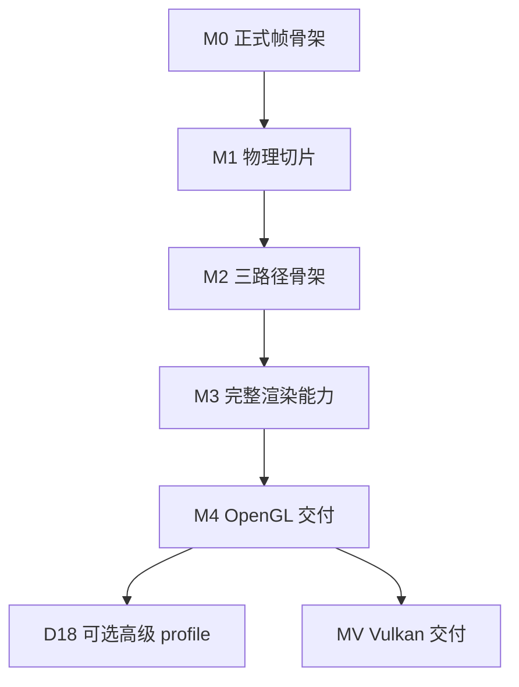

# Physara 开发计划

> 以 [AGENTS.md](../AGENTS.md) 和 [Architecture.md](Architecture.md) 为基准。Reference 解释已核实的上游事实与限制，Architecture 记录项目采纳的方案和合同；本文据此安排实现顺序、工作包边界、依赖及完成条件。每次变更的具体技术取舍、可观察行为和实施步骤在 OpenSpec 中确定，AGENTS 只约束通用开发行为。
>
> 本文包含 **20 个开发阶段、113 个工作包**：OpenGL 完整基线 100 个、可选高级 profile 5 个、后续 Vulkan 8 个。清单只在实际实施并验收后勾选，文档批准不代表实现完成。阶段编号表达开发推进顺序，与 Architecture.md 的单帧数据流阶段编号分开。

## 阅读与使用

1. 先看开发主线与阶段入口，确认当前能交付什么。
2. 进入阶段后，以工作包 ID 选择一个目标或若干相邻目标，再创建原生 OpenSpec change。
3. 每个工作包列出职责位置、前置依赖、架构依据、具体任务和验收结果；核对完成条件后更新状态。
4. 通过阶段出口再扩展下一层能力；末尾覆盖表用于检查模块和功能是否遗漏。

## 1. 开发主线与范围

### 1.1 先建立纵向闭环，再扩充能力

第一条开发主线是：**可重建工程 → 真实窗口与资源寿命 → Shader/RHI 原生图像 → 编辑器与呈现 → 整帧 RenderGraph → glTF 模型与 JSON 编辑器场景 → 核心物理 Forward**。

这条主线尽早使用正式模块及同一产品入口。原生 fixture 可以先验证 RHI 像素；产品从编辑器接入阶段起始终启动完整编辑界面。基础 Graph 接入后，原有最小顺序编排随该次替换收敛，不保留另一套生产 Renderer。

随后在已有画面上完善增量准备/预算、静态几何覆盖与相机历史、阴影、Forward+ 与 Deferred；再完成标准材质扩展、透明透射、屏幕效果、时域镜头和编辑工作流。资产、UI、RHI、Renderer 都随对应纵向能力一起集成，测试、失败退出和诊断随任务落地。

Physara 只编辑和渲染静态场景，不实现动画播放、骨骼、Skin/Morph 或动态变形。模型资产统一使用 `Assets/Models` 中只读的 glTF/GLB；一个 `Assets/Scenes/*.scene.json` 保存 Assets 引用、静态实体/TRS/灯与物体参数、实例材质/纹理覆盖和主 View 相机及 requested 设置，重新打开后继续编辑保存。Asset 负责标准资产导入与校验，Scene 提供实例状态、快照和构建校验，Editor/Session 组合 JSON 文件读写及 Scene/View 的恢复，Renderer 消费已加载的数据。验证随功能安排，测试文件、框架和运行方式由后续实施统一确定，不预先建立目录或独立工具模块。

| 里程碑 | 达成阶段 | 可实际观察的结果 |
|---|---|---|
| M0：正式帧骨架 | D05 | Shader/RHI 原生测试通过；带编辑器程序通过 Graph 合成 UI 并呈现，图失败有安全退路 |
| M1：可用物理切片 | D07 | 可导入 glTF 模型、加载 JSON 场景并基础编辑，以物理 Forward、灯光、IBL、曝光和正式显示链显示 |
| M2：三路径骨架 | D11 | 静态几何与阴影已共用；Forward、Forward+、Deferred 在当前已启用配置下原子切换且 HDR 可比 |
| M3：完整渲染能力 | D15 | 目标材质/透明/屏幕效果与时域镜头闭环；三路径共享 None/FXAA/TAA 基础 profile |
| M4：OpenGL 基线交付 | D17 | 编辑/保存/重导入/拾取/截图/诊断与压力验收完整，可重建和部署 |
| MV：Vulkan 后端交付 | D19 | 同一上层系统通过 Vulkan 原生、跨后端图像和呈现寿命验收 |

图示里程碑依赖；具体任务顺序以阶段表和工作包前置为准。D18 与 D19 互不构成默认前置，Vulkan 可以在 M4 后直接推进。

### 1.2 交付范围分级

| 范围 | 工作 | 完成判定 |
|---|---|---|
| OpenGL 完整基线 | D00–D17；完整公共 RHI 谱系与真实 GL 基础 profile、三路径、架构目标 glTF profile、物理渲染链和轻量编辑器 | 全部基线目标闭环；每一声明能力有对应证据 |
| 独立可选 profile | D18 的 Forward/Forward+ MSAA、PCSS、moments 阴影、SSR Hi-Z traversal、flare | 每项单独选定、建立 spec、验证后启用；未选择保持禁用/不支持 |
| 后续后端 | D19 Vulkan | M4 后迁移，与 GL 共用既有上层合同；独立完成验收 |
| 需要新需求才能立项 | Deferred MSAA、bindless profile、GPU Froxel producer、异步多队列/heap aliasing、RT/mesh/sparse、自动曝光、运动模糊、其他显示输出 profile | 当前不自动增加实施任务；先明确行为/成本/能力及架构变化，再建立 change |

目标 glTF 扩展已经纳入基线任务。它们与可选的高阶阴影/AA profile 分开管理，不能因为“扩展”二字全部延期。游戏框架、脚本系统、任意材质图和自研 UI 工具包不属于既定产品范围。

### 1.3 依赖和集成规则

- 阶段“入口”是集成门槛；工作包“前置”是该阶段内的硬依赖，两者取并集。D00–D17 和 D19 的出口需要本阶段全部工作包及所列场景通过；D18 逐项选择验收。
- 相同前置下独立的工作包可以调整顺序。例如 D12 的多种不透明扩展在共享 Fresnel 基础之后可分别推进。个人实施默认保留一条清楚的主线。
- CPU 算法/工具可提前探索，但依赖链未就绪时不计为整条能力完成。重排正式实施顺序先更新相关入口、依赖和验收，不能靠临时生产分支绕过合同。
- 后续工作包在前期基础上扩充：D02 建资源，D03 建提交，D05 接图，D08 完成版本/预算；同一系统只有一个长期 owner。
- D17 执行整体交付验收，前面的每个工作包仍必须及时运行其必要检查。性能埋点从模块出现时加入，正式报告按真实比较需求产生。
- 功能对外声明可用时形成输入→准备→资源/图→GPU→输出/诊断→退休→验证闭环，未就绪能力显示 Pending/不支持。

## 2. 工作包尺度、OpenSpec 与完成规则

### 2.1 三层任务结构

| 层级 | 作用 | 和 OpenSpec 的关系 |
|---|---|---|
| 开发阶段 Dxx | 一个可集成、可观察的系统增量 | 通常包含多个 changes，不以整阶段创建巨型 spec |
| 工作包 Dxx-Txx | 一个职责清楚、可独立验收的功能目标 | 默认选择一个工作包；同一目标的相邻包可合并 |
| 包内清单 | 明确需要交付的数据/行为、接入及边界场景 | 为实施 tasks 提供范围，不逐条机械生成一个 spec |

本计划把 Shader、RHI、UI 等必要跨层工作放进同一可验收目标。跨目录不自动意味着需要拆 change；互不依赖的算法或不同能力 profile 应分别评审。

**创建 change 时的尺度判断：**

1. 能否用一句话说明交付行为，并用一组有限场景验收？能则通常可以作为一个 change。
2. 是否存在独立发布、独立回滚的两个目标，或一个目标必须等待尚未解决的架构选择？存在则拆分。
3. 是否只剩一个无独立意义的函数、字段或转发接口？应合入它服务的行为目标。
4. 移植/原生能力族如果在实施调研后仍过大，可把同一工作包细化为稳定子目标，例如 `D19-T03.a`；先在本计划补清前置与验收，再分别关联 changes。细化保持父任务含义，不能用无限细分掩盖未完成。

示例：D10-T01/T02 可合为“CPU Froxel 数据与安全上传”；D10-T03/T04 可合为“Forward+ 接入与原子切换”。D12 的 clearcoat、sheen 等各自有独立行为和参考图，默认分别建立 change。D00-T02/T03 可在同一次工程基线变更中交付。示例只说明边界，实际划分在启动相应任务时确定。

### 2.2 change 的准备与追踪

选择工作包后，先读取该项架构链接、受影响代码和现有已采纳 specs，再沿锁定 OpenSpec 原生流程探索/提案、形成需要的 specs/design/tasks、apply、verify、sync/archive。产物依赖和命令以安装版本/schema 为准。

- proposal 关联本计划 ID，说明本次覆盖哪些目标、哪些仍留在原工作包。
- spec 定义可观察行为和失败场景；design 按参考分析与现实设备讨论技术，不把本计划当成已经作出的全部实现决策。
- tasks 展开本次真实实施和验证顺序。原生 verify 使用构建、测试、图像/数值、寿命和必要性能证据，不另建 verification.md。
- 本文保留宏观进度；具体实施状态和历史由原生 change 管理。完成工作包时在其完成条件后追加对应 change/归档路径，多个 changes 列明共同覆盖范围。
- 工作包只有在包内目标和验收均满足时才整体完成。原生验证通过但尚未归档可标记“已验证，待归档”；未运行场景明确记录。
- 已实施或归档的任务保留其 ID 与事实；未开始的工作包可随范围调整合并或重排，并同步计数、前置与所有当前引用，不修改归档来覆盖历史。

不预先替全部任务生成 spec，不指定无依据的工期。**D00 已核查归档，D01-T01/T02 已完成并归档，下一实施目标为 D01-T03/T04**；较后阶段只在所需前置已具备时展开技术讨论与实施设计。

### 2.3 每项统一的完成门槛

包内“完成条件”与以下通用门槛同时成立：

- 输入/输出、状态 owner、版本、错误和取消/退出可解释，完成其实际消费链。
- 受影响构建和必要检查通过；原生语义有真实 backend 证据，物理/颜色/时域有对应数值或图像/序列依据。
- 参数、能力和 Pending/失败对调用者及必要 UI 可见；不支持项不靠空操作伪造成功。
- 新缓存、上传区段、查询和 UI 历史有容量、失效与退休，不增加无界状态或隐式全设备等待。
- 架构/spec/代码保持一致，替代实现及时清理，来源/许可、必要使用说明及原生 change 同步交付。

以下各阶段只列本阶段特有结果；通用规则不在每项重复。未勾选项表示尚未实施；完成状态及检查结果以工作包和对应 change 的实际记录为准。

## 3. 阶段索引

| 阶段 | 性质 | 入口 | 工作包 | 交付目标 |
|---|---|---|---|---|
| [D00](#dev-d00) 建立可重建的工程与开发基线 | 基线 | 工程起点 | 4 | 形成轻量、可干净配置和构建的 2.0 工程，确认资源归属与依赖来源。 |
| [D01](#dev-d01) 建立 Core 与窗口宿主的可靠寿命 | 基线 | [D00](#dev-d00) | 4 | 获得可采集输入、处理尺寸变化、正确退出的真实 GL 4.6 窗口与最小基础设施。 |
| [D02](#dev-d02) 移植 RHI 合同并实现原生资源 | 基线 | [D01](#dev-d01) | 5 | 保留 NVRHI 完整公共谱系，先实现基础 OpenGL 资源与可验证的设备/资源生命周期。 |
| [D03](#dev-d03) 打通 Shader ABI 与第一次原生绘制 | 基线 | [D02](#dev-d02) | 5 | 从统一 Shader 输入到 RHI Pipeline、Draw、提交票据和像素读回形成首条 GPU 纵向链。 |
| [D04](#dev-d04) 建立带编辑器的可呈现程序 | 基线 | [D03](#dev-d03) | 5 | 让唯一 Runtime 真正启动 Editor，打通 UI 输入、RHI 绘制、窗口末端复制和有界帧槽。 |
| [D05](#dev-d05) 让整帧经 RenderGraph 执行 | 基线 | [D04](#dev-d04) | 5 | 将上传、测试视口、UI 与窗口输出纳入同一声明、编译和执行链，建立图正确性及失败退路。 |
| [D06](#dev-d06) 接入标准资产、场景与首个真实视口 | 基线 | [D05](#dev-d05) | 7 | 把 glTF CPU 数据、Scene、只读准备、GPU 驻留与 Forward 几何连到现有编辑器帧图。 |
| [D07](#dev-d07) 形成可用的物理 Forward 渲染器 | 基线 | [D06](#dev-d06) | 6 | 完成核心 metallic-roughness、物理灯光/相机、IBL 和正确显示，使后续路径有统一的参考输出。 |
| [D08](#dev-d08) 完善准备、资源预算与执行能力 | 基线 | [D07](#dev-d07) | 8 | 在现有可用画面的基础上完成大场景所需的增量准备、批处理、图资源池、完整基础 GL 命令和热重载。 |
| [D09](#dev-d09) 实现完整基础阴影链 | 基线 | [D08](#dev-d08) | 5 | 将保守阴影 CPU 计划、资源预算、静态几何/遮罩绘制及 Hard/PCF 采样接入共享灯光模型。 |
| [D10](#dev-d10) 实现 CPU Froxel 与 Forward+ | 基线 | [D09](#dev-d09) | 5 | 保持物理模型不变，以 Filament 式 CPU Froxel 改变局部灯候选集合，形成第二条可切换路径。 |
| [D11](#dev-d11) 接入 Deferred 并完成三路径切换骨架 | 基线 | [D10](#dev-d10) | 5 | 实现紧凑核心 GBuffer、扩展表面辅助合同和共享 deferred lighting，保持完整上下游一致。 |
| [D12](#dev-d12) 完成标准不透明材质扩展 | 基线 | [D11](#dev-d11) | 6 | 沿标准 glTF 扩展、共享物理库和 ForwardExtension 路由逐项闭环，控制组合与能量近似。 |
| [D13](#dev-d13) 完成透明覆盖和物理透射 | 基线 | [D12](#dev-d12) | 6 | 把核心 alpha blend 与 transmission/volume/dispersion 放入统一 HDR 合成，维持表面、历史和选择语义。 |
| [D14](#dev-d14) 接入屏幕空间遮蔽、接触阴影与 SSR | 基线 | [D13](#dev-d13) | 5 | 在完整表面上接入三路径共享屏幕效果，并随 SSR 首次建立独立 ReflectionHdr 与成对历史深度。 |
| [D15](#dev-d15) 完成时域、镜头和显示链 | 基线 | [D14](#dev-d14) | 7 | 把 HDR 合成、基础高度雾、TAA、物理 DoF、Bloom 和完整显示设置组织为唯一后处理链。 |
| [D16](#dev-d16) 完成编辑、持久化、读回与诊断闭环 | 基线 | [D15](#dev-d15) | 7 | 在已接入的编辑器基础上补齐日常创作/调试流程，闭合资产变更、场景保存、GPU 结果消费和资源卸载。 |
| [D17](#dev-d17) 完成 OpenGL 基线验收与可复用性能基准 | 基线 | [D16](#dev-d16) | 5 | 对已逐步验证的系统执行整体交付验收，确认支持矩阵、可重建运行包、质量与资源预算。 |
| [D18](#dev-d18) 按需增加独立高级 profile | 可选 | [D17](#dev-d17) | 5 | 对架构中明确可选的能力分别实施、验证和启用，保持基础单样本三路径配置稳定。 |
| [D19](#dev-d19) 在同一合同下接入 Vulkan | 后续 | [D17](#dev-d17) | 8 | 在完整 OpenGL 渲染器之后迁移 NVRHI Vulkan 后端，验证同一 Scene/Shader/Graph/Editor 的跨后端行为。 |

## 4. 分阶段工作清单

阶段内的完成条件可在对应 OpenSpec verify 中核对。包内清单表示待交付目标；详细编码步骤在实施 change 的 tasks 中展开。

### D00 · 建立可重建的工程与开发基线

**性质：** 基线。**入口：** D00 为工程起点。

**阶段目标：** 形成轻量、可干净配置和构建的 2.0 工程，确认资源归属与依赖来源。

#### D00-T01 · 确认重建边界与可用资源清单

**职责位置：** 工程根、Assets、ThirdParty。**前置：** 本阶段入口满足。**架构依据：** [1.1](Architecture.md#build)、[3.1](Architecture.md#asset-types)、[12.3](Architecture.md#project-docs)。

- [x] 核对当前保留的模型、纹理、环境、图标及第三方源码，记录用途、来源与许可；未核实项明确注明。
- [x] 确认 glTF/GLB 模型与 JSON 编辑器场景的目录归属，场景通过资源引用组合模型；启动输入在实际加载能力实现时确定。
- [x] 对齐现有目录与架构职责，保留当前有用途的资源和源码，初始化不依赖旧引擎程序或生成缓存。

**完成条件：** 当前资源和目录有明确归属，来源及待核实项可查；工程重建不依赖个人机器路径或旧构建残留。

#### D00-T02 · 建立 target 级构建与依赖锁定

**职责位置：** CMakeLists、各模块 CMakeLists、ThirdParty。**前置：** [D00-T01](#d00-t01)。**架构依据：** [1.1](Architecture.md#build)。

- [x] 用根及各模块 `CMakeLists.txt` 组织实际构建内容，明确源码、语言标准、第一方警告与公共/私有依赖；按需加入已有实现。
- [x] 第三方保持精简源码与头文件，在 `ThirdParty/README.md` 记录固定版本或 commit、来源、许可和必要修改；NVRHI 仅供阅读参考，不加入构建。
- [x] 验证离线配置、源码树外 Debug/Release 构建与缺失依赖诊断；需要编译的第三方源码随工程生成到 build 目录。

**完成条件：** 空构建目录可离线重建当前工程，依赖方向清楚，第三方不继承第一方警告策略，版本与来源记录和实际源码一致。

#### D00-T03 · 确认构建入口与使用说明

**职责位置：** 工程根、各模块 CMakeLists。**前置：** [D00-T02](#d00-t02)。**架构依据：** [1.1](Architecture.md#build)。

- [x] 在工程说明中给出所需编译工具、configure/build 命令、构建输出位置与当前可用范围。
- [x] 为第一方 CMake 中的目标职责、依赖关系和必要平台设置补充简明中文说明，保持模块组织直观。
- [x] 核对当前配置的正常构建与必要失败诊断；临时输出保留在 build 中，未实现的程序和图形能力如实注明。

**完成条件：** 读者能从说明与 CMake 理解当前构建内容并复现构建，实际检查结果与工程能力一致。

#### D00-T04 · 初始化原生 OpenSpec 与文档关联

**职责位置：** openspec、Docs/Reference、Docs/Developments.md。**前置：** [D00-T02](#d00-t02)。**架构依据：** [12.3](Architecture.md#project-docs)、[12.4](Architecture.md#feature-closure)。

- [x] 记录使用的 OpenSpec 版本、官方 schema 和项目配置，沿原生工作流管理后续 change。
- [x] 对齐 AGENTS.md、Architecture.md 与本计划；引用已有 Filament/NVRHI 分析，保留源码版本及许可证信息。
- [x] 确认任务 ID 到 change 的关联写法和状态更新规则；按实际验证结果更新完成标记。

**完成条件：** 当前文档相互一致，后续工作包能关联原生 change，实施与验证记录有单一归属。

**D00 阶段出口：** 在新构建目录完成声明配置的 configure/build；CMake 组织、依赖记录、资源归属和文档一致，当前未实现的能力清楚可见。

**当前状态：** 轻量工程初始化已核查并归档，关联 [establish-d00-baseline](../openspec/changes/archive/2026-10-22-establish-d00-baseline/tasks.md)。当前第三方源码的干净 Debug/Release 构建、缺失源码诊断、文档链接与 OpenSpec 严格结构校验通过；业务程序和 GPU 能力尚未实现，资源来源未知项保留明确记录。

### D01 · 建立 Core 与窗口宿主的可靠寿命

**性质：** 基线。**入口：** [D00](#dev-d00) 的阶段出口通过。

**阶段目标：** 获得可采集输入、处理尺寸变化、正确退出的真实 GL 4.6 窗口，只加入本阶段已经消费的基础机制。

#### D01-T01 · 落地最小身份、错误与计时机制

**职责位置：** Engine/Core。**前置：** 本阶段入口满足。**架构依据：** [1.2](Architecture.md#core)、[conventions](Architecture.md#conventions)。

- [x] 实现窗口与后续真实消费者需要的类型化身份、秒计时、带上下文错误结果及有界日志；不同身份不可混用。
- [x] 核对正常与初始化失败诊断、日志容量、时间单位和最小 owner 的关闭顺序，不预建当前没有消费者的帧内存或作业系统。

**完成条件：** 窗口链能表达身份、失败和时间，不引入全局服务定位器；FrameArena、后台作业和文件监视分别随实际消费者接入。

**当前状态：** 已完成并归档；关联 [establish-native-gl-host](../openspec/changes/archive/2026-10-25-establish-native-gl-host/tasks.md)。类型化身份、受检代际、秒计时、有界错误与日志已由真实宿主消费，Core 边界与失败检查在 Debug/Release 通过。

#### D01-T02 · 实现 DeviceHost 和原生 GL 启动边界

**职责位置：** Platform/DeviceHost、GlfwWindow、OpenGLDeviceHost。**前置：** [D01-T01](#d01-t01)。**架构依据：** [1.5](Architecture.md#platform-start)、[1.4](Architecture.md#runtime)。

- [x] 依次完成 GLFW 初始化、窗口/context 创建、current、入口加载、实际版本/limits 查询；Device 工厂在 D02 接入。
- [x] 实现唯一宿主和主线程合同，隔离 GlfwAccess 私有借用；Engine targets 不链接 Platform。
- [x] 为 GLFW/context/加载失败和部分初始化退出建立真实宿主检查；记录实际平台与驱动信息。

**完成条件：** 真实 GL context 可重复创建销毁，失败不留下全局 GLFW 状态或半初始化宿主。

**当前状态：** 已完成并归档；关联 [establish-native-gl-host](../openspec/changes/archive/2026-10-25-establish-native-gl-host/tasks.md)。Windows x64/MSVC 的干净 Debug/Release 构建、Intel GL 4.6 Core 的可见/隐藏启动、32 次生命周期、初始化失败及重建、回调恢复和线程检查通过；原生观测与故障注入的证据分别记录在 tasks 中。

#### D01-T03 · 实现窗口状态与有序输入快照

**职责位置：** Platform/Input.hpp、GlfwWindow。**前置：** [D01-T02](#d01-t02)。**架构依据：** [2.1](Architecture.md#input)、[conventions](Architecture.md#conventions)。

- [ ] 采集逻辑尺寸、framebuffer 像素尺寸、content scale、焦点、鼠标键盘与文本，形成有序事件和 poll 后只读快照。
- [ ] 定义按键释放、失焦清理、鼠标捕获和 closeRequested；平台请求在确定边界应用。
- [ ] 检查 DPI/跨屏比例、零尺寸、快速 resize 和文本输入，确认单位转换只在约定边界发生。

**完成条件：** 输入和尺寸不依赖初始窗口值；关闭请求由上层解释，窗口不会在回调里自行销毁。

#### D01-T04 · 建立单产品入口及分阶段退出

**职责位置：** Runtime/Main.cpp。**前置：** [D01-T02](#d01-t02)、[D01-T03](#d01-t03)。**架构依据：** [1.4](Architecture.md#runtime)、[frame-flow](Architecture.md#frame-flow)、[11.5](Architecture.md#shutdown)。

- [ ] Main.cpp 只装配当前存在的 Core/DeviceHost，保留后续 Editor、RenderEngine 的依赖方向；不创建第二个产品入口。
- [ ] 落实 poll、关闭/最小化判断与平台请求的基本顺序，暂不宣称具备场景渲染能力。
- [ ] 检查正常、初始化失败及用户关闭的逆依赖释放；后续每引入一个实际 owner 就扩充同一退出路径。

**完成条件：** 启动程序与隐藏窗口检查复用同一宿主；最小化不创建零尺寸 GPU 目标。

**D01 阶段出口：** 单入口可反复启动/关闭；初始化失败、失焦、DPI 变化和零像素窗口均有确定行为，全部原生对象在所属线程释放。

**当前状态：** D01-T01/T02 已完成并归档，D01-T03/T04 尚未实施；当前交付 Core/Platform 静态库，尚无产品程序、输入快照、RHI Device 或渲染画面，D01 总出口未通过。

### D02 · 移植 RHI 合同并实现原生资源

**性质：** 基线。**入口：** [D01](#dev-d01) 的阶段出口通过。

**阶段目标：** 保留 NVRHI 完整公共谱系，先实现基础 OpenGL 资源与可验证的设备/资源生命周期。

#### D02-T01 · 机械移植完整公共接口与来源映射

**职责位置：** RHI/RHI.hpp、Resource.hpp、Containers.hpp、Utils.hpp。**前置：** 本阶段入口满足。**架构依据：** [7.1](Architecture.md#rhi)。

- [ ] 按 Architecture 固定 NVRHI commit 移植公共类型、接口、句柄、描述符、资源状态和扩展方法，应用受控命名规则。
- [ ] 记录上游路径/目标路径、hash、许可及非机械差异；保留未来 Vulkan 所需字段和虚函数。
- [ ] 建立公共消费者编译检查和接口差异核对；不把 GL 暂不支持的 API 从公共合同删掉。

**完成条件：** 公共声明与固定上游有可审查的映射，业务层不出现窗口、ImGui 或 CombinedTextureSampler 公共类型。

#### D02-T02 · 移植 Common 与 Validation 并定义初始 profile

**职责位置：** RHI/Common、RHI/Validation、Validation.hpp。**前置：** [D02-T01](#d02-t01)。**架构依据：** [7.2](Architecture.md#rhi-objects)、[7.5](Architecture.md#barriers)、[7.7](Architecture.md#capabilities)。

- [ ] 移植资源引用、状态跟踪及公共辅助逻辑，核对 GL 所需的后端分类、状态和合法调用验证。
- [ ] 定义真实 caps 与资源格式/usage 检查；未实现方法返回明确不支持，不能成功执行空操作。
- [ ] 增加描述符、range、绑定与能力的正反用例；状态跟踪先保留单一权威，为 D05/D08 接入发射。

**完成条件：** Validation 可包裹 GL Device，能区分非法调用、能力不支持和真正成功。

#### D02-T03 · 接入 GL Device、资源对象与基本格式

**职责位置：** RHI/OpenGL.hpp、RHI/OpenGL、Platform/OpenGLDeviceHost。**前置：** [D02-T01](#d02-t01)、[D02-T02](#d02-t02)。**架构依据：** [7.3](Architecture.md#opengl)、[7.2](Architecture.md#rhi-objects)、[7.7](Architecture.md#capabilities)。

- [ ] 在有效 context 上创建 Device，读取并保存 limits/格式支持，落实 GL_UPPER_LEFT、ZERO_TO_ONE 及公共 raster 语义。
- [ ] 实现 DSA Buffer、Texture、独立 Sampler、基础视图/Framebuffer 和图形目标所需格式；创建失败有明确诊断。
- [ ] 验证尺寸、mip/layer、格式、sRGB/data、usage 和样本限制；公开 API 保持 Texture/Sampler 分离。

**完成条件：** 基础资源可在真实设备上创建与检查，非法描述在 Release 也不会发出非法原生命令。

#### D02-T04 · 实现安全的初始上传与资源释放协议

**职责位置：** RHI/OpenGL 资源/上传/删除。**前置：** [D02-T03](#d02-t03)。**架构依据：** [7.4](Architecture.md#uploads)、[11.1](Architecture.md#retirement)。

- [ ] 实现有界、拥有源数据的基础 Buffer/Texture 内容写入路径；声明 CPU 数据可以释放的确切时刻。
- [ ] 实现 wrapper 引用与 context 线程原生删除队列；设备关闭前清理资源，后续提交引用从 D03 接入。
- [ ] 验证资源创建失败、重复分配释放、视图持有关系及原生名称复用时的缓存失效。

**完成条件：** 资源生存期不依赖固定帧差；在途复用尚未启用时也没有裸指针或错误线程删除。

#### D02-T05 · 建立真实资源与设备能力一致性用例

**职责位置：** RHI、Platform。**前置：** [D02-T03](#d02-t03)、[D02-T04](#d02-t04)。**架构依据：** [12.1](Architecture.md#tests)、[7.7](Architecture.md#capabilities)、[conventions](Architecture.md#conventions)。

- [ ] 建立共享 DeviceHost 的 native fixture，验证 buffer 数据、纹理行序、mip/layer 和格式读写所需的最小原生读回通道。
- [ ] 记录 GL graphics 单队列/单即时列表等 profile；对 replay、异步队列、RT/mesh/sparse 等当前能力明确拒绝。
- [ ] 测试异常描述、资源耗尽可控失败与设备前资源释放；测试辅助原生操作只位于 fixture/后端边界。

**完成条件：** 资源语义有真实设备证据；测试环境与产品使用同一个 GL 后端实现。

**D02 阶段出口：** 公共层、Common、Validation 可构建；真实 GL 设备可创建/写入/释放基础资源，不支持项明确报错，设备/context 退出顺序正确。

### D03 · 打通 Shader ABI 与第一次原生绘制

**性质：** 基线。**入口：** [D02](#dev-d02) 的阶段出口通过。

**阶段目标：** 从统一 Shader 输入到 RHI Pipeline、Draw、提交票据和像素读回形成首条 GPU 纵向链。

#### D03-T01 · 实现权威 Shader 接口与编译步骤

**职责位置：** Engine/Shader、Engine/Shader/Interface、Shaders/Common、相关 CMakeLists。**前置：** 本阶段入口满足。**架构依据：** [1.3](Architecture.md#shader-build)、[8.1](Architecture.md#shader-runtime)。

- [ ] 以单一 schema 生成 C++/GLSL 布局，校验尺寸、offset、矩阵、数组和固定宽度字段；生成物进入 build。
- [ ] 在 Shader 模块及其 CMake 中接入所需编译步骤，处理 include、入口、选项、工具版本与依赖 hash，输出 canonical Vulkan SPIR-V、反射和可定位错误。
- [ ] 从一个真实常量/纹理测试程序建立增量构建、干净构建和 ABI 不匹配失败测试。

**完成条件：** 生成/编译步骤不依赖消费其结果的 Renderer，业务不手写另一份 CPU/GPU 布局。

#### D03-T02 · 实现 GL Shader、绑定与 Pipeline lowering

**职责位置：** RHI/OpenGL Shader/Bindings/Pipeline、Engine/Shader。**前置：** [D03-T01](#d03-t01)。**架构依据：** [7.3](Architecture.md#opengl)、[7.2](Architecture.md#rhi-objects)、[1.3](Architecture.md#shader-build)。

- [ ] 通过 SPIRV-Cross 把 canonical IR lowering 为 GLSL 460，映射 builtin、clip 与资源布局，完成 native program link。
- [ ] 按活动资源反射建立 PipelineBindingPlan，合并 Texture/Sampler 采样对并紧凑分配 UBO/SSBO/image/texture 单元，校验真实 limits。
- [ ] 实现 BindingLayout/BindingSet、GraphicsPipeline、基础 framebuffer 兼容检查；以共享纹理不同 sampler 等用例校验 lowering。

**完成条件：** 逻辑 set/binding 与原生单元映射可诊断，合法接口不因全项目预留大量固定 binding 而误判设备不足。

#### D03-T03 · 实现单即时列表与基础 Draw 状态

**职责位置：** RHI/OpenGL CommandList/Graphics/ContextState。**前置：** [D03-T02](#d03-t02)。**架构依据：** [7.6](Architecture.md#command-execution)、[7.5](Architecture.md#barriers)。

- [ ] 实现 open/close、clear、vertex/index 绑定、动态 viewport/scissor、raster/depth/blend、draw/indexed/instanced 和必要 copy。
- [ ] 区分 ContextState、访问 tracker 与数据 revision；为实际消费发出最小必要同步，clear 的用途先于后续 draw 用途建立。
- [ ] 用非对称图验证 CCW/负缩放、Reverse-Z、scissor、sRGB、GL_InstanceID+baseInstance 和已含 baseVertex 的顶点索引。

**完成条件：** 原生 Draw 在即时列表调用时发出，Execute 不重放；基本状态及索引语义通过像素/已知数据检查。

#### D03-T04 · 实现提交票据、在途引用与完成回收

**职责位置：** RHI/OpenGL 提交/queries/删除。**前置：** [D03-T03](#d03-t03)。**架构依据：** [11.1](Architecture.md#retirement)、[7.4](Architecture.md#uploads)、[11.3](Architecture.md#readbacks)。

- [ ] Execute 为已发出的列表建立 submission/fence/flush 与 in-flight 引用批次，区分 recording、submitted、completed；fence 创建失败不返回有效 ticket，未获票据的引用保留到受控退出。
- [ ] 用实际完成值控制上传数据、查询和资源删除；初始同步读回仅可用于明确的测试/冷路径，正常帧不等待全设备。
- [ ] 检查关闭后提交、重复执行拒绝、提交后立即释放 CPU 句柄、在途退出和未提交即时工作退出；区分 poll 的 Complete/Pending/Failed，只有 Complete 推进完成值。Fatal 停止新渲染而不等于 device lost，可用 context 的无 fence 工作在退出收拢，失效 context 不等待失败 ID。

**完成条件：** 像素读回和资源退休由真实完成驱动，CPU 释放不导致 GPU 或上传区段提前复用。

#### D03-T05 · 形成首个稳定原生绘制门槛

**职责位置：** RHI、Renderer、Shaders/Passes。**前置：** [D03-T03](#d03-t03)、[D03-T04](#d03-t04)。**架构依据：** [12.1](Architecture.md#tests)、[conventions](Architecture.md#conventions)、[8.1](Architecture.md#shader-runtime)。

- [ ] 把四角色块/标记、深度梯度、非零实例及索引偏移组织为固定测试输入，验证真实后端输出。
- [ ] 覆盖 clear→draw→copy/readback、不同 Framebuffer、纹理采样和实例范围；增加 Validation 失败用例。
- [ ] 清理只为验证产生的重复生产代码，测试使用正式 Shader/RHI 链；不新增产品 Viewer 或直接 GL 的 Renderer。

**完成条件：** 第一次图像成功可重现且可自动判定，后续阶段能够复用同一编译、绑定、提交和完成链。

**D03 阶段出口：** 已知图案经 canonical Shader→GL lowering→公共 RHI Draw→真实完成→读回通过；非零 base instance/base vertex、方向、深度、颜色验证有效。

### D04 · 建立带编辑器的可呈现程序

**性质：** 基线。**入口：** [D03](#dev-d03) 的阶段出口通过。

**阶段目标：** 让唯一 Runtime 真正启动 Editor，打通 UI 输入、RHI 绘制、窗口末端复制和有界帧槽。

#### D04-T01 · 建立 EditorSession、面板和输入路由

**职责位置：** Editor/Session、Panels、ImGui、Runtime。**前置：** 本阶段入口满足。**架构依据：** [2.2](Architecture.md#editor-input)、[1.4](Architecture.md#runtime)。

- [ ] 接入固定版本 Dear ImGui docking 与官方 GLFW 输入适配，私有适配文件负责回调链和 GlfwAccess。
- [ ] 建立 Session、面板注册/布局、选择身份及编辑意图入口；此时无领域数据的控件保持未启用。
- [ ] 统一文本/模态、Gizmo、相机的输入优先级和 focus/capture 清理，禁止各面板直接接管 GLFW 回调。

**完成条件：** 面板可以组合/隐藏，Engine 不反向依赖 Editor，Editor 通过领域窄入口访问数据，不承担宿主 context 所有权。

#### D04-T02 · 实现 ImGui 公共 RHI 绘制与纹理协议

**职责位置：** Editor/ImGui、Shaders/UI。**前置：** [D04-T01](#d04-t01)。**架构依据：** [10.2](Architecture.md#imgui-renderer)、[10.1](Architecture.md#editor-output)。

- [ ] 实现 UI VB/IB 上传、clip/scissor、DPI、Idx/VtxOffset、reset-state callback 和 draw commands，全部走公共 RHI；callback 命令完成后跳过普通纹理解析与绘制。
- [ ] 实现当前 ImGui 纹理 create/update/destroy 协议、字体与稳定 UiTextureId/generation，绑定引用受提交完成保护；像素/更新矩形有独立所有权，实际执行并有效提交才确认更新，失败保留请求重试。
- [ ] 按线性域 straight-alpha 合成，处理 sRGB 创作配色、图标纹理和字体覆盖率；验证图像与文本边缘。

**完成条件：** UI 不使用 ImGui 原生 OpenGL renderer；纹理销毁或重建不会留下悬空 draw-data 引用。

#### D04-T03 · 接入 PresentColor 和正确窗口提交

**职责位置：** Platform/OpenGLDeviceHost、RHI/OpenGL 互操作、Runtime。**前置：** [D04-T02](#d04-t02)。**架构依据：** [10.3](Architecture.md#present)、[11.1](Architecture.md#retirement)、[conventions](Architecture.md#conventions)。

- [ ] 按帧槽创建非零尺寸 PresentColor，Runtime 只把 RHI 目标送入绘制；默认 framebuffer 不伪装为普通纹理。
- [ ] 列表关闭后进行 host 末端原生复制，维护同一 ContextState 并显式保活源，然后 Execute 插 fence、flush，最后 SwapBuffers。
- [ ] 核对窗口 sRGB 能力与行序，验证颜色只编码一次；失败目标不复制/交换，末端复制本身失败也进入取消；单独统计 PresentWait 与 GPU 工作完成。

**完成条件：** 最终窗口源访问在本帧 tracking fence 之前，呈现互操作不会污染下一帧 RHI 状态缓存。

#### D04-T04 · 接入有界 FrameSlot 与最小视口资源身份

**职责位置：** Runtime、Engine/Renderer 帧状态、Editor/Viewport。**前置：** [D04-T03](#d04-t03)。**架构依据：** [5.1](Architecture.md#frame-state)、[10.1](Architecture.md#editor-output)、[11.2](Architecture.md#history-commit)。

- [ ] 随真实帧数据引入 FrameArena，检查容量、对齐、算术溢出与失效借用；建立有界 FrameSlot、提交引用和票据回收，复用依据完成值，等待/查询失败不能 reset 该槽。
- [ ] 建立稳定 ViewId 与 UI 纹理注册；基础 UI 程序/字体失败明确终止启动，无 Scene 或场景准备中仍可清屏呈现 UI 和可诊断占位，NoSceneOutputs 不推进 View 历史。
- [ ] 覆盖窗口/视口连续 resize、最小化恢复、最后一帧在途退出和字体/目标重建；请求不在 GPU execute 中修改。

**完成条件：** 入口始终为带编辑器的程序，测试图与真实场景能力状态可区分，帧槽不会凭 CPU 帧号复用。

#### D04-T05 · 建立领域编辑命令与渲染配置请求边界

**职责位置：** Editor/Commands、Session、Viewport。**前置：** [D04-T01](#d04-t01)、[D04-T04](#d04-t04)。**架构依据：** [2.3](Architecture.md#edits)、[2.4](Architecture.md#viewport-input)、[5.7](Architecture.md#plan-readiness)。

- [ ] 建立命令/事务、拖拽合并和 undo/redo 的窄协议，先覆盖真实存在的 View/编辑器配置；后续 Scene 命令扩充同一入口。
- [ ] 分离 View 设置、编辑器布局和平台 VSync/标题请求，保留 requested/effective、Pending/失败原因。
- [ ] 测试事务边界、合并、撤销重做及 Session 销毁；面板不保存另一份可分叉的权威渲染设置。

**完成条件：** 当前 View/编辑器设置的编辑可应用及撤销，后续领域操作沿同一窄入口加入；不提前建立通用命令框架。

**D04 阶段出口：** 真实窗口稳定显示 Docking 编辑器及测试视口；字体更新、resize/DPI、颜色、提交前末端复制、在途关闭均可验证。

### D05 · 让整帧经 RenderGraph 执行

**性质：** 基线。**入口：** [D04](#dev-d04) 的阶段出口通过。

**阶段目标：** 将上传、测试视口、UI 与窗口输出纳入同一声明、编译和执行链，建立图正确性及失败退路。

#### D05-T01 · 实现图资源、版本与 Pass 权限

**职责位置：** Engine/Renderer/RenderGraph。**前置：** 本阶段入口满足。**架构依据：** [6.2](Architecture.md#graph)。

- [ ] 实现 typed GraphId、代校验、纹理/Buffer 描述、subresource/range、import/export 与读写版本。
- [ ] 实现 setup 即时声明及 execute 的拥有型 PassData/arena 捕获；执行期只能访问 Pass 已声明资源。
- [ ] 覆盖同一外部资源重复导入、失效 ID、越界访问、Load/Store 内容有效性与资源写版本用例。

**完成条件：** 图合同足以表示真实 UI/上传/输出，不依赖跨帧保存 GraphId 或回调借用栈变量。

#### D05-T02 · 实现依赖编译、活性裁剪与确定顺序

**职责位置：** RenderGraph Compiler。**前置：** [D05-T01](#d05-t01)。**架构依据：** [6.3](Architecture.md#graph-compile)。

- [ ] 由资源访问建立 RAW/WAR/WAW、版本和 range 依赖，检查未初始化读、非法 feedback、覆盖和环。
- [ ] 从外部输出/side effects 建立活性，稳定拓扑排序并形成首末使用和物理分配计划。
- [ ] 用跨分支、同资源不同 range、被裁剪上传和读回副作用验证编译；非法图不给按声明顺序执行的兜底。

**完成条件：** 纯 CPU 测试能验证正确依赖和失败诊断，compile 不调用原生创建或发出 Draw。

#### D05-T03 · 实现图执行、首次使用分配与单一同步

**职责位置：** RenderGraph Executor、RHI Common/OpenGL。**前置：** [D05-T02](#d05-t02)。**架构依据：** [6.4](Architecture.md#graph-resources)、[7.5](Architecture.md#barriers)、[7.4](Architecture.md#uploads)。

- [ ] 在 execute 的首次实际使用建立兼容物理资源及 PassResources，接通上传、clear、采样、attachment 等实际用途；创建/recipe 失败明确停止并报告，不能向 Pass 交付空资源。
- [ ] GraphManaged 模式关闭 RHI 自动推断，由图提交用途给同一 tracker/emitter；正常与失败退出均恢复模式，失效设备不再发原生命令；独立 RHI 调用仍用其自动入口。
- [ ] 验证 clear 所需状态先于 Draw、depth 只读附件并采样的联合用途，以及上传→采样、附件→UI 和 Shader 读→后续写的原生结果；RAW/WAR/WAW 都遵守唯一同步发射合同。

**完成条件：** 一个依赖只有一个同步发射权威；图编译与 GL 原生执行边界清楚。

#### D05-T04 · 将 UI、窗口和本帧纹理绑定接入图

**职责位置：** Renderer、Editor/ImGui、Viewport、Runtime。**前置：** [D05-T03](#d05-t03)。**架构依据：** [10.1](Architecture.md#editor-output)、[10.2](Architecture.md#imgui-renderer)、[10.3](Architecture.md#present)、[frame-flow](Architecture.md#frame-flow)。

- [ ] 用图构建上传、验证视口和 UI Pass，导出窗口 PresentColor；把 D04 的临时顺序编排收敛到唯一 Graph 路径。
- [ ] UiTextureId 保持稳定，FrameSlotUiFrameBindings 保存本帧 GraphId，执行时从 PassResources 解析实际纹理。
- [ ] 验证隐藏面板/多次 Image 引用、图资源裁剪、目标换代与绑定在途保活；图 ID 不进入 Session 长期状态。

**完成条件：** 同一帧图可解释 UI 读了哪个视口版本和最终窗口目标，构图过程中不绘制。

#### D05-T05 · 实现图失败、UI fallback 与帧取消

**职责位置：** Runtime、Renderer、DeviceHost。**前置：** [D05-T04](#d05-t04)。**架构依据：** [frame-flow](Architecture.md#frame-flow)、[11.2](Architecture.md#history-commit)、[11.5](Architecture.md#shutdown)。

- [ ] 实现尚未执行的主图编译失败后的安全 UI-only 图，显式导入未被覆写的上一有效输出；无有效输出时展示明确状态，记录 NoSceneOutputs。
- [ ] fallback 也失败或执行中途失败时按宿主协议取消；不在部分场景命令后拼 UI 图，不读取无效窗口颜色，已经发出的 GL 工作仍完成提交/退休或受控退出。
- [ ] 注入 UI/读回准备、fallback 准备、首次资源/recipe 创建、构图、部分命令执行和提交失败；准备阶段 Fatal 立即转受控退出，FrameSlot、PresentationFrame、上传请求/版本、历史与在途引用均不失去 owner，UI 纹理更新可重试。

**完成条件：** 错误帧不会推进场景历史、破坏下一帧或泄漏呈现资源，失败诊断可定位实际 Pass/资源。

**D05 阶段出口：** 产品帧只经统一 Graph 路径；未初始化读、非法 feedback/环会失败，正常帧可到窗口；执行前失败可显示安全旧输出/UI，中途失败走取消，均不推进失败场景的历史。

### D06 · 接入标准资产、场景与首个真实视口

**性质：** 基线。**入口：** [D05](#dev-d05) 的阶段出口通过。

**阶段目标：** 把 glTF CPU 数据、Scene、只读准备、GPU 驻留与 Forward 几何连到现有编辑器帧图。

#### D06-T01 · 建立不可变资产、请求与版本发布

**职责位置：** Engine/Asset、Core Jobs/IO、Assets。**前置：** 本阶段入口满足。**架构依据：** [1.2](Architecture.md#core)、[3.1](Architecture.md#asset-types)、[3.3](Architecture.md#asset-images)。

- [ ] 实现 AssetId/ContentRevision、Unloaded/Loading/CpuReady/Failed/Cancelled、源身份和不可变 CPU 资产记录。
- [ ] 随异步资产导入引入有界 Core 作业队列、独立拥有结果、取消和帧边界完成队列；实现所需受控路径、文件读取与内容 hash，验证请求/源/目标版本后发布，CPU Ready 与 GPU Ready 分离。
- [ ] 检查重复请求、迟到结果、停止接单、取消和 join；worker 不访问 UI、Scene 可变状态或原生设备。
- [ ] 建立图片、HDR/EXR 和 Editor 图像的 color/data/alpha 元数据，按语义区分同像素的不同解释。

**完成条件：** 迟到/取消结果安全丢弃，CPU 记录只含标准数据和引用，不带 RHI/UI 对象。

#### D06-T02 · 实现标准 glTF 模型解码与校验

**职责位置：** Engine/Asset。**前置：** [D06-T01](#d06-t01)。**架构依据：** [3.2](Architecture.md#asset-import)、[3.3](Architecture.md#asset-images)、[3.4](Architecture.md#asset-persistence)。

- [ ] 支持 glTF/GLB、URI/buffer/accessor 的 offset/stride/normalized/sparse、索引与合法拓扑处理，校验尺寸溢出和预算。
- [ ] 解码静态层级、核心材质/纹理、相机和灯；明确三角形拓扑转换、缺 NORMAL 的逐面法线及忽略源 TANGENT、MikkTSpace 面角点输出的拆顶点/重建索引、UV0/UV1、负缩放和扩展报告，缺必需 UV 不伪造输入。
- [ ] 在 Asset 导入入口完成 CPU 校验；未知 required 拒绝，实际使用 Skin/Morph 的实例明确拒绝，静态节点按初始变换导入，动画曲线不播放并报告；其余可选未支持项报告可见降级。

**完成条件：** 正常与异常输入可无 GPU/UI 地校验，glTF/GLB 模型只读且只提供静态资产，不承担场景 JSON 或模型写出。

#### D06-T03 · 实现 Scene 实例、变换与 JSON 场景读写

**职责位置：** Engine/Scene、Editor/Session。**前置：** [D06-T02](#d06-t02)。**架构依据：** [4.1](Architecture.md#scene)、[3.4](Architecture.md#asset-persistence)。

- [ ] 落地 entt、EntityHandle generation、稳定实体身份、父子关系和 SourceRef；从 glTF 资产节点实例化独立 Scene 实例。
- [ ] 验证无环层级、TRS 可表达性和非均匀/负缩放，按脏根传播 world transform/bounds，无脏根不推进版本；区分保存用 DocumentRevision、非相机静态内容的 RenderContentRevision 和 CameraRevision，撤销/重做沿同一入口更新。
- [ ] 实现新增/删除/重设父级及实例参数覆盖的领域入口；材质字段和纹理资源/UV/sampler 覆盖归 Scene，未覆盖值引用只读模型，删除后旧请求/选中身份失效，Scene 不创建 GPU 资源。
- [ ] 由 EditorSession 串行组合单个 `Assets/Scenes/*.scene.json` 的读写；Scene 提供实体/实例覆盖快照和候选校验，主 View 提供相机及 requested 配置；资源引用统一相对资源根，不复制模型或纹理正文。
- [ ] 打开期间冻结文档编辑并保留 UI/取消；校验通过后整体替换 Scene 和主 View，失败保留原状态。保存使用只读快照并允许后续编辑，成功仅标记对应版本，另存路径只在对应操作成功后更新。

**完成条件：** 父子更新和实体复用可测，同一资产可多实例使用且不共享可变场景状态；JSON 保存重开能恢复当前承诺的实例与设置，模型正文仍由 glTF/GLB 提供。

#### D06-T04 · 提取 SceneFrame 并准备相机与可见集

**职责位置：** Renderer/Prepare、View、Engine/Scene Camera。**前置：** [D06-T03](#d06-t03)。**架构依据：** [5.2](Architecture.md#prepare)、[5.3](Architecture.md#view-preparation)、[4.3](Architecture.md#camera)、[5.1](Architecture.md#frame-state)。

- [ ] 从 Scene 提取一次连续只读对象/Primitive/灯描述和索引，多 View 共享 SceneFrame，静态资产由 handle/revision 引用。
- [ ] 实现 glTF perspective/orthographic 与编辑器相机，校验已声明投影 profile 的 FOV/magnification/near/far；区分有限稳定裁剪投影与渲染投影，固定 aspect 使用 letterbox 与有效图像矩形，正交视线方向不套透视公式；相机移动与静态内容版本分别更新，带灯/可渲染组件或影响渲染子树的相机实体变换同时更新内容版本。
- [ ] 实现可解释的 CPU bounds/culling 与无效/零尺寸 View 处理，稳定视锥为最大 jitter/滤波范围留 guard band；相机坐标与裁剪结果使用固定非对称场景验证。

**完成条件：** 构图和 execute 不遍历/修改 ECS，多视口不会复制整份材质与场景数据。

#### D06-T05 · 建立几何/纹理驻留和首个 Forward 子图

**职责位置：** Renderer/Materials、Draw、Paths、Passes、Shaders/Geometry/Material。**前置：** [D06-T04](#d06-t04)。**架构依据：** [5.5](Architecture.md#gpu-residency)、[5.6](Architecture.md#draws)、[6.1](Architecture.md#paths)、[8.2](Architecture.md#geometry)、[8.5](Architecture.md#materials)。

- [ ] 实现按 asset+revision 的初始 Geometry/TextureCache、材质 GPU 行、绑定和拥有型 UploadBatch，上传在图内执行。
- [ ] 实现共享静态 VertexFetch/SurfaceFrame、world 变换与 normal/tangent/handedness，统一当前 depth/color 的 alpha 覆盖；接入标准 UV/normal/ORM、doubleSided、texture_transform、emissive_strength 和 unlit 语义，后续 shadow/ID 消费时复用。
- [ ] 建立 DrawRecord 与 Forward 的 PrepareSurface/ShadeOpaque 合同；先以标准 unlit 和显式材质/法线诊断入口验证真实几何，lit PBR 在 D07 闭环。

**完成条件：** glTF 可以正确出现在真实视口；无灯光模型的诊断输出不标成已完成 PBR，不在 execute 创建或查找资产。

#### D06-T06 · 接入最小可用场景编辑与相机导航

**职责位置：** Editor/Panels、Commands、Viewport、Session。**前置：** [D06-T03](#d06-t03)、[D06-T04](#d06-t04)、[D06-T05](#d06-t05)。**架构依据：** [2.3](Architecture.md#edits)、[2.4](Architecture.md#viewport-input)、[10.1](Architecture.md#editor-output)。

- [ ] 接入层级树、选择、Transform Inspector、导入状态和 View 面板，以及 JSON 场景的新建/打开/保存；属性修改通过既有事务与 undo/redo。
- [ ] 实现 fly/orbit/pan、窗口到视口的单次坐标映射和帧边界 extent 请求；主 View 的导航 cameraPose、可选 cameraEntityId 和渲染请求可保存，额外 View 保持会话状态。
- [ ] 验证删除选中实体、隐藏/恢复视口、父级缩放下变换及撤销；不为界面建立另一套 Scene。

**完成条件：** 真实场景可用最小编辑器操作，属性变化沿 revision→准备→上传→图输出生效。

#### D06-T07 · 建立静态资产到窗口的集成门槛

**职责位置：** Engine/Asset、Engine/Scene、Renderer、Editor。**前置：** [D06-T02](#d06-t02)、[D06-T05](#d06-t05)、[D06-T06](#d06-t06)。**架构依据：** [12.1](Architecture.md#tests)、[12.4](Architecture.md#feature-closure)、[11.5](Architecture.md#shutdown)。

- [ ] 覆盖多 Primitive/材质、UV0/UV1、缺切线、稀疏 accessor、负缩放、遮挡、正交/透视和双实例场景。
- [ ] 在导入中取消/退出、重复加载、资产失败和快速删除/resize，核对 CPU 发布、GPU 引用与旧 View 输出寿命。
- [ ] 把标准输入解释、几何诊断图及编辑操作加入可重现检查，保留明确的当前支持 profile。

**完成条件：** 第一次完整输入→场景→准备→图→RHI→UI→呈现的纵向链通过，后续增加物理模型无需重构入口。

**D06 阶段出口：** 可导入、查看、变换和删除 glTF 模型实例，并用 JSON 保存、重开编辑器场景；几何/纹理/相机语义正确，Scene 不持 GPU 对象，导入失败/取消不会发布半份资产。

### D07 · 形成可用的物理 Forward 渲染器

**性质：** 基线。**入口：** [D06](#dev-d06) 的阶段出口通过。

**阶段目标：** 完成核心 metallic-roughness、物理灯光/相机、IBL 和正确显示，使后续路径有统一的参考输出。

#### D07-T01 · 完成共享核心表面与 BRDF

**职责位置：** Shaders/Material、BRDF、Common、Renderer/Materials。**前置：** 本阶段入口满足。**架构依据：** [8.5](Architecture.md#materials)、[8.1](Architecture.md#shader-runtime)、[4.4](Architecture.md#physical-inputs)。

- [ ] 形成 MaterialInputs→SurfaceGeometry→PixelParams，按 Filament 路线实现 GGX、height-correlated Smith、Schlick、漫反射及配套能量项。
- [ ] 实现法线/切线与双面语义、粗糙度过滤和边界处理；核心模型只存在一份，depth/color 复用 alpha 与几何合同。
- [ ] 建立白炉、粗糙度/金属度极限、方向反照率和 CPU 数值参考；标明模型近似，不凭视觉调整任意补偿常数。

**完成条件：** 核心材质在共享库中可验证，连续参数不生成指数级 Shader 变体。

#### D07-T02 · 实现物理相机与预曝光输入

**职责位置：** Engine/Scene Camera、View、Renderer/Prepare、Editor/Panels。**前置：** [D07-T01](#d07-t01)。**架构依据：** [4.3](Architecture.md#camera)、[4.4](Architecture.md#physical-inputs)、[9.1](Architecture.md#temporal-contract)。

- [ ] 实现 ISO、快门、光圈、EV compensation、传感器、焦距/视场及对焦距离的单位和计算，保留 glTF yfov 权威语义。
- [ ] 按既定标定生成 preExposure，写入统一 View ABI，并把当前值和最后成功渲染值分开保存。
- [ ] 接入物理参数命令与界面，测试 EV 档位、长度换算和零/非法输入；快门不被宣称为已有运动模糊。

**完成条件：** 曝光倍率可计算与复现，同一参数在灯光、自发光、背景和后处理使用相同曝光域。

#### D07-T03 · 实现统一物理灯列表与 Forward 直接光

**职责位置：** Renderer/Lighting、Prepare、Shaders/Lighting。**前置：** [D07-T01](#d07-t01)、[D07-T02](#d07-t02)。**架构依据：** [5.4](Architecture.md#light-preparation)、[4.4](Architecture.md#physical-inputs)、[8.6](Architecture.md#lighting)、[8.7](Architecture.md#opaque-shading)。

- [ ] 接入 KHR_lights_punctual 的方向/点/聚光灯、颜色、lux/candela、衰减、spot 角和 range；未指定 range 保持无穷语义。
- [ ] 准备完整可见灯集合与统一 EvaluateLighting，Forward 先遍历完整候选列表，阴影输入在 D09 接入同一合同。
- [ ] 验证 inverse-square、聚光边界、光源单位、曝光相应关系、多灯叠加与零灯场景。

**完成条件：** 直接光结果有数值依据，后续 Forward+/Deferred 只更换候选选择和表面获取。

#### D07-T04 · 完成环境准备、DFG 与 IBL

**职责位置：** Engine/Asset Environment、Renderer/Lighting、Shaders/BRDF/Lighting。**前置：** [D07-T01](#d07-t01)、[D07-T02](#d07-t02)、[D07-T03](#d07-t03)。**架构依据：** [3.3](Architecture.md#asset-images)、[5.4](Architecture.md#light-preparation)、[8.6](Architecture.md#lighting)。

- [ ] 实现 HDR 环境到 cubemap、GGX prefilter、SH9 与固定 Filament DFG 编码；按实施 spec 选择可验证的冷路径/图内绘制预计算。
- [ ] 建立含源 hash、处理设置、算法/工具版本的 EnvironmentCache，旋转在查询空间处理，标明相对/绝对亮度校准。
- [ ] 整合漫反射/镜面 IBL、AO 输入默认值和天空背景；环境 Pending 保留旧有效代，不能黑图假装就绪。

**完成条件：** 核心材质直接光与 IBL 使用同一模型，环境旋转/曝光不重复烘焙或重复乘强度。

#### D07-T05 · 接入固定显示 profile 与基础 FXAA

**职责位置：** Renderer/PostProcess、Shaders/PostProcess、Editor/View。**前置：** [D07-T02](#d07-t02)、[D07-T04](#d07-t04)。**架构依据：** [9.4](Architecture.md#display-output)、[conventions](Architecture.md#conventions)。

- [ ] 接入 Architecture 固定 Filament ACESToneMapper/ColorGrading profile 与成对原色转换，形成 display-linear ViewOutput。
- [ ] 打通 None/FXAA、输出尺寸和基础空间缩放的图组装，FXAA 按感知亮度合同取样，不重复曝光/tonemap。
- [ ] 验证 SRGB 颜色纹理、线性数据纹理、自发光、高亮、UI 色块和窗口编码，保留 HDR 比较出口。

**完成条件：** 首个 PBR 纵向切片已有正式显示链，后续镜头/时域阶段只扩充相应 Pass。

#### D07-T06 · 开放核心物理编辑并建立参考场景

**职责位置：** Editor/Panels、Commands、Assets/Scenes。**前置：** [D07-T03](#d07-t03)、[D07-T04](#d07-t04)、[D07-T05](#d07-t05)。**架构依据：** [2.3](Architecture.md#edits)、[4.4](Architecture.md#physical-inputs)、[12.1](Architecture.md#tests)、[12.2](Architecture.md#benchmark)。

- [ ] 接入实例材质因子/纹理覆盖、物理灯、环境和曝光 Inspector，显示导入支持范围与 Pending/失败原因；修改 Scene 覆盖与主 View 请求，不改写共享 glTF/GLB。
- [ ] 建立材质球、标准尺度、已知光照、HDR 环境和非对称方向测试，固定输入 hash、曝光和线性/HDR 误差口径。
- [ ] 采集 CPU/RHI 基本计数与资源数量，接好 GPU timer 指标接口，原生 query 就绪后再填时延；真实比较结论才保存长期性能报告。

**完成条件：** 可加载、编辑并正确显示标准 PBR 场景，后续阶段有统一视觉/数值和成本基线。

**D07 阶段出口：** 标准静态场景在固定曝光下完成直接光+IBL 的核心 PBR；有 HDR/数值参考，视口与窗口颜色一致，None/FXAA 已可用。

### D08 · 完善准备、资源预算与执行能力

**性质：** 基线。**入口：** [D07](#dev-d07) 的阶段出口通过。

**阶段目标：** 在现有可用画面的基础上完成大场景所需的增量准备、批处理、图资源池、完整基础 GL 命令和热重载。

#### D08-T01 · 完成增量 SceneFrame 与多 View 工作集

**职责位置：** Renderer/Prepare、FrameSlot。**前置：** 本阶段入口满足。**架构依据：** [5.2](Architecture.md#prepare)、[5.3](Architecture.md#view-preparation)、[5.1](Architecture.md#frame-state)。

- [ ] 按 revision/合并脏集合更新各 FrameSlot 保留的对象、Primitive、灯提取数组，只在槽可复用时修改并只读发布；结构代变化重建索引与对应上传，相机/View uniform 独立更新，不因 arena reset 重新编码未变场景。
- [ ] 明确 SceneFrame 共享与每 View 可见索引边界，为多个离屏 View 建立独立输出/设置及一次场景提取。
- [ ] 记录提取/裁剪成本、arena 高水位和增长，测试多帧槽轮转、大对象数、空场景、多 View、稀疏编辑及结构增删；验证脏集合有界、空闲不重打包，旧槽不借用已复用 arena。

**完成条件：** 增量性可由计数与版本证明，不以无效的“每帧都脏”缓存保持正确。

#### D08-T02 · 完成版本化驻留与安全高效上传

**职责位置：** Renderer/Materials、Lighting、RHI/OpenGL Upload。**前置：** [D08-T01](#d08-t01)。**架构依据：** [5.5](Architecture.md#gpu-residency)、[7.4](Architecture.md#uploads)、[11.1](Architecture.md#retirement)。

- [ ] 把初始缓存扩充为受预算约束的 Geometry pages、Texture views、Material tables/Binding caches 与环境版本；有效 mip 层级和 sampler LOD 配套，颜色/数据过滤语义分开，查询环境朝向/强度不触发重复卷积。
- [ ] 实现 persistent/coherent 区段、volatile CB 与 push-constant 兼容区；明确保留 binding 范围，避免与 lowering 分配冲突。
- [ ] 把 recording/submission/completion 关联到区段/版本复用，合并脏上传 range；场景上传包在 Draw 阶段追加 View/实例/indirect 数据后封存并检查全部准备结果，UI 上传独立声明，裁剪或失败不确认上传版本；测试小容量环回、在途改材质/重导入及超预算。

**完成条件：** 不覆盖在途 GPU 数据，缓存与上传区段均有容量、超限策略、失效与退休协议。

#### D08-T03 · 完成 Draw 排序、实例与间接批次

**职责位置：** Renderer/Draw、RHI/OpenGL Graphics。**前置：** [D08-T02](#d08-t02)。**架构依据：** [5.6](Architecture.md#draws)、[7.6](Architecture.md#command-execution)。

- [ ] 以完整兼容 key 排序/分组不透明 Draw，稳定处理 hash 碰撞、ID 宽度溢出、不同纹理/sampler 和几何页。
- [ ] 生成实例表及 indexed indirect 参数，按能力实现基础 profile 所需 indirect/MDI；不以 bindless 假设跨材质无限合批。
- [ ] 验证非零 firstInstance/baseVertex、大材质数、实例索引和结果等价；同步记录 Draw、bind、上传与批次数。

**完成条件：** 批处理保持像素与索引语义，execute 不反射、编译或创建临时 Pipeline。

#### D08-T04 · 实现 compute 与多消费域同步一致性

**职责位置：** RHI/OpenGL。**前置：** [D08-T02](#d08-t02)。**架构依据：** [7.6](Architecture.md#command-execution)、[7.5](Architecture.md#barriers)、[7.7](Architecture.md#capabilities)。

- [ ] 实现 Renderer 后续需要的 ComputePipeline/dispatch、SSBO/image 与图内计算接口，校验资源布局和工作组/访问 limits。
- [ ] 验证同资源多种消费域的写入/可见版本与未完成 Shader 读访问，覆盖 compute→texture、indirect、buffer update、copy、连续写读及读→后续写，不用单个 pending bool 掩盖 WAR。
- [ ] 扩充 storage 格式/usage、subresource/range、dispatch 边界和 unsupported 正反用例，更新 capability 事实表。

**完成条件：** 后续计算 Pass 可由公共 RHI 表达，正确性不依赖全局重 barrier 或全设备等待。

#### D08-T05 · 完成传输、staging 与非阻塞 queries

**职责位置：** RHI/OpenGL Transfer/Queries。**前置：** [D08-T02](#d08-t02)、[D08-T04](#d08-t04)。**架构依据：** [7.6](Architecture.md#command-execution)、[11.3](Architecture.md#readbacks)、[7.7](Architecture.md#capabilities)。

- [ ] 完善 clear/copy、mip 生成、基础支持格式的 resolve、Buffer/Texture staging 与真实 row pitch，覆盖数组/cube/mip/range。
- [ ] 实现 EventQuery 捕获提交与可轮转 TimerQuery，提供 available/pending 结果及有界查询容量，正常帧不阻塞获取。
- [ ] 验证 transfer 与 graphics/compute 混合顺序、不同消费域、读回格式/行对齐、取消和在途退出，更新真实格式/样本能力。

**完成条件：** 后续拾取/截图/计时复用正式传输查询链，未完成数据不能提前 map 或报告成功。

#### D08-T06 · 完成图资源池、跨帧导入与预算

**职责位置：** RenderGraph、RenderEngine 资源池。**前置：** [D08-T02](#d08-t02)、[D08-T04](#d08-t04)、[D08-T05](#d08-t05)。**架构依据：** [6.4](Architecture.md#graph-resources)、[6.3](Architecture.md#graph-compile)、[11.4](Architecture.md#diagnostics)。

- [ ] 按格式/usage/尺寸/样本与真实使用区间复用兼容对象，首次使用 materialize，建立池容量与回收高水位。
- [ ] 完善外部/history/UI/readback 导出、状态回传、子资源活性与 resize 换代，初期仍为单队列且不做 heap aliasing。
- [ ] 压力测试尺寸/格式来回切换、无活性分支、资源池预算耗尽及在途对象保留，发布图摘要供诊断。

**完成条件：** 图对象复用与 GPU 安全可同时证明，缓存增长不会因持续 resize 无界累积。

#### D08-T07 · 实现有限变体、完整代热重载与准备预算

**职责位置：** Engine/Shader、Renderer/Paths、View、Editor/Diagnostics。**前置：** [D08-T02](#d08-t02)、[D08-T04](#d08-t04)。**架构依据：** [5.7](Architecture.md#plan-readiness)、[1.3](Architecture.md#shader-build)、[8.1](Architecture.md#shader-runtime)。

- [ ] 建立 schema 化 VariantKey 与允许组合、含 include/工具/ABI 及 native 设备驱动身份的 cache key 和明确容量；数值参数仍走数据。
- [ ] 后台处理 CPU 编译，在 GL context 线程按预算 link/建 Pipeline；完整 ABI/绑定/资源代就绪后帧边界发布。
- [ ] 随热重载接入文件变更通知及事件合并；检查 Shader 错误、include 修改、ABI 变化、快速重复请求及在途旧代，失败保留旧完整代并展示源行诊断。

**完成条件：** 热重载和计划准备不在 Draw 内阻塞编译，Pending/Failed 与 Active 有可追踪状态。

#### D08-T08 · 验证扩展执行链和空闲成本

**职责位置：** RHI、Renderer/RenderGraph、Renderer、Editor/Diagnostics。**前置：** [D08-T03](#d08-t03)、[D08-T04](#d08-t04)、[D08-T05](#d08-t05)、[D08-T06](#d08-t06)、[D08-T07](#d08-t07)。**架构依据：** [12.1](Architecture.md#tests)、[11.4](Architecture.md#diagnostics)、[12.2](Architecture.md#benchmark)。

- [ ] 对冻结场景、稀疏编辑、多 View、连续加载和 Shader 重载运行集成测试，核对上传/创建/绑定与池统计。
- [ ] 验证打开/隐藏统计面板不改变事实归属，未就绪 GPU timer 为 Pending，不触发同步查询。
- [ ] 以同画质比较增量/批处理前后的成本；没有测得收益的复杂优化回到对应 change 重新评估。

**完成条件：** 后续特性建立在已测量、可诊断且寿命可靠的准备/执行链上。

**D08 阶段出口：** 固定场景空闲时无无谓重建/上传，变更只更新相关版本；批次与原生调用可核对，缓存有预算，原生同步与在途重载测试通过。

### D09 · 实现完整基础阴影链

**性质：** 基线。**入口：** [D08](#dev-d08) 的阶段出口通过。

**阶段目标：** 将保守阴影 CPU 计划、资源预算、静态几何/遮罩绘制及 Hard/PCF 采样接入共享灯光模型。

#### D09-T01 · 实现阴影计划、分配与缓存失效

**职责位置：** Renderer/Lighting、Prepare、View、Editor/Panels。**前置：** 本阶段入口满足。**架构依据：** [5.4](Architecture.md#light-preparation)、[8.3](Architecture.md#shadows)。

- [ ] 从稳定有限相机范围生成阴影视图和保守 caster 集，包含相机画外但影响可见区域的物体。
- [ ] 建立方向/spot/point 的 region/层分配、质量和字节预算、dirty 更新与稳定 light/shadow 索引。
- [ ] 定义预算耗尽、灯删除、尺寸变化和阴影禁用的有效状态及统计；静态结果按相关版本失效。

**完成条件：** 阴影可从 CPU 计划追溯到实际 light/region，不把主视图可见集直接当 caster 集。

#### D09-T02 · 实现稳定方向光 CSM

**职责位置：** Renderer/Passes、Lighting、Shaders/Shadow。**前置：** [D09-T01](#d09-t01)。**架构依据：** [8.3](Architecture.md#shadows)、[8.2](Architecture.md#geometry)、[conventions](Architecture.md#conventions)。

- [ ] 实现 1–4 cascade split，透视线性/对数混合、正交线性划分；完整 receiver 包围球固定 XY 尺度并按世界 texel 吸附，Z 包含画外 caster，使用常规 shadow depth clear/compare 与 caster bias。
- [ ] 通过统一几何/alpha Shader 生成深度，处理负缩放、静态实例、mask 和双面投射；由图声明深度写→采样。
- [ ] 实现级联选择/过渡与调试可视化，测试近远范围、慢速相机移动、画外 caster 和 cascade 边界。

**完成条件：** CSM 深度语义独立于主视图 Reverse-Z，稳定性和遮挡正确性有固定场景验证。

#### D09-T03 · 实现 spot 与 point shadow

**职责位置：** Renderer/Lighting、Passes、Shaders/Shadow。**前置：** [D09-T01](#d09-t01)、[D09-T02](#d09-t02)。**架构依据：** [8.3](Architecture.md#shadows)、[8.6](Architecture.md#lighting)。

- [ ] 实现 spot 投影和 point 六面视图、层/atlas 地址及统一近远面；光源无限 range 与有限 shadowDistance 分开，比较量与写入使用相同投影，不能混用径向距离和非线性深度。
- [ ] 共享几何、bias 和采样合同，处理 cubemap/atlas 接缝、越界及失效 region。
- [ ] 验证编辑光源/静态物体后的阴影更新、面边界、未指定 range 的光源规划及有界分配的降级显示。

**完成条件：** 三类 punctual/方向灯均能产生可查询可见性，未分配阴影不会读取无效纹理。

#### D09-T04 · 接入 Hard/PCF 与统一光照查询

**职责位置：** Shaders/Shadow、Lighting、Renderer/Paths。**前置：** [D09-T02](#d09-t02)、[D09-T03](#d09-t03)。**架构依据：** [8.3](Architecture.md#shadows)、[8.6](Architecture.md#lighting)、[8.7](Architecture.md#opaque-shading)。

- [ ] 实现基础 Hard/PCF 的深度比较、接收偏移、过滤质量和 cascade/spot/point 查询；PCF 过滤比较结果，atlas guard band 与 point 跨面采样覆盖最大核，明确 Poisson 仅为采样分布。
- [ ] 让共享 EvaluateLighting 消费同一 visibility 接口，材质响应与阴影采样解耦。
- [ ] 接入质量/预算 UI 和统计，比较开关阴影的 HDR 输出及性能，PCSS/moments 留到可选 profile。

**完成条件：** 基础阴影与灯光、材质和环境参数相互独立，后续路径无需复制阴影实现。

#### D09-T05 · 建立阴影回归与资源压力门槛

**职责位置：** Renderer、RenderGraph、RHI。**前置：** [D09-T01](#d09-t01)、[D09-T02](#d09-t02)、[D09-T03](#d09-t03)、[D09-T04](#d09-t04)。**架构依据：** [12.1](Architecture.md#tests)、[8.3](Architecture.md#shadows)、[12.2](Architecture.md#benchmark)。

- [ ] 固定 CSM 稳定、spot 边缘、point 六面、薄片/mask、负缩放和多实例 和画外 caster 回归。
- [ ] 压力测试大灯数、region 重分配、关闭阴影、resize 及在途资源退休，核对图访问与实际成本。
- [ ] 建立不同质量下的画质/成本参考，后续 Forward+/Deferred 对同一阴影结果做一致性检查。

**完成条件：** 阴影具有可重现的质量与预算边界，不依赖手动观察单个静态场景。

**D09 阶段出口：** 方向/聚光/点光阴影在 Forward 可用；画外 caster、级联边界、接缝、深度 convention、预算不足与静态覆盖正确。

### D10 · 实现 CPU Froxel 与 Forward+

**性质：** 基线。**入口：** [D09](#dev-d09) 的阶段出口通过。

**阶段目标：** 保持物理模型不变，以 Filament 式 CPU Froxel 改变局部灯候选集合，形成第二条可切换路径。

#### D10-T01 · 实现有限视域 Froxel 结构与 CPU 分箱

**职责位置：** Renderer/Prepare、Lighting。**前置：** 本阶段入口满足。**架构依据：** [5.4](Architecture.md#light-preparation)、[5.3](Architecture.md#view-preparation)。

- [ ] 定义与 Shader 共用的 Froxel 参数、header/index ABI 和 32 位索引语义，网格与有限稳定裁剪范围关联；透视用正 near 的 log-Z，正交用可接受 near=0 的线性 Z，CPU cell 边界与 Shader lookup 配套。
- [ ] 对有界点/聚光灯做保守相交与列表压缩，directional 和未指定 range 的局部灯进入明确的全局候选集合。
- [ ] 测试透视/正交及 near=0、边界 cell、极近/极远、spot、空集合、相机变化和大灯数，比较 CPU 候选覆盖参考。

**完成条件：** 网格不会因透视渲染使用无限远而丢失有限分箱定义，索引宽度与容量不隐式截断。

#### D10-T02 · 实现溢出退路与图内上传

**职责位置：** Renderer/Lighting、UploadBatch、Shaders/Lighting。**前置：** [D10-T01](#d10-t01)。**架构依据：** [5.4](Architecture.md#light-preparation)、[5.5](Architecture.md#gpu-residency)、[7.4](Architecture.md#uploads)。

- [ ] 按网格/索引预算生成正常或 overflow header，溢出 Shader 改走完整可见灯列表，不截断光源。
- [ ] 把 headers/indices/global lights 放入拥有型上传包，图声明写入和后继 ShaderResource 访问。
- [ ] 暴露溢出次数、索引量和 fallback 成本，强制小预算测试溢出输出与 full-list 一致。

**完成条件：** 内存压力影响成本和可见状态，不能改变场景中的光照内容。

#### D10-T03 · 实现 Forward+ 子图与计划准备

**职责位置：** Renderer/Paths、Shaders/Passes、Engine/Shader。**前置：** [D10-T02](#d10-t02)。**架构依据：** [6.1](Architecture.md#paths)、[8.7](Architecture.md#opaque-shading)、[5.7](Architecture.md#plan-readiness)。

- [ ] 用同一 PrepareSurface 与共享 EvaluateLighting 接入 Froxel candidate provider，材质/阴影/IBL 代码不分叉。
- [ ] 准备新的结构变体与必要绑定，沿既有 Ready/Pending/Failed 协议进入 View 计划。
- [ ] 在当前已支持 None/FXAA 配置下于帧边界切换，保留几何/材质驻留和编辑状态。

**完成条件：** Forward+ 是同一 Renderer 的不透明策略，不创建第二套 Scene、后处理或资源管理器。

#### D10-T04 · 实现双路径原子切换与正确历史失效

**职责位置：** View、Renderer/Paths、Editor/Panels。**前置：** [D10-T03](#d10-t03)。**架构依据：** [5.7](Architecture.md#plan-readiness)、[11.2](Architecture.md#history-commit)、[2.3](Architecture.md#edits)。

- [ ] 实现 requested/effective 路径、准备中继续有效计划、失败原因及切换完成的原子发布。
- [ ] 只替换布局/格式相关资源并按兼容性失效历史，禁止 WaitForIdle 或重新加载场景。
- [ ] 测试快速重复请求、编译失败、相机移动中切换、resize 与多 View 独立切换。

**完成条件：** UI 显示的有效路径与真实执行一致，未就绪请求不被伪装为成功。

#### D10-T05 · 验证 HDR 等价与多灯成本

**职责位置：** Renderer、Runtime、Editor/Diagnostics。**前置：** [D10-T01](#d10-t01)、[D10-T02](#d10-t02)、[D10-T03](#d10-t03)、[D10-T04](#d10-t04)。**架构依据：** [12.1](Architecture.md#tests)、[12.2](Architecture.md#benchmark)、[8.6](Architecture.md#lighting)。

- [ ] 固定同一 SceneFrame、曝光、阴影、IBL、分辨率和画质，对两路径线性/HDR 输出做误差比较。
- [ ] 包含 range 缺省、overflow、极端相机、聚光边界和不同光源规模，核对灯集合无漏项。
- [ ] 分别测量 CPU 分箱、上传和 GPU 灯循环，保留 fallback 比例，不只记录总 FPS。

**完成条件：** Forward+ 的收益与代价可以解释且没有通过丢灯获得，第二路径可作为后续 Deferred 参照。

**D10 阶段出口：** Forward+ 与完整灯循环 Forward 在同输入 HDR 下等价；无穷 range、列表溢出、相机范围和空灯情况均正确。

### D11 · 接入 Deferred 并完成三路径切换骨架

**性质：** 基线。**入口：** [D10](#dev-d10) 的阶段出口通过。

**阶段目标：** 实现紧凑核心 GBuffer、扩展表面辅助合同和共享 deferred lighting，保持完整上下游一致。

#### D11-T01 · 实现固定核心 GBuffer 编解码

**职责位置：** Renderer/Passes、Shaders/Material/Passes。**前置：** 本阶段入口满足。**架构依据：** [8.2](Architecture.md#geometry)、[8.5](Architecture.md#materials)。

- [ ] 实现 G0 RGBA8_SRGB、G1 RGBA16F、G2 R11G11B10F、G3 R16_UINT 的 18 B/pixel 核心布局，depth 单独管理。
- [ ] 共享材质采样和法线/roughness/metallic/AO/预曝光 emissive 编解码，清理 DeferredEligible 等 flags 的默认值。
- [ ] 验证 sRGB、量化/极值误差、alphaMask、双面、静态实例和材质覆盖；不扩成承载所有扩展的大型 GBuffer。

**完成条件：** GBuffer 每字段和误差可追溯到共享核心模型，正确性不依赖偶然 clear 值。

#### D11-T02 · 实现 SurfaceAux 与 ForwardExtension 路由

**职责位置：** Renderer/Draw、Paths、Passes、Shaders/Passes。**前置：** [D11-T01](#d11-t01)。**架构依据：** [8.2](Architecture.md#geometry)、[5.6](Architecture.md#draws)、[6.1](Architecture.md#paths)。

- [ ] 在核心 GBuffer 后为 Unlit/非核心不透明 profile 写真实 depth、normal/roughness，并清除 DeferredEligible。
- [ ] DeferredLighting 只照明 eligible 像素，ForwardUnlit/ForwardExtension 在同一表面深度下输出各自颜色。
- [ ] 以 Unlit 和已有 profile 验证遮挡、覆盖、边界；为 D12 扩展提供相同测试入口。

**完成条件：** AO/SSR 未来读取的是实际最近表面，扩展不会既被 deferred 照明又被 forward 重画。

#### D11-T03 · 实现共享 DeferredLighting 与子图

**职责位置：** Renderer/Paths、Shaders/Lighting/Passes、RenderGraph。**前置：** [D11-T01](#d11-t01)、[D11-T02](#d11-t02)。**架构依据：** [8.7](Architecture.md#opaque-shading)、[8.6](Architecture.md#lighting)、[6.1](Architecture.md#paths)。

- [ ] 由 GBuffer/depth 重建共享 PixelParams/几何状态，使用既有灯、Froxel、阴影和 IBL EvaluateLighting。
- [ ] 按 PrepareSurface→表面效果输入→ShadeOpaque 的合同组装，输出统一 OpaqueOutput；当屏幕效果未启用使用明确默认输入。
- [ ] 验证 attachment→sampling、联合只读深度用途、无效背景和 sky 拼接的图访问与原生结果。

**完成条件：** Deferred 只改变表面存取和不透明子图，光照公式与后处理没有第三份实现。

#### D11-T04 · 完成三路径配置兼容与事务切换

**职责位置：** View、Renderer/Paths、Engine/Shader、Editor/Panels。**前置：** [D11-T03](#d11-t03)。**架构依据：** [5.7](Architecture.md#plan-readiness)、[6.1](Architecture.md#paths)、[7.7](Architecture.md#capabilities)。

- [ ] 把三策略注册到固定组装入口，核对每路径输出、布局、资源准备和当前 AA/效果支持矩阵。
- [ ] 在已有 None/FXAA 下完成三路径切换；TAA 待 D15 验收再启用，Deferred+MSAA 能力保持 false。
- [ ] 测试 Pending、失败、快速循环切换、多 View、相机移动和分辨率变化；只使不兼容历史失效且不全设备等待。

**完成条件：** 同一场景与驻留资源可跨三路径复用，requested/effective 和不支持原因完整可见。

#### D11-T05 · 建立三路径等价与可视化门槛

**职责位置：** Renderer、Editor/Diagnostics。**前置：** [D11-T01](#d11-t01)、[D11-T02](#d11-t02)、[D11-T03](#d11-t03)、[D11-T04](#d11-t04)。**架构依据：** [12.1](Architecture.md#tests)、[12.2](Architecture.md#benchmark)、[10.1](Architecture.md#editor-output)。

- [ ] 对核心/Unlit、mask、静态实例、阴影、无穷灯及 Froxel overflow 做同输入 HDR 等价回归。
- [ ] 提供 GBuffer/深度/法线/路由可视化的 typed preview Pass，UI 不直接解释任意纹理位型。
- [ ] 记录附件字节、带宽相关指标、ForwardExtension 占比和 CPU/GPU 成本，形成首次三路径可比结果。

**完成条件：** 三路径在已启用能力上可比较，新增扩展和时域效果后沿同一用例继续补齐。

**D11 阶段出口：** 三路径在当前支持 profile 下可原子切换；核心材质 HDR 等价，Unlit/扩展表面遮挡正确，GBuffer 与 SurfaceOutput 语义可检查。

### D12 · 完成标准不透明材质扩展

**性质：** 基线。**入口：** [D11](#dev-d11) 的阶段出口通过。

**阶段目标：** 沿标准 glTF 扩展、共享物理库和 ForwardExtension 路由逐项闭环，控制组合与能量近似。

#### D12-T01 · 实现 IOR 与 specular profile

**职责位置：** Engine/Asset、Renderer/Materials、Shaders/Material/BRDF/Lighting。**前置：** 本阶段入口满足。**架构依据：** [8.5](Architecture.md#materials)、[4.4](Architecture.md#physical-inputs)、[8.6](Architecture.md#lighting)。

- [ ] 接入 KHR_materials_ior/specular 的规范默认值、因子/颜色/纹理与扩展关系，扩充权威 ABI 和 feature key。
- [ ] 在共享 PixelParams 中计算 dielectric Fresnel 与能量分配，同时完成直接光和环境响应；核对标准 specular 的 F0/F90 适配，以及金属分支不受 dielectric weight 错误调制。
- [ ] 接入 ForwardExtension、Inspector 和相同静态几何/alpha，验证不同 IOR/specular 与三路径 HDR 一致性。

**完成条件：** 扩展通过完整输入到输出链，不只改变某条路径的直接光高光。

#### D12-T02 · 实现 clearcoat 叠层 profile

**职责位置：** Asset、Materials、Shaders/Material/BRDF/Lighting。**前置：** [D12-T01](#d12-t01)。**架构依据：** [8.5](Architecture.md#materials)、[8.6](Architecture.md#lighting)、[8.2](Architecture.md#geometry)。

- [ ] 导入 clearcoat 因子、roughness、独立 normal 与纹理变换，生成有限 profile 和 GPU 参数。
- [ ] 实现上层微表面与基底衰减、直接光及配套 IBL，核对双法线、几何可见性和 clearcoat 对 emission 的叠层衰减。
- [ ] 验证参考材质、法线极值、base+coat 能量近似及 Deferred SurfaceAux 覆盖，补 Inspector/历史失效回归。

**完成条件：** 清漆层在三路径和两类光照中有一致物理语义，扩展不增加全局 GBuffer 附件。

#### D12-T03 · 实现 sheen 与配套环境响应

**职责位置：** Asset、Materials、Shaders/BRDF/Lighting、EnvironmentCache。**前置：** [D12-T01](#d12-t01)。**架构依据：** [8.5](Architecture.md#materials)、[8.6](Architecture.md#lighting)。

- [ ] 导入 sheen color/roughness 与标准交互关系，接入共享参数、纹理与 UI 编辑。
- [ ] 实现 Charlie/Neubelt 及固定参考的叠层/能量处理，准备并验证对应 DFG/IBL 数据。
- [ ] 验证布料参考、极端 roughness、其他层组合、路由和几何各出口，记录所采用实时近似的边界。

**完成条件：** sheen 不借用无配套环境项的普通 GGX 高光，不宣称具备未设计的完整皮下散射。

#### D12-T04 · 实现 anisotropy 与方向语义

**职责位置：** Asset、Materials、Shaders/Geometry/BRDF/Lighting。**前置：** [D12-T01](#d12-t01)。**架构依据：** [8.5](Architecture.md#materials)、[8.6](Architecture.md#lighting)、[8.2](Architecture.md#geometry)。

- [ ] 导入 anisotropy 强度/方向/纹理并校验切线依赖；按架构适配标准 glTF 与 Filament 的参数化，统一 UV 变换和切线/副切线语义，不直接复制同名参数。
- [ ] 实现各向异性微表面、粗糙度与方向处理，完成匹配的直接光和 IBL 近似。
- [ ] 验证旋转、镜像 UV、负缩放、非均匀缩放和缺失切线的可见行为，补路由、Inspector 及参考图。

**完成条件：** 方向随正确几何空间变化，三路径表现一致且默认 isotropic 材质成本不被无谓增加。

#### D12-T05 · 实现 iridescence 薄膜 profile

**职责位置：** Asset、Materials、Shaders/Material/BRDF/Lighting。**前置：** [D12-T01](#d12-t01)。**架构依据：** [8.5](Architecture.md#materials)、[8.6](Architecture.md#lighting)。

- [ ] 导入薄膜因子、IOR、厚度参数/纹理与规范交互，建立单位及合法值检查；允许 iridescenceThicknessMinimum 大于 Maximum，不将合法反向插值误判为非法范围。
- [ ] 实现固定参考的薄膜 Fresnel 实时近似并配合基底/其他层的顺序，同时覆盖直接光和 IBL。
- [ ] 验证厚度、角度、金属/介质变化与组合参考，接入 ForwardExtension、编辑及静态几何出口测试。

**完成条件：** 薄膜近似与扩展支持边界明确，shader 组织保持共享模型层次。

#### D12-T06 · 完成扩展组合与能力回归

**职责位置：** Engine/Asset、Renderer、Editor、Engine/Shader。**前置：** [D12-T02](#d12-t02)、[D12-T03](#d12-t03)、[D12-T04](#d12-t04)、[D12-T05](#d12-t05)。**架构依据：** [8.5](Architecture.md#materials)、[12.1](Architecture.md#tests)、[5.7](Architecture.md#plan-readiness)。

- [ ] 按标准排斥/叠层规则建立有限合法组合与非法组合场景，覆盖已支持 texture_transform/emissive_strength/unlit。
- [ ] 在三路径中比较直接光、IBL、阴影、SurfaceAux 遮挡、depth；核对变体规模及绑定 limits。
- [ ] 更新导入/渲染 capability 与面板，启用扩展需要完整就绪；编译失败保持旧有效代而不半发布。

**完成条件：** 单项扩展与声明可用组合有真实证据；未声明组合有明确处理，后续透射复用同一模型合同。

**D12 阶段出口：** 目标不透明扩展均完成导入、ABI、直接光、IBL、三路径路由、覆盖/历史失效 和参考图；能力表只声明已通过的组合。

### D13 · 完成透明覆盖和物理透射

**性质：** 基线。**入口：** [D12](#dev-d12) 的阶段出口通过。

**阶段目标：** 把核心 alpha blend 与 transmission/volume/dispersion 放入统一 HDR 合成，维持表面、历史和选择语义。

#### D13-T01 · 实现稳定排序 alpha blend

**职责位置：** Renderer/Draw、Paths、Shaders/Material/Passes。**前置：** 本阶段入口满足。**架构依据：** [5.6](Architecture.md#draws)、[8.8](Architecture.md#transparency)、[8.2](Architecture.md#geometry)。

- [ ] 完成核心 alphaMode=BLEND 的稳定远到近排序、透明 depth/write/blend 和双面语义，共用物理材质与灯光。
- [ ] 限定只合并相邻兼容透明项，保留排序 tie-breaker；记录排序透明的固有限制及可见质量策略。
- [ ] 验证透明叠层、mask/blend 区别、静态实例、自发光、阴影接收与三路径结果；明确可见表面与 alpha 阈值的合同。

**完成条件：** 透明不因减少 bind 而破坏顺序，覆盖率 alpha 与光学透射率是不同参数。

#### D13-T02 · 建立天空与折射背景 mip

**职责位置：** Renderer/Paths、Passes、RenderGraph。**前置：** [D13-T01](#d13-t01)。**架构依据：** [8.8](Architecture.md#transparency)、[9.1](Architecture.md#temporal-contract)、[8.6](Architecture.md#lighting)。

- [ ] 固定不透明+ForwardExtension+天空的组合位置，生成折射用预曝光 HDR 背景及其 mip。
- [ ] 按折射背景的真实采样声明图访问和 mip 生成依赖；SSR 的 ReflectionHdr 与历史深度随 D14-T04 首次接入。
- [ ] 检查背景资源活性、曝光改变、resize/隐藏恢复、在途资源退休及采样层级，保证折射不会读写同一颜色版本。

**完成条件：** 折射消费已完成的不透明/扩展/天空背景，背景 mip 与曝光域正确；不提前分配尚无消费者的时域历史。

#### D13-T03 · 实现 transmission 与折射路由

**职责位置：** Asset、Materials、Shaders/Material/Lighting、Renderer/Paths。**前置：** [D13-T02](#d13-t02)。**架构依据：** [8.5](Architecture.md#materials)、[8.8](Architecture.md#transparency)、[8.6](Architecture.md#lighting)。

- [ ] 导入 transmission 因子/纹理及 IOR 依赖，设置 Refractive 路由、背景采样输入和能力状态。
- [ ] 实现反射/透射能量分配、直接光 BTDF、粗糙折射背景 mip 和屏幕外环境退路；直接光、背景与 IBL 一起验收，背景采样沿一致预曝光域。
- [ ] 验证 coverage/optical transmission 分离、背景遮挡/越界、直接光/IBL 与三路径一致，补 Inspector/覆盖/历史失效。

**完成条件：** 透射不是简单降低 alpha，屏幕近似和有限背景信息的限制在 profile 中清楚定义。

#### D13-T04 · 实现 volume 吸收与厚度

**职责位置：** Asset、Materials、Shaders/Material/Lighting。**前置：** [D13-T03](#d13-t03)。**架构依据：** [8.5](Architecture.md#materials)、[8.8](Architecture.md#transparency)。

- [ ] 导入 thickness、attenuationColor/Distance 与依赖关系，定义长度单位和无穷/零边界。
- [ ] 按 Beer–Lambert 实现路径长度/厚度的吸收近似；明确 mesh 空间厚度与 world 空间吸收距离的转换，验证实例缩放及 shear 限制，并与 transmission、折射方向和现有层组合。
- [ ] 验证标准体积材质、尺度变化、薄壁/厚物体、能量/颜色及三路径，补参数编辑和几何覆盖回归。

**完成条件：** 体积扩展的吸收与覆盖 alpha 分离，不声称屏幕折射已实现任意多次体散射。

#### D13-T05 · 实现 dispersion 的有限质量 profile

**职责位置：** Asset、Materials、Shaders/Material/Lighting、View。**前置：** [D13-T04](#d13-t04)。**架构依据：** [8.5](Architecture.md#materials)、[8.8](Architecture.md#transparency)、[7.7](Architecture.md#capabilities)。

- [ ] 导入 dispersion 参数和规范依赖，建立多波段 IOR/折射采样的有限质量等级。
- [ ] 结合 transmission/volume 完成色散、越界/缺背景退路和预曝光处理，明确多采样成本。
- [ ] 验证标准参考、强色散边缘、不同质量误差及三路径；UI 仅显示已完成 profile 和真实 effective 设置。

**完成条件：** 目标 glTF 透射扩展支持闭环，质量与成本可说明，未完成高档配置不宣称支持。

#### D13-T06 · 整合静态透明链与跨路径回归

**职责位置：** Renderer/Passes、View、Editor。**前置：** [D13-T01](#d13-t01)、[D13-T02](#d13-t02)、[D13-T03](#d13-t03)、[D13-T04](#d13-t04)、[D13-T05](#d13-t05)。**架构依据：** [8.8](Architecture.md#transparency)、[9.1](Architecture.md#temporal-contract)、[8.2](Architecture.md#geometry)、[12.1](Architecture.md#tests)。

- [ ] 形成统一 CompositeOutput，固定折射与 Alpha Blend 的组装顺序及代表性深度合同；具体 temporal reactive/invalidity 资源在 TAA 首次消费时按需接入。
- [ ] 复核折射背景、覆盖、排序与图访问，检查没有非法颜色 feedback；后续拾取与 TAA 在各自消费者接入时选择保守策略。
- [ ] 覆盖静态透明/透射实例、相机移动与曝光切换、背景变化、排序交叉和资源重载，对三路径比较同一场景。

**完成条件：** 三路径共享同一透明组装，背景与覆盖合同清楚，当前渲染结果具有可验证的有限近似边界。

**D13 阶段出口：** 核心透明和标准透射扩展可编辑可渲染；三路径使用同一透明链，折射背景、预曝光、覆盖与组合顺序明确。

### D14 · 接入屏幕空间遮蔽、接触阴影与 SSR

**性质：** 基线。**入口：** [D13](#dev-d13) 的阶段出口通过。

**阶段目标：** 在完整表面上接入三路径共享屏幕效果，并随 SSR 首次建立独立 ReflectionHdr 与成对历史深度。

#### D14-T01 · 建立深度层级和共同屏幕输入

**职责位置：** Renderer/Passes、Shaders/ScreenSpace、RenderGraph。**前置：** 本阶段入口满足。**架构依据：** [8.4](Architecture.md#surface-effects)、[8.2](Architecture.md#geometry)、[6.1](Architecture.md#paths)。

- [ ] 根据消费者需要请求完整 SurfaceOutput，核对 Forward 前置表面与 Deferred+SurfaceAux 的真实最近覆盖；SSR 启用时提供基底 eligibility，Unlit/各向异性及独立透明表面不冒充合法反射输入。
- [ ] 构建深度金字塔/位置重建及 normal/roughness 输入，reduction 读取主深度 convention。
- [ ] 提供深度/法线/层级 typed preview，验证 mip/尺寸/奇数分辨率、Reverse-Z 和遮挡边界。

**完成条件：** 屏幕效果不会在尚缺扩展表面的核心 GBuffer 上先执行。

#### D14-T02 · 实现 Filament 式 SAO 与过滤

**职责位置：** Shaders/ScreenSpace、Renderer/Passes、Editor/Panels。**前置：** [D14-T01](#d14-t01)。**架构依据：** [8.4](Architecture.md#surface-effects)、[8.6](Architecture.md#lighting)。

- [ ] 实现按世界半径投影的 SAO 采样、bias、分辨率/质量 profile 和 depth/normal-aware 过滤，透视按深度缩放，正交使用固定像素/世界比例。
- [ ] 将结果接入间接光 AO/可选已有合同输入，区分材质 occlusion、屏幕 AO 与直接光阴影。
- [ ] 验证接触/薄物体/背景、camera scale、扩展遮挡、关闭等于中性输入和三路径结果。

**完成条件：** AO 的作用域与近似明确，未遮挡像素不因重复乘 AO 莫名变暗。

#### D14-T03 · 实现屏幕接触阴影

**职责位置：** Shaders/ScreenSpace/Shadow、Renderer/Lighting/Passes。**前置：** [D14-T01](#d14-t01)。**架构依据：** [8.4](Architecture.md#surface-effects)、[8.3](Architecture.md#shadows)、[8.6](Architecture.md#lighting)。

- [ ] 实现有限步数深度追踪、厚度/偏移和质量边界，定义与 shadow-map 可见性组合的规则。
- [ ] 接入相应灯/材质可见性输入和中性退路；离屏或深度不足不伪造完整场景阴影。
- [ ] 验证薄片、屏幕边界、自遮挡、静态实例和不同分辨率，暴露步数/质量及成本。

**完成条件：** 接触阴影补充已有 shadow map，算法边界和屏幕信息缺失可解释。

#### D14-T04 · 实现前帧辐亮度 SSR 基线

**职责位置：** Shaders/ScreenSpace、Renderer/Passes、View histories。**前置：** [D14-T01](#d14-t01)、[D14-T02](#d14-t02)。**架构依据：** [8.4](Architecture.md#surface-effects)、[8.6](Architecture.md#lighting)、[9.1](Architecture.md#temporal-contract)。

- [ ] 首次接入静态深度与相机矩阵重投影，建立 ReflectionHdr 及与颜色同次成功提交的历史深度/相机/曝光；从不透明+扩展+天空之后、透明之前导出，内容版本改变、首帧或 camera cut 时失效。
- [ ] 实现当前表面投影深度 ray march、交点/厚度、置信度与历史深度拒绝；按 Filament 思路生成反射辐亮度 Gaussian RGBA mip，roughness/距离选择 LOD，并回退到匹配的 IBL。
- [ ] 按当前/历史 preExposure 比重标定，处理 disocclusion、history invalid、越界和 roughness，回退到匹配的 IBL；基线粗糙 SSR 只支持透视，正交请求显示不支持而非套用透视 LOD。
- [ ] SSR 作为预曝光入射辐亮度只替换合法各向同性基底的环境项，保留上层衰减及独立清漆/Sheen IBL，各向异性基底回退自身环境近似；不重复乘环境 intensity，检查镜面方向、曝光跃迁、纯相机移动及静态内容编辑后的失效。

**完成条件：** SSR 只使用正确历史角色，首帧和缺失样本没有未初始化读或镜头/UI 反馈。

#### D14-T05 · 完成屏幕效果跨路径与压力验证

**职责位置：** Renderer、Editor/Diagnostics、Runtime。**前置：** [D14-T02](#d14-t02)、[D14-T03](#d14-t03)、[D14-T04](#d14-t04)。**架构依据：** [12.1](Architecture.md#tests)、[8.4](Architecture.md#surface-effects)、[12.2](Architecture.md#benchmark)。

- [ ] 固定核心/扩展/Unlit 前后遮挡、透明背景、相机运动和曝光切换的回归，比较三路径 HDR。
- [ ] 覆盖奇数尺寸、render scale、效果切换、多 View 暂停恢复与在途资源重建，确认关闭效果可裁剪相关 Pass。
- [ ] 测量 depth hierarchy、AO、contact、SSR 各自成本与质量，Hi-Z traversal 优化另走可选任务。

**完成条件：** 基线屏幕效果具备输入完整性、历史安全、质量等级和独立成本证据。

**D14 阶段出口：** SAO、接触阴影、SSR 在三路径同输入下结果一致；扩展/Unlit 正确遮挡，历史失效/越界有正确退路，效果不污染能量与曝光语义。

### D15 · 完成时域、镜头和显示链

**性质：** 基线。**入口：** [D14](#dev-d14) 的阶段出口通过。

**阶段目标：** 把 HDR 合成、基础高度雾、TAA、物理 DoF、Bloom 和完整显示设置组织为唯一后处理链。

#### D15-T01 · 完善 HDR 历史准入与失效协议

**职责位置：** View、Renderer/PostProcess、Shaders/PostProcess。**前置：** 本阶段入口满足。**架构依据：** [9.1](Architecture.md#temporal-contract)、[11.2](Architecture.md#history-commit)。

- [ ] 统一 camera cut、尺寸/路径/投影/曝光、RenderContentRevision 及质量变更的历史兼容判定；纯相机 pose 变化不递增静态内容版本，继续使用相机重投影。
- [ ] 核对 CompositeOutput 的静态代表性深度、透明 reactive/invalidity 和曝光比，保证所需元数据随历史版本一起发布。
- [ ] 测试 NoSceneOutputs、最小化、暂停 View、多视口不同节奏和曝光跃迁，只在成功场景提交时轮转。

**完成条件：** 所有 temporal 消费者可判断历史是否可用，不拼接失败帧、不同内容版本或另一 View 的相机/深度历史。

#### D15-T02 · 实现 TAA 前高度雾合成

**职责位置：** Renderer/PostProcess、Shaders/PostProcess、Editor/Panels。**前置：** [D15-T01](#d15-t01)。**架构依据：** [9.1](Architecture.md#temporal-contract)、[9.4](Architecture.md#display-output)。

- [ ] 定义架构基线高度雾的物理/近似参数、空间与曝光域，使用明确的代表性场景深度。
- [ ] 实现 HDR 合成并放入 TAA 之前，结合透明/reactive 处理和中性关闭输入；明确多层透明与离屏信息的近似。
- [ ] 验证相机高度/距离、曝光、天空/透明、三路径及历史稳定性，接入参数命令和可见质量设置。

**完成条件：** 高度雾在唯一后处理链的固定位置工作，单位、历史影响与近似边界可验证。

#### D15-T03 · 实现 HDR TAA 重投影与累积

**职责位置：** Renderer/PostProcess、Shaders/PostProcess、View。**前置：** [D15-T01](#d15-t01)、[D15-T02](#d15-t02)。**架构依据：** [9.2](Architecture.md#taa)、[9.1](Architecture.md#temporal-contract)、[6.1](Architecture.md#paths)。

- [ ] 实现 jitter 序列与投影、重建/重投影、深度 disocclusion、neighborhood clamp 和历史权重。
- [ ] 建立独立的 TaaHdr 及成对历史深度，相机/曝光/jitter 与颜色来自同次成功提交；静态内容改变时失效历史，纯相机移动保留重投影资格，历史在 DoF/Bloom 前导出。
- [ ] 接入当前透明的代表性深度与 reactive/invalidity、曝光重标定及无效退路，不增加逐对象 motion/前态；多层透明无法精确对应单层深度时保守降低历史权重。
- [ ] 以静态细节、camera cut、相机移动/透明、曝光和路径切换序列检查 ghosting、抖动与收敛，给出允许误差。

**完成条件：** TAA 是三路径共同后处理，ReflectionHdr 与 TaaHdr 保持各自固定生产点。

#### D15-T04 · 实现物理景深 DoF

**职责位置：** Renderer/PostProcess、Shaders/PostProcess、Editor/Panels。**前置：** [D15-T03](#d15-t03)。**架构依据：** [9.3](Architecture.md#lens-effects)、[4.3](Architecture.md#camera)。

- [ ] 由传感器、焦距、光圈和对焦距离生成 CoC，统一米/镜头单位、像素尺度与符号。
- [ ] 实现 CoC/tile、近远景分离、gather/blur/compose 的有限质量方案，资源和用途由图声明。
- [ ] 验证焦平面、近/远遮挡、亮点和 render scale；基线只对透视相机提供薄透镜 DoF，正交请求显示不支持并保持有效配置可见，参数编辑不改变场景灯光。

**完成条件：** DoF 位于 TAA 后且不写入 TaaHdr/ReflectionHdr，物理参数对可观察景深有一致影响。

#### D15-T05 · 实现 HDR Bloom 与亮度语义

**职责位置：** Renderer/PostProcess、Shaders/PostProcess、Editor/Panels。**前置：** [D15-T03](#d15-t03)。**架构依据：** [9.3](Architecture.md#lens-effects)、[9.4](Architecture.md#display-output)。

- [ ] 实现多尺度 downsample/upsample/compose 与质量等级，明确 threshold 的绝对/预曝光域及强度含义。
- [ ] 把 Bloom 放在正确镜头链位置，不创建 Light、不重复影响表面光照，不把发光材质自动当面积光源。
- [ ] 验证曝光改变、HDR 高亮、emissive_strength、奇数尺寸和关闭效果，测量资源/带宽成本。

**完成条件：** Bloom 的曝光与历史顺序正确，效果开关不会改变核心 PBR 物理输入。

#### D15-T06 · 完善 ColorGrading、输出与 AA 兼容

**职责位置：** Renderer/PostProcess、View、Editor/Panels、Shaders/PostProcess。**前置：** [D15-T03](#d15-t03)、[D15-T04](#d15-t04)、[D15-T05](#d15-t05)。**架构依据：** [9.4](Architecture.md#display-output)、[5.7](Architecture.md#plan-readiness)、[conventions](Architecture.md#conventions)。

- [ ] 完善设置变化驱动的 LUT、白平衡、创作调整和 gamut mapping，继续使用 D07 固定 ToneMapper profile。
- [ ] 完成 HDR→时域/镜头→ToneMap/ColorGrading→可选 FXAA/空间缩放→display-linear ViewOutput 的组装和中间输出。
- [ ] 正式启用三路径 None/FXAA/TAA 兼容矩阵，验证不同渲染/显示分辨率，明确 SDR sRGB 之外未承诺的输出 profile。

**完成条件：** 完整后处理只有一条权威顺序，AA/路径切换的 effective 配置真实可见。

#### D15-T07 · 建立时域序列、镜头和颜色门槛

**职责位置：** Renderer、Editor。**前置：** [D15-T01](#d15-t01)、[D15-T02](#d15-t02)、[D15-T03](#d15-t03)、[D15-T04](#d15-t04)、[D15-T05](#d15-t05)、[D15-T06](#d15-t06)。**架构依据：** [12.1](Architecture.md#tests)、[9.2](Architecture.md#taa)、[9.3](Architecture.md#lens-effects)、[conventions](Architecture.md#conventions)。

- [ ] 以多帧序列验证相机移动、静态内容编辑、透明、SSR、曝光、camera cut、路径/AA 切换和隐藏恢复，既检查 HDR 也检查最终显示。
- [ ] 验证灰阶/高亮/gamut、DoF/Bloom 开关与 UI 线性合成，保证颜色转换和窗口编码只在定义位置发生。
- [ ] 压力测试历史/镜头资源在途 resize、取消、热重载和关闭，记录质量档位及独立 CPU/GPU 成本。

**完成条件：** 完整物理渲染到显示链可复现，三路径共享效果的等价性与时间连续性有证据。

**D15 阶段出口：** 三路径均支持 None/FXAA/TAA 的基础单样本 profile；曝光/相机重投影/历史正确，镜头与显示效果不进入错误历史角色或 UI 能量链。

### D16 · 完成编辑、持久化、读回与诊断闭环

**性质：** 基线。**入口：** [D15](#dev-d15) 的阶段出口通过。

**阶段目标：** 在已接入的编辑器基础上补齐日常创作/调试流程，闭合资产变更、场景保存、GPU 结果消费和资源卸载。

#### D16-T01 · 完成资产浏览、重导入与卸载

**职责位置：** Engine/Asset、Renderer caches、Editor/Panels/Session。**前置：** 本阶段入口满足。**架构依据：** [3.1](Architecture.md#asset-types)、[3.4](Architecture.md#asset-persistence)、[5.5](Architecture.md#gpu-residency)。

- [ ] 完成资源浏览/过滤、加载状态、缩略图有界缓存及关联源诊断，面板不重复解析资产。
- [ ] 实例固定当前有效 CPU 版本，候选重导入先校验 SourceRef、节点/Primitive/材质槽映射，再准备 GPU 新代并显式激活；无法证明兼容时保留旧实例并报告，不能按旧索引自动跟随最新 AssetId。
- [ ] 检查同源多实例、快速修改/取消/卸载、已选资产删除和在途旧代；磁盘源已变化而实例版本冲突未解决时阻止普通保存，提供重新绑定/重新实例化，不建立资产历史仓库。

**完成条件：** 重新导入不是原地覆盖活资源，CPU/GPU readiness 与实际可用版本可追踪。

#### D16-T02 · 完善 JSON 场景持久化与工作区恢复

**职责位置：** Engine/Scene、Engine/Asset、Editor/Session/Commands。**前置：** [D16-T01](#d16-t01)。**架构依据：** [3.4](Architecture.md#asset-persistence)、[2.3](Architecture.md#edits)、[12.3](Architecture.md#project-docs)。

- [ ] 完善单个 `Assets/Scenes/*.scene.json` 的受支持字段，保存 Assets 引用、稳定实体/层级/TRS、物体和灯光参数、实例材质/纹理覆盖、环境及 mainView；mainView 保存导航 cameraPose、可选 cameraEntityId、physicalLens 与 requested 渲染设置，其余 View 为会话状态。
- [ ] 由 EditorSession 串行协调打开/保存/另存/关闭；打开冻结文档编辑但保留取消，候选校验后一次发布，保存使用只读快照并允许继续编辑，成功只标记对应版本，另存路径仅在对应操作成功后更新。Scene 不依赖 Renderer 或 JSON 类型，布局/选中项独立管理。
- [ ] 检查另存、未知版本、坏引用/丢失资产、路径、重导入冲突和保存重开；恢复每种已支持材质/纹理覆盖及主 View 设置后继续编辑保存，失败不替换有效场景、不破坏原文件，也不因迟到结果清除新修改。

**完成条件：** JSON 场景保存重开保持已承诺的实例、覆盖与设置，资产引用可定位；glTF/GLB 保持标准模型格式，编辑器状态不混入场景内容。

#### D16-T03 · 完成 Gizmo、编辑叠加和选择显示

**职责位置：** Editor/Viewport、Commands、Shaders/UI/Passes。**前置：** [D16-T01](#d16-t01)。**架构依据：** [2.4](Architecture.md#viewport-input)、[10.1](Architecture.md#editor-output)、[2.3](Architecture.md#edits)。

- [ ] 实现 world/local Gizmo、父逆变换与单次拖拽事务；对不可表达 shear 的操作明确拒绝/约束。
- [ ] 实现 grid、灯/相机图标、选择轮廓等 display-linear 叠加，深度读取和 stable/jitter 映射遵守 View 合同。
- [ ] 验证 undo/redo、负/非均匀缩放、DPI/render scale、相机捕获和隐藏面板，叠加不进入物理/时域历史。

**完成条件：** 叠加与操作定位一致，编辑可视化不修改 PBR 参数或占有原生图形状态。

#### D16-T04 · 完成异步 GPU 拾取与失效防护

**职责位置：** Editor/Viewport、Renderer/Passes、RHI Queries/Readback。**前置：** [D16-T03](#d16-t03)。**架构依据：** [11.3](Architecture.md#readbacks)、[2.4](Architecture.md#viewport-input)、[8.2](Architecture.md#geometry)。

- [ ] 随首次 GPU 拾取建立 R32_UINT ID 出口与 pick-index 映射，0 为背景、1..N 查捕获表，检查容量与索引范围；复用已有静态几何/alpha 覆盖，明确 NoHit、透明选择及图标优先策略。
- [ ] 实现 copy→close/submit→query→后续 poll→ready map，返回前验证 Scene/内容、View/generation/extent、相机版本及最新选择 requestId，不能在鼠标回调同步 ReadPixels。
- [ ] 测试背景/越界结果、实体槽复用、删除、场景切换、resize、DPI、相机变化及连续点击/层级树选择后的迟到请求、静态实例/扩展/透射和 CPU 图标命中优先级。

**完成条件：** 点击结果只能应用于原请求仍有效的目标，没有 GPU wait 或过期身份误选。

#### D16-T05 · 完成截图、query 与非阻塞结果消费

**职责位置：** RHI Queries/Staging、Renderer、Core jobs、Editor/Panels。**前置：** [D16-T01](#d16-t01)。**架构依据：** [11.3](Architecture.md#readbacks)、[conventions](Architecture.md#conventions)、[11.1](Architecture.md#retirement)。

- [ ] 完成 Event/Timer 可轮转对象与 row-pitch 正确的 staging 读取，未 ready 保持 Pending，控制在途容量。
- [ ] 接入 SceneHDR、ViewOutput 和含 UI 窗口目标截图，copy 位于对应生产者之后；CPU 编码作业独立拥有结果。
- [ ] EXR 去预曝光并标记 scene-linear，PNG 输出正确显示编码；测试非紧密 row pitch、取消、连续请求和退出。

**完成条件：** 结果消费不阻塞正常绘制，截图颜色/方向与各出口合同一致。

#### D16-T06 · 完成模块化诊断与调试面板

**职责位置：** Editor/Diagnostics/Panels、Core/Renderer/RHI 统计 owner。**前置：** [D16-T04](#d16-t04)、[D16-T05](#d16-t05)。**架构依据：** [11.4](Architecture.md#diagnostics)、[10.1](Architecture.md#editor-output)、[12.2](Architecture.md#benchmark)。

- [ ] 提供 CPU/GPU、FrameSlot 背压、PresentWait、Draw/bind/upload/barrier、缓存/图/资源及 Froxel/路由等只读快照。
- [ ] 完善材质/灯/相机/效果面板和 typed preview，显示 Pending/失败/有效配置；统计事实由真实 owner 发布。
- [ ] 为日志、曲线、缩略图、图摘要和查询 ring 设置容量/节流，测量面板隐藏/显示成本并避免遍历场景重算统计。

**完成条件：** 诊断能解释当前成本与退路，关闭面板不会继续无谓生成昂贵展示数据。

#### D16-T07 · 验证编辑全流程与关闭完整性

**职责位置：** Editor、Engine/Asset、Renderer、Platform。**前置：** [D16-T01](#d16-t01)、[D16-T02](#d16-t02)、[D16-T03](#d16-t03)、[D16-T04](#d16-t04)、[D16-T05](#d16-t05)、[D16-T06](#d16-t06)。**架构依据：** [12.1](Architecture.md#tests)、[11.5](Architecture.md#shutdown)、[12.4](Architecture.md#feature-closure)。

- [ ] 固定打开、导航、编辑材质/灯/静态物体、切路径/效果、拾取、截图、保存和重开的用户操作序列。
- [ ] 在加载/重载/查询在途时关闭，先停止接单再取消/join，再完成 GPU/Editor/Renderer/Device/context 的逆依赖释放。
- [ ] 测试未保存关闭取消、部分初始化、主图/fallback 与 fence 创建/查询失败；分别覆盖可用 context 上 Fatal 的 GPU 收拢和真实设备失效退出，检查引用/原生对象/线程均退出。

**完成条件：** 完整编辑器是渲染器的可用前端，失败与关闭路径与正常功能同样闭环。

**D16 阶段出口：** 可以完成打开→编辑→撤销→保存→重开；重导入与拾取/截图均异步且抗失效，面板隐藏成本和统计预算可测。

### D17 · 完成 OpenGL 基线验收与可复用性能基准

**性质：** 基线。**入口：** [D16](#dev-d16) 的阶段出口通过。

**阶段目标：** 对已逐步验证的系统执行整体交付验收，确认支持矩阵、可重建运行包、质量与资源预算。

#### D17-T01 · 审计全模块合同与 native conformance

**职责位置：** Engine、Editor、RHI、Platform。**前置：** 本阶段入口满足。**架构依据：** [12.1](Architecture.md#tests)、[7.7](Architecture.md#capabilities)、[12.4](Architecture.md#feature-closure)。

- [ ] 按本文覆盖表逐项核对所有基线行为、API 合同、模块依赖和关闭协议；补齐真正缺失的场景而非重复已足够的测试。
- [ ] 在声明支持的设备/驱动/操作系统配置运行 native suite，明确未运行项及最低 caps；不扩大到未经覆盖的环境。
- [ ] 核对所有 profile、格式、绑定 limits、三路径和 None/FXAA/TAA，未支持项保持明确能力结果。

**完成条件：** 交付能力与真实证据一致，未解决关键正确性/寿命问题不被性能工作掩盖。

#### D17-T02 · 完成同一 Runtime 的性能采样流程

**职责位置：** Runtime、Core/Renderer stats、Assets。**前置：** [D17-T01](#d17-t01)。**架构依据：** [12.2](Architecture.md#benchmark)、[11.4](Architecture.md#diagnostics)。

- [ ] 在同一 Runtime 入口中接入确定性预热/采样流程，复用正式 Scene/Renderer/Graph/DeviceHost 和已有统计，按需输出测量结果。
- [ ] 固定场景 hash、相机、版本、设备/驱动、分辨率、路径、AA、效果、扩展比例、灯、VSync 和采样数。
- [ ] 输出 CPU/GPU 分开 median/p95、帧槽/PresentWait、分配/上传/绑定/显存等；必要时隔离 UI 成本并同时测正常编辑模式。

**完成条件：** 同口径数据可重复生成，结果不会把跳过扩展、丢灯或隐藏质量差异当性能提升。

#### D17-T03 · 建立画质/成本基准和有依据优化

**职责位置：** Renderer/RHI/Editor 对应 owner、按需 Docs/Performance。**前置：** [D17-T02](#d17-t02)。**架构依据：** [12.2](Architecture.md#benchmark)、[11.4](Architecture.md#diagnostics)、[12.3](Architecture.md#project-docs)。

- [ ] 选择小/多实例/多灯/复杂静态几何/扩展/透明/高分辨率等代表负载，对照已有画质门槛明确瓶颈。
- [ ] 仅为已测瓶颈提出后续聚焦 change，保持输入/质量一致并报告改善和代价，性能目标按目标硬件确定。
- [ ] 需要长期复用比较时再建立 Docs/Performance 报告；原始临时产物保留在 build/artifacts，不给每任务强制新增报告。

**完成条件：** 形成可持续测量基线，优化没有破坏物理语义、三路径等价或可理解的所有权。

#### D17-T04 · 完成连续运行与资源压力验收

**职责位置：** Renderer、Editor、Platform、所有资源 owner。**前置：** [D17-T01](#d17-t01)、[D17-T02](#d17-t02)。**架构依据：** [11.1](Architecture.md#retirement)、[11.2](Architecture.md#history-commit)、[11.5](Architecture.md#shutdown)、[11.4](Architecture.md#diagnostics)。

- [ ] 循环导入/卸载、场景切换、三路径/AA/效果切换、热重载、DPI/resize、最小化恢复和多 View。
- [ ] 覆盖图/Shader/资产失败、query/上传环回和预算耗尽，检查内存/对象/缓存高水位稳定及 CPU/GPU 引用退休。
- [ ] 分别测试在途关闭和初始化每个失败点，确认回调恢复、作业 join 和 context 前原生删除。

**完成条件：** 长时间操作和失败注入没有无界增长、死锁、过期历史、非法调用或资源泄漏。

#### D17-T05 · 完成可重建运行包与用户入口

**职责位置：** CMake targets、Runtime、Assets/Shaders、Docs。**前置：** [D17-T01](#d17-t01)、[D17-T04](#d17-t04)。**架构依据：** [1.1](Architecture.md#build)、[1.4](Architecture.md#runtime)、[12.3](Architecture.md#project-docs)。

- [ ] 实现当前支持环境的部署/安装布局，随包提供正确 Shader 包、启动资源、依赖运行库与许可信息。
- [ ] 从干净目录验证 Debug/Release 构建和无源码工作区的启动，正常入口始终启动带编辑器的渲染器。
- [ ] 核对源码/缓存/资源路径、错误提示与已支持配置，补必要运行说明，归档已完成 OpenSpec changes。

**完成条件：** 用户无需作者机器路径或旧 build 缓存即可启动已声明产品；基线可提交最终验收。

**D17 阶段出口：** 全部基线工作包与声明能力验证通过；可重建、可启动、可编辑、可保存，三路径/AA/目标 glTF profile 与真实支持范围一致。

### D18 · 按需增加独立高级 profile

**性质：** 可选。**入口：** [D17](#dev-d17) 的阶段出口通过。

**阶段目标：** 对架构中明确可选的能力分别实施、验证和启用，保持基础单样本三路径配置稳定。

#### D18-T01 · Forward/Forward+ MSAA profile

**职责位置：** Renderer/Paths、RenderGraph、RHI、PostProcess。**前置：** 本阶段入口满足。**架构依据：** [5.7](Architecture.md#plan-readiness)、[8.2](Architecture.md#geometry)、[7.7](Architecture.md#capabilities)。

- [ ] 定义 Forward/Forward+ 多样本附件、边缘/深度/normal resolve 和透明/后处理兼容矩阵。
- [ ] 实现所选样本与格式、资源代/切换、结果 resolve 和有效配置显示；Deferred MSAA 继续保持不支持。
- [ ] 对 alphaMask、几何边缘、静态实例、透明、TAA/SSR 等兼容组合做 native conformance，并比较画质/带宽/显存。

**完成条件：** 只有明确验证的组合启用；切入 Deferred 时拒绝或按用户选择的可见 policy 解析配置。

#### D18-T02 · PCSS 阴影 profile

**职责位置：** Renderer/Lighting、Shaders/Shadow、Editor/Panels。**前置：** 本阶段入口满足。**架构依据：** [8.3](Architecture.md#shadows)、[7.7](Architecture.md#capabilities)。

- [ ] 定义 blocker search、半影估计、光源尺寸和 filter 质量，复用已有 shadow-depth 语义。
- [ ] 实现级联/spot/point 计划支持范围与参数，控制采样预算及失败/不支持显示。
- [ ] 验证接触硬远处软、bias/边界、不同光源与三路径，和 PCF 比较质量及成本。

**完成条件：** PCSS 独立于基础 PCF 验收，不能把采样图案菜单当作算法完成。

#### D18-T03 · moments 阴影存储 profile

**职责位置：** Renderer/Lighting/Passes、Shaders/Shadow、RenderGraph。**前置：** 本阶段入口满足。**架构依据：** [8.3](Architecture.md#shadows)、[6.4](Architecture.md#graph-resources)。

- [ ] 在独立 spec 中选择并解释 EVSM/EVSSM 路线、精度、指数/可见性近似与适用灯类型。
- [ ] 同时实现 moments 生成、资源格式、过滤、mip/blur 与采样，切换时使不兼容缓存和资源失效。
- [ ] 验证 light bleeding、数值溢出、边界、质量与资源/带宽成本，保留基础 shadow-depth profile。

**完成条件：** 新存储和查询链一起完成，有数值和原生证据，名称与实际算法一致。

#### D18-T04 · SSR Hi-Z traversal profile

**职责位置：** Shaders/ScreenSpace、Renderer/Passes。**前置：** 本阶段入口满足。**架构依据：** [8.4](Architecture.md#surface-effects)、[12.2](Architecture.md#benchmark)。

- [ ] 在基线 ray march 已有画质参考上定义层级步进、交点精化和厚度规则。
- [ ] 复用深度层级/ReflectionHdr/曝光与置信度合同，保持屏幕外和无效历史退路。
- [ ] 比较高/低 roughness、薄几何、反向深度和分辨率下的错误/漏交及 GPU 成本。

**完成条件：** 优化用同质量证据证明收益，不改变历史来源或丢弃困难像素。

#### D18-T05 · 可选镜头 flare profile

**职责位置：** Renderer/PostProcess、Shaders/PostProcess、Editor/Panels。**前置：** 本阶段入口满足。**架构依据：** [9.3](Architecture.md#lens-effects)、[9.4](Architecture.md#display-output)。

- [ ] 定义作为图像效果的输入域、亮度/质量参数、遮挡近似和与 Bloom/DoF 的固定组合顺序。
- [ ] 实现图内 Pass、资源预算、开关裁剪与显示设置，不把 flare 纳入表面能量积分。
- [ ] 验证曝光变化、高亮、镜头边缘和 UI 不受污染，测量各质量成本。

**完成条件：** 可选图像效果拥有完整 profile，关闭时无不必要资源与执行成本。

**D18 阶段出口：** 本阶段每项独立决定是否实施；选中的 profile 完成输入/图/RHI/输出/UI/退出/原生验证后才启用，不作为 OpenGL 基线完成前提。

### D19 · 在同一合同下接入 Vulkan

**性质：** 后续。**入口：** [D17](#dev-d17) 的阶段出口通过。

**阶段目标：** 在完整 OpenGL 渲染器之后迁移 NVRHI Vulkan 后端，验证同一 Scene/Shader/Graph/Editor 的跨后端行为。

#### D19-T01 · 确定 Vulkan 源映射与设备基础 profile

**职责位置：** RHI/Vulkan.hpp、RHI/Vulkan、Platform、ThirdParty。**前置：** 本阶段入口满足。**架构依据：** [7.8](Architecture.md#vulkan)、[7.1](Architecture.md#rhi)、[7.7](Architecture.md#capabilities)。

- [ ] 按固定 NVRHI 源基线核对实际 Vulkan feature/extension/loader 与提交要求，记录命名和必要差异。
- [ ] 选择并验证可覆盖现有基础 renderer 的设备/格式/样本/绑定 profile，保留不支持项的真实报告。
- [ ] 补充构建与许可/部署依赖；不因接入 Vulkan 自动开启 RT、mesh、descriptor indexing 或 async queues。

**完成条件：** 需要的原生能力与上游实现一致，基础上层合同不通过新增后端特判来补洞。

#### D19-T02 · 实现 VulkanDeviceHost 与呈现生命周期

**职责位置：** Platform/VulkanDeviceHost.cpp、DeviceHost。**前置：** [D19-T01](#d19-t01)。**架构依据：** [7.8](Architecture.md#vulkan)、[10.3](Architecture.md#present)、[11.5](Architecture.md#shutdown)。

- [ ] 实现 instance/device/queue 组合、surface/swapchain、acquire token、窗口状态和 native 宿主所有权。
- [ ] 定义 acquire wait、render-finished/present 信号、out-of-date/suboptimal、零尺寸与重建协议。
- [ ] 实现取消时消费 acquire 信号/处理图像的完整协议，区分渲染完成和呈现引擎已释放资源。

**完成条件：** 宿主可安全 acquire/取消/重建/退出，Engine 不获得 swapchain token 或平台原生类型。

#### D19-T03 · 迁移 Vulkan 资源与视图

**职责位置：** RHI/Vulkan、Common/Validation。**前置：** [D19-T01](#d19-t01)、[D19-T02](#d19-t02)。**架构依据：** [7.8](Architecture.md#vulkan)、[7.2](Architecture.md#rhi-objects)、[1.3](Architecture.md#shader-build)。

- [ ] 迁移 Buffer/Texture/views/Sampler/Framebuffer、原生存储与映射，按公共资源描述和引用模型实现。
- [ ] 对照公共接口验证格式/usage/range/对齐、视图兼容、内存/引用关系和初始资源状态，保持来源可追踪。
- [ ] 补齐非 coherent 主机映射：按 nonCoherentAtomSize 对齐所需范围，CPU 写后条件 flush、GPU 完成后 CPU 读前条件 invalidate，并建立主机访问依赖；本工作包检查映射范围、对齐和主机访问操作，GPU 可见性随 D19-T05 的正式 copy/readback 链验证，像素 Draw 随命令链接入。

**完成条件：** 同一公共资源合同有真实 Vulkan 存储/读写证据，原生对象和内存生命周期可解释。

#### D19-T04 · 迁移 Vulkan 绑定、Shader 与 Pipeline

**职责位置：** RHI/Vulkan Binding/Shader/Pipeline。**前置：** [D19-T03](#d19-t03)。**架构依据：** [7.8](Architecture.md#vulkan)、[7.2](Architecture.md#rhi-objects)、[1.3](Architecture.md#shader-build)。

- [ ] 迁移 binding layout/set、descriptor 管理、canonical SPIR-V Shader 与 graphics/compute Pipeline，保持公开 Texture/Sampler 语义。
- [ ] 验证 Shader ABI、layout/Framebuffer 兼容、缓存 key、动态状态和 descriptor 在途版本/保活。
- [ ] 对照固定上游行为和现有公共消费者完成有效/非法绑定、不同 sampler、PSO 和资源限额用例；GL lowering 不进入上层。

**完成条件：** 既有 Shader 包和绑定合同可在 Vulkan 建立有效 Pipeline，来源差异和真实能力可追踪。

#### D19-T05 · 迁移命令、上传、barrier 与完成退休

**职责位置：** RHI/Vulkan CommandList/Queue/Upload/Queries。**前置：** [D19-T03](#d19-t03)、[D19-T04](#d19-t04)。**架构依据：** [7.8](Architecture.md#vulkan)、[7.5](Architecture.md#barriers)、[7.4](Architecture.md#uploads)、[11.1](Architecture.md#retirement)、[11.3](Architecture.md#readbacks)。

- [ ] 迁移图形/compute、copy/clear/indirect、staging、query 和公共状态转换；接入同一 GraphManaged 用途入口，copy 入口独立退出活动 rendering scope，不能依赖空 barrier 列表偶然触发退出。
- [ ] 建立真实提交/完成值、版本化上传、在途绑定/资源引用与 native 删除；设备失效必须锁存 Fatal，Execute 返回后先检查再推进历史，停止新提交且不等待失败 ID。
- [ ] 检查 producer/consumer、跨帧上传、释放后提交、coherent/非 coherent copy/readback 可见性、非紧密 row pitch、查询及设备失效退出；首发保持单线程录制，未来启用并行时先以每列表/线程 VCB 状态或原子游标解决共享 cursor，并审核其余共享字段，slot CAS 不能代替该协议。

**完成条件：** 已有 GL 合同用例可按 Vulkan native 行为验证，状态与寿命正确性不靠 deviceWaitIdle。

#### D19-T06 · 接通整帧图、UI 与窗口呈现

**职责位置：** RenderGraph、Runtime、Editor/ImGui、Platform。**前置：** [D19-T02](#d19-t02)、[D19-T03](#d19-t03)、[D19-T05](#d19-t05)。**架构依据：** [7.8](Architecture.md#vulkan)、[frame-flow](Architecture.md#frame-flow)、[10.2](Architecture.md#imgui-renderer)、[10.3](Architecture.md#present)。

- [ ] 把 acquire 的 RHI 目标/状态导入相同 Graph，在提交边界接入 wait/signal，按宿主协议 present。
- [ ] 复用同一 UI RHI renderer、稳定纹理 ID、资源池和完成驱动 FrameSlot，核对 clip/viewport/winding 与 sRGB。
- [ ] 验证主图失败/UI fallback、未提交取消、窗口最小化、out-of-date 和在途重建，不新增第二套渲染主循环。

**完成条件：** 唯一产品入口可选择 Vulkan 并启动完整编辑器，平台语义差异局限于指定边界。

#### D19-T07 · 完成跨后端渲染与能力一致性

**职责位置：** RHI、Renderer、Editor、Platform。**前置：** [D19-T06](#d19-t06)。**架构依据：** [12.1](Architecture.md#tests)、[7.8](Architecture.md#vulkan)、[conventions](Architecture.md#conventions)、[8.7](Architecture.md#opaque-shading)。

- [ ] 比较 GL/Vulkan 三路径、目标 glTF 扩展、静态几何、阴影、透明/SSR、None/FXAA/TAA、镜头与最终显示。
- [ ] 验证非零实例/索引、方向/深度、拾取/截图、热重载、资源池/在途退出和最低能力设备。
- [ ] 按数值格式/算法误差定义跨后端容差，明确不同 caps 导致的有效 profile，不伪造完全相同的硬件能力。

**完成条件：** 跨后端相同配置结果等价，后端差异不导致静默缺失功能或换一套物理模型。

#### D19-T08 · 完成 Vulkan 成本、部署与交付

**职责位置：** Runtime、各模块 CMakeLists、ThirdParty、Docs。**前置：** [D19-T07](#d19-t07)。**架构依据：** [12.2](Architecture.md#benchmark)、[7.8](Architecture.md#vulkan)、[12.3](Architecture.md#project-docs)。

- [ ] 在同场景/配置和可比设备上采集 CPU/GPU/提交/呈现/显存指标，解释 API/驱动差异。
- [ ] 完成 Vulkan 依赖、Shader 包、启动选择、设备错误诊断与干净安装验证；同步当前支持矩阵。
- [ ] 完成长期架构变化与已采纳行为同步、原生 verify/archive；可选 D18 profile 仅移植已选且有证据的部分。

**完成条件：** Vulkan 后端成为同一 renderer 的受支持实现，后续优化建立独立 change 而不改写已有完成记录。

**D19 阶段出口：** 声明的 Vulkan 基础 profile 通过 RHI 原生与整帧一致性验收；窗口 acquire/present/退休/取消独立正确，切换后端无需另写上层 Renderer。

## 5. 全功能与工程覆盖核对

### 5.1 架构单元到工作包

下表覆盖 Architecture.md 的全部细分设计单元。“主要工作包”是首次闭环与关键扩充位置，关联不代表每个引用都要另开 change；各阶段回归还会消费此前能力。

| 架构单元 | 主要工作包 | 闭环重点 |
|---|---|---|
| [1.1 CMake、ThirdParty 与构建依赖](Architecture.md#build) | [D00-T02](#d00-t02)、[D00-T03](#d00-t03)、[D17-T05](#d17-t05) | 单向构建、锁定依赖、干净构建与部署 |
| [1.2 Core：后续阶段共同使用的最小机制](Architecture.md#core) | [D01-T01](#d01-t01)、[D04-T04](#d04-t04)、[D06-T01](#d06-t01)、[D08-T07](#d08-t07) | 身份/计时、有实际消费者的 arena/作业/IO 与变更通知 |
| [1.3 Shader 构建：先生成合同，再形成编译包](Architecture.md#shader-build) | [D03-T01](#d03-t01)、[D03-T02](#d03-t02)、[D08-T07](#d08-t07) | 生成 ABI、canonical IR、反射/lowering、完整代发布 |
| [1.4 Runtime 单入口与长期对象装配](Architecture.md#runtime) | [D01-T04](#d01-t04)、[D04-T01](#d04-t01)、[D17-T05](#d17-t05) | 单 Main.cpp、对象装配、编辑器产品入口 |
| [1.5 Platform 创建窗口、context 与 RHI Device](Architecture.md#platform-start) | [D01-T02](#d01-t02)、[D02-T03](#d02-t03)、[D19-T02](#d19-t02) | 窗口/context/设备边界与部分初始化退出 |
| [2.1 窗口事件、输入快照与坐标单位](Architecture.md#input) | [D01-T03](#d01-t03)、[D04-T01](#d04-t01)、[D06-T06](#d06-t06) | 事件/快照、逻辑像素与 DPI、捕获/失焦 |
| [2.2 EditorSession、面板与 UI 输入解释](Architecture.md#editor-input) | [D04-T01](#d04-t01)、[D04-T05](#d04-t05)、[D06-T06](#d06-t06) | Session/面板、私有 GLFW 适配、编辑意图 |
| [2.3 领域命令、撤销与应用边界](Architecture.md#edits) | [D04-T05](#d04-t05)、[D06-T06](#d06-t06)、[D16-T02](#d16-t02) | 领域事务、拖拽合并、撤销/重做、保存 |
| [2.4 视口输入、相机/Gizmo 与拾取请求](Architecture.md#viewport-input) | [D06-T06](#d06-t06)、[D16-T03](#d16-t03)、[D16-T04](#d16-t04) | 导航/Gizmo、坐标、异步选择与过期身份 |
| [3.1 AssetManager 与标准数据合同](Architecture.md#asset-types) | [D06-T01](#d06-t01)、[D16-T01](#d16-t01) | 标准资产、不可变发布、源身份/内容版本 |
| [3.2 glTF 模型解码与校验](Architecture.md#asset-import) | [D06-T02](#d06-t02)、[D12-T06](#d12-t06)、[D13-T06](#d13-t06) | glTF 语义、Asset 内部 CPU 校验、完整扩展报告 |
| [3.3 纹理、环境与编辑器资源的语义](Architecture.md#asset-images) | [D06-T01](#d06-t01)、[D06-T02](#d06-t02)、[D07-T04](#d07-t04) | 颜色/数据/环境/UI 图像语义与纹理 key |
| [3.4 场景实例化、重导入与保存](Architecture.md#asset-persistence) | [D06-T03](#d06-t03)、[D16-T01](#d16-t01)、[D16-T02](#d16-t02) | 实例化、重导入、JSON 场景保存/重开与模型引用恢复 |
| [4.1 Scene、层级与增量变换](Architecture.md#scene) | [D06-T03](#d06-t03)、[D06-T06](#d06-t06)、[D16-T03](#d16-t03) | entt、层级无环、增量 TRS、版本与命令 |
| [4.2 静态内容版本与编辑失效](Architecture.md#static-content) | [D06-T03](#d06-t03)、[D06-T06](#d06-t06)、[D14-T04](#d14-t04) | DocumentRevision、RenderContentRevision、CameraRevision 与编辑失效 |
| [4.3 相机投影、物理镜头与曝光输入](Architecture.md#camera) | [D06-T04](#d06-t04)、[D07-T02](#d07-t02)、[D15-T04](#d15-t04) | 标准投影、稳定/抖动、物理曝光/镜头 |
| [4.4 材质、灯光与环境的物理创作参数](Architecture.md#physical-inputs) | [D07-T01](#d07-t01)、[D07-T02](#d07-t02)、[D07-T03](#d07-t03) | glTF 参数、物理单位、显式环境/镜头设置 |
| [5.1 RenderEngine、Renderer、View 与帧槽](Architecture.md#frame-state) | [D04-T04](#d04-t04)、[D06-T04](#d06-t04)、[D08-T01](#d08-t01) | RenderEngine/Renderer/View、完成驱动 FrameSlot |
| [5.2 SceneFrame：从 ECS 到连续只读快照](Architecture.md#prepare) | [D06-T04](#d06-t04)、[D08-T01](#d08-t01) | 一次提取、只读连续快照、多 View 共享 |
| [5.3 View 相机、裁剪与可见工作集](Architecture.md#view-preparation) | [D06-T04](#d06-t04)、[D08-T01](#d08-t01)、[D10-T01](#d10-t01) | 相机/culling、可见集、View uniform |
| [5.4 灯列表、阴影计划与环境准备](Architecture.md#light-preparation) | [D07-T03](#d07-t03)、[D09-T01](#d09-t01)、[D10-T01](#d10-t01) | 完整灯集合、保守阴影计划、Froxel |
| [5.5 GPU 驻留、材质绑定与上传包](Architecture.md#gpu-residency) | [D06-T05](#d06-t05)、[D08-T02](#d08-t02)、[D16-T01](#d16-t01) | 资源/实例材质/静态内容版本、上传包、重导入退休 |
| [5.6 材质路由、DrawRecord、排序与 Batch](Architecture.md#draws) | [D08-T03](#d08-t03)、[D11-T02](#d11-t02)、[D13-T01](#d13-t01) | 完整 key/实例/indirect、材质路由与透明顺序 |
| [5.7 Pipeline 准备、热重载与路径切换事务](Architecture.md#plan-readiness) | [D08-T07](#d08-t07)、[D10-T04](#d10-t04)、[D11-T04](#d11-t04)、[D15-T06](#d15-t06) | 有限变体、热重载代、原子路径/AA 切换 |
| [6.1 三路径子图与完整 Pass 生产消费](Architecture.md#paths) | [D06-T05](#d06-t05)、[D10-T03](#d10-t03)、[D11-T03](#d11-t03) | 两个策略组装入口与统一上下游输出 |
| [6.2 图资源版本、Pass 数据与权限](Architecture.md#graph) | [D05-T01](#d05-t01)、[D05-T04](#d05-t04) | typed ID/版本、声明权限、拥有型 PassData |
| [6.3 依赖、活性、拓扑与物理计划](Architecture.md#graph-compile) | [D05-T02](#d05-t02)、[D08-T06](#d08-t06) | hazards/活性/拓扑/物理计划、无非法图兜底 |
| [6.4 资源池、跨帧输入与外部输出](Architecture.md#graph-resources) | [D05-T03](#d05-t03)、[D08-T06](#d08-t06)、[D14-T04](#d14-t04) | 首次使用分配、兼容池、跨帧角色与预算 |
| [7.1 NVRHI 公共层的移植与命名边界](Architecture.md#rhi) | [D02-T01](#d02-t01)、[D02-T02](#d02-t02)、[D19-T01](#d19-t01) | 固定 NVRHI 源基线、完整公共谱系与差异映射 |
| [7.2 Device、资源、绑定、Pipeline 与 Validation](Architecture.md#rhi-objects) | [D02-T03](#d02-t03)、[D03-T02](#d03-t02)、[D19-T03](#d19-t03)、[D19-T04](#d19-t04) | 资源/绑定/Pipeline/Validation 与 native 行为 |
| [7.3 OpenGL 资源与 Shader/Pipeline lowering](Architecture.md#opengl) | [D02-T03](#d02-t03)、[D03-T02](#d03-t02)、[D03-T03](#d03-t03) | DSA、分离纹理采样器 lowering、GL builtin/坐标语义 |
| [7.4 UploadBatch、volatile 常量与 push constants](Architecture.md#uploads) | [D02-T04](#d02-t04)、[D08-T02](#d08-t02)、[D10-T02](#d10-t02) | 拥有源数据、持久映射/volatile/push、完成驱动复用 |
| [7.5 图执行器、访问用途与单一同步发射者](Architecture.md#barriers) | [D05-T03](#d05-t03)、[D08-T04](#d08-t04)、[D19-T05](#d19-t05) | GraphManaged/自动入口、单 tracker/emitter、多消费域 |
| [7.6 即时 CommandList、状态缓存与真实 Draw](Architecture.md#command-execution) | [D03-T03](#d03-t03)、[D08-T03](#d08-t03)、[D08-T04](#d08-t04) | 即时列表不重放、状态缓存、draw/compute/copy |
| [7.7 能力与不支持项的可见合同](Architecture.md#capabilities) | [D02-T05](#d02-t05)、[D08-T04](#d08-t04)、[D17-T01](#d17-t01) | 真实 limits/格式/队列与可见不支持原因 |
| [7.8 同一合同下的 Vulkan 接入位置](Architecture.md#vulkan) | [D19-T01](#d19-t01)、[D19-T02](#d19-t02)、[D19-T05](#d19-t05)、[D19-T07](#d19-t07) | 同合同后端、WSI 寿命、完整跨后端验证 |
| [8.1 GLSL 模块架构与薄 Pass 入口](Architecture.md#shader-runtime) | [D03-T01](#d03-t01)、[D07-T01](#d07-t01)、[D08-T07](#d08-t07) | 职责分层、薄入口、受控变体/依赖 |
| [8.2 静态几何与 Depth/Normal/GBuffer](Architecture.md#geometry) | [D06-T05](#d06-t05)、[D11-T01](#d11-t01)、[D11-T02](#d11-t02)、[D16-T04](#d16-t04) | 统一静态几何/覆盖、ID与成对历史深度、核心 GBuffer/SurfaceAux |
| [8.3 生成阴影并形成可查询可见性](Architecture.md#shadows) | [D09-T01](#d09-t01)、[D09-T02](#d09-t02)、[D09-T03](#d09-t03)、[D09-T04](#d09-t04) | CSM/spot/point、Hard/PCF、预算与画外 caster |
| [8.4 AO、接触阴影与前帧辐亮度 SSR](Architecture.md#surface-effects) | [D14-T01](#d14-t01)、[D14-T02](#d14-t02)、[D14-T03](#d14-t03)、[D14-T04](#d14-t04) | 完整表面、SAO/contact/SSR、正确历史/曝光 |
| [8.5 MaterialInputs 到 PixelParams 的统一物理模型](Architecture.md#materials) | [D07-T01](#d07-t01)、[D12-T06](#d12-t06)、[D13-T06](#d13-t06) | 核心+全部目标标准扩展、直接光/IBL/路由闭环与实例覆盖 |
| [8.6 方向/局部灯、阴影与 IBL 的统一聚合](Architecture.md#lighting) | [D07-T03](#d07-t03)、[D07-T04](#d07-t04)、[D10-T03](#d10-t03)、[D11-T03](#d11-t03) | 同一聚合器、候选选择、阴影/环境/DFG |
| [8.7 Forward、Forward+ 与 Deferred 如何消费同一模型](Architecture.md#opaque-shading) | [D07-T03](#d07-t03)、[D10-T03](#d10-t03)、[D11-T03](#d11-t03) | 三路径同模型/单位，HDR 等价 |
| [8.8 天空背景、透明覆盖与物理透射](Architecture.md#transparency) | [D13-T01](#d13-t01)、[D13-T02](#d13-t02)、[D13-T03](#d13-t03)、[D13-T06](#d13-t06) | 透明排序、背景/历史、透射/吸收/色散/reactive |
| [9.1 相机重投影、曝光与历史有效性](Architecture.md#temporal-contract) | [D14-T04](#d14-t04)、[D15-T01](#d15-t01)、[D15-T03](#d15-t03) | 相机重投影、静态内容版本、历史角色、曝光/有效性 |
| [9.2 TAA 重投影、裁剪与累积](Architecture.md#taa) | [D15-T03](#d15-t03)、[D15-T07](#d15-t07) | 重投影/拒绝/裁剪、reactive、三路径序列回归 |
| [9.3 DoF、Bloom 与镜头效果](Architecture.md#lens-effects) | [D15-T04](#d15-t04)、[D15-T05](#d15-t05)、[D18-T05](#d18-t05) | 物理 DoF、HDR Bloom、可选 flare |
| [9.4 ToneMap、ColorGrading、FXAA 与 ViewOutput](Architecture.md#display-output) | [D07-T05](#d07-t05)、[D15-T06](#d15-t06) | 固定 ToneMapper/原色适配、LUT/FXAA/输出 |
| [10.1 编辑叠加、视口输出与本帧纹理解析](Architecture.md#editor-output) | [D05-T04](#d05-t04)、[D11-T05](#d11-t05)、[D16-T03](#d16-t03) | 稳定 UI 纹理、本帧解析、typed preview/叠加 |
| [10.2 ImGui RHI Renderer 与纹理协议](Architecture.md#imgui-renderer) | [D04-T02](#d04-t02)、[D05-T04](#d05-t04)、[D19-T06](#d19-t06) | RHI VB/IB/clip/offset、纹理协议、线性合成 |
| [10.3 Platform 末端复制、提交与窗口呈现](Architecture.md#present) | [D04-T03](#d04-t03)、[D19-T02](#d19-t02)、[D19-T06](#d19-t06) | GL 末端复制在 fence 前、Vulkan acquire/present 独立寿命 |
| [11.1 RHI 在途引用与原生删除](Architecture.md#retirement) | [D03-T04](#d03-t04)、[D08-T02](#d08-t02)、[D17-T04](#d17-t04) | 在途引用、完成票据、context 前删除 |
| [11.2 FrameSlot 复用与 View 历史提交](Architecture.md#history-commit) | [D05-T05](#d05-t05)、[D14-T04](#d14-t04)、[D15-T01](#d15-t01) | 只有成功场景提交推进，失败/UI-only/跳帧不混用 |
| [11.3 Event/Timer、截图与异步拾取](Architecture.md#readbacks) | [D08-T05](#d08-t05)、[D16-T04](#d16-t04)、[D16-T05](#d16-t05)、[D19-T05](#d19-t05) | query/row pitch、截图出口、异步身份安全拾取 |
| [11.4 统计快照、缓存预算与诊断面板](Architecture.md#diagnostics) | [D08-T08](#d08-t08)、[D16-T06](#d16-t06)、[D17-T02](#d17-t02) | 事实 owner、快照/节流/容量、图/资源/成本 |
| [11.5 取消、失败与完整关闭](Architecture.md#shutdown) | [D01-T04](#d01-t04)、[D05-T05](#d05-t05)、[D16-T07](#d16-t07)、[D19-T02](#d19-t02) | 逐阶段失败释放、停止发布/join、提交/WSI 退出 |
| [12.1 按功能安排验证](Architecture.md#tests) | [D02-T05](#d02-t05)、[D06-T07](#d06-t07)、[D17-T01](#d17-t01)、[D19-T07](#d19-t07) | 按实际功能验证 CPU 合同、原生语义和行为/序列 |
| [12.2 Benchmark 与性能报告时机](Architecture.md#benchmark) | [D07-T06](#d07-t06)、[D10-T05](#d10-t05)、[D17-T02](#d17-t02)、[D17-T03](#d17-t03) | 随功能埋点、同口径比较、按需正式报告 |
| [12.3 Docs、Reference 与 OpenSpec 的唯一归属](Architecture.md#project-docs) | [D00-T04](#d00-t04)、[D16-T02](#d16-t02)、[D17-T05](#d17-t05) | 当前规范/架构、参考、计划与原生 specs/change |
| [12.4 新增能力仍保持一条完整链](Architecture.md#feature-closure) | [D06-T07](#d06-t07)、[D12-T06](#d12-t06)、[D16-T07](#d16-t07)、[D17-T01](#d17-t01) | 每项贯穿输入、GPU、UI/统计、退休与验证 |

### 5.2 目标 glTF 与重要 profile 的最终交付位置

| 能力 | 基线工作包 | 关键验收 |
|---|---|---|
| 核心节点/mesh/材质/图像/sampler、perspective/orthographic | D06-T01–T05、D07-T01 | 标准解码、默认值、单位/坐标、纹理/法线、可见性 |
| 静态几何与相机重投影 | D06-T03/T05、D14-T04、D15-T03 | 静态覆盖、内容编辑失效、相机/颜色/深度历史同次提交 |
| KHR_lights_punctual | D06-T02、D07-T03、D09 | 物理强度、range、完整灯集合、三类阴影 |
| KHR_materials_unlit | D06-T05、D11-T02 | 免灯光语义、SurfaceAux 遮挡；相机重投影与拾取随 D14/D16 消费时回归 |
| KHR_texture_transform | D06-T02/T05、D12-T06 | 每槽 UV 集/变换与切线相关语义 |
| KHR_materials_emissive_strength | D06-T05、D07-T05、D15-T05 | HDR 自发光、预曝光与显示，不自动产生 Light |
| KHR_materials_ior / specular | D12-T01 | Fresnel、直接光/IBL、ForwardExtension |
| KHR_materials_clearcoat | D12-T02 | 独立上层/法线、基底衰减、环境响应 |
| KHR_materials_sheen | D12-T03 | Charlie/Neubelt、DFG/IBL 与叠层 |
| KHR_materials_anisotropy | D12-T04 | 方向、切线、直接光与 IBL |
| KHR_materials_iridescence | D12-T05 | 薄膜近似、单位、组合参考 |
| 核心 alpha BLEND | D13-T01/T06 | 稳定排序、覆盖、静态深度重投影/reactive、选择策略 |
| KHR_materials_transmission | D13-T03 | 反射/透射、粗糙背景采样、越界退路 |
| KHR_materials_volume | D13-T04 | 标准厚度/吸收、Beer–Lambert 与尺度 |
| KHR_materials_dispersion | D13-T05 | 多波段折射、质量/成本边界 |
| None/FXAA/TAA、SAO/contact/SSR、DoF/Bloom、高度雾、固定显示 profile | D07-T05、D14、D15 | 三路径同配置、历史角色/曝光、序列/颜色回归 |

每种材质扩展还要进入 D12-T06 / D13-T06 的组合、三路径和几何出口回归，以及 D16 的保存/重导入/拾取/编辑链。目标之外的 required 扩展仍拒绝，不能把“不崩溃加载”记为支持。

### 5.3 工程目录的责任与交付阶段

目录沿用 Architecture.md。以下给出开发归属，不增加空模块；文件只在相应能力实际落地时出现。

| 工程位置 | 主要工作包/阶段 | 交付责任 |
|---|---|---|
| 根及各模块 CMakeLists.txt | D00-T02/T03、D17-T05、D19-T01 | target 关系、必要生成步骤、声明配置与部署 |
| RHI 公共头：RHI.hpp / Resource.hpp / Containers.hpp / Utils.hpp | D02-T01 | 完整 NVRHI 公共谱系的命名移植 |
| RHI/Common、Validation、Validation.hpp | D02-T02、D05-T03、D08-T04 | 引用、合同验证、统一状态跟踪 |
| RHI/OpenGL.hpp、RHI/OpenGL | D02–D04、D08 | GL 工厂、资源/Shader/绑定/命令/提交/退休 |
| Platform/DeviceHost.hpp / DeviceHost.cpp / OpenGLDeviceHost.cpp | D01-T02/T04、D04-T03、D05-T05 | 窄宿主、初始化、PresentColor/呈现、取消/退出 |
| Platform/Input.hpp / GlfwWindow.cpp / GlfwAccess.hpp | D01-T03、D04-T01 | 输入状态/单位、窗口事件、Editor 私有适配借用 |
| Engine/Core | D01-T01、D04-T04、D06-T01、D08-T07、D16-T06 | 身份/计时日志、按实际消费接入 arena/作业/IO/取消/变更通知 |
| Engine/Asset | D06-T01/T02、D12/D13、D16-T01/T02 | glTF/GLB 标准导入/发布、扩展、校验与重导入 |
| Engine/Scene | D06-T03/T04、D07-T02/T03、D16-T02 | 实例/层级/变换、可保存快照与候选场景校验、主相机引用、静态创作参数、内容版本 |
| Engine/Shader、Interface | D03-T01、D08-T07 | 权威 ABI、所需编译/生成步骤、包/反射、变体/热重载代 |
| Engine/Renderer 根状态 | D04-T04、D06-T04、D08 | RenderEngine/Renderer/View 与帧内合同 |
| Renderer/Prepare | D06-T04、D08-T01、D10 | 静态场景提取、相机/culling、灯工作集 |
| Renderer/Draw | D06-T05、D08-T03、D11-T02、D13-T01 | 路由、排序、完整 key、实例/indirect |
| Renderer/Materials | D06-T05、D07-T01、D08-T02、D12/D13 | 材质/纹理 GPU 记录、绑定和版本驻留 |
| Renderer/Lighting | D07-T03/T04、D09、D10 | 灯、环境、阴影计划/Froxel 与缓存 |
| Renderer/RenderGraph | D05、D08-T06、D14-T04 | 图合同/编译/执行、对象池、历史与外部输出 |
| Renderer/Paths、Passes | D06-T05、D09–D14 | 三路径固定组装入口和共享真实 Pass |
| Renderer/PostProcess | D07-T05、D15 | 时域、镜头、显示和 ViewOutput |
| Editor/Session、Commands | D04-T01/T05、D06-T06、D16 | 选择/事务/undo、工作区、未保存状态 |
| Editor/Panels | D04-T01、D06-T06、D07-T06、D16-T06 | 随功能接入控制、资源/属性、支持/失败状态 |
| Editor/Viewport | D06-T06、D16-T03/T04 | 导航、Gizmo、叠加和异步拾取 |
| Editor/ImGui | D04-T01/T02、D05-T04 | 私有输入适配、RHI renderer、纹理/帧绑定 |
| Editor/Diagnostics | D08-T08、D11-T05、D16-T06 | 只读统计、图/资源与 typed preview |
| Runtime/Main.cpp | D01-T04、D04、D05、D16-T07 | 唯一产品入口、帧编排、对象装配/逆序关闭 |
| Assets/Models | D00-T01、D06 | 标准 glTF/GLB 模型及来源 |
| Assets/Scenes | D06-T03、D16-T02 | JSON 编辑器场景、模型引用和场景设置 |
| Assets/Textures、Environments、Editor | D00-T01、D06-T01、D07-T04、D04-T02 | 场景纹理/HDR 环境、图标字体与语义 |
| Shaders/Common、Geometry | D03-T01、D06-T05 | 公共数值/ABI 消费、共享静态几何 |
| Shaders/Material、BRDF、Lighting | D07、D10–D13 | 统一物理模型、候选聚合与标准扩展 |
| Shaders/Shadow、ScreenSpace | D09、D14、可选 D18 | 阴影与屏幕方法，有限质量 profile |
| Shaders/PostProcess、UI、Passes | D04-T02、D07-T05、D15、贯穿各 GPU 阶段 | 显示/镜头、线性 UI、薄 Pass 入口 |
| ThirdParty/CMakeLists.txt、README.md | D00-T02、D19-T01 | 精简依赖构建、固定版本/来源/许可和必要修改记录；NVRHI 只供参考 |
| AGENTS.md、Docs/Architecture.md、Reference、Developments.md | D00-T04，相关 change 同步 | 通用准则、当前架构、参考分析与本计划 |
| openspec/config.yaml、specs、changes | D00-T04，贯穿所有实施 | 锁定原生流程、已采纳行为和可追踪历史 |
| 后续 RHI/Vulkan.hpp、RHI/Vulkan、Platform/VulkanDeviceHost.cpp | D19 | 只在后端接入时落地，沿既有接口和寿命模型 |

## 6. 实施过程中怎样维护本计划

1. **启动工作包：** 检查阶段入口和包内前置，选择本次覆盖 ID，使用原生 change 讨论实际技术与验收输入。
2. **发现规模变化：** 在编码前明确缩小/细化/合并目标与新依赖；保护已实施/归档 ID，未开始任务调整后同步全部当前引用。发现基准架构需要变化时，在对应 change 中解决并同步当前结论。
3. **推进功能：** 一次交付包含正常行为、失败/取消/退出、必要 UI/诊断和验证；每阶段始终有上一有效可用结果。
4. **完成工作包：** 对包内目标与完成条件逐项核对，关联原生 change 和已有证据；只有已证明部分可勾选。
5. **通过阶段出口：** 汇总实际支持 profile、剩余限制和下一阶段前置。可选项明确是否选择，不影响已定义基线的完成范围。

D00 工程基线已归档，运行期工作仍未实施，下一步按 D01 的窗口闭环推进。M1 之前优先解决输入到窗口的真实链路；M1 之后以现有基线逐项扩展。每次实施的技术细节在对应 spec/design 中确定，避免计划先于实际调研冻结全部算法参数和设备预算。
