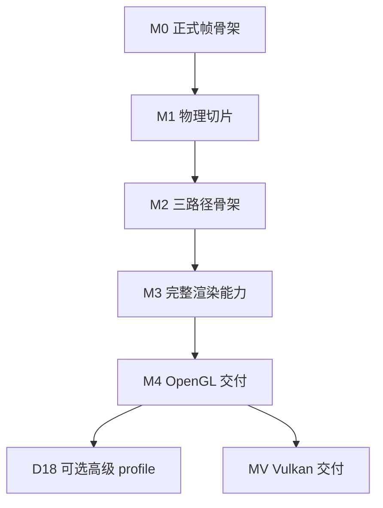

# Physara 开发计划

> 以 [AGENTS.md](../../AGENTS.md) 和 [Architecture.md](../Architecture.md) 为基准。Reference 解释已核实的上游事实与限制，Architecture 记录项目采纳的方案和合同；本文据此安排实现顺序、工作包边界、依赖及完成条件。每次变更的具体技术取舍、可观察行为和实施步骤在 OpenSpec 中确定，AGENTS 只约束通用开发行为。
>
> 本文包含 **20 个开发阶段、113 个工作包**：OpenGL 完整基线 100 个、可选高级 profile 5 个、后续 Vulkan 8 个。清单只在实际实施并验收后勾选，文档批准不代表实现完成。阶段编号表达开发推进顺序，与 Architecture.md 的单帧数据流阶段编号分开。

## 当前阶段

当前阶段为 D04 · 建立带编辑器的可呈现程序。D04-T01 的 EditorSession、面板和输入路由，以及 D04-T02 的 ImGui 公共 RHI 绘制与纹理协议均已验收归档。当前工作包为 D04-T03 · 接入 PresentColor 和正确窗口提交，待立项。D03 的五个工作包及阶段出口均已完成。 [D04 阶段](D03-D05-FramePipeline.md#dev-d04) · [D04-T03](D03-D05-FramePipeline.md#d04-t03) · [D04-T02 验收](../../openspec/changes/archive/2026-11-10-establish-imgui-rhi-renderer/tasks.md#final-verification) · [D04-T01 验收](../../openspec/changes/archive/2026-11-10-establish-editor-session-input/tasks.md#final-verification) · [D03 阶段](D03-D05-FramePipeline.md#dev-d03)

## 阅读与使用

1. 先看开发主线与阶段入口，确认当前能交付什么。
2. 进入阶段后，以工作包 ID 选择一个目标或若干相邻目标，再创建原生 OpenSpec change。
3. 每个工作包列出职责位置、前置依赖、架构依据、具体任务和验收结果；核对完成条件后更新状态。
4. 实现与本地验证后，按 [独立审查闭环](../../AGENTS.md#review-loop) 交给另一会话审查/注释，以 [CodeReview.md](../CodeReview.md) 整改并复核，完成最终 verify 后再同步/归档。
5. 通过阶段出口再扩展下一层能力。核对跨模块覆盖时使用[覆盖索引](Coverage.md)。

## 1. 开发主线与范围

### 1.1 先建立纵向闭环，再扩充能力

第一条开发主线是：**可重建工程 → 真实窗口与资源寿命 → Shader/RHI 原生图像 → 编辑器与呈现 → 整帧 RenderGraph → glTF 模型与 JSON 编辑器场景 → 核心物理 Forward**。

这条主线尽早使用正式模块及同一产品入口。原生 fixture 可以先验证 RHI 像素；产品从编辑器接入阶段起始终启动完整编辑界面。基础 Graph 接入后，原有最小顺序编排随该次替换收敛，不保留另一套生产 Renderer。

随后在已有画面上完善增量准备/预算、静态几何覆盖与相机历史、阴影、Forward+ 与 Deferred；再完成标准材质扩展、透明透射、屏幕效果、时域镜头和编辑工作流。资产、UI、RHI、Renderer 都随对应纵向能力一起集成，测试、失败退出和诊断随任务落地。

Physara 只编辑和渲染静态场景，不实现动画播放、骨骼、Skin/Morph 或动态变形。模型资产统一使用 `Assets/Models` 中只读的 glTF/GLB；一个 `Assets/Scenes/*.scene.json` 保存 Assets 引用、静态实体/TRS/灯与物体参数、实例材质/纹理覆盖和主 View 相机及 requested 设置，重新打开后继续编辑保存。Asset 负责标准资产导入与校验，Scene 提供实例状态、快照和构建校验，Editor/Session 组合 JSON 文件读写及 Scene/View 的恢复，Renderer 消费已加载的数据。验证随功能安排；开发测试材料只在 build 下按工作包归类，具体范围与停止条件遵循 [开发约定](../../AGENTS.md#workflow) 和对应技能，不预先建立测试框架或独立工具模块。

| 里程碑 | 达成阶段 | 可实际观察的结果 |
|---|---|---|
| M0：正式帧骨架 | D05 | Shader/RHI 原生测试通过；带编辑器程序通过 Graph 合成 UI 并呈现，图失败有安全退路 |
| M1：可用物理切片 | D07 | 可导入 glTF 模型、加载 JSON 场景并基础编辑，以物理 Forward、灯光、IBL、曝光和正式显示链显示 |
| M2：三路径骨架 | D11 | 静态几何与阴影已共用；Forward、Forward+、Deferred 在当前已启用配置下原子切换且 HDR 可比 |
| M3：完整渲染能力 | D15 | 目标材质/透明/屏幕效果与时域镜头闭环；三路径共享 None/FXAA/TAA 基础 profile |
| M4：OpenGL 基线交付 | D17 | 编辑/保存/重导入/拾取/截图/诊断与压力验收完整，可重建和部署 |
| MV：Vulkan 后端交付 | D19 | 同一上层系统通过 Vulkan 原生、跨后端图像和呈现寿命验收 |

图示里程碑依赖；具体任务顺序以阶段表和工作包前置为准。D18 与 D19 互不构成默认前置，Vulkan 可以在 M4 后直接推进。

### 1.2 交付范围分级

| 范围 | 工作 | 完成判定 |
|---|---|---|
| OpenGL 完整基线 | D00–D17；完整公共 RHI 谱系与真实 GL 基础 profile、三路径、架构目标 glTF profile、物理渲染链和轻量编辑器 | 全部基线目标闭环；每一声明能力有对应证据 |
| 独立可选 profile | D18 的 Forward/Forward+ MSAA、PCSS、moments 阴影、SSR Hi-Z traversal、flare | 每项单独选定、建立 spec、验证后启用；未选择保持禁用/不支持 |
| 后续后端 | D19 Vulkan | M4 后迁移，与 GL 共用既有上层合同；独立完成验收 |
| 需要新需求才能立项 | Deferred MSAA、bindless profile、GPU Froxel producer、异步多队列/heap aliasing、RT/mesh/sparse、自动曝光、运动模糊、其他显示输出 profile | 当前不自动增加实施任务；先明确行为/成本/能力及架构变化，再建立 change |

目标 glTF 扩展已经纳入基线任务。它们与可选的高阶阴影/AA profile 分开管理，不能因为“扩展”二字全部延期。游戏框架、脚本系统、任意材质图和自研 UI 工具包不属于既定产品范围。

### 1.3 依赖和集成规则

- 阶段“入口”是集成门槛；工作包“前置”是该阶段内的硬依赖，两者取并集。D00–D17 和 D19 的出口需要本阶段全部工作包及所列场景通过；D18 逐项选择验收。
- 相同前置下独立的工作包可以调整顺序。例如 D12 的多种不透明扩展在共享 Fresnel 基础之后可分别推进。个人实施默认保留一条清楚的主线。
- CPU 算法/工具可提前探索，但依赖链未就绪时不计为整条能力完成。重排正式实施顺序先更新相关入口、依赖和验收，不能靠临时生产分支绕过合同。
- 后续工作包在前期基础上扩充：D02 建资源，D03 建提交，D05 接图，D08 完成版本/预算；同一系统只有一个长期 owner。
- D17 执行整体交付验收，前面的每个工作包仍必须及时运行其必要检查。性能埋点从模块出现时加入，正式报告按真实比较需求产生。
- 功能对外声明可用时形成输入→准备→资源/图→GPU→输出/诊断→退休→验证闭环，未就绪能力显示 Pending/不支持。

## 2. 工作包尺度、OpenSpec 与完成规则

### 2.1 三层任务结构

| 层级 | 作用 | 和 OpenSpec 的关系 |
|---|---|---|
| 开发阶段 Dxx | 一个可集成、可观察的系统增量 | 通常包含多个 changes，不以整阶段创建巨型 spec |
| 工作包 Dxx-Txx | 一个职责清楚、可独立验收的功能目标 | 默认选择一个工作包；同一目标的相邻包可合并 |
| 包内清单 | 明确需要交付的数据/行为、接入及边界场景 | 为实施 tasks 提供范围，不逐条机械生成一个 spec |

本计划把 Shader、RHI、UI 等必要跨层工作放进同一可验收目标。跨目录不自动意味着需要拆 change；互不依赖的算法或不同能力 profile 应分别评审。

**创建 change 时的尺度判断：**

1. 能否用一句话说明交付行为，并用一组有限场景验收？能则通常可以作为一个 change。
2. 是否存在独立发布、独立回滚的两个目标，或一个目标必须等待尚未解决的架构选择？存在则拆分。
3. 是否只剩一个无独立意义的函数、字段或转发接口？应合入它服务的行为目标。
4. 移植/原生能力族如果在实施调研后仍过大，可把同一工作包细化为稳定子目标，例如 `D19-T03.a`；先在本计划补清前置与验收，再分别关联 changes。细化保持父任务含义，不能用无限细分掩盖未完成。

示例：D10-T01/T02 可合为“CPU Froxel 数据与安全上传”；D10-T03/T04 可合为“Forward+ 接入与原子切换”。D12 的 clearcoat、sheen 等各自有独立行为和参考图，默认分别建立 change。D00-T02/T03 可在同一次工程基线变更中交付。示例只说明边界，实际划分在启动相应任务时确定。

### 2.2 change 的准备与追踪

选择工作包后，先读取该项架构链接、受影响代码和现有已采纳 specs，再沿锁定 OpenSpec 原生流程探索/提案、形成需要的 specs/design/tasks、apply；实现与本地验证后执行 [A/B 独立审查与注释闭环](../../AGENTS.md#review-loop)，验收通过再完成最终 verify、sync/archive。产物依赖和命令以安装版本/schema 为准；独立审查不改变 schema。

- proposal 关联本计划 ID，说明本次覆盖哪些目标、哪些仍留在原工作包。
- spec 定义可观察行为和失败场景；design 按参考分析与现实设备讨论技术，不把本计划当成已经作出的全部实现决策。
- tasks 按依赖安排具体实施、验证、[独立审查闭环](../../AGENTS.md#review-loop)及收尾任务，并留存相应证据；审查、整改和验收细节由对应 change 管理。
- 本文只在对应阶段或工作包记录推进状态、必要的前置/范围调整及 change/归档引用，不复述实施细节、问题单或验证报告。多个 changes 列明共同覆盖范围。
- 普通实施只更新本计划与 change；是否需要修改架构，先按 [文档职责规范](../../AGENTS.md#document-boundaries) 判断，不能把实施进度回写为架构设计。
- 工作包只有在包内目标、独立审查/注释及验收均满足时才整体完成。实现与本地检查完成可标记“待独立审查”，整改阶段标记“待整改/复核”；B 验收与最终 verify 均通过但尚未归档可标记“已验收，待归档”。未运行场景明确记录。
- 已实施或归档的任务保留其 ID 与事实；未开始的工作包可随范围调整合并或重排，并同步计数、前置与所有当前引用，不修改归档来覆盖历史。

不预先替全部任务生成 spec，不指定无依据的工期。**D00、D01 和 D02 的现有 changes 均已归档；D01 的真实跨屏缺口已补齐，D01/D02 阶段出口已通过**，对应工作包引用相关 change。新闭环不追溯改写这些历史验收，其余工作包继续遵守所列前置。

### 2.3 每项统一的完成门槛

包内完成条件必须满足。以下门槛按本次实际改变的合同选用，验证深度见[验证范围与停止条件](../../.agents/skills/physara-verification/SKILL.md)。

- 说明输入、输出与状态 owner，验证实际消费链。涉及版本、错误、取消或退出时检查相应路径。
- 受影响构建和必要检查通过；原生语义有真实 backend 证据，物理/颜色/时域有对应数值或图像/序列依据。
- 参数、能力和 Pending/失败对调用者及必要 UI 可见；不支持项不靠空操作伪造成功。
- 新缓存、上传区段、查询和 UI 历史有容量、失效与退休，不增加无界状态或隐式全设备等待。
- 架构/spec/代码保持一致，替代实现及时清理，来源/许可、必要使用说明及原生 change 同步交付。
- 独立审查闭环和最终 verify 已通过，具体要求见 [AGENTS.md](../../AGENTS.md#review-loop)。

以下各阶段只列本阶段特有结果。未勾选项尚未满足完成条件，实施和验收进度以对应 change 的任务记录为准。

## 3. 阶段索引

| 阶段 | 性质 | 入口 | 工作包 | 交付目标 |
|---|---|---|---|---|
| [D00](D00-D02-Foundation.md#dev-d00) 建立可重建的工程与开发基线 | 基线 | 工程起点 | 4 | 形成轻量、可干净配置和构建的 2.0 工程，确认资源归属与依赖来源。 |
| [D01](D00-D02-Foundation.md#dev-d01) 建立 Core 与窗口宿主的可靠寿命 | 基线 | [D00](D00-D02-Foundation.md#dev-d00) | 4 | 获得可采集输入、处理尺寸变化、正确退出的真实 GL 4.6 窗口与最小基础设施。 |
| [D02](D00-D02-Foundation.md#dev-d02) 移植 RHI 合同并实现原生资源 | 基线 | [D01](D00-D02-Foundation.md#dev-d01) | 5 | 保留 NVRHI 完整公共谱系，先实现基础 OpenGL 资源与可验证的设备/资源生命周期。 |
| [D03](D03-D05-FramePipeline.md#dev-d03) 打通 Shader ABI 与第一次原生绘制 | 基线 | [D02](D00-D02-Foundation.md#dev-d02) | 5 | 从统一 Shader 输入到 RHI Pipeline、Draw、提交票据和像素读回形成首条 GPU 纵向链。 |
| [D04](D03-D05-FramePipeline.md#dev-d04) 建立带编辑器的可呈现程序 | 基线 | [D03](D03-D05-FramePipeline.md#dev-d03) | 5 | 让唯一 Runtime 真正启动 Editor，打通 UI 输入、RHI 绘制、窗口末端复制和有界帧槽。 |
| [D05](D03-D05-FramePipeline.md#dev-d05) 让整帧经 RenderGraph 执行 | 基线 | [D04](D03-D05-FramePipeline.md#dev-d04) | 5 | 将上传、测试视口、UI 与窗口输出纳入同一声明、编译和执行链，建立图正确性及失败退路。 |
| [D06](D06-D07-SceneAndForward.md#dev-d06) 接入标准资产、场景与首个真实视口 | 基线 | [D05](D03-D05-FramePipeline.md#dev-d05) | 7 | 把 glTF CPU 数据、Scene、只读准备、GPU 驻留与 Forward 几何连到现有编辑器帧图。 |
| [D07](D06-D07-SceneAndForward.md#dev-d07) 形成可用的物理 Forward 渲染器 | 基线 | [D06](D06-D07-SceneAndForward.md#dev-d06) | 6 | 完成核心 metallic-roughness、物理灯光/相机、IBL 和正确显示，使后续路径有统一的参考输出。 |
| [D08](D08-D11-RenderPaths.md#dev-d08) 完善准备、资源预算与执行能力 | 基线 | [D07](D06-D07-SceneAndForward.md#dev-d07) | 8 | 在现有可用画面的基础上完成大场景所需的增量准备、批处理、图资源池、完整基础 GL 命令和热重载。 |
| [D09](D08-D11-RenderPaths.md#dev-d09) 实现完整基础阴影链 | 基线 | [D08](D08-D11-RenderPaths.md#dev-d08) | 5 | 将保守阴影 CPU 计划、资源预算、静态几何/遮罩绘制及 Hard/PCF 采样接入共享灯光模型。 |
| [D10](D08-D11-RenderPaths.md#dev-d10) 实现 CPU Froxel 与 Forward+ | 基线 | [D09](D08-D11-RenderPaths.md#dev-d09) | 5 | 保持物理模型不变，以 Filament 式 CPU Froxel 改变局部灯候选集合，形成第二条可切换路径。 |
| [D11](D08-D11-RenderPaths.md#dev-d11) 接入 Deferred 并完成三路径切换骨架 | 基线 | [D10](D08-D11-RenderPaths.md#dev-d10) | 5 | 实现紧凑核心 GBuffer、扩展表面辅助合同和共享 deferred lighting，保持完整上下游一致。 |
| [D12](D12-D13-Materials.md#dev-d12) 完成标准不透明材质扩展 | 基线 | [D11](D08-D11-RenderPaths.md#dev-d11) | 6 | 沿标准 glTF 扩展、共享物理库和 ForwardExtension 路由逐项闭环，控制组合与能量近似。 |
| [D13](D12-D13-Materials.md#dev-d13) 完成透明覆盖和物理透射 | 基线 | [D12](D12-D13-Materials.md#dev-d12) | 6 | 把核心 alpha blend 与 transmission/volume/dispersion 放入统一 HDR 合成，维持表面、历史和选择语义。 |
| [D14](D14-D15-ImagePipeline.md#dev-d14) 接入屏幕空间遮蔽、接触阴影与 SSR | 基线 | [D13](D12-D13-Materials.md#dev-d13) | 5 | 在完整表面上接入三路径共享屏幕效果，并随 SSR 首次建立独立 ReflectionHdr 与成对历史深度。 |
| [D15](D14-D15-ImagePipeline.md#dev-d15) 完成时域、镜头和显示链 | 基线 | [D14](D14-D15-ImagePipeline.md#dev-d14) | 7 | 把 HDR 合成、基础高度雾、TAA、物理 DoF、Bloom 和完整显示设置组织为唯一后处理链。 |
| [D16](D16-D17-EditorAndDelivery.md#dev-d16) 完成编辑、持久化、读回与诊断闭环 | 基线 | [D15](D14-D15-ImagePipeline.md#dev-d15) | 7 | 在已接入的编辑器基础上补齐日常创作/调试流程，闭合资产变更、场景保存、GPU 结果消费和资源卸载。 |
| [D17](D16-D17-EditorAndDelivery.md#dev-d17) 完成 OpenGL 基线验收与可复用性能基准 | 基线 | [D16](D16-D17-EditorAndDelivery.md#dev-d16) | 5 | 对已逐步验证的系统执行整体交付验收，确认支持矩阵、可重建运行包、质量与资源预算。 |
| [D18](D18-D19-Extensions.md#dev-d18) 按需增加独立高级 profile | 可选 | [D17](D16-D17-EditorAndDelivery.md#dev-d17) | 5 | 对架构中明确可选的能力分别实施、验证和启用，保持基础单样本三路径配置稳定。 |
| [D19](D18-D19-Extensions.md#dev-d19) 在同一合同下接入 Vulkan | 后续 | [D17](D16-D17-EditorAndDelivery.md#dev-d17) | 8 | 在完整 OpenGL 渲染器之后迁移 NVRHI Vulkan 后端，验证同一 Scene/Shader/Graph/Editor 的跨后端行为。 |

## 4. 分阶段工作清单

第 3 节中的阶段链接直达对应分卷。阶段内的完成条件在 OpenSpec verify 中核对，编码步骤与证据见对应 change tasks。

## 5. 全功能与工程覆盖核对

[覆盖索引](Coverage.md)按架构单元、glTF/profile 和工程目录映射到工作包。

## 6. 实施过程中怎样维护本计划

1. **启动工作包：** 检查阶段入口和包内前置，选择本次覆盖 ID，使用原生 change 讨论实际技术与验收输入。
2. **发现规模变化：** 在编码前明确缩小/细化/合并目标与新依赖；保护已实施/归档 ID，未开始任务调整后同步全部当前引用。发现基准架构需要变化时，在对应 change 中解决并同步当前结论。
3. **推进功能。** 交付工作包约定的行为，只对实际涉及的失败、取消或退出路径补充处理和验证。每阶段保留上一有效可用结果。
4. **交接与收尾：** 实现及本地检查后交接 B 审查/注释，A 整改，B 复核；验收通过并完成最终 verify 后，才勾选对应收尾任务、同步/归档并重置问题单。按包内目标与完成条件关联 change 和证据，只有已证明部分可勾选。
5. **通过阶段出口：** 汇总实际支持 profile、剩余限制和下一阶段前置。可选项明确是否选择，不影响已定义基线的完成范围。

启动、切换或归档工作包时更新[当前阶段](#current-stage)及 change 引用。
