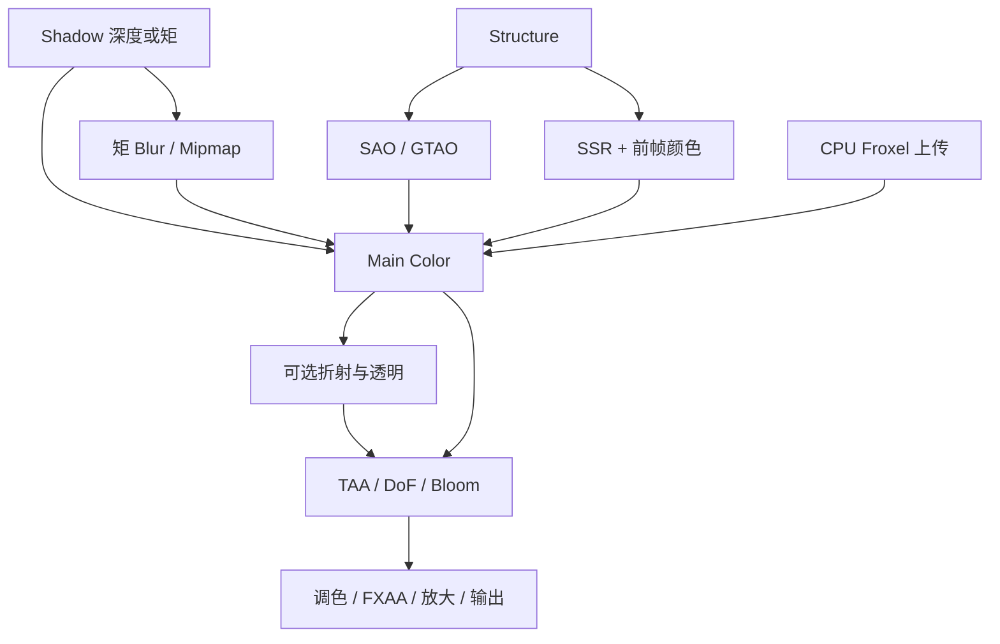
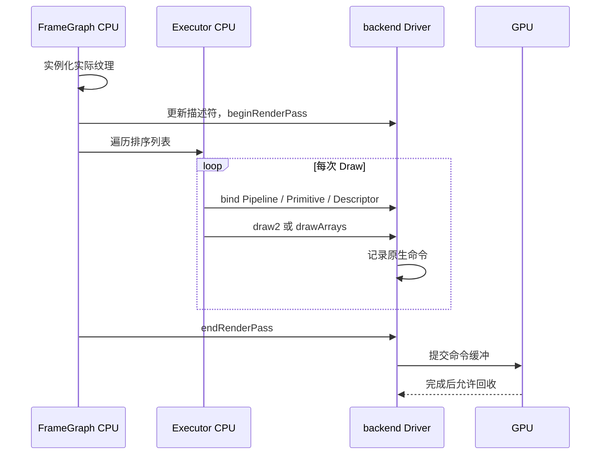

# Filament · FrameGraph、后端与表面阶段

[Filament 技术目录](../Filament_Rendering_Pipeline_Analysis.md) · [源码索引](SourceIndex.md#fa)

<a id="f7"></a>
## 7. FrameGraph：把 Draw 列表放入有依赖的 Pass

### 7.1 模块架构

| 层 | 描述 | 解决的问题 |
|---|---|---|
| FrameGraph | Pass、资源版本、usage | 谁生产、谁读取 |
| 图内 RenderPass 声明 | attachments、clear、samples、viewport | 怎样建立目标 |
| RenderPass::Command | 排序 Draw 与自定义操作 | 目标内的执行顺序 |



这是合并可选分支的依赖图。SSR 使用前帧颜色，屏幕折射可使用本帧不透明背景；两者不是同一个纹理生产阶段。[F07](SourceIndex.md#f07) [F08](SourceIndex.md#f08) [F60](SourceIndex.md#f60)

### 7.2 setup 处理虚拟资源，execute 处理实际 Handle

```cpp
fg.addPass("Color",
    setup(builder, data):
        data.shadow = builder.sample(shadowResult)
        data.ao = builder.sample(aoResult)
        data.ssr = builder.sample(ssrResult)
        data.color = builder.createTexture(colorDesc)
        data.color = builder.write(data.color, COLOR_ATTACHMENT)
        data.depth = builder.write(depth, DEPTH_ATTACHMENT)
        builder.declareRenderPass(attachments, clearFlags, samples)

    execute(resources, data, driver):
        bindActualPassTextures(resources, data)
        view.commitDescriptorSet(driver)
        rp = resources.getRenderPassInfo()
        driver.beginRenderPass(rp.target, rp.params)
        drawExecutor.execute(engine, driver)
        driver.endRenderPass()
)
```

### 7.3 编译和执行如何衔接

```cpp
FrameGraph.compile():
    dependencyGraph.cull()
    stablePartitionActivePasses()
    for activePass in constructionOrder:
        registerResourceReadsAndWrites()
    for liveResource:
        resource.firstUser.devirtualizeList.add(resource)
        resource.lastUser.destroyList.add(resource)
    resolveAttachmentRequirements()

FrameGraph.execute(driver):
    for pass in activeConstructionOrder:
        for resource in pass.devirtualizeList:
            resource.createThroughAllocatorOrTextureCache()
        pass.execute(FrameGraphResources(...), driver)
        for resource in pass.destroyList:
            resource.releaseThroughAllocatorOrTextureCache()
```

当前是有效 Pass 按构建顺序执行的模型；图本身不自动变成跨队列调度器。逻辑 release 可进入 TextureCache，不能视作此时 GPU 已完成或立即物理释放。[F07](SourceIndex.md#f07) [F49](SourceIndex.md#f49) [F50](SourceIndex.md#f50)

### 7.4 Froxel 等待点如何嵌入图

```cpp
// Renderer 的 Prepare Color Passes 有副作用回调：
executePrepareColor():
    prepareOptionalSubpassResolveAndChannelClearMaterials()
    if view.froxelJob exists:
        join(view.froxelJob)
        view.commitFroxels(driver, arena)
```

前面的图工作可以先推进，后台任务与图编译重叠；到颜色消费灯列表前，CPU join 与 Buffer 更新保证输入已产生。第 8 节就在这个 execute 边界将全部数据与 Draw 汇合。[F08](SourceIndex.md#f08)

<a id="f8"></a>
## 8. 后端边界：从 Pass 回调到原生 GPU 命令

### 8.1 完整调用链



DriverApi 的 CPU 命令流通常位于 Executor 与具体 Driver 之间，解耦前端与后端执行；配置也可能采用单线程路径。[F02](SourceIndex.md#f02) [F17](SourceIndex.md#f17) [F18](SourceIndex.md#f18)

### 8.2 Executor 的状态机

```cpp
Executor.execute():
    currentMaterial = null
    currentPipeline = empty
    currentPrimitive = null

    for cmd in sortedCommands:
        if cmd.isCustom:
            cmd.callback()
            continue

        M = cmd.materialInstance
        if M != currentMaterial:
            selectPerViewLayoutCompatibleWith(M, cmd.variant)
            bindCorrespondingPerViewSet()
            M.use(driver, cmd.variant)                    // PER_MATERIAL
            applyMaterialScissorStencilAndOffsets()
            currentMaterial = M

        pipeline = gatherPipelineState(cmd, M)            // 概念
        if pipeline != currentPipeline:
            driver.bindPipeline(pipeline)
            currentPipeline = pipeline
        if cmd.primitive != currentPrimitive:
            driver.bindRenderPrimitive(cmd.primitive)
            currentPrimitive = cmd.primitive

        driver.bindDescriptorSet(cmd.objectSet, PER_RENDERABLE,
                                 {cmd.objectSlot * 256, cmd.skinningOffset})
        if cmd.hasMorphing:
            driver.setPushConstant(VERTEX, MORPHING_BUFFER_OFFSET,
                                   cmd.morphingOffset)

        if cmd.isIndexed:
            driver.draw2(cmd.first, cmd.count, cmd.instanceCount)
        else:
            driver.drawArrays(cmd.first, cmd.count, cmd.instanceCount)
```

此处是 `R`、`M` 与 View 灯光绑定的汇合点。绑定到位后，GPU 顶点/片元阶段才会读取对应字节。[F09](SourceIndex.md#f09)

### 8.3 CommandStream 的参数所有权

```cpp
// 返回资源身份的典型 S/R 分离。
handle = driver.createResourceS()
stream.record(createResourceR, handle, copiedDescription)

// 延迟调用必须持有参数。
stream.record(updateBuffer, handle, move(BufferDescriptor))
stream.record(bindDescriptorSet, setHandle, copiedOffsets)
stream.record(draw2, firstIndex, count, instanceCount)

// 后端消费。
for command in cpuCommandBuffer:
    dispatcher.invokeConcreteDriver(command)
```

同步获得 Handle 不等于原生创建完成；BufferDescriptor 的回调也不等于 GPU 最后使用完成。同步查询有另外的调用约定，不能把所有 API 都视为相同异步方式。[F17](SourceIndex.md#f17) [F18](SourceIndex.md#f18)

### 8.4 Filament Vulkan 的原生落点

| Driver 请求 | Vulkan 实现 |
|---|---|
| updateBufferObject | 取得 VulkanBufferObject，loadFromCpu，持有资源并调度上传源释放 |
| beginRenderPass | 处理 acquire、附件布局、command buffer 与 RenderPass/FBO cache |
| bindPipeline | 根据 Shader、vertex input、raster、target/layout 选 Pipeline |
| bindDescriptorSet | 保存 Set 与动态 offset，按需要处理 external sampler |
| draw2 | prepareDraw 提交描述符，再 vkCmdDrawIndexed |
| drawArrays | prepareDraw 后 vkCmdDraw |
| commit / flush | 提交、呈现依赖与完成回收 |

```cpp
VulkanDriver.draw2(firstIndex, count, instances):
    if noPrimitiveBound:
        return
    prepareDraw():
        finalizeExternalSamplerDependentLayoutIfNeeded()
        descriptorSetCache.commit(cmd, pipelineLayout, setMask)
    vkCmdDrawIndexed(cmd.buffer, count, instances, firstIndex, 0, 0)
```

本基线 Filament Vulkan 用 RenderPass/FBO cache；配套文档的 NVRHI Vulkan 用 dynamic rendering。同职责不意味着同实现。[F71](SourceIndex.md#f71) [F72](SourceIndex.md#f72)

材质工具链和接口中存在 Compute 相关能力，但该基线 VulkanDriver::dispatchCompute 仍为空的 FIXME 实现。不能由接口存在推断这条后端路径已经能执行 Compute；本文追踪的主要表面与后处理链使用实际的 Raster Draw 路径。[F21](SourceIndex.md#f21) [F71](SourceIndex.md#f71)

### 8.5 两份分析的连接点

| 前端已经确定 | 后端 / RHI 落实 |
|---|---|
| Pass 读写的纹理和附件 | View、attachment、状态转换 |
| Shader 与固定状态 | Pipeline / PipelineLayout |
| View、Material、Object 的数据 | Descriptor 与动态偏移 |
| 几何范围和实例数 | 顶点/索引绑定和原生 Draw |
| 后续 Pass/下一帧的消费 | 屏障、提交、在途引用与完成 |

[NVRHI 第 0、7–12 节](../NVRHI/InterfacesAndDevice.md#n0)继续拆解这一层职责。Filament 与 NVRHI 没有直接依赖关系，这里对齐的是输入/输出含义。下面转入 GPU 的执行视角，追踪这些输入如何产生图像。

<a id="f9"></a>
## 9. GPU 前置阶段：深度、阴影、AO 与反射输入

### 9.1 模块架构：主颜色需要哪些已完成结果

| 生产阶段 | 使用的 CPU 准备结果 | 产生的 GPU 资源 | 主颜色的消费方式 |
|---|---|---|---|
| Shadow | shadow camera、caster、atlas 参数 | 深度或指数矩 array | 每灯 visibility |
| Structure | 稳定相机、几何深度变体 | 深度与层级/辅助信息 | AO、Contact、SSR |
| SAO/GTAO | AO 配置、viewport 映射 | AO / 可选 Bent Normal | 间接光遮蔽 |
| SSR | 表面反射变体、相机重投影、前帧颜色 | 反射色与置信度 | 与镜面 IBL 融合 |

这些不是完整材质 G-buffer。主颜色仍在 Surface Shader 内求 BRDF 与光照。[F28](SourceIndex.md#f28) [F31](SourceIndex.md#f31) [F34](SourceIndex.md#f34)

### 9.2 Shadow Pass：同一几何在光源视角重画

```cpp
for shadowView in shadowPlan:
    bindShadowViewUniforms(shadowView)
    beginPass(shadowAtlasRegion)

    for caster in shadowView.casters:
        clipPosition = surfaceVertex(caster, shadowView.camera) // 共用几何路径
        rasterize(clipPosition)

        // depth fragment variant：
        if alphaMasked or transparentShadowEnabled or customDepth:
            inputs = initMaterial()
            material(inputs)
            alpha = inputs.baseColor.a
            if alphaMasked and alpha < maskThreshold:
                discard
            if transparentShadowEnabled and gradientNoise(pixel) >= alpha:
                discard

        if momentVariant:
            output = computeDepthMoments(linearLightSpaceDepth)
        else:
            writeDepthOnly()

    endPass()

if momentFilteringNeeded:
    blurAndGenerateMomentMipChain()
```

蒙皮、Morph、顶点位移与必要 Alpha 求值必须保留，否则颜色形状和投影形状会分离。透明阴影使用噪声覆盖率近似，而不是直接积分 RGB 玻璃吸收或焦散。[F23](SourceIndex.md#f23) [F28](SourceIndex.md#f28) [F31](SourceIndex.md#f31)

### 9.3 阴影查询的三条技术线

**PCF**：对深度比较结果求平均，使用 comparison sampler。bias、receiver/normal offset 与光空间尺度一起控制 acne 和接触分离。

**EVSM/ELVSM**：moments Shader 使用光空间线性深度的重映值 d：

```cpp
positive = exp(c * d)
negative = -exp(-c * d)
m1 = {positive, negative}
m2 = m1 * m1

linearVariance = 0.25 * (dFdx(d)^2 + dFdy(d)^2)
m2 += c*c * m2 * linearVariance
moments = {m1.x, clamp(m2.x), m1.y, clamp(m2.y)}
```

这份四通道数据可以过滤，再用概率界估计可见性。普通深度 Mipmap 不能替代该编码。

**PCSS 接口对应的 EVSSM**：本基线通过矩 Mip 估计 blocker，按半影选 LOD，当前默认 5 Tap 合并矩；DPCF 枚举会回退该路径。[F32](SourceIndex.md#f32) [F33](SourceIndex.md#f33)

```cpp
querySoftShadow(receiver, shadowRecord):
    searchRadius = projectLightSizeAndReceiverDistance(...)
    searchLod = clamp(log2(searchRadiusInTexels), 0, maxMip)
    searchMoments = textureLod(shadowMap, receiver.xy, searchLod)
    blockerDepth = decodeAverageBlockerFromNegativeMoment(searchMoments)

    ratio = directional
        ? worldDepthDifference(receiver, blockerDepth)
        : perspectiveBlockerReceiverRatio(receiver, blockerDepth)
    penumbra = applyConfiguredRatioLimits(ratio) * projectedLightSize

    filterLod = chooseMomentLod(penumbra)
    filteredMoments = weightedQuincunx5(shadowMap, receiver.xy, filterLod)
    return evaluateEVSM(filteredMoments, receiver.depth)
```

上述结果是后续直接灯贡献的 visibility，不是整幅图统一乘一张灰图。额外方向光不走主光级联阴影。

### 9.4 Structure 与 AO：由深度恢复局部几何关系

```cpp
structure = drawDepthVariant(stableCamera, relevantGeometry)
depthMips = buildDepthHierarchy(structure)

for pixel in aoResolution:
    position = reconstructViewPosition(depth)
    normal   = estimateNormalFromDepthNeighborhood()

    if aoType == SAO:
        ao = integrateSpiralDepthSamples(position, normal, radius, ...)
    else if aoType == GTAO:
        for sliceDirection:
            horizons = sampleDepthAlongSlice(...)
            integrateVisibility(horizons, thicknessModel, ...)
        ao, bentNormal = finalizeSliceIntegration()

ao = bilateralFilterUsingDepth(ao)
ao = depthAwareUpsampleWhenRequired(ao)
```

默认 AO 类型为 SAO，GTAO 受构建开关和选项控制。SAO 质量档对应 7/11/16/32 样本；GTAO 采用独立 slice/step 参数。可选 Bent Normal 表达非遮蔽方向，不能当普通法线贴图使用。[F33](SourceIndex.md#f33) [F34](SourceIndex.md#f34) [F35](SourceIndex.md#f35)

Contact Shadow 同样沿屏幕深度短距离检查遮挡，补充细小接触细节。它无法看到屏幕外和深度后面的完整几何。

### 9.5 SSR：在主颜色之前获取反射补充

当前 SSR 用特殊 Surface variant 重绘符合条件的表面，并从前帧颜色历史取得命中辐亮度。它先生成反射结果，再为结果生成 Gaussian mip，主颜色阶段按粗糙度和相机距离选择 LOD，不是只对历史颜色做普通 box mip。[F34](SourceIndex.md#f34) [F36](SourceIndex.md#f36) [F61](SourceIndex.md#f61)

```cpp
if previousFrame.ssrColor does not exist:
    reflections = empty  // 主颜色将使用 IBL
else:
    for fragment of screenSpaceReflectionObjects:
        worldPosition, normal, roughness = evaluateReflectionSurface()
        ray = reflect(viewRay, normal)
        hit = traceScreenSpaceRay(
            structure, viewPosition, ray,
            thickness, stride, maxSteps, maxDistance)

        if hit.valid:
            uvHistory = projectCurrentViewHitToPreviousColor(hit)
            radiance = sample(previousFrame.ssrColor, uvHistory)
            confidence = fadeScreenEdgesDistanceAndBackface(...)
        else:
            radiance = 0
            confidence = 0

        // RGB 已乘 confidence，RGBA 必须一起过滤，避免无命中区域泄漏颜色。
        reflections = {radiance * confidence, confidence}
    buildGaussianReflectionMipChain(reflections)
```

trace helper 来自 McGuire/Mara 的投影 DDA：裁掉 near 后的无效射线段，沿屏幕主轴步进，以齐次位置和 reciprocal-w 做透视校正，比较一个步进区间的 view-space Z 范围与场景深度/厚度。bias、stride、最大步数和最大距离共同限制查询；它不查询场景 BVH，也不能恢复离屏信息。命中点通过 `ssrReprojection` 从当前 view space 投到历史颜色的栅格，不读取逐对象 motion。[F61](SourceIndex.md#f61)

当前预滤波 profile 只在 `p < sqrt(0.5)` 时使用 SSR；以 `alpha=p²`、正的相机平面距离 `d` 计算 `lod=max(0,(log2(alpha/d)+lodOffset)*0.8614)`。`lodOffset` 来自反射分辨率、视场和 Gaussian 初始核，`0.8614` 与逐级 Gaussian 方差累积的推导配套；不能单独把这两个常量挪到另一种 mip 核上。超出有效粗糙度、没有历史或没有命中时，confidence 为零，回退 IBL。[F34](SourceIndex.md#f34) [F36](SourceIndex.md#f36)

输出 RGB 是已乘 confidence 的屏幕辐亮度，A 是贡献权重；第 11 节采用 `IBL*(1-A)+DFG*RGB`。若接收方选择未预乘表示，必须同时改过滤和合成，不能再对已预乘 RGB 乘一次 A。上游 SSR 历史从所选颜色路径的 `linearColor` 导出；其包含范围与该路径有关。Physara 的 ReflectionHdr 导出点和实际生产相机矩阵另由架构明确，不能把上游保留的 jitter 投影疑问当作已验证合同。[F08](SourceIndex.md#f08) [F36](SourceIndex.md#f36) [F61](SourceIndex.md#f61)

<a id="f10"></a>
## 10. 主表面阶段：顶点数据如何变成可着色片元

### 10.1 模块架构

```text
VertexBuffer + Object/Bone/Morph 数据
    → 顶点世界位置、法线、切线、UV
    → materialVertex()
    → 投影、光栅化、插值
    → computeShadingParams()
    → material() 内填写输入并调用 prepareMaterial()
    → PixelParams / 光照求值
```

它连接了第 1、5、8 节：VertexBuffer 决定属性解释，PerRenderable 窗口决定当前对象，Pipeline 决定 Shader 变体，PerMaterial 提供用户材质数据。[F25](SourceIndex.md#f25) [F26](SourceIndex.md#f26) [F27](SourceIndex.md#f27)

### 10.2 顶点路径：几何与用户位移的顺序

```cpp
surfaceVertex():
    logicalInstance = decodeInstanceAndEyeIndex()
    initObjectUniforms(logicalInstance)

    v = initMaterialVertex()
    // 初始化 helper 内由 position、Morph、skinning、顶点域等形成世界位置。

    if tangentAttributePresent:
        N, T = unpackQuaternionTangentFrame()
        if morphingTangentsEnabled:
            N = applyMorphNormal(N)
        if skinningEnabled:
            N, T = skinNormalAndTangent(N, T)
        N, T = transformByObjectNormalMatrix(N, T)

    materialVertex(v)         // 用户可改 worldPosition / worldNormal 等
    emitUvColorAndCustomVaryings(v)
    emitWorldPositionAndTangentFrame(v)

    clip = deviceDomain
        ? computeDeviceDomainPosition(v)
        : frame.clipFromWorld * v.worldPosition
    applyStereoViewportAndBackendClipConvention(clip)
    gl_Position = clip
```

正交标架可压为 quaternion，减少顶点存储；non-uniform scale 依赖 normal matrix，负 determinant 还影响正反面。Depth 优化变体会删除不影响深度的代码，但不能删除影响位移/覆盖率的路径。

Device domain、stereo logical instance 和各后端裁剪空间补偿是同一顶点阶段的分支；不是在 CPU 场景坐标上永久翻转一次就完成。

### 10.3 片元入口与 prepareMaterial 的实际位置

```cpp
surfaceFragment():
    initObjectUniforms()
    computeShadingParams()       // 几何法线、TBN、view、屏幕坐标

    MaterialInputs M
    initMaterial(M)
    material(M)                 // 用户代码；其中必须按契约调用 prepareMaterial
    applyAlphaMask(M.baseColor)

    color = evaluateMaterial(M) // 第 11 节
    color = applyPostLightingBlendWhenEnabled(color, M)
    color = applyFogWhenEnabled(color)
    output(color)

// 用户函数的典型逻辑顺序：
material(inout M):
    M.normal = sampleAndDecodeNormal(...)
    M.bentNormal = optionalBentNormal(...)
    M.clearCoatNormal = optionalCoatNormal(...)
    prepareMaterial(M)

    M.baseColor = evaluateBaseColor(...)
    M.roughness = evaluateRoughness(...)
    M.metallic  = evaluateMetallic(...)
    // 此后可使用依赖最终着色法线的 getter。
```

编译器检查 prepareMaterial 调用链；该函数不是 surface main 在用户函数之后自动调用的单独一步。它将切线空间法线转世界空间，计算 NoV、反射向量及相关分层法线。[F23](SourceIndex.md#f23) [F24](SourceIndex.md#f24) [F25](SourceIndex.md#f25) [F70](SourceIndex.md#f70)

### 10.4 MaterialInputs 的完整接口分组

当前 Property 枚举有 37 个字段。下表按它们进入求值链的位置归组；可用性依 shading model、功能宏和 material API level，而不是每个 Shader 都存全部字段。[F22](SourceIndex.md#f22) [F26](SourceIndex.md#f26)

| 作用 | 字段 | 解释与关键默认值 |
|---|---|---|
| 基础响应 | baseColor、roughness、metallic、reflectance | 线性白、p=1、m=0、r=0.5 |
| 几何法线 | normal | 切线空间，默认 (0,0,1) |
| 局部遮蔽 | ambientOcclusion、bentNormal | AO=1；可见方向 |
| 自发光 | emissive | RGB + 曝光权重，默认 (0,0,0,1) |
| 清漆 | clearCoat、clearCoatRoughness、clearCoatNormal | 上层介质、独立粗糙度/法线 |
| 各向异性 | anisotropy、anisotropyDirection | 强度 0、方向 (1,0,0) |
| 次表面 | thickness、subsurfacePower、subsurfaceColor | 厚度、散射指数/颜色 |
| 绒毛/布料 | sheenColor、sheenRoughness | Charlie 高光参数 |
| Spec-Gloss | specularColor、glossiness | 直接 F0、p=1-glossiness |
| 折射 | absorption、transmission、ior、dispersion、microThickness | 逆长度、透射、IOR、色散、薄层路径 |
| 镜面扩展 | specularFactor、specularColorFactor | 强度与介质镜面染色 |
| 后光照 | postLightingColor、postLightingMixFactor | 光照后混合 |
| 裁剪空间 | clipSpaceTransform、clipSpacePosition | Vertex domain / API-level 分支 |
| 接收阴影 | shadowStrength | 功能启用时调制 visibility |
| 第二高光 | secondRoughness、secondRoughnessWeight | API level >=2 的第二波瓣 |
| 薄膜干涉 | iridescence、iridescenceIor、iridescenceThickness | 默认 0、1.3、400 nm |

Cloth 初始化 sheenColor 为当时 baseColor 的平方根，用户之后改 baseColor 不会自动重算。Thickness 在次表面/折射分支的解释不同；不能将 nm 薄膜厚度和场景单位的几何厚度混用。

片元现在已获得 M 与最终几何状态 S。下一节沿 evaluateMaterial(M) 展开，说明它们怎样和 CPU 准备的灯、环境、阴影纹理共同产生线性 HDR。
