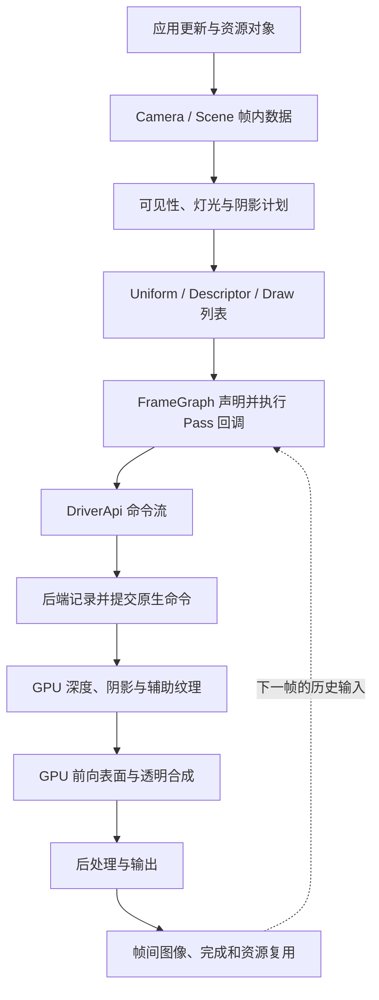
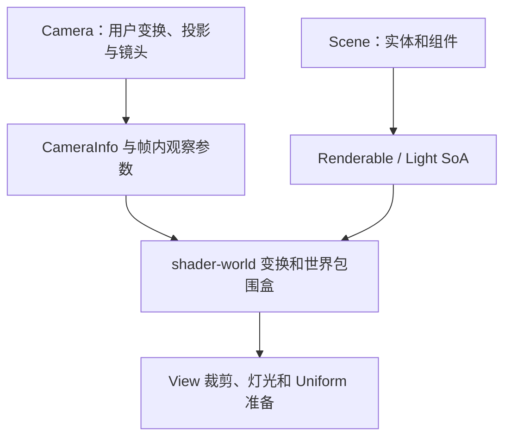

# Filament · 资源与帧准备

[Filament 技术目录](../Filament_Rendering_Pipeline_Analysis.md) · [源码索引](SourceIndex.md#fa)

<a id="f0"></a>
## 0. 整体架构：一帧如何贯穿全部模块

### 0.1 三条流在同一条管线上交汇

Filament 是 clustered forward renderer。CPU 不只提供几何数据，还要确定对象可见范围、Shader 变体、局部灯列表和 Pass 依赖；GPU 通过同一组接口约定读取这些结果，执行表面光照与图像处理。[F03](SourceIndex.md#f03) [F08](SourceIndex.md#f08) [F09](SourceIndex.md#f09)

| 流 | 起点 | 中间表达 | 终点 |
|---|---|---|---|
| 场景数据流 | Entity、Geometry、Material、Light、Camera | SoA、Uniform、Descriptor、Texture | Shader 输入 |
| 控制流 | beginFrame / render / endFrame | RenderPass 命令、FrameGraph 回调、DriverApi | 原生 Draw、提交和呈现 |
| 资源生存期流 | 创建、上传、引用 | 帧内临时资源、在途命令引用、跨帧图像 | 复用或销毁 |

**CPU 执行了 FrameGraph 回调，不代表 GPU 已执行对应 Pass。** 回调主要生成后端命令；后端记录原生命令；提交后 GPU 才消费。资源回收必须跟随自己的生存期流，而不能简单跟随 CPU 函数返回。



这里按依赖展示 GPU 工作。CPU 在进入 GPU 阶段之前，已经把这些工作对应的 Pass 都描述出来。

### 0.2 对象关系：谁持有状态，谁驱动执行

| 对象 | 直接责任 | 如何进入下一层 |
|---|---|---|
| Engine / FEngine | 资源、组件管理器、JobSystem、DriverApi、内置资源 | 提供所有帧准备所需的上下文 |
| Scene / FScene | 实体集合、Skybox、IndirectLight | prepare 生成 Renderable/Light SoA |
| Camera / FCamera | 用户投影、变换、镜头和曝光 | View 派生本帧 CameraInfo |
| View / FView | Scene、Camera、viewport、效果选项、帧历史 | prepare 得到可见工作集与 GPU 参数 |
| RenderPass | 一组可执行的几何/自定义命令 | Executor 发出 DriverApi 调用 |
| FrameGraph | Pass 与资源读写关系 | compile/execute 调度 Pass 回调 |
| backend Driver | Handle、状态和命令的原生实现 | 原生命令缓冲/图形调用 |
| Shader | 几何、材质、光照和图像算法 | 产生目标纹理和最终像素 |

Scene 决定“有什么”，View 决定“从哪里、以哪些选项渲染”，Renderer 决定“什么时候执行这一帧”。多个 View 可以共享 Scene，但可见集合、曝光、Froxel 和历史各自属于相应 View 的渲染过程。[F01](SourceIndex.md#f01) [F02](SourceIndex.md#f02) [F03](SourceIndex.md#f03) [F04](SourceIndex.md#f04)

### 0.3 一帧的总控伪代码

```cpp
// 控制流概要；具体的图声明顺序和延迟开始分支在后文展开。
if (renderer.beginFrame(swapChain)) {
    // beginFrame 成功的普通路径中：
    // backend beginFrame 已排入命令流，Engine::prepare 已提交材质变化。

    for (View V : views) {
        CameraInfo camera = V.computeCameraInfo(engine);
        CameraInfo colorCamera = applyViewportAndTaaJitter(camera); // 概念

        V.prepare(engine, driver, arena, viewport, colorCamera, ...);
        // 输出：场景 SoA、可见范围、阴影计划、Uniform、后台 Froxel job。

        FrameGraph fg(...);
        declareShadowAndScreenSpacePasses(fg, V, camera);           // 概念

        DrawCommands commands = buildColorDrawCommands(V);          // 概念
        declareColorAndRefractionPasses(fg, commands, V);           // 概念
        declarePostProcessAndOutput(fg, V);                        // 概念

        fg.compile();   // 裁去无效 Pass，确定资源首次/末次使用
        fg.execute(driver);
        // 这里调用 CPU 回调：得到实际资源、提交描述符、发后端命令。
    }

    renderer.endFrame();
    // 提交呈现相关命令，推进命令流和回收；并非 CPU 等到 GPU 全部完成。
}
```

下面始终沿同一个例子分析：View `V` 中有 Renderable `R`，其 Primitive 使用 MaterialInstance `M`，受主方向光 `D`、局部灯 `L` 和环境 IBL 影响。`R` 的变换、`M` 的参数、`L` 的光强分别进入 object、material、view/light 数据；最终在同一个片元的光照函数里重新汇合。

<a id="f1"></a>
## 1. 资源进入引擎：建立可被一帧引用的对象

### 1.1 模块架构与输入输出

这一阶段位于帧循环之前，或由流式加载按需触发。核心转换是：

| 输入 | CPU 资源对象 | 后续帧使用的内容 |
|---|---|---|
| 顶点/索引字节与格式 | VertexBuffer / IndexBuffer | 几何范围和抽象 Handle |
| 图像、mip、格式与用途 | Texture | 纹理 Handle 与采样约定 |
| 材质描述与用户 Shader | Material Package → Material | 参数布局、Shader、固定状态 |
| 实例参数与贴图 | MaterialInstance | Uniform 字节和资源绑定 |
| 变换、包围盒、Primitive | Transform/Renderable 组件 | Scene 可收集的实体记录 |

gltfio 的 AssetLoader/ResourceLoader 是资产层入口之一：前者建立实体、层级和资源描述，后者补充几何/图像数据；核心 Renderer 不在每帧重新解析 glTF。[F42](SourceIndex.md#f42) [F43](SourceIndex.md#f43) [F44](SourceIndex.md#f44) [F45](SourceIndex.md#f45) [F46](SourceIndex.md#f46)

### 1.2 几何与纹理的接收逻辑

```cpp
// 资源 API 的结构化伪代码。
vertexBuffer = buildVertexBuffer(vertexCount, attributeDescriptions);
indexBuffer  = buildIndexBuffer(indexCount, indexType);
texture      = buildTexture(dimensions, format, mipCount, usage);

// BufferDescriptor / PixelBufferDescriptor 移交数据及释放回调。
vertexBuffer.setBufferAt(engine, slot, move(vertexBytes));
indexBuffer.setBuffer(engine, move(indexBytes));
texture.setImage(engine, level, move(pixelBytes));

R = entityManager.create();
transformManager.create(R);
RenderableManager::Builder(primitiveCount)
    .geometry(0, topology, vertexBuffer, indexBuffer, offset, count)
    .material(0, M)
    .boundingBox(bounds)
    .build(engine, R);
scene.addEntity(R);
```

资源描述和内容更新分开：属性 stride/type 决定 Shader 怎样解释数据；数据上传决定对应存储里是什么字节。对 Texture，format/target/mip/usage 决定存储与 View，像素描述决定上传源的行布局、类型和压缩块解释。

源 CPU 字节的释放回调，仅说明后端不再需要该段上传源；GPU 资源的最后一次 Draw 可能还没执行。这一所有权会在第 8 节后端上传路径中继续追踪。

### 1.3 Material Package：编译阶段先建立 Shader ABI

```cpp
// MaterialBuilder / ShaderGenerator / 语义分析的等价流程。
package = compileMaterial(description, userCode) {
    parseParameterAndSamplerDeclarations();
    analyzeMaterialPropertyAccesses(userCode);
    validatePrepareMaterialCallChain();

    features = propertiesActuallyUsedByMaterial;
    interfaces = generateUniformSamplerAndVaryingInterfaces(features);

    for (backendTarget, shaderModel, supportedVariant) {
        source = assembleEngineShaderAndUserFunctions(
            interfaces, shadingModel, features, supportedVariant);
        code = compileOptimizeAndTranslate(source, backendTarget);
        package.add(code, interfaces, rasterAndBlendMetadata);
    }
    return package;
}
```

编译器从实际属性访问决定启用的功能。normal、clearCoat、anisotropy 等不仅改变片元公式，还可能改变顶点属性、varying、sampler 和程序组合。因此包内的 Shader 与运行时参数布局必须一致。[F21](SourceIndex.md#f21) [F22](SourceIndex.md#f22) [F23](SourceIndex.md#f23) [F70](SourceIndex.md#f70)

### 1.4 Material 与实例如何连接到一帧

```cpp
material = Material::Builder().package(packageBytes).build(engine);
M = material.createInstance();

M.setParameter("baseColor", linearColor);
M.setParameter("roughness", p);
M.setParameter("albedo", texture, sampler);

// 修改写入 CPU 参数与脏标记。
// 真正 Uniform / Descriptor 提交由 Engine::prepare 或显式 commit 推进。
```

Material 保存模板、接口与程序；实例保存参数和绑定。程序选择还分三层：

| 条件 | 表达位置 | 作用 |
|---|---|---|
| 有无法线、清漆、虹彩等 | 属性分析/编译功能 | 决定 Shader 结构 |
| Depth、SSR、stereo、skinning 等 | Variant | 选择渲染用途 |
| 动态光、方向光、额外方向光等 | DynamicSpecConstKey / specialization | 固化本次执行条件 |

本阶段输出的资源仍是持久对象；下一阶段不会重新创建它们，而是提交变化并从它们提取本帧所需数据。[F19](SourceIndex.md#f19) [F20](SourceIndex.md#f20) [F47](SourceIndex.md#f47)

<a id="f2"></a>
## 2. 帧开始：提交材质变化并建立执行上下文

### 2.1 模块架构

`FRenderer::beginFrame` 负责建立当前 SwapChain、推进 Stream/后端周期任务、进行帧节奏判断，再在实际开始帧时调用 `FEngine::prepare`。[F02](SourceIndex.md#f02) [F08](SourceIndex.md#f08)

```cpp
beginFrame(sc):
    frameId++
    currentSwapChain = sc
    sc.makeCurrent(driver)
    driver.updateStreams(...)
    driver.tick()

    beginWork = lambda:
        driver.beginFrame(time, interval, frameId)
        updateFrameTimingAndUserHistory()
        engine.prepare(driver)

    if shouldRenderFrame() or pacedPresentationRequested:
        beginWork()
        return true

    deferredBeginWork = beginWork
    currentSwapChain = null
    engine.flush()
    return false
```

返回 false 的路径保留延迟开始闭包；若调用方仍调用 render/end，源码会推进这部分工作。普通应用入口按 true 时 render/end 理解即可，但内部“开始一帧”并不等同于单一固定位置的一段函数体。

### 2.2 Engine::prepare 怎样处理上一阶段的变化

```cpp
Engine.prepare(driver):
    if uboBatchingEnabled:
        uboManager.beginFrame(driver)

    for each materialInstance M:
        if M.domain == SURFACE:
            M.commit(driver, uboManager)

    if uboBatchingEnabled:
        uboManager.finishBeginFrame(driver)

MaterialInstance.commit(...):
    if uniformDataDirty:
        if usingUboBatching:
            allocateOrUpdateSharedUboRegion()
        else:
            driver.updateBufferObject(materialUbo, sourceBytes)
        clearUniformDirty()

    ensureUboAllocationHasDescriptorBinding()
    descriptorSet.commit(layout, driver)
```

后处理实例通常在本帧中途才设置参数，因此不靠这一次全局 Surface commit 完成。相同地，“对象存在”不代表每帧都上传：dirty 条件控制实际更新，小材质参数还能聚合进共享 UBO。[F02](SourceIndex.md#f02) [F47](SourceIndex.md#f47)

**进入下一阶段的状态**：`M` 的变化已进入后端命令流，Engine 可为本帧 View 准备提供一致的资源/程序接口。View 接下来处理 Camera、Scene 和可见性，决定哪些资源会被 Draw 消费。

<a id="f3"></a>
## 3. View 准备：从 Camera 与 Scene 得到统一的帧数据

### 3.1 模块架构：两份输入合成一份观察状态



CameraInfo 规定“本帧怎样观察”；Scene SoA 规定“需要观察的连续数据”。它们必须使用同一 shader-world/world-origin 契约，否则 CPU AABB、灯位置、GPU 模型矩阵会描述不同空间。[F03](SourceIndex.md#f03) [F04](SourceIndex.md#f04) [F12](SourceIndex.md#f12)

### 3.2 Camera：投影、裁剪和图像采样分开

相机看向局部 -Z，view 是 Camera model 的逆。标准透视 API 保留有限 far 的 culling projection，同时令渲染投影的远平面趋于无穷。自定义投影由调用者提供相应矩阵。[F12](SourceIndex.md#f12)

```cpp
camera.model = cameraEntity.worldTransform;
camera.view  = inverse(camera.model);

// 标准透视 setter 内部的两份语义。
camera.cullingProjection = perspective(near, finiteFar, fov, aspect);
camera.renderProjection  = perspective(near, infinity, fov, aspect);

// 渲染投影转换到内部反向 [0,1] 深度。
camera.renderProjection = reversedZeroToOne * camera.renderProjection;

stableCamera = computeCameraInfo(camera);
paddedCamera = adjustProjectionForViewportAndGuardBand(stableCamera); // 概念
colorCamera  = applyTaaJitter(paddedCamera);                          // 概念
```

主相机 Reverse-Z 要和 clear depth、depth compare、重建深度一起使用；culling projection 保持自己的稳定语义。当前 color 使用 jittered CameraInfo，Structure 等路径使用相应稳定参数。viewport padding、guard band 和动态分辨率还决定屏幕纹理的物理/逻辑坐标映射。

焦距 setter 使用 24 mm 垂直传感器尺寸：

```text
fovY = 2 * atan(24 mm / (2 * focalLength_mm))
halfHeight = near * tan(fovY / 2)
halfWidth  = halfHeight * aspect
```

### 3.3 曝光为何在 CPU 准备阶段就出现

```cpp
EV100 = log2((aperture * aperture / shutterSeconds) * (100 / ISO));
exposure = 1 / (1.2 * exp2(EV100));

// 方向光和环境在 View 参数准备时预曝光。
directionalIntensityForShader = lux * exposure;
iblIntensityForShader         = environmentIntensity * exposure;

// 局部灯保留光强，Shader 后续结合 exposure 处理。
localLightRecord.intensity = candela;
frameUniforms.exposure = exposure;
```

这样光照累加前就缩放到更适合 FP16 的数值范围。曝光不是后处理 Gamma；相机光圈还会在 DoF 中决定 CoC，因此 Camera 的数据同时流向光照和镜头处理。[F13](SourceIndex.md#f13) [F16](SourceIndex.md#f16)

### 3.4 Scene::prepare：由 Entity 管理转为连续遍历

```cpp
Scene.prepare(worldTransform, cache):
    transformManager.ensureWorldTransformsUpToDate()

    renderableInstances = []
    localLightInstances = []
    directionalInstances = []

    for entity in scene.entities:
        if not entityManager.isAlive(entity):
            continue
        collectExistingComponents(entity)
        if renderable.instanceCount > 0:
            renderableInstances.append(renderable, transform)
        classifyLightIntoDirectionalOrLocalLists()

    chooseDominantAndExtraDirectionalLights()
    resizeSoaStorageToVectorFriendlyCapacity()

    parallel_for renderableInstances:
        shaderWorld = float(worldTransform * accurateWorldTransform)
        bounds = transformLocalAabb(localBounds, shaderWorld)
        reversedWinding = determinant(shaderWorld.linearPart) < 0
        writeRenderableSoa(shaderWorld, bounds, flags, resources)

    parallel_for localLightInstances:
        writeLightSoa(transformedPosition, direction, radius, lightData)
```

世界变换在这一步由高精度表示转入 Shader 使用的 float 空间；负缩放影响 winding，不只是法线。SoA 将 bounds、变换、可见标记、资源引用分列，允许接下来的裁剪循环只读热点字段。[F04](SourceIndex.md#f04) [F05](SourceIndex.md#f05) [F06](SourceIndex.md#f06)

本阶段还未生成最终可见列表。其输出是“可供批处理的 Scene 数据 + CameraInfo”，下一阶段用两者筛出颜色与各阴影视图的工作集。
