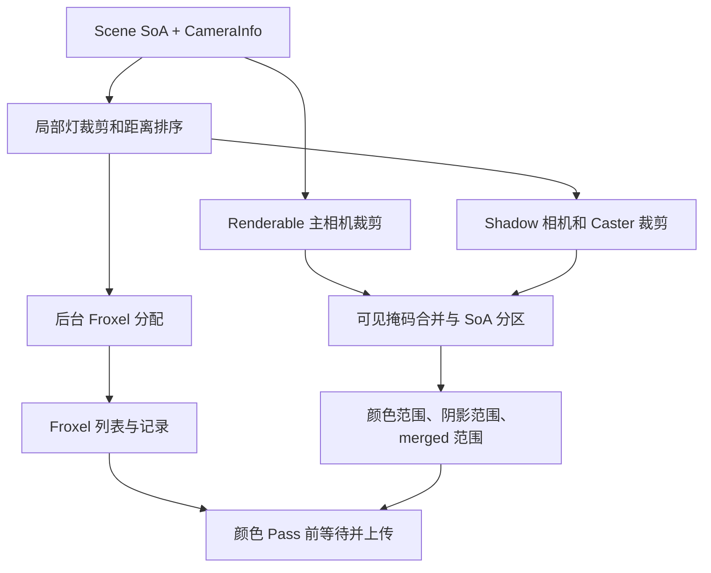

# Filament · 可见性、GPU 数据与绘制命令

[Filament 技术目录](../Filament_Rendering_Pipeline_Analysis.md) · [源码索引](SourceIndex.md#fa)

<a id="f4"></a>
## 4. 可见性与灯光：把场景缩减为本帧的工作集

### 4.1 模块架构：并行任务如何依赖



Froxel 可以与 Draw/FrameGraph 构建重叠。依赖点在颜色工作真正消费灯索引之前，并不要求一启动任务就立刻等待。[F03](SourceIndex.md#f03) [F08](SourceIndex.md#f08) [F11](SourceIndex.md#f11)

### 4.2 View::prepare 的核心控制流

```cpp
View.prepare(...):
    scene.prepare(..., sceneCache)
    lightJob = launch(prepareVisibleLights) if localLightsExist

    prepareVisibleRenderables(cullingFrustum)   // 写主视图可见位
    join(lightJob)                             // Shadow/Froxel 需稳定灯集合

    hasDynamicLighting = visibleLocalLightCount > 0
    if hasDynamicLighting:
        froxelizer.prepare(viewport, projection, near, far, ...)
        froxelJob = launch(froxelizer.froxelizeLights)

    prepareShadowing(...)                      // 写各阴影相关可见位
    combineLayerAndCastReceiveMasks()
    partitionRenderableSoa()

    visibleRange     = mainCameraRenderableRange
    dirCasterRange   = directionalShadowCasterRange
    mergedRange      = unionOfRequiredColorAndShadowCandidates

    scene.prepareVisibleRenderables(mergedRange)
    updateObjectUniforms(mergedRange)
    prepareSkinMorphInstanceDescriptors(mergedRange)
    prepareCameraAndLightingUniforms(...)
```

### 4.3 为什么分区，而不是只存 visible=true

一个对象可能不在主相机中，却给可见地面投影。FView 将 SoA 分为主相机可见、主相机与方向 caster 共有、仅方向 caster、潜在局部灯 caster、完全不可见等区域。[F03](SourceIndex.md#f03)

```cpp
// 概念化展示分区的消费关系。
colorDraws.read(mainVisibleRange);
directionalShadowDraws.read(directionalCasterRange);
punctualShadowQueries.read(mergedCandidateRange);
objectUboUpload.read(mergedRange);
```

这些范围相互重叠或共享候选，不是把一份颜色可见列表传给所有阴影视图。

### 4.4 灯的压缩：物理输入如何进入 Light SoA

LightManager 对强度做单位转换，View 负责可见性、排序和预算。主方向光按强度选出；额外方向光最多 4 个且不投影；局部灯进入动态列表。[F04](SourceIndex.md#f04) [F14](SourceIndex.md#f14) [F54](SourceIndex.md#f54)

```cpp
switch light.type:
    POINT:
        candela = inputIsCandela ? intensity : lumens / (4 * PI);
    FOCUSED_SPOT:
        candela = inputIsCandela ? intensity
                                : lumens / (2 * PI * (1 - cosOuter));
    SPOT:
        candela = inputIsCandela ? intensity : lumens / PI;
    DIRECTIONAL or SUN:
        illuminance = lux;

localRecord = {
    position, inverseRadiusSquared,
    direction, linearColor, candela,
    spotScaleOffset, channelMask, shadowMetadata
};
```

普通 Spot 的 lumen 归一化不随锥角改变，Focused Spot 则随外锥变化；两者不是相同灯类型换了一个名字。颜色可由色温辅助得到，强度仍独立处理。

### 4.5 Froxel：从空间相交到 Shader 列表

XY 切 tile，Z 按近似对数分层；每个局部灯影响一个 Froxel 子集。当前在 CPU 做相交与压缩，Shader 只查列表。[F11](SourceIndex.md#f11) [F56](SourceIndex.md#f56)

```cpp
Froxelizer.froxelizeLights(...):
    updateGridPlanesAndBoundingSpheres()

    parallel_for lightGroups:
        for localLight L:
            candidateCells = projectLightBoundsToGrid(L)
            for cell in candidateCells:
                if lightIntersectsCell(L, cell):
                    groupBitset[cell].set(L.index)

    for cell:
        lightBits = combineGroupBitsets(cell)
        if lightBits == reusableNeighborRecord:
            froxelEntry[cell] = neighborEntry
        else if recordBufferHasCapacity(lightBits.count):
            offset = appendLightIndices(lightBits)
            froxelEntry[cell] = {offset, count}
        else:
            froxelEntry[cell] = conservativeAllLightsRecord
```

当前局部灯索引与 Froxel 灯数量使用 8 位约束，全局动态光配置为 255。FroxelEntry 的 32 位字将 offset 放在高 16 位、count 放在低 8 位；Shader 按相同位段解包。容量不足的保守回退会保留照明但增加片元遍历。**CPU 输出的 offset/count 必须和 Shader 解包完全一致**，该契约将在第 11 节灯循环中消费。[F56](SourceIndex.md#f56) [F74](SourceIndex.md#f74)

### 4.6 Shadow 计划：先决定视图，再渲染深度

```cpp
prepareShadowing(...):
    if dominantDirectionalLight.castsShadows:
        fitOneToFourCascadeViews(cameraFiniteRange, relevantBounds)

    for visibleLocalLight L:
        if L.castsShadows:
            if L.isSpot:  allocateOneProjectedShadowView(L)
            if L.isPoint: allocateSixFaceViews(L)

    for shadowView:
        determineCasterCandidatesAndVisibility()
        assignAtlasRegionAndArrayLayer()
        writeLightFromWorldMatrixBiasAndFilterParameters()
```

这里形成的是阴影视图、caster 范围和 atlas 元数据；对应纹理的内容由后面的 GPU Shadow Pass 产生。颜色 Shader 同时需要“这份 CPU 参数”和“那份 GPU 纹理”，两者缺一不可。[F31](SourceIndex.md#f31)

### 4.7 阴影相机内部：划分、聚焦和稳定化

ShadowMapManager 用 cascadeSplitPositions 的比例把相机 near/far 区间划成各 cascade；实际分割位置是 near+(far-near)*fraction，不在该入口无条件套用一套固定的对数分割公式。每级临时改写裁剪投影的 near/far，再交给 ShadowMap::updateDirectional。[F31](SourceIndex.md#f31)

```cpp
for cascade in configuredCascades:
    slice = camera.withFiniteCullRange(split[cascade], split[cascade+1])
    Mv, nearZ, farZ, clippedVolume = computeDirectionalShadowBounds(
        slice, sceneCasters, sceneReceivers, optionalDepthClamp)
    if clippedVolume.isEmpty:
        markCascadeWithoutVisibleShadow()
        continue

    Mp = directionalOrthoProjection(nearZ, farZ)
    L = optionalAlignLightProjectionWithCameraForward()
    W = options.lispsm && !options.stable ? computeLiSPSMWarp(...) : identity
    focus = fitInterestingReceiverVolume(W * L * Mp * Mv, clippedVolume)
    if options.stable:
        focus = snapUsingFixedFrustumScaleAndWorldReference(focus, shadowResolution)

    S = focus * W * L * Mp * Mv
    shaderMatrix = atlasTextureMapping * S
    writeCascadeSplitMatrixLayerBiasAndTexelScale(...)
```

源码将裁剪后的接收体积聚焦到光空间的有效 XY 范围，以提高有限分辨率利用率。Stable 分支使用固定尺度并将参考位置对齐到 texel 网格，降低相机微动产生的闪烁；LiSPSM 通过光空间透视变形改善分辨率分配，与 stable 模式互斥。常量偏移结合世界尺度处理，法线偏移还依赖世界空间 texel 大小，不能只把一个固定深度常数应用到所有级联。[F75](SourceIndex.md#f75)

Spot 使用光源透视投影；Point 对六个方向分别建立视图，映射到分配的 array/atlas 位置。有效区域保留一 texel 边界，方向光边界与点光相邻面过滤的处理不同。这份 CPU 相机/分配结果随后同时进入 caster 绘制和片元 shadow 查询。[F31](SourceIndex.md#f31) [F75](SourceIndex.md#f75)

<a id="f5"></a>
## 5. GPU 数据准备：将工作集转换为 Uniform 和描述符

### 5.1 模块架构：三组数据在 Draw 时合流

| 数据 | Set | 生产者 | 消费者 |
|---|---:|---|---|
| PER_VIEW | 0 | Camera、Light、Pass 参数 | 投影、光照、屏幕纹理查询 |
| PER_RENDERABLE | 1 | 可见对象、骨骼、Morph、Instance | 变换、变形与 object flags |
| PER_MATERIAL | 2 | MaterialInstance commit | 用户材质函数 |

Set 角色固定，具体 layout 可以按材质特征与 Pass 改变。ColorPassDescriptorSet 保存不同 layout 的集合，Executor 为当前材质选择兼容的一份。[F14](SourceIndex.md#f14) [F15](SourceIndex.md#f15) [F16](SourceIndex.md#f16) [F09](SourceIndex.md#f09)

### 5.2 对象 Uniform：连续存储，按 Draw 改偏移

`PerRenderableData` 为 256 bytes，`PerViewUib` 为 2 KiB，均有静态断言。成员 offset、矩阵布局、数组 stride 和 Shader 声明共同构成 ABI。[F15](SourceIndex.md#f15)

```cpp
View.updateUBOs(mergedRange):
    objectCount = mergedRange.size()
    extraInstances = sum(explicitInstanceCounts)
    slots = objectCount + extraInstances
    if slots > capacity:
        growObjectUboWithHeadroomAndDynamicWindowPadding()

    staging = slots >= streamThreshold
        ? pool.allocate(slots * 256)
        : driver.allocatePod<PerRenderableData>(slots)

    for i in mergedRange:
        staging[i] = renderableSoa.objectUniform[i]
        if hasInstanceBuffer(i):
            appendPreparedInstanceData(staging, ...)

    driver.resetBufferObject(objectUbo)
    driver.updateBufferObjectUnsynchronized(
        objectUbo, BufferDescriptor(staging, releaseCallback), 0)

// Draw 时只改变数据窗口：
objectOffset = objectSlot * sizeof(PerRenderableData)
driver.bindDescriptorSet(objectSet, PER_RENDERABLE,
                         {objectOffset, skinningOffset})
```

例如对象槽为 7，起始偏移为 1792 bytes。显式 instancing、骨骼和 Morph 又有自己的偏移，不应混成一个“对象 ID”。

`reset/unsynchronized` 表达前端更新意图；Filament Vulkan 本基线的 reset 为 no-op，unsynchronized 更新仍走 loadFromCpu，不能据 API 名称认定已有无同步 orphan 快路径。[F03](SourceIndex.md#f03) [F09](SourceIndex.md#f09) [F71](SourceIndex.md#f71)

### 5.3 数值先准备，图资源在执行时补全

| 数据 | 何时就绪 |
|---|---|
| 相机、曝光、灯参数 | View prepare / commitUniforms |
| 对象、骨骼、材质 Buffer | 对象/材质提交 |
| Froxel 字节 | 后台任务完成，颜色前置回调上传 |
| Shadow、AO、SSR 临时 Texture | 图资源实例化后，Pass 回调取得实际 Handle |

```cpp
// 构图前：稳定数值已经可提交。
view.prepareCameraAndLighting(...)
view.commitUniforms(driver)

// Color Pass 的 CPU execute 回调：
view.prepareSSAO(resources.getTexture(data.ssao))
view.prepareSSR(resources.getTexture(data.ssr))
view.prepareShadowMapping(engine, resources.getTexture(data.shadows))
view.commitDescriptorSet(driver)
```

这解释了为何不能把 View::prepare 写成“一次上传完全部资源”。前端先建立 GPU 数据布局；FrameGraph 实例化纹理后，才补上图内生产者的输出。[F08](SourceIndex.md#f08) [F60](SourceIndex.md#f60)

### 5.4 PerView binding 骨架

| binding | 内容 | 下游算法 |
|---:|---|---|
| 0 | Frame Uniforms | 矩阵、曝光、viewport |
| 1 | Shadow records | 矩阵、layer、bias、过滤参数 |
| 2 | Lights | 局部灯属性 |
| 3 | Record Buffer | 灯索引序列 |
| 4 | Froxel Buffer | offset/count |
| 5 | Structure | 屏幕深度输入 |
| 6 | Shadow Map | shadow array/atlas |
| 7 | IBL DFG | BRDF 预积分 |
| 8 | IBL Specular | 预过滤 Cubemap |
| 9 | SSAO | AO / Bent Normal |
| 10 | SSR / SSR History | 按 Pass 的 layout 解释 |
| 11 | Fog | 雾环境纹理 |

下一阶段生成的 DrawRecord 将引用这些 Set、资源和偏移，而不复制所有 GPU 数据。[F14](SourceIndex.md#f14)

### 5.5 骨骼、Morph 和实例数据怎样沿同一路径上传

骨骼变换由调用者/资产动画层计算后进入 setBones；渲染核心接收变换并打包，不会在 Draw 时重新解析动画曲线。SkinningBuffer 将变换转为行主序的三行仿射矩阵，并保存用于法线处理的余子式数据，按 bone offset 更新 GPU Buffer。[F76](SourceIndex.md#f76)

```cpp
setBones(transforms, count, boneOffset):
    packed = driver.allocatePod<BoneData>(count)
    for i in count:
        T = transpose(transforms[i])
        C = cofactorMatrix(transforms[i].upperLeft3x3)
        packed[i].transform = {T[0], T[1], T[2]} // 矩阵按列索引，得到原矩阵的三行
        packed[i].cof0 = C[0]
        packed[i].cof1x = C[1].x
    driver.updateBufferObject(bonesUbo, packed, boneOffset * sizeof(BoneData))

setMorphWeights(weights, count, offset):
    packed = expandEachWeightToFloat4(weights)
    driver.updateBufferObject(morphUbo, packed, offset * sizeof(float4))
```

MorphTargetBuffer 将每个 target 的顶点位置/切线数据存入 array texture；权重留在 Uniform，target/vertex 坐标和 Primitive 的偏移在顶点阶段共同选择数据。[F06](SourceIndex.md#f06) [F77](SourceIndex.md#f77)

View 对 mergedRange 内对象组装 PerRenderable Descriptor：对象 Uniform、骨骼 Uniform、Morph Uniform、Morph position/tangent textures 和可选骨骼索引/权重纹理一起绑定；随后把 Descriptor Handle 写回 SoA。未启用相应能力的普通对象可共享通用对象 Set。由此可见，变形数据上传、Shader 变体选择与对象可见分区是相互配合的三步。[F03](SourceIndex.md#f03)

实例变换则进入对象 Uniform 的实例区域，由 draw 的实例数和顶点阶段实例索引消费。Shadow、Structure、Color 必须使用兼容的变形和实例输入，才能对同一个 R 得到一致的几何。

<a id="f6"></a>
## 6. 绘制命令：把可见 Primitive 转成排序后的执行记录

### 6.1 模块架构与命令记录

RenderPass 的输入是可见范围、几何、MaterialInstance、Variant 和 flags；输出是排序后的 Command 数组与 Executor。[F09](SourceIndex.md#f09) [F10](SourceIndex.md#f10)

```cpp
// 概念字段，对应 Command / PrimitiveInfo 的职责。
DrawRecord = {
    key64,
    materialInstance, variant, dynamicSpecConstKey,
    primitive, vertexInput, rasterState,
    objectSlot, objectDescriptorSet, skinningOffset, morphingOffset,
    firstElement, elementCount, instanceCount, isIndexed
}
```

这条记录把“持久资源是什么”和“本次怎样绘制”合成一个执行单元。

### 6.2 生成、程序准备、排序

```cpp
buildRenderPass(builder):
    count = computeCountFromVisiblePrimitivePrefixSums()
    commands = arena.allocate(count)

    parallel_for disjointVisibleRanges:
        for R in range:
            for P in R.primitives:
                if rejectedByPassVisibilityOrFlags(R, P):
                    continue
                cmd = gatherGeometryMaterialAndObjectBindings(R, P)
                cmd.variant = filterVariantForMaterialAndPass(...)
                cmd.specKey = dynamicLightingConditions(...)
                cmd.key64 = encodePassChannelPriorityDepthAndMaterial(...)
                append(cmd)

    appendSentinel()
    for cmd in commands:
        if cmd.isDraw:
            cmd.M.prepareProgram(cmd.variant, cmd.specKey, priority)

    sort(commands, byKey64)
    finalizeCompatibleInstancingAndScissor()
    return RenderPass(commands)
```

前缀计数让 worker 写入不重叠区间；program prepare 在受控线程进行。主 Color 列表在构图期间生成，部分 SSR/Structure 等列表在对应回调里构建，并不存在一个统一的“所有 Draw 同时生成完”的节点。

| 类别 | 排序目标 | 不能破坏的条件 |
|---|---|---|
| Depth | 减少无效工作 | 顶点位移、Alpha Test 一致 |
| Opaque | 深度分桶与状态局部性 | 利用深度剔除 |
| Refraction | 背景先完成 | 可读取有效背景 |
| Blended | back-to-front 与显式优先级 | 透明合成顺序 |
| Custom | 在特定位置插入引擎操作 | 插入点语义 |

自动实例化还需几何、Pipeline、绑定和状态兼容；相同材质不足以证明兼容。

### 6.3 Draw 分类反过来决定图结构

```cpp
colorPass = buildColorRenderPass(...)
firstRefraction = findFirstScreenSpaceRefractionCommand(colorPass)

if firstRefraction exists:
    chooseOpaqueThenRefractionGraph()
else:
    chooseSingleColorGraph()
```

Draw 系统与 FrameGraph 相互配合：图利用分类结果划分 Pass，Executor 又利用图的真实纹理和附件执行命令。[F08](SourceIndex.md#f08) [F60](SourceIndex.md#f60)
