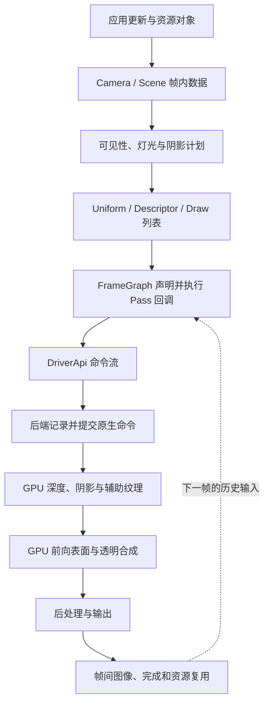
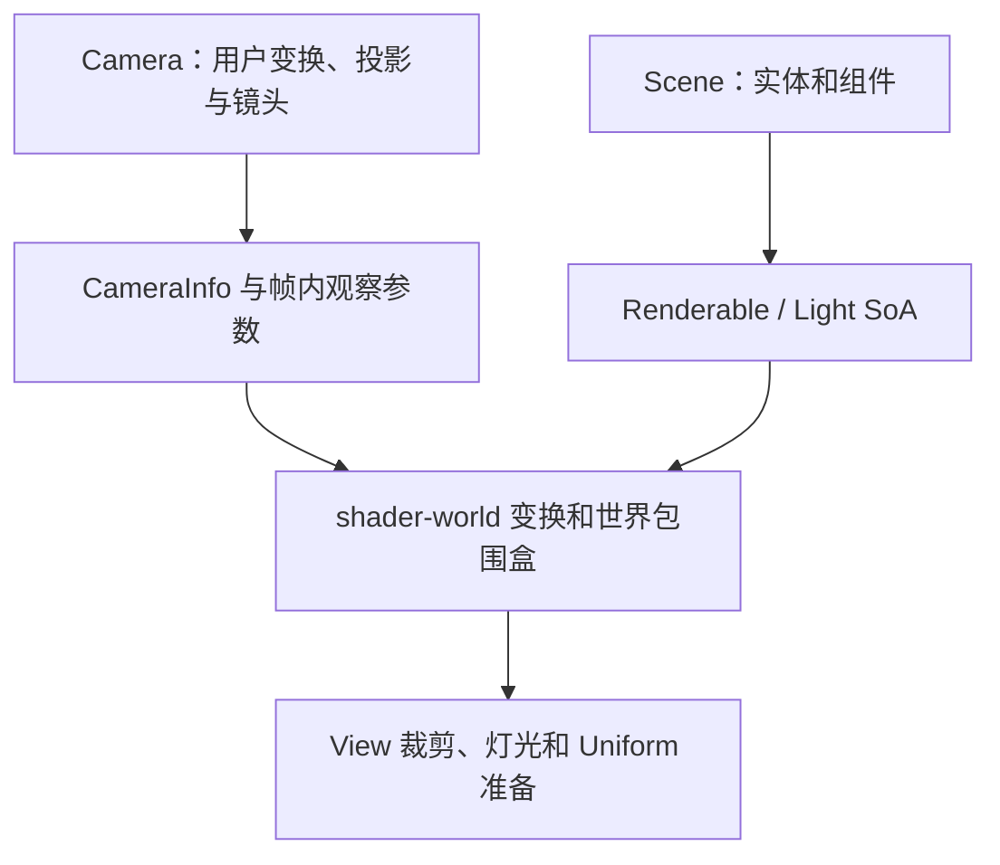
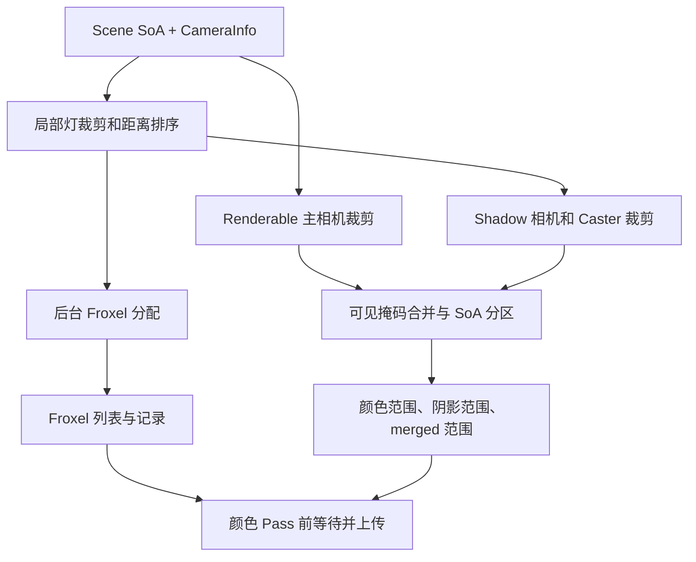
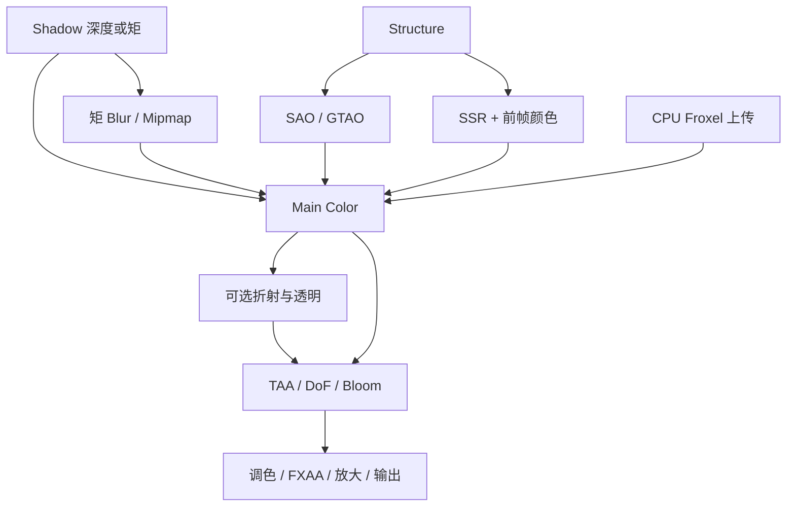
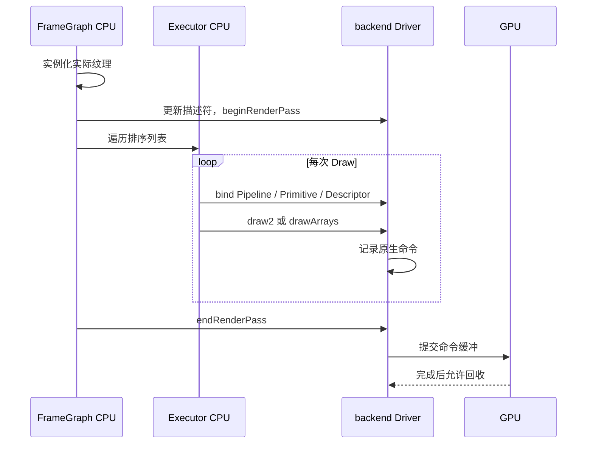

# Filament 渲染管线：架构、数据流与执行逻辑

> 分析基线：[google/filament @ b4dfdb073d5543d8569d37e0ee26f79cf794db14](https://github.com/google/filament/tree/b4dfdb073d5543d8569d37e0ee26f79cf794db14)。
> 源码许可：Apache-2.0；分析/伪代码不改变上游版权与移植时的来源保留要求。
>
> 本文按“资源进入引擎 → 一帧 CPU 准备 → Pass 与绘制命令组织 → 后端执行 → GPU 着色 → 输出与帧间复用”分析现有实现。伪代码保留依赖关系与关键分支，省略错误处理、模板和平台条件；标注“概念”的记录或辅助函数只用于解释代码，不是项目新增接口。
>
> 配套文档：[NVRHI_RHI_Vulkan_Analysis.md](NVRHI_RHI_Vulkan_Analysis.md)。两份文档分别研究渲染前端和 RHI 执行层的工作。Filament 使用自己的 backend，并不调用 NVRHI；对应关系在第 8、15 节明确说明。
>
> 本文保留上游的动画、Skin、Morph 等能力分析，不表示 Physara 采用这些功能。Physara 的静态场景范围、标准资产映射和时域采纳合同以 [Architecture.md](../Architecture.md) 为准；下文单独标出的适配边界用于解释技术依据，不替代项目架构。

## 目录

- [0. 整体架构：一帧如何贯穿全部模块](#f0)
- [1. 资源进入引擎：建立可被一帧引用的对象](#f1)
- [2. 帧开始：提交材质变化并建立执行上下文](#f2)
- [3. View 准备：从 Camera 与 Scene 得到统一的帧数据](#f3)
- [4. 可见性与灯光：把场景缩减为本帧的工作集](#f4)
- [5. GPU 数据准备：将工作集转换为 Uniform 和描述符](#f5)
- [6. 绘制命令：把可见 Primitive 转成排序后的执行记录](#f6)
- [7. FrameGraph：把 Draw 列表放入有依赖的 Pass](#f7)
- [8. 后端边界：从 Pass 回调到原生 GPU 命令](#f8)
- [9. GPU 前置阶段：深度、阴影、AO 与反射输入](#f9)
- [10. 主表面阶段：顶点数据如何变成可着色片元](#f10)
- [11. 光照求值：材质响应、直接光和 IBL 的完整调用链](#f11)
- [12. 颜色合成：折射、透明、天空、雾与自发光](#f12)
- [13. 图像输出：Resolve、TAA、镜头和显示变换](#f13)
- [14. 帧结束：提交、呈现、历史保存和资源回收](#f14)
- [15. 将一次 Draw 从头追踪到尾](#f15)
- [A. 源码索引](#fa)

<a id="f0"></a>
## 0. 整体架构：一帧如何贯穿全部模块

### 0.1 三条流在同一条管线上交汇

Filament 是 clustered forward renderer。CPU 不只提供几何数据，还要确定对象可见范围、Shader 变体、局部灯列表和 Pass 依赖；GPU 通过同一组接口约定读取这些结果，执行表面光照与图像处理。[F03] [F08] [F09]

| 流 | 起点 | 中间表达 | 终点 |
|---|---|---|---|
| 场景数据流 | Entity、Geometry、Material、Light、Camera | SoA、Uniform、Descriptor、Texture | Shader 输入 |
| 控制流 | beginFrame / render / endFrame | RenderPass 命令、FrameGraph 回调、DriverApi | 原生 Draw、提交和呈现 |
| 资源生存期流 | 创建、上传、引用 | 帧内临时资源、在途命令引用、跨帧图像 | 复用或销毁 |

**CPU 执行了 FrameGraph 回调，不代表 GPU 已执行对应 Pass。** 回调主要生成后端命令；后端记录原生命令；提交后 GPU 才消费。资源回收必须跟随自己的生存期流，而不能简单跟随 CPU 函数返回。



这里按依赖展示 GPU 工作。CPU 在进入 GPU 阶段之前，已经把这些工作对应的 Pass 都描述出来。

### 0.2 对象关系：谁持有状态，谁驱动执行

| 对象 | 直接责任 | 如何进入下一层 |
|---|---|---|
| Engine / FEngine | 资源、组件管理器、JobSystem、DriverApi、内置资源 | 提供所有帧准备所需的上下文 |
| Scene / FScene | 实体集合、Skybox、IndirectLight | prepare 生成 Renderable/Light SoA |
| Camera / FCamera | 用户投影、变换、镜头和曝光 | View 派生本帧 CameraInfo |
| View / FView | Scene、Camera、viewport、效果选项、帧历史 | prepare 得到可见工作集与 GPU 参数 |
| RenderPass | 一组可执行的几何/自定义命令 | Executor 发出 DriverApi 调用 |
| FrameGraph | Pass 与资源读写关系 | compile/execute 调度 Pass 回调 |
| backend Driver | Handle、状态和命令的原生实现 | 原生命令缓冲/图形调用 |
| Shader | 几何、材质、光照和图像算法 | 产生目标纹理和最终像素 |

Scene 决定“有什么”，View 决定“从哪里、以哪些选项渲染”，Renderer 决定“什么时候执行这一帧”。多个 View 可以共享 Scene，但可见集合、曝光、Froxel 和历史各自属于相应 View 的渲染过程。[F01] [F02] [F03] [F04]

### 0.3 一帧的总控伪代码

```cpp
// 控制流概要；具体的图声明顺序和延迟开始分支在后文展开。
if (renderer.beginFrame(swapChain)) {
    // beginFrame 成功的普通路径中：
    // backend beginFrame 已排入命令流，Engine::prepare 已提交材质变化。

    for (View V : views) {
        CameraInfo camera = V.computeCameraInfo(engine);
        CameraInfo colorCamera = applyViewportAndTaaJitter(camera); // 概念

        V.prepare(engine, driver, arena, viewport, colorCamera, ...);
        // 输出：场景 SoA、可见范围、阴影计划、Uniform、后台 Froxel job。

        FrameGraph fg(...);
        declareShadowAndScreenSpacePasses(fg, V, camera);           // 概念

        DrawCommands commands = buildColorDrawCommands(V);          // 概念
        declareColorAndRefractionPasses(fg, commands, V);           // 概念
        declarePostProcessAndOutput(fg, V);                        // 概念

        fg.compile();   // 裁去无效 Pass，确定资源首次/末次使用
        fg.execute(driver);
        // 这里调用 CPU 回调：得到实际资源、提交描述符、发后端命令。
    }

    renderer.endFrame();
    // 提交呈现相关命令，推进命令流和回收；并非 CPU 等到 GPU 全部完成。
}
```

下面始终沿同一个例子分析：View `V` 中有 Renderable `R`，其 Primitive 使用 MaterialInstance `M`，受主方向光 `D`、局部灯 `L` 和环境 IBL 影响。`R` 的变换、`M` 的参数、`L` 的光强分别进入 object、material、view/light 数据；最终在同一个片元的光照函数里重新汇合。

<a id="f1"></a>
## 1. 资源进入引擎：建立可被一帧引用的对象

### 1.1 模块架构与输入输出

这一阶段位于帧循环之前，或由流式加载按需触发。核心转换是：

| 输入 | CPU 资源对象 | 后续帧使用的内容 |
|---|---|---|
| 顶点/索引字节与格式 | VertexBuffer / IndexBuffer | 几何范围和抽象 Handle |
| 图像、mip、格式与用途 | Texture | 纹理 Handle 与采样约定 |
| 材质描述与用户 Shader | Material Package → Material | 参数布局、Shader、固定状态 |
| 实例参数与贴图 | MaterialInstance | Uniform 字节和资源绑定 |
| 变换、包围盒、Primitive | Transform/Renderable 组件 | Scene 可收集的实体记录 |

gltfio 的 AssetLoader/ResourceLoader 是资产层入口之一：前者建立实体、层级和资源描述，后者补充几何/图像数据；核心 Renderer 不在每帧重新解析 glTF。[F42] [F43] [F44] [F45] [F46]

### 1.2 几何与纹理的接收逻辑

```cpp
// 资源 API 的结构化伪代码。
vertexBuffer = buildVertexBuffer(vertexCount, attributeDescriptions);
indexBuffer  = buildIndexBuffer(indexCount, indexType);
texture      = buildTexture(dimensions, format, mipCount, usage);

// BufferDescriptor / PixelBufferDescriptor 移交数据及释放回调。
vertexBuffer.setBufferAt(engine, slot, move(vertexBytes));
indexBuffer.setBuffer(engine, move(indexBytes));
texture.setImage(engine, level, move(pixelBytes));

R = entityManager.create();
transformManager.create(R);
RenderableManager::Builder(primitiveCount)
    .geometry(0, topology, vertexBuffer, indexBuffer, offset, count)
    .material(0, M)
    .boundingBox(bounds)
    .build(engine, R);
scene.addEntity(R);
```

资源描述和内容更新分开：属性 stride/type 决定 Shader 怎样解释数据；数据上传决定对应存储里是什么字节。对 Texture，format/target/mip/usage 决定存储与 View，像素描述决定上传源的行布局、类型和压缩块解释。

源 CPU 字节的释放回调，仅说明后端不再需要该段上传源；GPU 资源的最后一次 Draw 可能还没执行。这一所有权会在第 8 节后端上传路径中继续追踪。

### 1.3 Material Package：编译阶段先建立 Shader ABI

```cpp
// MaterialBuilder / ShaderGenerator / 语义分析的等价流程。
package = compileMaterial(description, userCode) {
    parseParameterAndSamplerDeclarations();
    analyzeMaterialPropertyAccesses(userCode);
    validatePrepareMaterialCallChain();

    features = propertiesActuallyUsedByMaterial;
    interfaces = generateUniformSamplerAndVaryingInterfaces(features);

    for (backendTarget, shaderModel, supportedVariant) {
        source = assembleEngineShaderAndUserFunctions(
            interfaces, shadingModel, features, supportedVariant);
        code = compileOptimizeAndTranslate(source, backendTarget);
        package.add(code, interfaces, rasterAndBlendMetadata);
    }
    return package;
}
```

编译器从实际属性访问决定启用的功能。normal、clearCoat、anisotropy 等不仅改变片元公式，还可能改变顶点属性、varying、sampler 和程序组合。因此包内的 Shader 与运行时参数布局必须一致。[F21] [F22] [F23] [F70]

### 1.4 Material 与实例如何连接到一帧

```cpp
material = Material::Builder().package(packageBytes).build(engine);
M = material.createInstance();

M.setParameter("baseColor", linearColor);
M.setParameter("roughness", p);
M.setParameter("albedo", texture, sampler);

// 修改写入 CPU 参数与脏标记。
// 真正 Uniform / Descriptor 提交由 Engine::prepare 或显式 commit 推进。
```

Material 保存模板、接口与程序；实例保存参数和绑定。程序选择还分三层：

| 条件 | 表达位置 | 作用 |
|---|---|---|
| 有无法线、清漆、虹彩等 | 属性分析/编译功能 | 决定 Shader 结构 |
| Depth、SSR、stereo、skinning 等 | Variant | 选择渲染用途 |
| 动态光、方向光、额外方向光等 | DynamicSpecConstKey / specialization | 固化本次执行条件 |

本阶段输出的资源仍是持久对象；下一阶段不会重新创建它们，而是提交变化并从它们提取本帧所需数据。[F19] [F20] [F47]

<a id="f2"></a>
## 2. 帧开始：提交材质变化并建立执行上下文

### 2.1 模块架构

`FRenderer::beginFrame` 负责建立当前 SwapChain、推进 Stream/后端周期任务、进行帧节奏判断，再在实际开始帧时调用 `FEngine::prepare`。[F02] [F08]

```cpp
beginFrame(sc):
    frameId++
    currentSwapChain = sc
    sc.makeCurrent(driver)
    driver.updateStreams(...)
    driver.tick()

    beginWork = lambda:
        driver.beginFrame(time, interval, frameId)
        updateFrameTimingAndUserHistory()
        engine.prepare(driver)

    if shouldRenderFrame() or pacedPresentationRequested:
        beginWork()
        return true

    deferredBeginWork = beginWork
    currentSwapChain = null
    engine.flush()
    return false
```

返回 false 的路径保留延迟开始闭包；若调用方仍调用 render/end，源码会推进这部分工作。普通应用入口按 true 时 render/end 理解即可，但内部“开始一帧”并不等同于单一固定位置的一段函数体。

### 2.2 Engine::prepare 怎样处理上一阶段的变化

```cpp
Engine.prepare(driver):
    if uboBatchingEnabled:
        uboManager.beginFrame(driver)

    for each materialInstance M:
        if M.domain == SURFACE:
            M.commit(driver, uboManager)

    if uboBatchingEnabled:
        uboManager.finishBeginFrame(driver)

MaterialInstance.commit(...):
    if uniformDataDirty:
        if usingUboBatching:
            allocateOrUpdateSharedUboRegion()
        else:
            driver.updateBufferObject(materialUbo, sourceBytes)
        clearUniformDirty()

    ensureUboAllocationHasDescriptorBinding()
    descriptorSet.commit(layout, driver)
```

后处理实例通常在本帧中途才设置参数，因此不靠这一次全局 Surface commit 完成。相同地，“对象存在”不代表每帧都上传：dirty 条件控制实际更新，小材质参数还能聚合进共享 UBO。[F02] [F47]

**进入下一阶段的状态**：`M` 的变化已进入后端命令流，Engine 可为本帧 View 准备提供一致的资源/程序接口。View 接下来处理 Camera、Scene 和可见性，决定哪些资源会被 Draw 消费。

<a id="f3"></a>
## 3. View 准备：从 Camera 与 Scene 得到统一的帧数据

### 3.1 模块架构：两份输入合成一份观察状态



CameraInfo 规定“本帧怎样观察”；Scene SoA 规定“需要观察的连续数据”。它们必须使用同一 shader-world/world-origin 契约，否则 CPU AABB、灯位置、GPU 模型矩阵会描述不同空间。[F03] [F04] [F12]

### 3.2 Camera：投影、裁剪和图像采样分开

相机看向局部 -Z，view 是 Camera model 的逆。标准透视 API 保留有限 far 的 culling projection，同时令渲染投影的远平面趋于无穷。自定义投影由调用者提供相应矩阵。[F12]

```cpp
camera.model = cameraEntity.worldTransform;
camera.view  = inverse(camera.model);

// 标准透视 setter 内部的两份语义。
camera.cullingProjection = perspective(near, finiteFar, fov, aspect);
camera.renderProjection  = perspective(near, infinity, fov, aspect);

// 渲染投影转换到内部反向 [0,1] 深度。
camera.renderProjection = reversedZeroToOne * camera.renderProjection;

stableCamera = computeCameraInfo(camera);
paddedCamera = adjustProjectionForViewportAndGuardBand(stableCamera); // 概念
colorCamera  = applyTaaJitter(paddedCamera);                          // 概念
```

主相机 Reverse-Z 要和 clear depth、depth compare、重建深度一起使用；culling projection 保持自己的稳定语义。当前 color 使用 jittered CameraInfo，Structure 等路径使用相应稳定参数。viewport padding、guard band 和动态分辨率还决定屏幕纹理的物理/逻辑坐标映射。

焦距 setter 使用 24 mm 垂直传感器尺寸：

```text
fovY = 2 * atan(24 mm / (2 * focalLength_mm))
halfHeight = near * tan(fovY / 2)
halfWidth  = halfHeight * aspect
```

### 3.3 曝光为何在 CPU 准备阶段就出现

```cpp
EV100 = log2((aperture * aperture / shutterSeconds) * (100 / ISO));
exposure = 1 / (1.2 * exp2(EV100));

// 方向光和环境在 View 参数准备时预曝光。
directionalIntensityForShader = lux * exposure;
iblIntensityForShader         = environmentIntensity * exposure;

// 局部灯保留光强，Shader 后续结合 exposure 处理。
localLightRecord.intensity = candela;
frameUniforms.exposure = exposure;
```

这样光照累加前就缩放到更适合 FP16 的数值范围。曝光不是后处理 Gamma；相机光圈还会在 DoF 中决定 CoC，因此 Camera 的数据同时流向光照和镜头处理。[F13] [F16]

### 3.4 Scene::prepare：由 Entity 管理转为连续遍历

```cpp
Scene.prepare(worldTransform, cache):
    transformManager.ensureWorldTransformsUpToDate()

    renderableInstances = []
    localLightInstances = []
    directionalInstances = []

    for entity in scene.entities:
        if not entityManager.isAlive(entity):
            continue
        collectExistingComponents(entity)
        if renderable.instanceCount > 0:
            renderableInstances.append(renderable, transform)
        classifyLightIntoDirectionalOrLocalLists()

    chooseDominantAndExtraDirectionalLights()
    resizeSoaStorageToVectorFriendlyCapacity()

    parallel_for renderableInstances:
        shaderWorld = float(worldTransform * accurateWorldTransform)
        bounds = transformLocalAabb(localBounds, shaderWorld)
        reversedWinding = determinant(shaderWorld.linearPart) < 0
        writeRenderableSoa(shaderWorld, bounds, flags, resources)

    parallel_for localLightInstances:
        writeLightSoa(transformedPosition, direction, radius, lightData)
```

世界变换在这一步由高精度表示转入 Shader 使用的 float 空间；负缩放影响 winding，不只是法线。SoA 将 bounds、变换、可见标记、资源引用分列，允许接下来的裁剪循环只读热点字段。[F04] [F05] [F06]

本阶段还未生成最终可见列表。其输出是“可供批处理的 Scene 数据 + CameraInfo”，下一阶段用两者筛出颜色与各阴影视图的工作集。

<a id="f4"></a>
## 4. 可见性与灯光：把场景缩减为本帧的工作集

### 4.1 模块架构：并行任务如何依赖



Froxel 可以与 Draw/FrameGraph 构建重叠。依赖点在颜色工作真正消费灯索引之前，并不要求一启动任务就立刻等待。[F03] [F08] [F11]

### 4.2 View::prepare 的核心控制流

```cpp
View.prepare(...):
    scene.prepare(..., sceneCache)
    lightJob = launch(prepareVisibleLights) if localLightsExist

    prepareVisibleRenderables(cullingFrustum)   // 写主视图可见位
    join(lightJob)                             // Shadow/Froxel 需稳定灯集合

    hasDynamicLighting = visibleLocalLightCount > 0
    if hasDynamicLighting:
        froxelizer.prepare(viewport, projection, near, far, ...)
        froxelJob = launch(froxelizer.froxelizeLights)

    prepareShadowing(...)                      // 写各阴影相关可见位
    combineLayerAndCastReceiveMasks()
    partitionRenderableSoa()

    visibleRange     = mainCameraRenderableRange
    dirCasterRange   = directionalShadowCasterRange
    mergedRange      = unionOfRequiredColorAndShadowCandidates

    scene.prepareVisibleRenderables(mergedRange)
    updateObjectUniforms(mergedRange)
    prepareSkinMorphInstanceDescriptors(mergedRange)
    prepareCameraAndLightingUniforms(...)
```

### 4.3 为什么分区，而不是只存 visible=true

一个对象可能不在主相机中，却给可见地面投影。FView 将 SoA 分为主相机可见、主相机与方向 caster 共有、仅方向 caster、潜在局部灯 caster、完全不可见等区域。[F03]

```cpp
// 概念化展示分区的消费关系。
colorDraws.read(mainVisibleRange);
directionalShadowDraws.read(directionalCasterRange);
punctualShadowQueries.read(mergedCandidateRange);
objectUboUpload.read(mergedRange);
```

这些范围相互重叠或共享候选，不是把一份颜色可见列表传给所有阴影视图。

### 4.4 灯的压缩：物理输入如何进入 Light SoA

LightManager 对强度做单位转换，View 负责可见性、排序和预算。主方向光按强度选出；额外方向光最多 4 个且不投影；局部灯进入动态列表。[F04] [F14] [F54]

```cpp
switch light.type:
    POINT:
        candela = inputIsCandela ? intensity : lumens / (4 * PI);
    FOCUSED_SPOT:
        candela = inputIsCandela ? intensity
                                : lumens / (2 * PI * (1 - cosOuter));
    SPOT:
        candela = inputIsCandela ? intensity : lumens / PI;
    DIRECTIONAL or SUN:
        illuminance = lux;

localRecord = {
    position, inverseRadiusSquared,
    direction, linearColor, candela,
    spotScaleOffset, channelMask, shadowMetadata
};
```

普通 Spot 的 lumen 归一化不随锥角改变，Focused Spot 则随外锥变化；两者不是相同灯类型换了一个名字。颜色可由色温辅助得到，强度仍独立处理。

### 4.5 Froxel：从空间相交到 Shader 列表

XY 切 tile，Z 按近似对数分层；每个局部灯影响一个 Froxel 子集。当前在 CPU 做相交与压缩，Shader 只查列表。[F11] [F56]

```cpp
Froxelizer.froxelizeLights(...):
    updateGridPlanesAndBoundingSpheres()

    parallel_for lightGroups:
        for localLight L:
            candidateCells = projectLightBoundsToGrid(L)
            for cell in candidateCells:
                if lightIntersectsCell(L, cell):
                    groupBitset[cell].set(L.index)

    for cell:
        lightBits = combineGroupBitsets(cell)
        if lightBits == reusableNeighborRecord:
            froxelEntry[cell] = neighborEntry
        else if recordBufferHasCapacity(lightBits.count):
            offset = appendLightIndices(lightBits)
            froxelEntry[cell] = {offset, count}
        else:
            froxelEntry[cell] = conservativeAllLightsRecord
```

当前局部灯索引与 Froxel 灯数量使用 8 位约束，全局动态光配置为 255。FroxelEntry 的 32 位字将 offset 放在高 16 位、count 放在低 8 位；Shader 按相同位段解包。容量不足的保守回退会保留照明但增加片元遍历。**CPU 输出的 offset/count 必须和 Shader 解包完全一致**，该契约将在第 11 节灯循环中消费。[F56] [F74]

### 4.6 Shadow 计划：先决定视图，再渲染深度

```cpp
prepareShadowing(...):
    if dominantDirectionalLight.castsShadows:
        fitOneToFourCascadeViews(cameraFiniteRange, relevantBounds)

    for visibleLocalLight L:
        if L.castsShadows:
            if L.isSpot:  allocateOneProjectedShadowView(L)
            if L.isPoint: allocateSixFaceViews(L)

    for shadowView:
        determineCasterCandidatesAndVisibility()
        assignAtlasRegionAndArrayLayer()
        writeLightFromWorldMatrixBiasAndFilterParameters()
```

这里形成的是阴影视图、caster 范围和 atlas 元数据；对应纹理的内容由后面的 GPU Shadow Pass 产生。颜色 Shader 同时需要“这份 CPU 参数”和“那份 GPU 纹理”，两者缺一不可。[F31]

### 4.7 阴影相机内部：划分、聚焦和稳定化

ShadowMapManager 用 cascadeSplitPositions 的比例把相机 near/far 区间划成各 cascade；实际分割位置是 near+(far-near)*fraction，不在该入口无条件套用一套固定的对数分割公式。每级临时改写裁剪投影的 near/far，再交给 ShadowMap::updateDirectional。[F31]

```cpp
for cascade in configuredCascades:
    slice = camera.withFiniteCullRange(split[cascade], split[cascade+1])
    Mv, nearZ, farZ, clippedVolume = computeDirectionalShadowBounds(
        slice, sceneCasters, sceneReceivers, optionalDepthClamp)
    if clippedVolume.isEmpty:
        markCascadeWithoutVisibleShadow()
        continue

    Mp = directionalOrthoProjection(nearZ, farZ)
    L = optionalAlignLightProjectionWithCameraForward()
    W = options.lispsm && !options.stable ? computeLiSPSMWarp(...) : identity
    focus = fitInterestingReceiverVolume(W * L * Mp * Mv, clippedVolume)
    if options.stable:
        focus = snapUsingFixedFrustumScaleAndWorldReference(focus, shadowResolution)

    S = focus * W * L * Mp * Mv
    shaderMatrix = atlasTextureMapping * S
    writeCascadeSplitMatrixLayerBiasAndTexelScale(...)
```

源码将裁剪后的接收体积聚焦到光空间的有效 XY 范围，以提高有限分辨率利用率。Stable 分支使用固定尺度并将参考位置对齐到 texel 网格，降低相机微动产生的闪烁；LiSPSM 通过光空间透视变形改善分辨率分配，与 stable 模式互斥。常量偏移结合世界尺度处理，法线偏移还依赖世界空间 texel 大小，不能只把一个固定深度常数应用到所有级联。[F75]

Spot 使用光源透视投影；Point 对六个方向分别建立视图，映射到分配的 array/atlas 位置。有效区域保留一 texel 边界，方向光边界与点光相邻面过滤的处理不同。这份 CPU 相机/分配结果随后同时进入 caster 绘制和片元 shadow 查询。[F31] [F75]


<a id="f5"></a>
## 5. GPU 数据准备：将工作集转换为 Uniform 和描述符

### 5.1 模块架构：三组数据在 Draw 时合流

| 数据 | Set | 生产者 | 消费者 |
|---|---:|---|---|
| PER_VIEW | 0 | Camera、Light、Pass 参数 | 投影、光照、屏幕纹理查询 |
| PER_RENDERABLE | 1 | 可见对象、骨骼、Morph、Instance | 变换、变形与 object flags |
| PER_MATERIAL | 2 | MaterialInstance commit | 用户材质函数 |

Set 角色固定，具体 layout 可以按材质特征与 Pass 改变。ColorPassDescriptorSet 保存不同 layout 的集合，Executor 为当前材质选择兼容的一份。[F14] [F15] [F16] [F09]

### 5.2 对象 Uniform：连续存储，按 Draw 改偏移

`PerRenderableData` 为 256 bytes，`PerViewUib` 为 2 KiB，均有静态断言。成员 offset、矩阵布局、数组 stride 和 Shader 声明共同构成 ABI。[F15]

```cpp
View.updateUBOs(mergedRange):
    objectCount = mergedRange.size()
    extraInstances = sum(explicitInstanceCounts)
    slots = objectCount + extraInstances
    if slots > capacity:
        growObjectUboWithHeadroomAndDynamicWindowPadding()

    staging = slots >= streamThreshold
        ? pool.allocate(slots * 256)
        : driver.allocatePod<PerRenderableData>(slots)

    for i in mergedRange:
        staging[i] = renderableSoa.objectUniform[i]
        if hasInstanceBuffer(i):
            appendPreparedInstanceData(staging, ...)

    driver.resetBufferObject(objectUbo)
    driver.updateBufferObjectUnsynchronized(
        objectUbo, BufferDescriptor(staging, releaseCallback), 0)

// Draw 时只改变数据窗口：
objectOffset = objectSlot * sizeof(PerRenderableData)
driver.bindDescriptorSet(objectSet, PER_RENDERABLE,
                         {objectOffset, skinningOffset})
```

例如对象槽为 7，起始偏移为 1792 bytes。显式 instancing、骨骼和 Morph 又有自己的偏移，不应混成一个“对象 ID”。

`reset/unsynchronized` 表达前端更新意图；Filament Vulkan 本基线的 reset 为 no-op，unsynchronized 更新仍走 loadFromCpu，不能据 API 名称认定已有无同步 orphan 快路径。[F03] [F09] [F71]

### 5.3 数值先准备，图资源在执行时补全

| 数据 | 何时就绪 |
|---|---|
| 相机、曝光、灯参数 | View prepare / commitUniforms |
| 对象、骨骼、材质 Buffer | 对象/材质提交 |
| Froxel 字节 | 后台任务完成，颜色前置回调上传 |
| Shadow、AO、SSR 临时 Texture | 图资源实例化后，Pass 回调取得实际 Handle |

```cpp
// 构图前：稳定数值已经可提交。
view.prepareCameraAndLighting(...)
view.commitUniforms(driver)

// Color Pass 的 CPU execute 回调：
view.prepareSSAO(resources.getTexture(data.ssao))
view.prepareSSR(resources.getTexture(data.ssr))
view.prepareShadowMapping(engine, resources.getTexture(data.shadows))
view.commitDescriptorSet(driver)
```

这解释了为何不能把 View::prepare 写成“一次上传完全部资源”。前端先建立 GPU 数据布局；FrameGraph 实例化纹理后，才补上图内生产者的输出。[F08] [F60]

### 5.4 PerView binding 骨架

| binding | 内容 | 下游算法 |
|---:|---|---|
| 0 | Frame Uniforms | 矩阵、曝光、viewport |
| 1 | Shadow records | 矩阵、layer、bias、过滤参数 |
| 2 | Lights | 局部灯属性 |
| 3 | Record Buffer | 灯索引序列 |
| 4 | Froxel Buffer | offset/count |
| 5 | Structure | 屏幕深度输入 |
| 6 | Shadow Map | shadow array/atlas |
| 7 | IBL DFG | BRDF 预积分 |
| 8 | IBL Specular | 预过滤 Cubemap |
| 9 | SSAO | AO / Bent Normal |
| 10 | SSR / SSR History | 按 Pass 的 layout 解释 |
| 11 | Fog | 雾环境纹理 |

下一阶段生成的 DrawRecord 将引用这些 Set、资源和偏移，而不复制所有 GPU 数据。[F14]

### 5.5 骨骼、Morph 和实例数据怎样沿同一路径上传

骨骼变换由调用者/资产动画层计算后进入 setBones；渲染核心接收变换并打包，不会在 Draw 时重新解析动画曲线。SkinningBuffer 将变换转为行主序的三行仿射矩阵，并保存用于法线处理的余子式数据，按 bone offset 更新 GPU Buffer。[F76]

```cpp
setBones(transforms, count, boneOffset):
    packed = driver.allocatePod<BoneData>(count)
    for i in count:
        T = transpose(transforms[i])
        C = cofactorMatrix(transforms[i].upperLeft3x3)
        packed[i].transform = {T[0], T[1], T[2]} // 矩阵按列索引，得到原矩阵的三行
        packed[i].cof0 = C[0]
        packed[i].cof1x = C[1].x
    driver.updateBufferObject(bonesUbo, packed, boneOffset * sizeof(BoneData))

setMorphWeights(weights, count, offset):
    packed = expandEachWeightToFloat4(weights)
    driver.updateBufferObject(morphUbo, packed, offset * sizeof(float4))
```

MorphTargetBuffer 将每个 target 的顶点位置/切线数据存入 array texture；权重留在 Uniform，target/vertex 坐标和 Primitive 的偏移在顶点阶段共同选择数据。[F06] [F77]

View 对 mergedRange 内对象组装 PerRenderable Descriptor：对象 Uniform、骨骼 Uniform、Morph Uniform、Morph position/tangent textures 和可选骨骼索引/权重纹理一起绑定；随后把 Descriptor Handle 写回 SoA。未启用相应能力的普通对象可共享通用对象 Set。由此可见，变形数据上传、Shader 变体选择与对象可见分区是相互配合的三步。[F03]

实例变换则进入对象 Uniform 的实例区域，由 draw 的实例数和顶点阶段实例索引消费。Shadow、Structure、Color 必须使用兼容的变形和实例输入，才能对同一个 R 得到一致的几何。


<a id="f6"></a>
## 6. 绘制命令：把可见 Primitive 转成排序后的执行记录

### 6.1 模块架构与命令记录

RenderPass 的输入是可见范围、几何、MaterialInstance、Variant 和 flags；输出是排序后的 Command 数组与 Executor。[F09] [F10]

```cpp
// 概念字段，对应 Command / PrimitiveInfo 的职责。
DrawRecord = {
    key64,
    materialInstance, variant, dynamicSpecConstKey,
    primitive, vertexInput, rasterState,
    objectSlot, objectDescriptorSet, skinningOffset, morphingOffset,
    firstElement, elementCount, instanceCount, isIndexed
}
```

这条记录把“持久资源是什么”和“本次怎样绘制”合成一个执行单元。

### 6.2 生成、程序准备、排序

```cpp
buildRenderPass(builder):
    count = computeCountFromVisiblePrimitivePrefixSums()
    commands = arena.allocate(count)

    parallel_for disjointVisibleRanges:
        for R in range:
            for P in R.primitives:
                if rejectedByPassVisibilityOrFlags(R, P):
                    continue
                cmd = gatherGeometryMaterialAndObjectBindings(R, P)
                cmd.variant = filterVariantForMaterialAndPass(...)
                cmd.specKey = dynamicLightingConditions(...)
                cmd.key64 = encodePassChannelPriorityDepthAndMaterial(...)
                append(cmd)

    appendSentinel()
    for cmd in commands:
        if cmd.isDraw:
            cmd.M.prepareProgram(cmd.variant, cmd.specKey, priority)

    sort(commands, byKey64)
    finalizeCompatibleInstancingAndScissor()
    return RenderPass(commands)
```

前缀计数让 worker 写入不重叠区间；program prepare 在受控线程进行。主 Color 列表在构图期间生成，部分 SSR/Structure 等列表在对应回调里构建，并不存在一个统一的“所有 Draw 同时生成完”的节点。

| 类别 | 排序目标 | 不能破坏的条件 |
|---|---|---|
| Depth | 减少无效工作 | 顶点位移、Alpha Test 一致 |
| Opaque | 深度分桶与状态局部性 | 利用深度剔除 |
| Refraction | 背景先完成 | 可读取有效背景 |
| Blended | back-to-front 与显式优先级 | 透明合成顺序 |
| Custom | 在特定位置插入引擎操作 | 插入点语义 |

自动实例化还需几何、Pipeline、绑定和状态兼容；相同材质不足以证明兼容。

### 6.3 Draw 分类反过来决定图结构

```cpp
colorPass = buildColorRenderPass(...)
firstRefraction = findFirstScreenSpaceRefractionCommand(colorPass)

if firstRefraction exists:
    chooseOpaqueThenRefractionGraph()
else:
    chooseSingleColorGraph()
```

Draw 系统与 FrameGraph 相互配合：图利用分类结果划分 Pass，Executor 又利用图的真实纹理和附件执行命令。[F08] [F60]

<a id="f7"></a>
## 7. FrameGraph：把 Draw 列表放入有依赖的 Pass

### 7.1 模块架构

| 层 | 描述 | 解决的问题 |
|---|---|---|
| FrameGraph | Pass、资源版本、usage | 谁生产、谁读取 |
| 图内 RenderPass 声明 | attachments、clear、samples、viewport | 怎样建立目标 |
| RenderPass::Command | 排序 Draw 与自定义操作 | 目标内的执行顺序 |



这是合并可选分支的依赖图。SSR 使用前帧颜色，屏幕折射可使用本帧不透明背景；两者不是同一个纹理生产阶段。[F07] [F08] [F60]

### 7.2 setup 处理虚拟资源，execute 处理实际 Handle

```cpp
fg.addPass("Color",
    setup(builder, data):
        data.shadow = builder.sample(shadowResult)
        data.ao = builder.sample(aoResult)
        data.ssr = builder.sample(ssrResult)
        data.color = builder.createTexture(colorDesc)
        data.color = builder.write(data.color, COLOR_ATTACHMENT)
        data.depth = builder.write(depth, DEPTH_ATTACHMENT)
        builder.declareRenderPass(attachments, clearFlags, samples)

    execute(resources, data, driver):
        bindActualPassTextures(resources, data)
        view.commitDescriptorSet(driver)
        rp = resources.getRenderPassInfo()
        driver.beginRenderPass(rp.target, rp.params)
        drawExecutor.execute(engine, driver)
        driver.endRenderPass()
)
```

### 7.3 编译和执行如何衔接

```cpp
FrameGraph.compile():
    dependencyGraph.cull()
    stablePartitionActivePasses()
    for activePass in constructionOrder:
        registerResourceReadsAndWrites()
    for liveResource:
        resource.firstUser.devirtualizeList.add(resource)
        resource.lastUser.destroyList.add(resource)
    resolveAttachmentRequirements()

FrameGraph.execute(driver):
    for pass in activeConstructionOrder:
        for resource in pass.devirtualizeList:
            resource.createThroughAllocatorOrTextureCache()
        pass.execute(FrameGraphResources(...), driver)
        for resource in pass.destroyList:
            resource.releaseThroughAllocatorOrTextureCache()
```

当前是有效 Pass 按构建顺序执行的模型；图本身不自动变成跨队列调度器。逻辑 release 可进入 TextureCache，不能视作此时 GPU 已完成或立即物理释放。[F07] [F49] [F50]

### 7.4 Froxel 等待点如何嵌入图

```cpp
// Renderer 的 Prepare Color Passes 有副作用回调：
executePrepareColor():
    prepareOptionalSubpassResolveAndChannelClearMaterials()
    if view.froxelJob exists:
        join(view.froxelJob)
        view.commitFroxels(driver, arena)
```

前面的图工作可以先推进，后台任务与图编译重叠；到颜色消费灯列表前，CPU join 与 Buffer 更新保证输入已产生。第 8 节就在这个 execute 边界将全部数据与 Draw 汇合。[F08]

<a id="f8"></a>
## 8. 后端边界：从 Pass 回调到原生 GPU 命令

### 8.1 完整调用链



DriverApi 的 CPU 命令流通常位于 Executor 与具体 Driver 之间，解耦前端与后端执行；配置也可能采用单线程路径。[F02] [F17] [F18]

### 8.2 Executor 的状态机

```cpp
Executor.execute():
    currentMaterial = null
    currentPipeline = empty
    currentPrimitive = null

    for cmd in sortedCommands:
        if cmd.isCustom:
            cmd.callback()
            continue

        M = cmd.materialInstance
        if M != currentMaterial:
            selectPerViewLayoutCompatibleWith(M, cmd.variant)
            bindCorrespondingPerViewSet()
            M.use(driver, cmd.variant)                    // PER_MATERIAL
            applyMaterialScissorStencilAndOffsets()
            currentMaterial = M

        pipeline = gatherPipelineState(cmd, M)            // 概念
        if pipeline != currentPipeline:
            driver.bindPipeline(pipeline)
            currentPipeline = pipeline
        if cmd.primitive != currentPrimitive:
            driver.bindRenderPrimitive(cmd.primitive)
            currentPrimitive = cmd.primitive

        driver.bindDescriptorSet(cmd.objectSet, PER_RENDERABLE,
                                 {cmd.objectSlot * 256, cmd.skinningOffset})
        if cmd.hasMorphing:
            driver.setPushConstant(VERTEX, MORPHING_BUFFER_OFFSET,
                                   cmd.morphingOffset)

        if cmd.isIndexed:
            driver.draw2(cmd.first, cmd.count, cmd.instanceCount)
        else:
            driver.drawArrays(cmd.first, cmd.count, cmd.instanceCount)
```

此处是 `R`、`M` 与 View 灯光绑定的汇合点。绑定到位后，GPU 顶点/片元阶段才会读取对应字节。[F09]

### 8.3 CommandStream 的参数所有权

```cpp
// 返回资源身份的典型 S/R 分离。
handle = driver.createResourceS()
stream.record(createResourceR, handle, copiedDescription)

// 延迟调用必须持有参数。
stream.record(updateBuffer, handle, move(BufferDescriptor))
stream.record(bindDescriptorSet, setHandle, copiedOffsets)
stream.record(draw2, firstIndex, count, instanceCount)

// 后端消费。
for command in cpuCommandBuffer:
    dispatcher.invokeConcreteDriver(command)
```

同步获得 Handle 不等于原生创建完成；BufferDescriptor 的回调也不等于 GPU 最后使用完成。同步查询有另外的调用约定，不能把所有 API 都视为相同异步方式。[F17] [F18]

### 8.4 Filament Vulkan 的原生落点

| Driver 请求 | Vulkan 实现 |
|---|---|
| updateBufferObject | 取得 VulkanBufferObject，loadFromCpu，持有资源并调度上传源释放 |
| beginRenderPass | 处理 acquire、附件布局、command buffer 与 RenderPass/FBO cache |
| bindPipeline | 根据 Shader、vertex input、raster、target/layout 选 Pipeline |
| bindDescriptorSet | 保存 Set 与动态 offset，按需要处理 external sampler |
| draw2 | prepareDraw 提交描述符，再 vkCmdDrawIndexed |
| drawArrays | prepareDraw 后 vkCmdDraw |
| commit / flush | 提交、呈现依赖与完成回收 |

```cpp
VulkanDriver.draw2(firstIndex, count, instances):
    if noPrimitiveBound:
        return
    prepareDraw():
        finalizeExternalSamplerDependentLayoutIfNeeded()
        descriptorSetCache.commit(cmd, pipelineLayout, setMask)
    vkCmdDrawIndexed(cmd.buffer, count, instances, firstIndex, 0, 0)
```

本基线 Filament Vulkan 用 RenderPass/FBO cache；配套文档的 NVRHI Vulkan 用 dynamic rendering。同职责不意味着同实现。[F71] [F72]

材质工具链和接口中存在 Compute 相关能力，但该基线 VulkanDriver::dispatchCompute 仍为空的 FIXME 实现。不能由接口存在推断这条后端路径已经能执行 Compute；本文追踪的主要表面与后处理链使用实际的 Raster Draw 路径。[F21] [F71]

### 8.5 两份分析的连接点

| 前端已经确定 | 后端 / RHI 落实 |
|---|---|
| Pass 读写的纹理和附件 | View、attachment、状态转换 |
| Shader 与固定状态 | Pipeline / PipelineLayout |
| View、Material、Object 的数据 | Descriptor 与动态偏移 |
| 几何范围和实例数 | 顶点/索引绑定和原生 Draw |
| 后续 Pass/下一帧的消费 | 屏障、提交、在途引用与完成 |

[NVRHI 第 0、7–12 节](NVRHI_RHI_Vulkan_Analysis.md#n0)继续拆解这一层职责。Filament 与 NVRHI 没有直接依赖关系，这里对齐的是输入/输出含义。下面转入 GPU 的执行视角，追踪这些输入如何产生图像。

<a id="f9"></a>
## 9. GPU 前置阶段：深度、阴影、AO 与反射输入

### 9.1 模块架构：主颜色需要哪些已完成结果

| 生产阶段 | 使用的 CPU 准备结果 | 产生的 GPU 资源 | 主颜色的消费方式 |
|---|---|---|---|
| Shadow | shadow camera、caster、atlas 参数 | 深度或指数矩 array | 每灯 visibility |
| Structure | 稳定相机、几何深度变体 | 深度与层级/辅助信息 | AO、Contact、SSR |
| SAO/GTAO | AO 配置、viewport 映射 | AO / 可选 Bent Normal | 间接光遮蔽 |
| SSR | 表面反射变体、相机重投影、前帧颜色 | 反射色与置信度 | 与镜面 IBL 融合 |

这些不是完整材质 G-buffer。主颜色仍在 Surface Shader 内求 BRDF 与光照。[F28] [F31] [F34]

### 9.2 Shadow Pass：同一几何在光源视角重画

```cpp
for shadowView in shadowPlan:
    bindShadowViewUniforms(shadowView)
    beginPass(shadowAtlasRegion)

    for caster in shadowView.casters:
        clipPosition = surfaceVertex(caster, shadowView.camera) // 共用几何路径
        rasterize(clipPosition)

        // depth fragment variant：
        if alphaMasked or transparentShadowEnabled or customDepth:
            inputs = initMaterial()
            material(inputs)
            alpha = inputs.baseColor.a
            if alphaMasked and alpha < maskThreshold:
                discard
            if transparentShadowEnabled and gradientNoise(pixel) >= alpha:
                discard

        if momentVariant:
            output = computeDepthMoments(linearLightSpaceDepth)
        else:
            writeDepthOnly()

    endPass()

if momentFilteringNeeded:
    blurAndGenerateMomentMipChain()
```

蒙皮、Morph、顶点位移与必要 Alpha 求值必须保留，否则颜色形状和投影形状会分离。透明阴影使用噪声覆盖率近似，而不是直接积分 RGB 玻璃吸收或焦散。[F23] [F28] [F31]

### 9.3 阴影查询的三条技术线

**PCF**：对深度比较结果求平均，使用 comparison sampler。bias、receiver/normal offset 与光空间尺度一起控制 acne 和接触分离。

**EVSM/ELVSM**：moments Shader 使用光空间线性深度的重映值 d：

```cpp
positive = exp(c * d)
negative = -exp(-c * d)
m1 = {positive, negative}
m2 = m1 * m1

linearVariance = 0.25 * (dFdx(d)^2 + dFdy(d)^2)
m2 += c*c * m2 * linearVariance
moments = {m1.x, clamp(m2.x), m1.y, clamp(m2.y)}
```

这份四通道数据可以过滤，再用概率界估计可见性。普通深度 Mipmap 不能替代该编码。

**PCSS 接口对应的 EVSSM**：本基线通过矩 Mip 估计 blocker，按半影选 LOD，当前默认 5 Tap 合并矩；DPCF 枚举会回退该路径。[F32] [F33]

```cpp
querySoftShadow(receiver, shadowRecord):
    searchRadius = projectLightSizeAndReceiverDistance(...)
    searchLod = clamp(log2(searchRadiusInTexels), 0, maxMip)
    searchMoments = textureLod(shadowMap, receiver.xy, searchLod)
    blockerDepth = decodeAverageBlockerFromNegativeMoment(searchMoments)

    ratio = directional
        ? worldDepthDifference(receiver, blockerDepth)
        : perspectiveBlockerReceiverRatio(receiver, blockerDepth)
    penumbra = applyConfiguredRatioLimits(ratio) * projectedLightSize

    filterLod = chooseMomentLod(penumbra)
    filteredMoments = weightedQuincunx5(shadowMap, receiver.xy, filterLod)
    return evaluateEVSM(filteredMoments, receiver.depth)
```

上述结果是后续直接灯贡献的 visibility，不是整幅图统一乘一张灰图。额外方向光不走主光级联阴影。

### 9.4 Structure 与 AO：由深度恢复局部几何关系

```cpp
structure = drawDepthVariant(stableCamera, relevantGeometry)
depthMips = buildDepthHierarchy(structure)

for pixel in aoResolution:
    position = reconstructViewPosition(depth)
    normal   = estimateNormalFromDepthNeighborhood()

    if aoType == SAO:
        ao = integrateSpiralDepthSamples(position, normal, radius, ...)
    else if aoType == GTAO:
        for sliceDirection:
            horizons = sampleDepthAlongSlice(...)
            integrateVisibility(horizons, thicknessModel, ...)
        ao, bentNormal = finalizeSliceIntegration()

ao = bilateralFilterUsingDepth(ao)
ao = depthAwareUpsampleWhenRequired(ao)
```

默认 AO 类型为 SAO，GTAO 受构建开关和选项控制。SAO 质量档对应 7/11/16/32 样本；GTAO 采用独立 slice/step 参数。可选 Bent Normal 表达非遮蔽方向，不能当普通法线贴图使用。[F33] [F34] [F35]

Contact Shadow 同样沿屏幕深度短距离检查遮挡，补充细小接触细节。它无法看到屏幕外和深度后面的完整几何。

### 9.5 SSR：在主颜色之前获取反射补充

当前 SSR 用特殊 Surface variant 重绘符合条件的表面，并从前帧颜色历史取得命中辐亮度。它先生成反射结果，再为结果生成 Gaussian mip，主颜色阶段按粗糙度和相机距离选择 LOD，不是只对历史颜色做普通 box mip。[F34] [F36] [F61]

```cpp
if previousFrame.ssrColor does not exist:
    reflections = empty  // 主颜色将使用 IBL
else:
    for fragment of screenSpaceReflectionObjects:
        worldPosition, normal, roughness = evaluateReflectionSurface()
        ray = reflect(viewRay, normal)
        hit = traceScreenSpaceRay(
            structure, viewPosition, ray,
            thickness, stride, maxSteps, maxDistance)

        if hit.valid:
            uvHistory = projectCurrentViewHitToPreviousColor(hit)
            radiance = sample(previousFrame.ssrColor, uvHistory)
            confidence = fadeScreenEdgesDistanceAndBackface(...)
        else:
            radiance = 0
            confidence = 0

        // RGB 已乘 confidence，RGBA 必须一起过滤，避免无命中区域泄漏颜色。
        reflections = {radiance * confidence, confidence}
    buildGaussianReflectionMipChain(reflections)
```

trace helper 来自 McGuire/Mara 的投影 DDA：裁掉 near 后的无效射线段，沿屏幕主轴步进，以齐次位置和 reciprocal-w 做透视校正，比较一个步进区间的 view-space Z 范围与场景深度/厚度。bias、stride、最大步数和最大距离共同限制查询；它不查询场景 BVH，也不能恢复离屏信息。命中点通过 `ssrReprojection` 从当前 view space 投到历史颜色的栅格，不读取逐对象 motion。[F61]

当前预滤波 profile 只在 `p < sqrt(0.5)` 时使用 SSR；以 `alpha=p²`、正的相机平面距离 `d` 计算 `lod=max(0,(log2(alpha/d)+lodOffset)*0.8614)`。`lodOffset` 来自反射分辨率、视场和 Gaussian 初始核，`0.8614` 与逐级 Gaussian 方差累积的推导配套；不能单独把这两个常量挪到另一种 mip 核上。超出有效粗糙度、没有历史或没有命中时，confidence 为零，回退 IBL。[F34] [F36]

输出 RGB 是已乘 confidence 的屏幕辐亮度，A 是贡献权重；第 11 节采用 `IBL*(1-A)+DFG*RGB`。若接收方选择未预乘表示，必须同时改过滤和合成，不能再对已预乘 RGB 乘一次 A。上游 SSR 历史从所选颜色路径的 `linearColor` 导出；其包含范围与该路径有关。Physara 的 ReflectionHdr 导出点和实际生产相机矩阵另由架构明确，不能把上游保留的 jitter 投影疑问当作已验证合同。[F08] [F36] [F61]

<a id="f10"></a>
## 10. 主表面阶段：顶点数据如何变成可着色片元

### 10.1 模块架构

```text
VertexBuffer + Object/Bone/Morph 数据
    → 顶点世界位置、法线、切线、UV
    → materialVertex()
    → 投影、光栅化、插值
    → computeShadingParams()
    → material() 内填写输入并调用 prepareMaterial()
    → PixelParams / 光照求值
```

它连接了第 1、5、8 节：VertexBuffer 决定属性解释，PerRenderable 窗口决定当前对象，Pipeline 决定 Shader 变体，PerMaterial 提供用户材质数据。[F25] [F26] [F27]

### 10.2 顶点路径：几何与用户位移的顺序

```cpp
surfaceVertex():
    logicalInstance = decodeInstanceAndEyeIndex()
    initObjectUniforms(logicalInstance)

    v = initMaterialVertex()
    // 初始化 helper 内由 position、Morph、skinning、顶点域等形成世界位置。

    if tangentAttributePresent:
        N, T = unpackQuaternionTangentFrame()
        if morphingTangentsEnabled:
            N = applyMorphNormal(N)
        if skinningEnabled:
            N, T = skinNormalAndTangent(N, T)
        N, T = transformByObjectNormalMatrix(N, T)

    materialVertex(v)         // 用户可改 worldPosition / worldNormal 等
    emitUvColorAndCustomVaryings(v)
    emitWorldPositionAndTangentFrame(v)

    clip = deviceDomain
        ? computeDeviceDomainPosition(v)
        : frame.clipFromWorld * v.worldPosition
    applyStereoViewportAndBackendClipConvention(clip)
    gl_Position = clip
```

正交标架可压为 quaternion，减少顶点存储；non-uniform scale 依赖 normal matrix，负 determinant 还影响正反面。Depth 优化变体会删除不影响深度的代码，但不能删除影响位移/覆盖率的路径。

Device domain、stereo logical instance 和各后端裁剪空间补偿是同一顶点阶段的分支；不是在 CPU 场景坐标上永久翻转一次就完成。

### 10.3 片元入口与 prepareMaterial 的实际位置

```cpp
surfaceFragment():
    initObjectUniforms()
    computeShadingParams()       // 几何法线、TBN、view、屏幕坐标

    MaterialInputs M
    initMaterial(M)
    material(M)                 // 用户代码；其中必须按契约调用 prepareMaterial
    applyAlphaMask(M.baseColor)

    color = evaluateMaterial(M) // 第 11 节
    color = applyPostLightingBlendWhenEnabled(color, M)
    color = applyFogWhenEnabled(color)
    output(color)

// 用户函数的典型逻辑顺序：
material(inout M):
    M.normal = sampleAndDecodeNormal(...)
    M.bentNormal = optionalBentNormal(...)
    M.clearCoatNormal = optionalCoatNormal(...)
    prepareMaterial(M)

    M.baseColor = evaluateBaseColor(...)
    M.roughness = evaluateRoughness(...)
    M.metallic  = evaluateMetallic(...)
    // 此后可使用依赖最终着色法线的 getter。
```

编译器检查 prepareMaterial 调用链；该函数不是 surface main 在用户函数之后自动调用的单独一步。它将切线空间法线转世界空间，计算 NoV、反射向量及相关分层法线。[F23] [F24] [F25] [F70]

### 10.4 MaterialInputs 的完整接口分组

当前 Property 枚举有 37 个字段。下表按它们进入求值链的位置归组；可用性依 shading model、功能宏和 material API level，而不是每个 Shader 都存全部字段。[F22] [F26]

| 作用 | 字段 | 解释与关键默认值 |
|---|---|---|
| 基础响应 | baseColor、roughness、metallic、reflectance | 线性白、p=1、m=0、r=0.5 |
| 几何法线 | normal | 切线空间，默认 (0,0,1) |
| 局部遮蔽 | ambientOcclusion、bentNormal | AO=1；可见方向 |
| 自发光 | emissive | RGB + 曝光权重，默认 (0,0,0,1) |
| 清漆 | clearCoat、clearCoatRoughness、clearCoatNormal | 上层介质、独立粗糙度/法线 |
| 各向异性 | anisotropy、anisotropyDirection | 强度 0、方向 (1,0,0) |
| 次表面 | thickness、subsurfacePower、subsurfaceColor | 厚度、散射指数/颜色 |
| 绒毛/布料 | sheenColor、sheenRoughness | Charlie 高光参数 |
| Spec-Gloss | specularColor、glossiness | 直接 F0、p=1-glossiness |
| 折射 | absorption、transmission、ior、dispersion、microThickness | 逆长度、透射、IOR、色散、薄层路径 |
| 镜面扩展 | specularFactor、specularColorFactor | 强度与介质镜面染色 |
| 后光照 | postLightingColor、postLightingMixFactor | 光照后混合 |
| 裁剪空间 | clipSpaceTransform、clipSpacePosition | Vertex domain / API-level 分支 |
| 接收阴影 | shadowStrength | 功能启用时调制 visibility |
| 第二高光 | secondRoughness、secondRoughnessWeight | API level >=2 的第二波瓣 |
| 薄膜干涉 | iridescence、iridescenceIor、iridescenceThickness | 默认 0、1.3、400 nm |

Cloth 初始化 sheenColor 为当时 baseColor 的平方根，用户之后改 baseColor 不会自动重算。Thickness 在次表面/折射分支的解释不同；不能将 nm 薄膜厚度和场景单位的几何厚度混用。

片元现在已获得 M 与最终几何状态 S。下一节沿 evaluateMaterial(M) 展开，说明它们怎样和 CPU 准备的灯、环境、阴影纹理共同产生线性 HDR。

<a id="f11"></a>
## 11. 光照求值：材质响应、直接光和 IBL 的完整调用链

### 11.1 模块架构：所有灯共用一次材质参数准备

第 10 节的 MaterialInputs 是用户接口，PixelParams 是光照计算接口。前者保留 metallic、reflectance、感知粗糙度等创作参数；后者保存 F0、微表面粗糙度、DFG、切线和各层响应。转换只做一次，然后由各类光共享。[F29]

```cpp
vec4 evaluateMaterial(MaterialInputs M) {
    PixelParams P;
    getPixelParams(M, P);                // 不是每盏灯各转换一次
    vec3 C = 0;

    evaluateIBL(M, P, C);                // 包括环境反射、漫反射、可选折射/SSR

    if (runtimeHasDirectionalLighting) {
        evaluateDirectionalLight(M, P, C);       // 主方向光，可含阴影
        evaluateExtraDirectionalLights(M, P, C); // 额外方向光
    }
    if (runtimeHasDynamicLighting)
        evaluatePunctualLights(M, P, C); // 只遍历当前 Froxel 的索引

    if (blendMode == FADE) C *= M.baseColor.a;
    vec4 result(C, computeDiffuseAlpha(M.baseColor.a));
    result.rgb += emissive(M, result.a);
    return clampPositiveInfinityToMediumpMax(result);
}
```

这个顺序把前面各模块接起来：PerMaterial 提供 M；PerView 提供曝光、环境和灯；PerRenderable 提供 light channel、接收阴影等对象属性；Froxel 索引决定逐灯循环长度；第 9 节的纹理提供 visibility 和屏幕空间补充。

### 11.2 从材质工作流转换到微表面参数

标准金属度工作流的核心关系是：

$$
c_d=c_{\mathrm{base}}(1-m),\quad
F_0=(1-m)\,0.16r^2+m\,c_{\mathrm{base}},\quad
\alpha=p^2.
$$

这里 r 是 reflectance，p 是 perceptual roughness，α 才是 BRDF 使用的粗糙度。r=0.5 得到介质 F0=0.04。若材质使用 IOR 且未显式提供 reflectance，则以 $((n-1)/(n+1))^2$ 求介质 F0；Specular-Glossiness 分支直接使用 specularColor，并令 p=1-glossiness。[F29] [F37]

```cpp
getPixelParams(M, P) {
    getSpecularPixelParams(M, P);
    getCommonPixelParams(M, P);       // diffuseColor、F0、IOR、transmission 等
    getIridescencePixelParams(M, P);  // 修改基底 F0，必须在 clear coat 接口变换前

    float kernel = geometricSpecularAA ? computeKernelRoughness(geometricN) : 0;
    getSheenPixelParams(M, P, kernel);
    getClearCoatPixelParams(M, P, kernel);
    getRoughnessPixelParams(M, P, kernel);
    getSubsurfacePixelParams(M, P);
    getAnisotropyPixelParams(M, P);
    getEnergyCompensationPixelParams(P); // 采样 DFG，供直接光和 IBL 共用
}
```

几何镜面抗锯齿不改变屏幕采样数量，而是由几何法线导数估算子像素法线方差，扩大粗糙度：

```cpp
variance = aaVariance *
    dot(vec2(dot(dFdx(Ng), dFdx(Ng)), dot(dFdy(Ng), dFdy(Ng))),
        square(frame.derivativesScale));
kernel = min(2 * variance, aaThreshold); // threshold 在 CPU 端已按接口约定处理
alpha = p * p;
filteredAlpha = sqrt(saturate(alpha * alpha + kernel));
filteredP = sqrt(filteredAlpha);
p = clamp(filteredP, MIN_PERCEPTUAL_ROUGHNESS, 1);
```

高精度/中精度的最小 p 分别约为 0.045 / 0.089，以避免峰值和除零问题。清漆、sheen、第二波瓣也各自经过相应过滤。基底粗糙度还会按清漆强度限制到不小于清漆粗糙度，这是层间模糊的工程近似。[F29] [F37]

### 11.3 标准 BRDF：D、V、F 的约定必须一起理解

标准模型以 GGX 分布、Smith 高度相关可见性和 Schlick Fresnel 为主。默认漫反射为 Lambert；源码同时保留其他 BRDF 辅助实现与质量分支，不能把“函数存在”当作默认配置。[F38] [F73]

$$
D_{\mathrm{GGX}}=
\frac{\alpha^2}
{\pi\left[(N\!\cdot H)^2(\alpha^2-1)+1\right]^2},\qquad
F=F_0+(F_{90}-F_0)(1-L\!\cdot H)^5.
$$

源码使用的 V 已包含微表面公式中的 $1/(4N\!\cdot V\,N\!\cdot L)$ 约定，因此镜面 BRDF 写成 D×V×F，不能在调用侧再除一次。实际 D 实现还利用向量叉积等变形提高中精度稳定性。

```cpp
surfaceShading(P, light, visibility) {
    H = normalize(V + light.L);
    NoL = saturate(dot(N, light.L));

    Fr = D_GGX(P.alpha, N, H)
       * V_SmithGGXCorrelated(P.alpha, NoV, NoL)
       * F_Schlick(P.F0, P.F90, dot(light.L, H));
    Fr *= P.energyCompensation;

    Fd = P.diffuseColor / PI;
    if (hasRefraction) Fd *= 1 - P.transmission;

    // 可选的第二波瓣、sheen、清漆在下一小节插入。
    return (Fd + Fr) * light.color * light.intensity
         * light.attenuation * NoL * visibility;
}
```

DFG 的 y 通道参与近似多次散射能量补偿：
`energyCompensation = 1 + F0 * (1 / dfg.y - 1)`。这不是逐路径多次散射追踪。标准直接光代码还保留“衰减漫反射以避免能量增益”的 TODO；因此对现有实现更准确的描述是物理驱动的实时近似，而非所有组合下严格能量守恒。[F29] [F73]

### 11.4 扩展层怎样进入同一个 surfaceShading

| 扩展 | 在参数阶段准备什么 | 在直接光阶段怎样接入 | 在 IBL 阶段怎样接入 |
|---|---|---|---|
| 各向异性 | anisotropicT/B、anisotropy | GGX 的 D、V 改用切线和副切线投影 | 调整反射方向/弯曲法线的近似 |
| 第二镜面波瓣 | 第二粗糙度、DFG、补偿系数、权重 | 第一与第二 Fr 做 mix，第二为各向同性 | 两个不同 LOD 的反射做 mix |
| Sheen | sheenColor、粗糙度、DFG.z、sheenScaling | 衰减基底后加 Charlie/Neubelt 响应 | 衰减基底，加入环境 sheen |
| 清漆 | 独立法线/粗糙度、clearCoat、可选基底 IOR 重映射 | 基底乘 1-Fcc，再加 GGX/Kelemen 清漆 | 环境基底衰减，再加独立清漆反射 |
| 薄膜干涉 | 由视角、薄膜 IOR/厚度改写 F0 | 后续 Fresnel 使用已修改 F0 | 同一 F0 进入 DFG 近似 |

各向异性粗糙度由单参数导出：
`αt=max(α(1+a), MIN_ROUGHNESS)`，`αb=max(α(1-a), MIN_ROUGHNESS)`。a 的符号改变拉伸方向，不表示负的物理粗糙度。[F73]

```cpp
// 标准模型中层的插入顺序，省略编译条件。
Fr0 = specularLobe(P, light) * P.energyCompensation;
if (hasSecondLobe)
    Fr0 = mix(Fr0, isotropicLobe(P.secondAlpha, P.F0) *
                   P.secondEnergyCompensation, P.secondWeight);

base = Fd + Fr0;
if (hasSheen)
    base = base * P.sheenScaling + sheenLobe(P, light);

if (hasClearCoat) {
    Fcc = schlick(0.04, 1, LoH) * P.clearCoat;
    coat = D_GGX(P.coatAlpha) * V_Kelemen(LoH) * Fcc;
    // 有独立清漆法线时，两个 NoL 必须分别计算。
    shaded = base * (1-Fcc) * NoL + coat * coatNoL;
} else {
    shaded = base * NoL;
}
return shaded * incidentRadiance * attenuation * shadowVisibility;
```

第二波瓣的混合避免简单相加导致响应无约束地增大；它受材质 API level 和模型条件限制。清漆固定使用对应 IOR≈1.5 的 F0=0.04，不能解释成任意多层介质求解器。[F22] [F29] [F73]

薄膜干涉位于参数转换层：以薄膜光程差约 `2*nFilm*thicknessNm*cosThetaFilm`，通过光谱灵敏度拟合及有限阶干涉项得到 RGB Fresnel，再反推等效 F0，与基底 F0 混合。代码使用两阶干涉近似；由 RGB F0 也不能完整恢复金属复数折射率。它不会为每盏灯分别执行完整光谱积分。[F38]

### 11.5 其他着色模型：改变共用循环中的响应函数

| 模型 | 与标准模型共用 | 发生变化的求值 |
|---|---|---|
| Lit / Specular-Glossiness | 灯、阴影、Froxel、IBL、输出流程 | 工作流参数化不同，进入同类微表面计算 |
| Cloth | 逐灯和环境框架 | Charlie 分布 + Neubelt 可见性；sheenColor 作为布料镜面颜色 |
| Subsurface | 标准表面高光和灯输入 | 增加厚度/背面透光的便宜散射近似 |
| Unlit | 顶点、材质、混合、雾/输出选项 | 不走常规 BRDF 灯循环；可选 shadow multiplier |
| Custom surface shading | 参数/灯输入框架和 Shader 生成 | 用户提供 surfaceShading，承担每灯响应的实现 |

Cloth 保留 Lambert 漫反射，使用 Charlie/Neubelt 高光，通常不使用标准 GGX 多次散射补偿；可选 subsurfaceColor 通过 wrap diffuse 等方式模拟柔软边缘。[F51]

Subsurface 不是离线 BSSRDF，也没有把光在物体内部多次随机游走。实际每灯流程的关键式如下：[F52]

```cpp
forwardScatter = exp2((saturate(dot(V, -L)) - 1) * subsurfacePower);
backScatter = (NoL * thickness + (1 - thickness)) * 0.5;
subsurface = mix(backScatter, 1, forwardScatter) * (1 - thickness);
C = subsurfaceColor * subsurface / PI;

if (NoL > 0) {
    Fd = diffuseColor / PI;
    Fr = standardSpecularLobe(...) * energyCompensation;
    // 阴影边缘处用散射颜色替代部分常规漫反射。
    Fd = mix(subsurfaceColor * subsurface / PI, Fd, pow4(visibility));
    C += (Fd + Fr) * NoL * visibility;
}
return C * light.color * light.intensity * light.attenuation;
```

透射散射项没有与正面项一样整体乘 NoL；源码对其阴影遮挡仍有 TODO。Custom surface shading 也不自动获得一个新的物理模型，它是把该函数的实现交给材质作者的扩展点。[F48] [F52] [F53]

### 11.6 直接光：CPU 物理单位如何变成片元入射量

第 4 节已把灯转换并压缩到 GPU 表达。方向光按方向给出空间常量入射；SUN 在方向光基础上增加太阳角半径有关的镜面近似。局部光需要距离、范围、聚光角和对象 light channel 过滤。[F30] [F54] [F56]

```cpp
evaluatePunctualLights(M, P, inout C) {
    uint froxel = findFroxel(fragmentXY, viewSpaceDepth);
    Record rec = froxelRecords[froxel];
    for (uint k = 0; k < rec.lightCount; ++k) {
        LightData D = lights[lightIndices[rec.offset + k]];
        if ((D.channels & object.channels) == 0) continue;

        delta = D.position - worldPosition;
        d2 = dot(delta, delta);
        L = delta * inversesqrt(d2);
        rangeWindow = square(saturate(1 - square(d2 * D.inverseRadiusSquared)));
        attenuation = rangeWindow / max(d2, 1e-4);

        if (D.isSpot)
            attenuation *= square(saturate(dot(D.direction, -L) *
                                            D.spotScale + D.spotOffset));
        attenuation *= viewDistanceFade(...);
        if (attenuation <= 0) continue;

        Light light = makeLight(L, D.color, D.intensity * frame.exposure, attenuation);
        visibility = D.hasShadow ? sampleLocalShadow(D, ...) : 1;
        visibility *= optionalScreenSpaceContactShadow(...);
        C += surfaceShading(P, light, visibility);
    }
}
```

rangeWindow 让有限半径外严格归零，半径内仍保留反平方形式；局部灯影响范围和光度强度是两个不同参数。Point 的流明转换为坎德拉时除 4π；Focused Spot 使用聚光立体角，Spot 的用户强度约定不同。Shader 不能再把流明直接塞进 `I/d²`。[F54] [F56]

环境和方向光已在 CPU 相关参数中结合曝光；局部光在 Shader 求值时乘曝光，不能再对整个 HDR 结果重复乘一次。现有主路径没有通用面积光积分。LightManager 中的 IES 判定仍是 TODO，不能仅因存在相关字段就认为已经实现完整 IES 配光。[F29] [F69]

### 11.7 IBL：离线卷积、运行时 DFG 和环境采样必须配套

运行时的主要输入是一个 IndirectLight 的远场环境、漫反射 SH 系数和 DFG LUT。它不是局部探针混合系统，也不是场景几何上的实时 GI。[F36] [F58]

| 输入 | 生成/准备 | 运行时用途 |
|---|---|---|
| 环境立方图的粗糙度层级 | cmgen / CubemapIBL 的重要性采样卷积 | 近似 GGX 高光积分 |
| 漫反射 SH | 1、4 或 9 个系数；CPU 完成对应卷积/归一化 | 由法线或 bent normal 重建低频环境 |
| DFG LUT | DFG::init 上传预积分查找表 | 结合 NoV、p、F0 估计方向反照率 |
| SSAO/材质 AO/bent normal | 第 9、10 节 | 局部遮蔽近似 |
| SSR 颜色和置信度 | 第 9 节 | 替换可见的部分环境镜面反射 |

DFG 不是任意“BRDF 两通道贴图”。当前表的 R 对应经典 split-sum 的 B，G 对应 A+B，蓝通道用于 cloth/sheen；因此代码写成：

$$
E=\operatorname{mix}(\mathrm{DFG}.r,\mathrm{DFG}.g,F_0)
 = B+F_0A.
$$

若换成常见的 (A,B) LUT 而不改 Shader，这个混合会错误。`LOD = maxMip * p * (2-p)` 也与 Filament 的环境预滤波约定配套；普通 box-filter mip 不能等价替代该资源。[F36] [F39] [F57]

```cpp
evaluateIBL(M, P, inout C) {
    E = mix(P.dfg.x, P.dfg.y, P.F0);
    ssr = sampleValidSSRIfEnabled(...); // RGB 已乘贡献置信度，A 保存同一权重

    if (ssr.a < 1) {
        R = getReflectedVector(P, N);   // 各向异性可调整反射方向
        Fr = E * samplePrefilteredEnvironment(R, lod(P.p));
        Fr *= P.energyCompensation;
        if (hasSecondLobe)
            Fr = mix(Fr, evaluateSecondPrefilteredLobe(P), P.secondWeight);
    } else Fr = 0;

    aoD = min(M.ambientOcclusion, sampleSSAO());
    aoS = specularAO(NoV, aoD, P.alpha, bentNormalData);
    Fr *= singleBounceAO(aoS);

    irradiance = evaluateSH(hasBentNormal ? bentN : N);
    // Lambert 的 1/PI 已在 SH 准备约定中，不能再除一次。
    Fd = P.diffuseColor * irradiance * (1-E) * singleBounceAO(aoD);

    evaluateSubsurfaceIBL(P, irradiance, Fd, Fr);
    applyMultiBounceAO(aoD, aoS, P, Fd, Fr); // 颜色相关的能量补偿近似
    evaluateSheenIBL(P, ..., Fd, Fr);
    evaluateClearCoatIBL(P, ..., Fd, Fr);
    Fd *= frame.iblLuminance;             // 已含曝光
    Fr *= frame.iblLuminance;

    if (hasRefraction) {
        Ft = evaluateRefraction(P, N, E) * P.transmission;
        Fd *= 1-P.transmission;
    }
    Fr = Fr * (1-ssr.a) + E * (ssr.rgb * singleBounceAO(aoS));
    C += Fd + Fr + optional(Ft);
}
```

SSAO 主要进入间接光遮蔽，不能直接当作每盏灯的阴影因子。SSR 已经是加权的屏幕空间反射入射量，在合成处应用相应 DFG 响应；不能先把它当最终高光、再乘一次完整 BRDF，也不能把 confidence 重复乘入。固定源码的 SSR 分支没有再次乘环境亮度，且不与环境分支完全共用所有能量补偿操作；移植时应明确所选共同模型，不能仅凭函数名称认定两分支代数相同。没有有效 SSR 的区域自然保留环境反射。[F36] [F59]

源码还有运行时重要性采样 IBL 的编译分支，但包含未完成项；本文的完整链路以默认的预滤波环境方案为准。接下来分析上面尚未展开的 Ft，以及颜色怎样写入 HDR 目标。

### 11.8 标准 glTF 输入与 Filament 参数的适配边界

同名材质属性不保证参数化相同。glTF 字段、默认值、纹理通道、颜色域与扩展交互属于资产语义；规范中明确标为非规范性的 Implementation 示例提供可选择的实时算法，不要求逐行复制。下列差异解释移植边界；Physara 的支持范围和固定求值 profile 仍见架构。

**核心、IOR 与 specular。** glTF metallic-roughness 的默认 metallic、roughness 都是 1，不采用 Filament 通用材质接口的 metallic=0 初始化。保留 glTF 的 IOR、specular weight/color，派生介质 F0/F90 后再按 metallic 与金属响应混合：

```text
weight = specularFactor * specularTexture.a
color = specularColorFactor * DecodeSrgb(specularColorTexture.rgb)
dielectricF0 = min(((ior-1)/(ior+1))² * color, 1) * weight
dielectricF90 = weight
```

默认 IOR=1.5、weight=1、color=1 恢复 F0=0.04。specular 只改变介质响应，不缩放金属高光；只修改 F0 而始终保留 F90=1 也不符合该扩展的响应定义。固定 Filament 在相应 feature 分支中有独立 F0/F90 字段，可以复用数据组织。IOR=0 是 Khronos 定义的兼容模式，基底 Fresnel 必须恒为 1，再按该模式组合 specular/color；不能将它按普通折射率直接代入折射函数或像固定 Filament 通用入口那样简单 clamp 到 1。[F29] [G01] [G02] [G09]

**各向异性。** 第 11.4 节的 `alpha*(1±a)` 是 Filament 自有参数化。KHR_materials_anisotropy 的强度 s 及纹理 B、方向 RG/rotation 需要先按扩展解释，再由 `alphaT=mix(alpha,1,s²)`、`alphaB=alpha` 产生两个方向粗糙度；它不等于给 Filament 的 a 直接赋 s。可以复用接受 alphaT/alphaB 的 GGX D 与各向异性 Smith visibility 基础函数，IBL 则明确采用其弯曲反射方向近似，不改写原始 glTF 参数。[F38] [F73] [G03]

**清漆、sheen 与发射。** KHR clearcoat 的独立法线缺省为几何法线，不继承基底 normal map；清漆和基底的 IOR 分开解释。标准层定义覆盖整个基底，包括发射；其非规范性实现示例用清漆透过权重衰减 emission。固定 Filament 的可选基底 IOR 重映射、以及灯光求值后直接相加的 emissive 不能不经适配便视为标准叠层。Sheen 也不等于切换整个 Cloth shading model；Charlie/visibility、albedo scaling 和 DFG 必须配套。KHR 示例允许用 NoV 单次查询的 albedo scaling 换取性能，因此 Filament 式简化可作为明确的实时 profile，而不是任意组合严格能量守恒的保证。[F29] [F36] [F73] [G04] [G05]

**透射与体积。** 固定 Filament 的直接光只把基底漫反射乘 `1-transmission`，透射 Ft 在 IBL/背景函数加入；这不自动提供逐灯 BTDF。KHR transmission 定义包含微表面透射分量，官方 Sample Renderer 的 [逐灯循环](https://github.com/KhronosGroup/glTF-Sample-Renderer/blob/5650e2c8958801445ac0b38937a83984e3a6b278/source/Renderer/shaders/pbr.frag#L353) 也求透射。选择实现完整的直接/间接响应时，应复用同一灯循环并补齐透射分量，不能仅展示背景折射便认为两者等价。厚度的 mesh space、吸收距离的 world space，以及实例变换的处理见第 12.2 节。[F36] [F73] [G06] [G07] [G08]

**薄膜。** KHR iridescenceFactor 乘强度纹理 R；厚度由纹理 G 在 minimum/maximum 间插值，单位 nm，无纹理时取 maximum，且 minimum 允许大于 maximum。原始薄膜 IOR 默认 1.3，不与场景米单位或基底 IOR 混淆。第 11.4 节的有限阶干涉和等效 F0 是具体实时求值近似，不替代这些输入语义。[F38] [G11]

<a id="f12"></a>
## 12. 颜色合成：折射、透明、天空、雾与自发光

### 12.1 模块架构：先有不透明背景，才能采样屏幕空间透射

折射横跨 CPU 图组织和 GPU 材质求值，不能只在“材质模型”中孤立讲一个 refract。第 6 节的排序结果找出折射命令分界；RendererUtils 将颜色执行划为不透明背景、可采样背景准备、折射部分等阶段。Shader 的屏幕空间透射输入来自背景颜色层级，和 SSR 反射使用的层在用途上区分。[F08] [F36] [F60]

```cpp
// CPU 图组织的依赖关系概要，不表示所有透明物体都分配独立背景。
background = renderOpaqueColor(...);
if (commandsContainScreenSpaceRefraction) {
    refractiveInput = resolveAndBuildRefractionLevels(background);
    background = renderRefractiveRange(background, refractiveInput, ...);
}
color = renderRemainingSortedBlendedCommands(background, ...);
```

这保证读背景和写当前颜色有明确资源关系；但屏幕外、被遮住的背景并不会因此变得可见。立方图折射模式则从环境采样，不依赖完整的场景几何求交。

### 12.2 折射：近似几何、Snell 定律、滤波和吸收

折射函数产生三项：出口位置、出口方向、内部路径长度 d。Solid 主分支使用球体厚度近似；Thin 分支以薄层近似处理。源码虽有 solid-box 辅助函数，当前类型选择路径并未因此暴露一个通用可选的盒体折射模型。[F36]

```cpp
Refraction solidSphereApprox(P, N, incomingRay) {
    etaIn = 1 / P.ior;
    NoRin = dot(N, incomingRay);
    rr = etaIn * incomingRay
       - (etaIn * NoRin + sqrt(max(1-etaIn*etaIn*(1-NoRin*NoRin), 0))) * N;

    NoR = dot(N, rr);
    d = P.thickness * (-NoR);
    exitPosition = worldPosition + rr * d;
    exitNormal = normalize(NoR * rr - N * 0.5); // Sphere fudge，非求交得到
    exitDirection = refract(rr, exitNormal, P.ior);
    return { exitPosition, exitDirection, d };
}

Refraction thinApprox(P, N, incomingRay) {
    d = 0;
    pos = worldPosition;
    if (hasMicroThickness) {
        rr = refract(incomingRay, N, 1/P.ior);
        d = P.microThickness / max(-dot(N, rr), 0.001);
        pos += rr * d;
    }
    return { pos, incomingRay, d };
}

vec3 evaluateTransmission(P, E) {
    ray = selectRefractionModel(P);
    lod = refractionLod(P.unclampedRoughness, P.ior, frame.refractionLodOffset);
    if (mode == CUBEMAP)
        t = environment(ray.direction, lod) * frame.iblLuminance;
    else
        t = refractiveBackground(projectToUv(ray.position), lod);

    t *= exp(-P.absorption * ray.d); // Beer-Lambert；absorption 为逆场景长度
    E = optionalThinLayerInternalReflectionCorrection(E, P.transmission);
    t *= (1-E) * P.diffuseColor;
    return t; // 外层 evaluateIBL 仅在这里返回后乘一次 transmission。
}
```

环境采样须结合环境亮度和曝光，屏幕背景已经预曝光，不能重复乘。粗糙透射通过不同 LOD 的颜色采样近似，没有逐微表面追踪。薄层还用一个收敛级数近似前后界面的内部反射：`E *= 1 + transmission*(1-E.g)/(1+E.g)`，随后再计算透射边界的 1-E。[F36]

glTF volume 的 `thicknessFactor` 和 thicknessTexture.G 给出 mesh-space 厚度，节点变换也作用于厚度；`attenuationDistance` 则是 world-space 距离。计算 Beer–Lambert 时，吸收系数的逆长度必须与实际 world-space 路径长度配套，不能因为两个字段都是长度就一同乘实例缩放。官方 Sample Renderer 从 model matrix 提取轴向尺度并构造近似透射路径，这是示例算法，不是规范强制的完整几何求交。球体、薄层或该尺度近似应有明确适用条件，非均匀缩放/剪切不能不加说明地视为精确体积传输。[G07] [G08]

色散进一步拆出四条 Solid Sphere 近似射线，对应约 486.1、546.1、589.3、656.3 nm；以 dispersion/20 和基础 IOR 的偏移生成各波段 IOR，加入像素抖动，各采一次环境或屏幕背景，最后由四个预计算 3×3 矩阵重建 RGB。吸收统一使用其中 r1 的代表路径长度。这是四样本光谱积分近似，不是只把 RGB 三个通道作屏幕平移，也不是任意精度光谱追踪。[F36]

KHR dispersion 的字段语义是 `20/Abbe`，默认零表示无色散。其非规范性示例提供更轻的 RGB 三次透射：`halfSpread=(ior-1)*0.025*dispersion`，三个 IOR 为 `ior-halfSpread, ior, ior+halfSpread`；极端值需避免红通道 IOR 小于 1。这是一种可选近似，并非资产保存三个 IOR，也不是固定 Filament 当前四波长实现。采纳哪种 profile 都应保持相同标准输入，分别说明采样成本、极值和体积路径近似。[G10]

### 12.3 透明：混合公式取决于材质约定和 Draw 排序

| 模式/策略 | Shader/光栅端逻辑 | 与前面阶段的关系 |
|---|---|---|
| Opaque | 视为不透明写颜色和深度 | 形成主要背景与遮挡 |
| Masked | alpha 阈值裁剪；可配 alpha-to-coverage | 深度/阴影变体必须采用兼容裁剪 |
| Transparent | 预乘约定；镜面反射保持相应表面表现 | 依赖命令排序和固定混合状态 |
| Fade | 参数阶段反预乘 baseColor，光照完成后整体彩色乘 alpha | 漫反射与镜面一起淡出 |
| Add / Multiply / Screen / Custom | 独立 blend equation / factors | 由 PipelineState 驱动，并非不同 BRDF |
| Two passes one side | 先深度、后颜色的策略 | 限制自身可见层 |
| Two passes two sides | 背面/正面两次绘制策略 | 改变自身表面的合成次序 |

这些模式由 Material/RenderPass 共同生成具体光栅状态。它们并不形成通用 order-independent transparency；相交透明物体的排序限制依然存在。折射的 transmission、透明混合 alpha、几何 thickness 是三个不同控制量，不能合并成一个“透明度”。[F09] [F19] [F29]

### 12.4 自发光、天空与雾进入同一 HDR 域

自发光在灯光求值后加入：
`emissive.rgb * mix(1, exposure, emissive.w)`；Transparent/Fade 还结合 alpha。emissive.w 是曝光权重，不是强度单位本身。它可以形成 Bloom 的高亮输入，但不会自动把这个网格注册成照亮其他物体的面积光。[F29]

Skybox 是环境背景的绘制。它与 IndirectLight 的照明数据相互独立：场景可以看见某个天空，却由另一份环境光资源照明。两者都要遵守曝光和颜色空间约定。[F58] [F62]

Fog 结合相机到表面的距离、垂直高度的密度变化和环境/太阳散射颜色，近似沿视线的透射与入射散射：

$$
C_{\mathrm{fogged}}=T\,C_{\mathrm{surface}}+(1-T)\,C_{\mathrm{scatter}},
\qquad T=e^{-\int \sigma_t(s)\,ds}.
$$

这里的积分用解析/工程近似处理，不是网格体积介质中的多次散射求解。按选项，雾可进入表面 Shader 或对应图像处理路径；必须识别所在路径的线性 HDR、alpha 和背景约定。[F63]

颜色至此仍是预曝光的线性 HDR。下一阶段处理图像采样、镜头效果和显示映射，而不是再次计算场景 BRDF。

<a id="f13"></a>
## 13. 图像输出：Resolve、TAA、镜头和显示变换

### 13.1 模块架构：同一 FrameGraph 上的后处理子图

后处理不是固定启用的直线清单。Renderer 依照 View 选项、MSAA、透明输出、分辨率和后端能力选择子图；内置后处理材质通常通过全屏 Raster Draw 执行。[F08] [F34]

```cpp
hdr = colorPassOutput;
depth = resolveDepthIfNecessary(colorPassDepth);

if (taaEnabled) {
    hdr = taa(hdr, depth, history, stableProjection, jitteredProjection);
    prepareCurrentTaaHistory(...);
}
hdr = resolveColorIfNecessary(hdr);

if (postProcessingEnabled) {
    if (dofEnabled) hdr = dof(hdr, depth, cameraLens);
    if (bloomEnabled || lensFlareEnabled)
        effects = bloomAndFlare(hdr);

    if (!colorGradingDoneInSubpass)
        ldr = colorGrading(hdr, effects, colorGradingLut);
    else ldr = previouslyProducedLdr;

    if (fxaaEnabled) ldr = fxaa(ldr);
    if (spatialUpscaleNeeded) ldr = upscale(ldr, outputViewport, ...);
}
exportOrBlitToOutput(selectedColor, ...);
```

Resolve 是多样本到单样本资源的转换，TAA 是跨帧采样重建，FXAA 是当前图像的边缘过滤；三者不应混成同一种抗锯齿。源码还存在定制 Resolve 和 color grading subpass 的条件路径：没有 Bloom、DoF、TAA 等后续 HDR 依赖，且样本/后端 framebuffer-fetch 等条件满足时，可以减少中间图像读写。[F08]

### 13.2 TAA：投影、历史图像和重新投影组成闭环

第 3 节对颜色采样加 jitter，同时保留稳定投影。`TaaJitterCamera` 在加入 jitter 前保存当前 `projection*view`，jitter 以渲染像素为单位记录；Shader 接收的 sample jitter 与投影偏移符号相反。所选模式可使用 Halton(2,3) 16 样本。TAA 的输出经当前邻域重建后位于 stable 输出栅格；原始 depth 与 depthHistory 仍在各帧 jittered 光栅栅格。这三种坐标不能当成同一 UV。[F34] [F64] [F78] [F79]

```cpp
// 对应上游 1:1 路径；UvToClip 同时包含实际后端的 UV/clip 约定。
taa(current, depth, previous, matrices, sampleJitter) {
    uvCurrent = currentPixelUv();
    z = depth(uvCurrent);
    R = previousStableClipFromWorld * inverse(currentStableClipFromWorld) * UvToClip;
    q = R * vec4(uvCurrent, z, 1);
    uvPrev = ClipToUv(q.xy / q.w);

    cur = reconstructLanczos2Neighborhood(current, sampleJitter);
    hist = sampleHistoryWithSelectedFilter(uvPrev);
    cur, hist = compressHdrForTemporalFiltering(cur, hist);

    stats = computeNeighborhoodStatistics(cur);
    hist = clipOrClampHistory(hist, stats, taaOptions);
    historyDepthUv = uvPrev + (sampleJitter - previousSampleJitter) / renderExtent;
    expectedHistoryDepth = q.z / q.w;
    valid = optionalDepthRejectionWithJitterNeighborhoodTolerance(
        expectedHistoryDepth, depthHistory(historyDepthUv), depthNeighborhood);
    weight = historyWeightAdjustedByMotionAndValidity(valid, ...);
    return expandHdrAfterTemporalFiltering(blendCurrentAndHistory(cur, hist, weight));
}
```

上述伪代码表示资源齐全的普通路径：没有历史时，上游以当前颜色/深度作为输入、采用当前矩阵并令 jitter 差为零，不读取未初始化历史。历史颜色可选 bilinear 或带 deringing 的 5-tap Catmull–Rom；当前颜色以 3×3 Lanczos-2 重建并限制负瓣 overshoot。历史限制可使用邻域 min/max 与九点均值/方差框的交集，clip 与 clamp 是可选策略，不是固定 0.9/0.1 混色。[F34] [F64] [F78]

HDR 过滤的可逆压缩为 `c/(1+maxRGB(c))`，过滤后用 `c/(1-maxRGB(c))` 还原，并对分母极点和非法值作防护。这是 TAA 内部的数值工作域，不是最终显示 ToneMap，也不改变线性 HDR 历史的角色。可选 YCoCg 不能省略 RGB gamut/有限值约束；固定基线还保留部分权重 gamut clamp 的 FIXME，不能把所有可选分支视为无条件正确。[F64] [F78]

`depthDisocclusion` 在该固定基线中默认关闭；启用时额外保留原始渲染分辨率 depth。比较 `q.z/q.w` 与 point-sampled depthHistory 的 raw Reverse-Z，两种深度差符号都可能表示表面变化；当前 3×3 深度范围和可选历史邻域用来容忍 jitter 在薄边界造成的采样跳变，不能用任意固定线性距离代替。当前/历史 depth 的 sample jitter 差只补一次，符号与当前重建使用同一接口定义。[F34] [F64] [F78]

此主路径以深度和相机变换为重投影基础，并不具备通用逐对象速度缓冲。骨骼动画、物体独立移动和多层透明会带来不同于纯相机运动的历史误差；depth rejection 也不能恢复其正确前态。代码中的 temporal upscaling 有独立的样本、重建和资源约束，不等于最后追加一个任意放大操作。[F08] [F64]

Physara 采用静态场景时，可复用相机-depth 重投影，无需建设对象 motion、Skin/Morph 前态。内容编辑与相机 pose 更新要分开识别：前者保守失效 TAA/SSR，后者保留静态重投影资格；确切失效 key、1:1 profile 和历史提交规则归架构。固定 Filament 的 FrameHistoryEntry 没有保存 preExposure 或在此函数显式重标定历史；Physara 若沿用预曝光变化，需要记录历史曝光并在压缩/混合前乘 `currentPreExposure/previousPreExposure`，这是项目适配，不应写成上游已经执行的行为。[F34] [F79]

### 13.3 景深：Camera 参数先转成 CoC，再调度空间滤波

Camera 的焦距 f、光圈 N、对焦距离 S 和传感器尺寸进入 CoC 计算。薄透镜近似中，孔径直径 A=f/N，传感器平面的弥散圈直径可写为：

$$
|\mathrm{CoC}|=\left|\frac{Af}{S-f}\left(1-\frac{S}{d}\right)\right|,
\qquad
\mathrm{CoC}_{px}=\mathrm{CoC}\frac{H_{px}}{H_{\mathrm{sensor}}}.
$$

源码据此准备 GPU 参数，而后在图上进行分辨率缩减、近远场分类、tile 范围统计/膨胀、颜色层级、散景 gather、过滤和合成。膨胀用于把前景大模糊核的影响传到相邻 tile，避免只按中心深度选择采样半径。[F12] [F34] [F65]

```cpp
coc = signedCircleOfConfusion(linearDepth, lensParameters);
tiles = reduceNearFarCocRange(coc);
tiles = dilateTilesForKernelReach(tiles);
lowResColor = prepareColorAndCocPyramid(hdr, coc);
bokeh = gatherNearAndFarLayers(lowResColor, tiles, apertureOptions);
return compositeSharpAndDefocused(hdr, filterBokeh(bokeh), coc);
```

这是图像空间的镜头模糊近似；它不代表相机每个像素真实发射多条穿过镜片的射线。曝光中的快门参数也不会自动产生物体运动模糊 Pass。

### 13.4 Bloom 与 Flare：提取高亮后跨尺度传播

Bloom 对 HDR 亮部进行阈值/亮度约束、降采样和多尺度过滤，再逐级重建并在颜色映射附近合成。可选 lens flare 使用相同图像输入构造镜头伪影，不参与 PBR 入射光积分。[F34] [F66]

```cpp
levels[0] = prefilterHighlights(hdr, threshold, exposureRelatedOptions);
for (i = 1; i < levelCount; ++i)
    levels[i] = filteredDownsample(levels[i-1]);
for (i = levelCount-2; i >= 0; --i)
    levels[i] = combine(levels[i], filteredUpsample(levels[i+1]));
bloom = levels[0] * bloomStrength;
```

Bloom 会放大 emissive 的视觉影响，却不会改变其他物体接收到的光。能量/亮度意义必须在合成权重中保持一致，不能在每个层级无约束累加后再假定亮度不变。

### 13.5 ColorGrading：CPU 烘焙变换，GPU 查表

ColorGrading 对象将白平衡、色彩变换、曝光相关创作调整、对比度、lift/gamma/gain 或 slope/offset/power、曲线、色调映射、色域/输出变换等组合进 LUT。不同 ToneMapper 提供 Linear、ACES、ACES Legacy、Filmic、PBR Neutral、GT7、AgX、Generic、Display Range 等实现。[F67] [F68]

```cpp
// 创建/修改 ColorGrading 时，在 CPU 端生成资源。
for (vec3 encodedSample : lutGrid) {
    vec3 sceneLinear = decodeLogDomain(encodedSample);
    vec3 graded = applyConfiguredColorOperations(sceneLinear);
    vec3 mapped = selectedToneMapper(graded);
    lut[encodedSample] = encodeConfiguredOutput(mapped);
}
upload(lut);

// GPU 的图像 Pass：具体合成顺序以 color grading material 分支为准。
hdrCombined = combineHdrWithBloomFlareAndVignetteInputs(...);
uv3 = encodeAndClampLutDomain(hdrCombined);  // 对应 LogC 等编码约定
out = sampleColorGradingLut(uv3);
out = applySelectedDitherAndAlphaRules(out);
```

这段伪代码说明 CPU 预计算和 GPU 查表的分工，不表示所有色彩操作都能交换顺序。色调映射处理 HDR 到目标范围的映射，OETF 处理输出编码；按所选目标与 LUT 配置保证总链路只做所需次数，不能在最终 Shader 再无条件加一次 pow(1/2.2)。[F34] [F67] [F68]

FXAA 和空间放大随后处理已选定的输出图像。最终 View 可能写入用户 RenderTarget、共享 SwapChain 的一个 viewport 或最终输出；有无最终 blit、混合、缩放和 padding 处理由资源与输出配置决定。[F08]

<a id="f14"></a>
## 14. 帧结束：提交、呈现、历史保存和资源回收

### 14.1 模块架构：帧内资源与帧间资源走不同出口

FrameGraph 临时资源可以在最后使用后交还分配器；下一帧要读的 TAA/SSR 图像必须从图的临时生命周期中分离。Renderer 的历史保存回调将纹理 detach 到当前 View 历史条目，renderJob 结束后提交历史环；旧条目通过受控销毁机制释放。[F03] [F07] [F08]

```cpp
// 图执行时：把需要持续存在的实体资源移交给 View。
historyPass.execute = [&](Resources& R) {
    R.detach(historyTexture, &view.currentHistory.color, &view.currentHistory.desc);
    view.currentHistory.camera = currentStableCamera;
    // TAA 深度等附加资源按功能路径保存。
};
fg.compile().execute(...);
view.commitFrameHistory(engine); // 轮转条目，处理最旧历史
```

普通纹理缓存复用、图资源 last-use 释放、View 的历史环和 Vulkan 在途对象引用是四个不同层次。图内“最后一次 CPU 使用”不能自行证明原生资源已不被 GPU 使用。

固定 TAA 的导出还包括启用 depthDisocclusion 时的 raw depth，并记录同次渲染的 stable projection、jitter 与采样序列位置；FrameHistory 的颜色、深度和元数据不能分别轮转。Renderer 在 renderJob 完成后调用 commitFrameHistory，这属于上游前端时序，不表示 GPU 已完成。Physara 用实际成功提交来发布完整历史代、失败不推进，并以 ticket 保护旧对象，是架构对 RHI 执行模型的采纳合同。[F03] [F08] [F34] [F79]

### 14.2 endFrame 的控制逻辑

```cpp
FRenderer::endFrame() {
    ensureDeferredBeginFrameWorkHasRunIfNeeded();
    swapChain.commit(driver);           // 呈现相关操作进入后端
    finishFrameTimingAndFrameSkipper();
    engine.submitFrame(...);
    driver.endFrame(...);

    driver.tick();                      // 后端周期任务推进
    textureAllocator.gc();              // 纹理分配器的回收策略
    engine.flush();                     // 推进 CPU 命令流
    engine.gc(...);                     // 引擎对象回收相关工作
}
```

这是控制逻辑概要，省略同步模式、性能提示与平台分支。GPU 的原生命令提交也可能因后端 flush、SwapChain 操作或其他条件发生，不能把所有 vkQueueSubmit 都等同于单一 endFrame 调用。[F08] [F72]

| 完成事件 | 能证明什么 | 不能据此证明什么 |
|---|---|---|
| 上传回调执行 | 对应 CPU 输入内存可按回调契约复用 | 整帧所有 GPU 工作完成 |
| FrameGraph 回调返回 | 对应后端调用已经生成 | 图像已被 GPU 渲染 |
| 后端命令提交 | 队列已接收相应工作 | 呈现图像已可见 |
| fence / 受追踪提交完成 | 对应原生工作已完成，可释放相关在途引用 | 用户已经看见显示器上的结果 |
| present 请求 | 交给呈现系统 | 与 CPU 返回瞬间同步显示 |

VulkanCommands 在完成后回收命令缓冲、同步对象和被命令引用的资源。这个阶段正是配套文档进一步拆解的 RHI 问题：记录、提交、完成值、资源保活和原生对象回收必须形成闭环。[F72]

<a id="f15"></a>
## 15. 将一次 Draw 从头追踪到尾

### 15.1 一个对象的完整技术路径

以下跟踪“带法线贴图的 Lit 不透明网格，接收局部光和阴影”的常规路径。可选效果只改变对应节点的输入或分支，不改变整条链的责任边界。

| 步骤 | 进入的数据 | 本层实际处理 | 传给下一层的结果 |
|---|---|---|---|
| 资源创建 | 顶点、索引、纹理、材质包 | Handle 创建、CPU 数据上传、参数绑定 | Geometry、MaterialInstance、Renderable |
| 帧开始 | 脏材质参数 | commit Uniform/Descriptor | 本帧可引用的材质状态 |
| Scene 准备 | Entity、Transform | 世界变换、AABB、SoA 收集 | 连续的候选对象与灯 |
| View 准备 | 相机、Scene SoA | 裁剪、可见分区、阴影计划、Froxel job | 本帧工作集 |
| GPU 参数准备 | 工作集、曝光、相机 | PerView/PerRenderable、Descriptor | UBO 区间和资源绑定 |
| Draw 构造 | 可见 Primitive | 选变体、排序 key、Primitive 索引 | 有序 DrawCommand |
| 图组织 | Draw 范围、效果选项 | 声明阴影/Structure/AO/颜色依赖 | 编译后的活动 Pass |
| 图执行 | 实际 Texture Handle | 补纹理 Descriptor、等待 Froxel、执行 Draw | DriverApi 调用 |
| 后端 | Program、Pipeline、Set、offset、Primitive | 状态缓存、原生命令记录/提交、资源保活 | GPU 可执行命令 |
| 顶点 | buffer、对象矩阵、相机 | 变形、世界/裁剪空间、切线框架 | 插值输入 |
| 片元 | 插值、贴图、材质参数 | prepareMaterial、PixelParams、IBL/逐灯/阴影 | 线性预曝光 HDR |
| 输出 | HDR、深度、历史 | TAA/镜头效果/色彩映射 | RenderTarget / SwapChain |
| 完成 | 在途提交、历史资源 | 呈现、历史轮转、引用回收 | 可复用资源与下一帧输入 |

### 15.2 “渲染管线”和“RHI”在什么位置相接

Filament 的 Executor 已经决定了要画什么、用哪个 Program、绑定哪些数据、写哪个目标。backend 继续解决这些意图怎样变成具体 API 的命令与资源操作。NVRHI 暴露的正是后者这一类能力；它不会替代 Scene/View/Froxel/BRDF。[F09] [F71]

| 已由 Filament 渲染层决定的事项 | backend 接收的执行需求 | 配套 NVRHI 分析的对应概念 |
|---|---|---|
| 可见 Primitive 与绘制顺序 | 顶点/索引、draw 参数 | GraphicsState、drawIndexed |
| Shader 变体与固定状态 | Program、PipelineState | Shader、GraphicsPipeline |
| PerView/PerMaterial/PerRenderable | Set、buffer、texture、动态偏移 | BindingLayout、BindingSet、动态 Uniform |
| 图中某个颜色/深度 Pass | 附件、clear/load/store | FramebufferInfo、dynamic rendering |
| Pass 间读写依赖 | 资源可用状态与同步 | ResourceStates、barrier、queue wait |
| 资源最后 CPU 使用 | 需要继续保留在途对象 | TrackedCommandBuffer、提交版本、GC |

这是职责对照，不是项目间可直接替换的 ABI。Filament Vulkan 当前使用自己的命令流、缓存和 VkRenderPass 路径；NVRHI Vulkan 使用自己的接口和 dynamic rendering。理解它们共同解决的执行问题，再分别沿实际源码阅读，才能把“对象为何被画出”和“这次 Draw 为何能安全执行”连成一条技术线。

<a id="fa"></a>
## A. 源码索引

Filament 源码链接固定到本文分析的 commit；补充的 Khronos 扩展和 Sample Renderer 分别固定到 `7cee0fcddd5730e90d488bfb5aa2e52171483dde`、`5650e2c8958801445ac0b38937a83984e3a6b278`，核心语义另链接官方规范。行号定位主要入口，相关分支位于同一文件中。正文的代码为结构化伪代码，准确签名、平台条件和异常处理以链接源码为准；示例算法不自动变成规范要求。

| 引用 | 文件 | 阅读主题 |
|---|---|---|
| [F01] | `README.md` | 公共 API 和主循环 |
| [F02] | `filament/src/details/Engine.cpp` | Engine、命令线程和资源准备 |
| [F03] | `filament/src/details/View.cpp` | View 准备、对象 UBO 和历史 |
| [F04] | `filament/src/details/Scene.cpp` | Scene SoA 和方向光选择 |
| [F05] | `filament/src/components/TransformManager.cpp` | 变换层级 |
| [F06] | `filament/src/components/RenderableManager.cpp` | Renderable 组件与资源 |
| [F07] | `filament/src/fg/FrameGraph.cpp` | 图编译和执行 |
| [F08] | `filament/src/details/Renderer.cpp` | 完整帧调度与 Pass 顺序 |
| [F09] | `filament/src/RenderPass.cpp` | 命令生成、排序和 Executor |
| [F10] | `filament/src/RenderPass.h` | 绘制命令数据结构 |
| [F11] | `filament/src/Froxelizer.cpp` | Froxel 构造、压缩和上传 |
| [F12] | `filament/src/details/Camera.cpp` | 投影、裁剪和物理镜头 |
| [F13] | `filament/src/Exposure.cpp` | 曝光公式与测光换算 |
| [F14] | `libs/filabridge/include/private/filament/EngineEnums.h` | Descriptor、灯数量和配置 |
| [F15] | `libs/filabridge/include/private/filament/UibStructs.h` | CPU/GPU UBO 布局 |
| [F16] | `filament/src/ds/PerViewDescriptorSetUtils.cpp` | PerView 参数填充 |
| [F17] | `filament/backend/include/private/backend/CommandStream.h` | CPU 后端命令流 |
| [F18] | `filament/backend/include/private/backend/DriverAPI.inc` | Driver API 声明 |
| [F19] | `filament/src/details/Material.cpp` | 材质包、程序与布局 |
| [F20] | `filament/src/DynamicSpecConstKey.h` | 动态特殊化键 |
| [F21] | `libs/filamat/src/MaterialBuilder.cpp` | 材质编译流程 |
| [F22] | `libs/filabridge/include/filament/MaterialEnums.h` | 材质域、混合与 37 个属性 |
| [F23] | `libs/filamat/src/shaders/ShaderGenerator.cpp` | Shader 生成与默认入口 |
| [F24] | `shaders/src/surface_main.fs` | 片元主入口 |
| [F25] | `shaders/src/surface_shading_parameters.fs` | 几何/材质法线准备 |
| [F26] | `shaders/src/surface_material_inputs.fs` | 材质字段、默认值与 API gate |
| [F27] | `shaders/src/surface_main.vs` | 顶点、实例和坐标补偿 |
| [F28] | `shaders/src/surface_depth_main.fs` | 深度与 moments Shader |
| [F29] | `shaders/src/surface_shading_lit.fs` | PixelParams、Specular AA、光照聚合 |
| [F30] | `shaders/src/surface_light_directional.fs` | 方向光和额外方向光 |
| [F31] | `filament/src/ShadowMapManager.cpp` | 阴影组织和矩 Mip 生成 |
| [F32] | `shaders/src/surface_shadowing.fs` | PCF/EVSM/EVSSM |
| [F33] | `filament/include/filament/Options.h` | 阴影、AO、TAA 等配置 |
| [F34] | `filament/src/PostProcessManager.cpp` | 结构、反射与后处理调度 |
| [F35] | `filament/src/materials/ssao/gtaoImpl.fs` | GTAO 求值 |
| [F36] | `shaders/src/surface_light_indirect.fs` | IBL、AO、折射和反射融合 |
| [F37] | `shaders/src/surface_material.fs` | 粗糙度和参数转换 |
| [F38] | `shaders/src/surface_brdf.fs` | BRDF 与薄膜干涉基础 |
| [F39] | `filament/src/DFG.cpp` | DFG LUT 加载和格式 |
| [F42] | `filament/src/details/VertexBuffer.cpp` | 顶点资源与数据上传 |
| [F43] | `filament/src/details/IndexBuffer.cpp` | 索引资源与上传 |
| [F44] | `libs/gltfio/src/AssetLoader.cpp` | 资产构建 |
| [F45] | `libs/gltfio/src/ResourceLoader.cpp` | 资产资源加载 |
| [F46] | `filament/src/details/Texture.cpp` | 纹理存储和上传 |
| [F47] | `filament/src/details/MaterialInstance.cpp` | 实例脏更新、UBO batching |
| [F48] | `shaders/src/surface_shading_lit_custom.fs` | 自定义表面着色 |
| [F49] | `filament/src/TextureCache.cpp` | 临时纹理缓存 |
| [F50] | `filament/src/fg/details/ResourceAllocator.h` | FrameGraph 资源构造/释放 |
| [F51] | `shaders/src/surface_shading_model_cloth.fs` | Cloth |
| [F52] | `shaders/src/surface_shading_model_subsurface.fs` | Subsurface |
| [F53] | `shaders/src/surface_shading_unlit.fs` | Unlit 与自发光 |
| [F54] | `filament/src/components/LightManager.cpp` | 灯单位与强度换算 |
| [F56] | `shaders/src/surface_light_punctual.fs` | 局部灯、衰减、Froxel 查询 |
| [F57] | `libs/ibl/src/CubemapIBL.cpp` | 环境预过滤与 DFG 积分编码 |
| [F58] | `filament/src/details/IndirectLight.cpp` | 间接光和 SH 转换 |
| [F59] | `shaders/src/surface_ambient_occlusion.fs` | AO、Bent Normal 与多反弹近似 |
| [F60] | `filament/src/RendererUtils.cpp` | Color/Refraction Pass 拆分 |
| [F61] | `shaders/src/surface_light_reflections.fs` | 屏幕空间射线追踪 |
| [F62] | `filament/src/materials/skybox.mat` | Skybox 绘制 |
| [F63] | `shaders/src/surface_fog.fs` | 雾密度积分与合成 |
| [F64] | `filament/src/materials/antiAliasing/taa/taa.mat` | TAA/深度历史与选项 |
| [F65] | `filament/src/materials/dof/dof.mat` | 散景求值 |
| [F66] | `filament/src/materials/bloom/bloomDownsample.mat` | Bloom 下采样 |
| [F67] | `filament/src/details/ColorGrading.cpp` | CPU 色彩变换与 LUT |
| [F68] | `filament/src/ToneMapper.cpp` | 色调映射器 |
| [F69] | `filament/src/components/LightManager.h` | IES 支持边界 |
| [F70] | `libs/filamat/src/sca/GLSLTools.cpp` | 材质语义验证 |
| [F71] | `filament/backend/src/vulkan/VulkanDriver.cpp` | Filament Vulkan Pipeline、上传与原生 Draw |
| [F72] | `filament/backend/src/vulkan/VulkanCommands.cpp` | Filament Vulkan 提交、完成与引用回收 |
| [F73] | `shaders/src/surface_shading_model_standard.fs` | 标准 BRDF、各向异性、sheen、清漆与第二波瓣 |
| [F74] | `filament/src/Froxelizer.h` | Froxel 数据编码与记录范围 |
| [F75] | `filament/src/ShadowMap.cpp` | 阴影相机聚焦、稳定化、LiSPSM 与纹理映射 |
| [F76] | `filament/src/details/SkinningBuffer.cpp` | 骨骼变换打包与上传 |
| [F77] | `filament/src/details/MorphTargetBuffer.cpp` | Morph target 纹理数据上传 |
| [F78] | `filament/src/materials/antiAliasing/taa/taa.md` | TAA 重建、裁剪、jitter 栅格和深度拒绝的源码配套说明 |
| [F79] | `filament/src/FrameHistory.h` | TAA 颜色/深度/矩阵/jitter 与 SSR 历史角色 |
| [G01] | Khronos `KHR_materials_specular` | 标准字段、通道、颜色域与 F0/F90 |
| [G02] | Khronos `KHR_materials_ior` | 普通 IOR 和零值兼容模式 |
| [G03] | Khronos `KHR_materials_anisotropy` | 标准方向/强度与两个方向粗糙度 |
| [G04] | Khronos `KHR_materials_clearcoat` | 层、法线与 emission 的关系 |
| [G05] | Khronos `KHR_materials_sheen` | Charlie、albedo scaling 与性能近似 |
| [G06] | Khronos `KHR_materials_transmission` | BTDF、资产语义与非规范性实现说明 |
| [G07] | Khronos `KHR_materials_volume` | mesh-space 厚度和 world-space 吸收距离 |
| [G08] | Khronos Sample Renderer `punctual.glsl` | 逐灯透射与实例厚度变换示例 |
| [G09] | Khronos glTF 2.0 官方规范 | 核心材质缺省值和纹理语义 |
| [G10] | Khronos `KHR_materials_dispersion` | Abbe 字段与非规范性 RGB 三采样示例 |
| [G11] | Khronos `KHR_materials_iridescence` | 薄膜强度、厚度纹理、单位与 IOR |

[F01]: https://github.com/google/filament/blob/b4dfdb073d5543d8569d37e0ee26f79cf794db14/README.md#L177
[F02]: https://github.com/google/filament/blob/b4dfdb073d5543d8569d37e0ee26f79cf794db14/filament/src/details/Engine.cpp#L774
[F03]: https://github.com/google/filament/blob/b4dfdb073d5543d8569d37e0ee26f79cf794db14/filament/src/details/View.cpp#L717
[F04]: https://github.com/google/filament/blob/b4dfdb073d5543d8569d37e0ee26f79cf794db14/filament/src/details/Scene.cpp#L80
[F05]: https://github.com/google/filament/blob/b4dfdb073d5543d8569d37e0ee26f79cf794db14/filament/src/components/TransformManager.cpp#L229
[F06]: https://github.com/google/filament/blob/b4dfdb073d5543d8569d37e0ee26f79cf794db14/filament/src/components/RenderableManager.cpp#L103
[F07]: https://github.com/google/filament/blob/b4dfdb073d5543d8569d37e0ee26f79cf794db14/filament/src/fg/FrameGraph.cpp#L144
[F08]: https://github.com/google/filament/blob/b4dfdb073d5543d8569d37e0ee26f79cf794db14/filament/src/details/Renderer.cpp#L771
[F09]: https://github.com/google/filament/blob/b4dfdb073d5543d8569d37e0ee26f79cf794db14/filament/src/RenderPass.cpp#L186
[F10]: https://github.com/google/filament/blob/b4dfdb073d5543d8569d37e0ee26f79cf794db14/filament/src/RenderPass.h#L62
[F11]: https://github.com/google/filament/blob/b4dfdb073d5543d8569d37e0ee26f79cf794db14/filament/src/Froxelizer.cpp#L731
[F12]: https://github.com/google/filament/blob/b4dfdb073d5543d8569d37e0ee26f79cf794db14/filament/src/details/Camera.cpp#L184
[F13]: https://github.com/google/filament/blob/b4dfdb073d5543d8569d37e0ee26f79cf794db14/filament/src/Exposure.cpp#L26
[F14]: https://github.com/google/filament/blob/b4dfdb073d5543d8569d37e0ee26f79cf794db14/libs/filabridge/include/private/filament/EngineEnums.h#L39
[F15]: https://github.com/google/filament/blob/b4dfdb073d5543d8569d37e0ee26f79cf794db14/libs/filabridge/include/private/filament/UibStructs.h#L72
[F16]: https://github.com/google/filament/blob/b4dfdb073d5543d8569d37e0ee26f79cf794db14/filament/src/ds/PerViewDescriptorSetUtils.cpp#L41
[F17]: https://github.com/google/filament/blob/b4dfdb073d5543d8569d37e0ee26f79cf794db14/filament/backend/include/private/backend/CommandStream.h#L196
[F18]: https://github.com/google/filament/blob/b4dfdb073d5543d8569d37e0ee26f79cf794db14/filament/backend/include/private/backend/DriverAPI.inc#L214
[F19]: https://github.com/google/filament/blob/b4dfdb073d5543d8569d37e0ee26f79cf794db14/filament/src/details/Material.cpp#L100
[F20]: https://github.com/google/filament/blob/b4dfdb073d5543d8569d37e0ee26f79cf794db14/filament/src/DynamicSpecConstKey.h#L31
[F21]: https://github.com/google/filament/blob/b4dfdb073d5543d8569d37e0ee26f79cf794db14/libs/filamat/src/MaterialBuilder.cpp#L1298
[F22]: https://github.com/google/filament/blob/b4dfdb073d5543d8569d37e0ee26f79cf794db14/libs/filabridge/include/filament/MaterialEnums.h#L255
[F23]: https://github.com/google/filament/blob/b4dfdb073d5543d8569d37e0ee26f79cf794db14/libs/filamat/src/shaders/ShaderGenerator.cpp#L340
[F24]: https://github.com/google/filament/blob/b4dfdb073d5543d8569d37e0ee26f79cf794db14/shaders/src/surface_main.fs#L40
[F25]: https://github.com/google/filament/blob/b4dfdb073d5543d8569d37e0ee26f79cf794db14/shaders/src/surface_shading_parameters.fs#L59
[F26]: https://github.com/google/filament/blob/b4dfdb073d5543d8569d37e0ee26f79cf794db14/shaders/src/surface_material_inputs.fs#L20
[F27]: https://github.com/google/filament/blob/b4dfdb073d5543d8569d37e0ee26f79cf794db14/shaders/src/surface_main.vs#L9
[F28]: https://github.com/google/filament/blob/b4dfdb073d5543d8569d37e0ee26f79cf794db14/shaders/src/surface_depth_main.fs#L21
[F29]: https://github.com/google/filament/blob/b4dfdb073d5543d8569d37e0ee26f79cf794db14/shaders/src/surface_shading_lit.fs#L295
[F30]: https://github.com/google/filament/blob/b4dfdb073d5543d8569d37e0ee26f79cf794db14/shaders/src/surface_light_directional.fs#L106
[F31]: https://github.com/google/filament/blob/b4dfdb073d5543d8569d37e0ee26f79cf794db14/filament/src/ShadowMapManager.cpp#L75
[F32]: https://github.com/google/filament/blob/b4dfdb073d5543d8569d37e0ee26f79cf794db14/shaders/src/surface_shadowing.fs#L210
[F33]: https://github.com/google/filament/blob/b4dfdb073d5543d8569d37e0ee26f79cf794db14/filament/include/filament/Options.h#L731
[F34]: https://github.com/google/filament/blob/b4dfdb073d5543d8569d37e0ee26f79cf794db14/filament/src/PostProcessManager.cpp#L747
[F35]: https://github.com/google/filament/blob/b4dfdb073d5543d8569d37e0ee26f79cf794db14/filament/src/materials/ssao/gtaoImpl.fs#L123
[F36]: https://github.com/google/filament/blob/b4dfdb073d5543d8569d37e0ee26f79cf794db14/shaders/src/surface_light_indirect.fs#L717
[F37]: https://github.com/google/filament/blob/b4dfdb073d5543d8569d37e0ee26f79cf794db14/shaders/src/surface_material.fs#L2
[F38]: https://github.com/google/filament/blob/b4dfdb073d5543d8569d37e0ee26f79cf794db14/shaders/src/surface_brdf.fs#L54
[F39]: https://github.com/google/filament/blob/b4dfdb073d5543d8569d37e0ee26f79cf794db14/filament/src/DFG.cpp#L41
[F42]: https://github.com/google/filament/blob/b4dfdb073d5543d8569d37e0ee26f79cf794db14/filament/src/details/VertexBuffer.cpp#L263
[F43]: https://github.com/google/filament/blob/b4dfdb073d5543d8569d37e0ee26f79cf794db14/filament/src/details/IndexBuffer.cpp#L102
[F44]: https://github.com/google/filament/blob/b4dfdb073d5543d8569d37e0ee26f79cf794db14/libs/gltfio/src/AssetLoader.cpp#L371
[F45]: https://github.com/google/filament/blob/b4dfdb073d5543d8569d37e0ee26f79cf794db14/libs/gltfio/src/ResourceLoader.cpp#L82
[F46]: https://github.com/google/filament/blob/b4dfdb073d5543d8569d37e0ee26f79cf794db14/filament/src/details/Texture.cpp#L109
[F47]: https://github.com/google/filament/blob/b4dfdb073d5543d8569d37e0ee26f79cf794db14/filament/src/details/MaterialInstance.cpp#L220
[F48]: https://github.com/google/filament/blob/b4dfdb073d5543d8569d37e0ee26f79cf794db14/shaders/src/surface_shading_lit_custom.fs#L18
[F49]: https://github.com/google/filament/blob/b4dfdb073d5543d8569d37e0ee26f79cf794db14/filament/src/TextureCache.cpp#L59
[F50]: https://github.com/google/filament/blob/b4dfdb073d5543d8569d37e0ee26f79cf794db14/filament/src/fg/details/ResourceAllocator.h#L80
[F51]: https://github.com/google/filament/blob/b4dfdb073d5543d8569d37e0ee26f79cf794db14/shaders/src/surface_shading_model_cloth.fs#L12
[F52]: https://github.com/google/filament/blob/b4dfdb073d5543d8569d37e0ee26f79cf794db14/shaders/src/surface_shading_model_subsurface.fs#L8
[F53]: https://github.com/google/filament/blob/b4dfdb073d5543d8569d37e0ee26f79cf794db14/shaders/src/surface_shading_unlit.fs#L38
[F54]: https://github.com/google/filament/blob/b4dfdb073d5543d8569d37e0ee26f79cf794db14/filament/src/components/LightManager.cpp#L349
[F56]: https://github.com/google/filament/blob/b4dfdb073d5543d8569d37e0ee26f79cf794db14/shaders/src/surface_light_punctual.fs#L126
[F57]: https://github.com/google/filament/blob/b4dfdb073d5543d8569d37e0ee26f79cf794db14/libs/ibl/src/CubemapIBL.cpp#L789
[F58]: https://github.com/google/filament/blob/b4dfdb073d5543d8569d37e0ee26f79cf794db14/filament/src/details/IndirectLight.cpp#L45
[F59]: https://github.com/google/filament/blob/b4dfdb073d5543d8569d37e0ee26f79cf794db14/shaders/src/surface_ambient_occlusion.fs#L142
[F60]: https://github.com/google/filament/blob/b4dfdb073d5543d8569d37e0ee26f79cf794db14/filament/src/RendererUtils.cpp#L312
[F61]: https://github.com/google/filament/blob/b4dfdb073d5543d8569d37e0ee26f79cf794db14/shaders/src/surface_light_reflections.fs#L60
[F62]: https://github.com/google/filament/blob/b4dfdb073d5543d8569d37e0ee26f79cf794db14/filament/src/materials/skybox.mat#L1
[F63]: https://github.com/google/filament/blob/b4dfdb073d5543d8569d37e0ee26f79cf794db14/shaders/src/surface_fog.fs#L8
[F64]: https://github.com/google/filament/blob/b4dfdb073d5543d8569d37e0ee26f79cf794db14/filament/src/materials/antiAliasing/taa/taa.mat#L35
[F65]: https://github.com/google/filament/blob/b4dfdb073d5543d8569d37e0ee26f79cf794db14/filament/src/materials/dof/dof.mat#L1
[F66]: https://github.com/google/filament/blob/b4dfdb073d5543d8569d37e0ee26f79cf794db14/filament/src/materials/bloom/bloomDownsample.mat#L1
[F67]: https://github.com/google/filament/blob/b4dfdb073d5543d8569d37e0ee26f79cf794db14/filament/src/details/ColorGrading.cpp#L743
[F68]: https://github.com/google/filament/blob/b4dfdb073d5543d8569d37e0ee26f79cf794db14/filament/src/ToneMapper.cpp#L694
[F69]: https://github.com/google/filament/blob/b4dfdb073d5543d8569d37e0ee26f79cf794db14/filament/src/components/LightManager.h#L173
[F70]: https://github.com/google/filament/blob/b4dfdb073d5543d8569d37e0ee26f79cf794db14/libs/filamat/src/sca/GLSLTools.cpp#L316
[F71]: https://github.com/google/filament/blob/b4dfdb073d5543d8569d37e0ee26f79cf794db14/filament/backend/src/vulkan/VulkanDriver.cpp#L2758
[F72]: https://github.com/google/filament/blob/b4dfdb073d5543d8569d37e0ee26f79cf794db14/filament/backend/src/vulkan/VulkanCommands.cpp#L418
[F73]: https://github.com/google/filament/blob/b4dfdb073d5543d8569d37e0ee26f79cf794db14/shaders/src/surface_shading_model_standard.fs#L118
[F74]: https://github.com/google/filament/blob/b4dfdb073d5543d8569d37e0ee26f79cf794db14/filament/src/Froxelizer.h#L152
[F75]: https://github.com/google/filament/blob/b4dfdb073d5543d8569d37e0ee26f79cf794db14/filament/src/ShadowMap.cpp#L128
[F76]: https://github.com/google/filament/blob/b4dfdb073d5543d8569d37e0ee26f79cf794db14/filament/src/details/SkinningBuffer.cpp#L175
[F77]: https://github.com/google/filament/blob/b4dfdb073d5543d8569d37e0ee26f79cf794db14/filament/src/details/MorphTargetBuffer.cpp#L183
[F78]: https://github.com/google/filament/blob/b4dfdb073d5543d8569d37e0ee26f79cf794db14/filament/src/materials/antiAliasing/taa/taa.md
[F79]: https://github.com/google/filament/blob/b4dfdb073d5543d8569d37e0ee26f79cf794db14/filament/src/FrameHistory.h#L33
[G01]: https://github.com/KhronosGroup/glTF/blob/7cee0fcddd5730e90d488bfb5aa2e52171483dde/extensions/2.0/Khronos/KHR_materials_specular/README.md
[G02]: https://github.com/KhronosGroup/glTF/blob/7cee0fcddd5730e90d488bfb5aa2e52171483dde/extensions/2.0/Khronos/KHR_materials_ior/README.md
[G03]: https://github.com/KhronosGroup/glTF/blob/7cee0fcddd5730e90d488bfb5aa2e52171483dde/extensions/2.0/Khronos/KHR_materials_anisotropy/README.md
[G04]: https://github.com/KhronosGroup/glTF/blob/7cee0fcddd5730e90d488bfb5aa2e52171483dde/extensions/2.0/Khronos/KHR_materials_clearcoat/README.md
[G05]: https://github.com/KhronosGroup/glTF/blob/7cee0fcddd5730e90d488bfb5aa2e52171483dde/extensions/2.0/Khronos/KHR_materials_sheen/README.md
[G06]: https://github.com/KhronosGroup/glTF/blob/7cee0fcddd5730e90d488bfb5aa2e52171483dde/extensions/2.0/Khronos/KHR_materials_transmission/README.md
[G07]: https://github.com/KhronosGroup/glTF/blob/7cee0fcddd5730e90d488bfb5aa2e52171483dde/extensions/2.0/Khronos/KHR_materials_volume/README.md
[G08]: https://github.com/KhronosGroup/glTF-Sample-Renderer/blob/5650e2c8958801445ac0b38937a83984e3a6b278/source/Renderer/shaders/punctual.glsl#L82
[G09]: https://registry.khronos.org/glTF/specs/2.0/glTF-2.0.html#reference-material-pbrmetallicroughness
[G10]: https://github.com/KhronosGroup/glTF/blob/7cee0fcddd5730e90d488bfb5aa2e52171483dde/extensions/2.0/Khronos/KHR_materials_dispersion/README.md
[G11]: https://github.com/KhronosGroup/glTF/blob/7cee0fcddd5730e90d488bfb5aa2e52171483dde/extensions/2.0/Khronos/KHR_materials_iridescence/README.md
