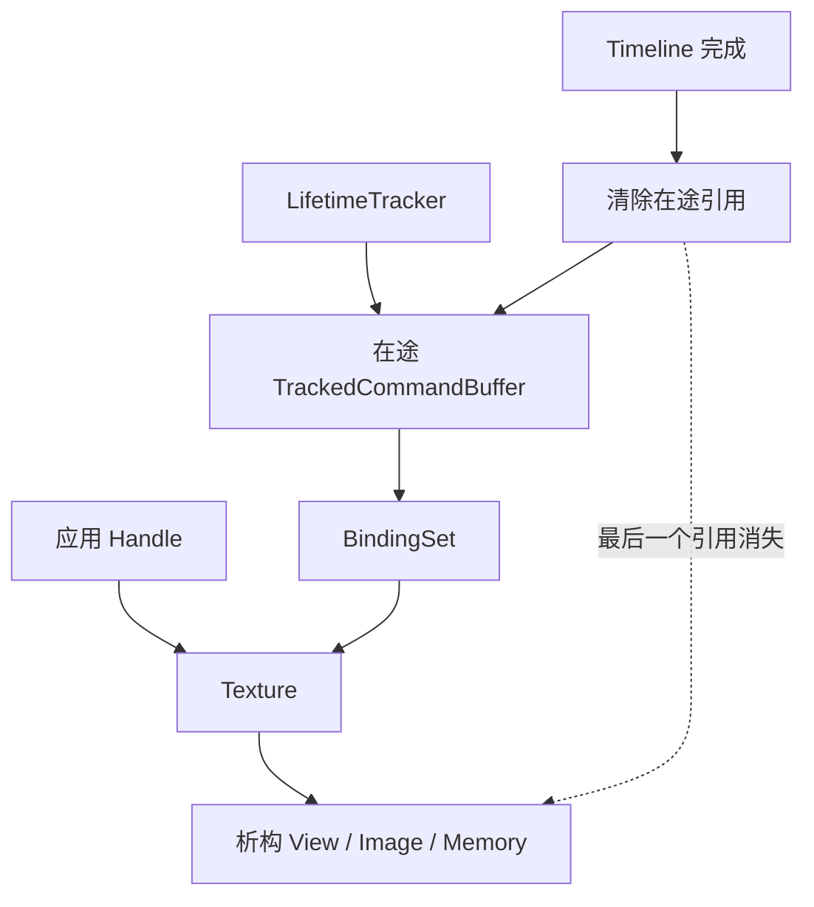

# NVRHI · 执行、提交与回收

[NVRHI 技术目录](../NVRHI_RHI_Vulkan_Analysis.md) · [源码索引](SourceIndex.md#na)

<a id="n8"></a>
## 8. 执行状态：Graphics、Compute 与原生 Draw

### 8.1 Graphics 模块架构：先准备可执行状态，再发出绘制

```cpp
CommandList::setGraphicsState(S) {
    if (autoBarriers) insertGraphicsResourceBarriers(S);
    bool hasPending = anyBarriers();

    if (current.pipeline != S.pipeline) {
        vkCmdBindPipeline(GRAPHICS, S.pipeline.native);
        retain(S.pipeline);
        pipelineChanged = true;
    }

    if (current.framebuffer != S.framebuffer || hasPending)
        endRenderPass();
    commitBarriers();
    if (!current.framebuffer) beginRenderPass(S.framebuffer);

    currentPipelineLayout = S.pipeline.layout;
    currentPushConstantVisibility = S.pipeline.pushStages;
    if (bindingArraysDiffer || anyVolatileBufferWrites)
        bindBindingSets(GRAPHICS, S.pipeline.layout, S.bindings, setIndexMap);

    updateViewportScissorIfChanged(S); // Vulkan viewport 用负 height 对应公共坐标约定
    updateDynamicStencilAndBlendConstants(S, pipelineChanged);
    bindIndexVertexAndRetainResourcesIfChanged(S);
    retainIndirectInputs(S);

    currentGraphics = S;
    clearOtherPipelineTypeCaches();
    anyVolatileBufferWrites = false;
}
```

这是当前源文件的顺序概要，Pipeline bind 可以早于 barrier；关键是 Draw 前相关资源依赖已提交且 rendering 已开始。状态缓存比较的粒度由实现定义，不能把一个“理想状态机”代入源码，假定每次 Pipeline 变化都强制重新绑定所有其他状态。[N10](SourceIndex.md#n10)

### 8.2 DrawArguments 到 vkCmdDraw* 的直接映射

```cpp
drawIndexed(A) {
    updateGraphicsVolatileBuffers(); // 若在上一次 state 设置之后又写了常量，重绑偏移
    vkCmdDrawIndexed(
        indexCount   = A.vertexCount,
        instanceCount= A.instanceCount,
        firstIndex   = A.startIndexLocation,
        vertexOffset = A.startVertexLocation,
        firstInstance= A.startInstanceLocation);
}
```

drawIndexed 仍使用字段名 vertexCount 作为 indexCount，这属于公共结构复用的命名约定。普通 draw 使用 vertexCount/startVertexLocation；indirect 读取预先在 GraphicsState 指定的参数 Buffer；indirect-count 还读取 count Buffer。RHI 不在这里做场景裁剪和排序。[N04](SourceIndex.md#n04) [N10](SourceIndex.md#n10)

一个常见细节是：可以在 setGraphicsState 之后再次 writeBuffer 到 volatile constant buffer，随后 draw 会通过 updateGraphicsVolatileBuffers 更新 descriptor dynamic offset。因此“每次写常量之后必须再调用 setGraphicsState”不是当前 Vulkan 路径的必需行为。[N10](SourceIndex.md#n10) [N14](SourceIndex.md#n14)

### 8.3 Compute：共享资源模型，切换独立原生 bind point

```cpp
setComputeState(S) {
    endRenderPass();
    if (autoBarriers) insertComputeResourceBarriers(S);

    if (currentCompute.pipeline != S.pipeline) {
        vkCmdBindPipeline(COMPUTE, S.pipeline.native);
        retain(S.pipeline);
    }
    retainIndirectInputIfNeeded(S);
    if (bindingArraysDiffer || anyVolatileBufferWrites)
        bindBindingSets(COMPUTE, S.pipeline.layout, S.bindings, setIndexMap);

    currentPipelineLayout = S.pipeline.layout;
    currentPushConstantVisibility = S.pipeline.pushStages;
    commitBarriers();
    currentCompute = S;
    clearOtherPipelineTypeCaches();
    anyVolatileBufferWrites = false;
}
dispatch(x,y,z) {
    updateComputeVolatileBuffers();
    vkCmdDispatch(x,y,z);
}
```

Compute 没有颜色/深度附件；其输入输出由 BindingSet 和 indirect 参数表达。CS 写 UAV 后，后续 Graphics 作为 SRV/顶点/indirect 使用，会经相应状态设置形成状态转换；相同 UAV 连续 dispatch 的依赖则按第 7.7 节处理。[N12](SourceIndex.md#n12) [N26](SourceIndex.md#n26)

### 8.4 Meshlet、RT 与 PushConstants 如何加入执行框架

Meshlet Pipeline 使用 Mesh/Amplification 等 Shader stage 和对应 mesh draw 命令，仍共享 BindingLayout、Framebuffer、状态跟踪和在途引用。Ray tracing 使用独立 bind point 和 SBT，但沿用相同资源/队列生命周期。扩展方法不需要另建一套对象所有权机制。[N27](SourceIndex.md#n27) [N28](SourceIndex.md#n28)

setPushConstants 根据当前 PipelineLayout 和允许的 stage flags 调用 vkCmdPushConstants。因此必须先设置兼容的 Pipeline 状态，再写 push constants，大小和 visibility 需落在创建时的 range 内。[N06](SourceIndex.md#n06) [N09](SourceIndex.md#n09)

Draw/Dispatch 到这里只是完成了**记录**。下一阶段才把关闭的命令缓冲提交到 GPU，并让上传版本与对象引用获得可比较的完成标记。

<a id="n9"></a>
## 9. 队列提交：完成值、跨队列等待和线程关系

### 9.1 模块架构：每个 Queue 有自己的 Timeline 和编号

Queue 包装 VkQueue，保存 queue family、可复用命令缓冲池、recordingID/submissionID/lastFinishedID、待提交 wait/signal semaphore 列表，以及默认 LifetimeTracker。Timeline semaphore 计数值对应该 Queue 的 submissionID。[N07](SourceIndex.md#n07) [N30](SourceIndex.md#n30)

```cpp
Device::executeCommandLists(lists, queueType) {
    Queue& Q = queues[queueType];
    uint64_t submittedID = Q.submit(lists);
    for (CommandList C : lists)
        C.executed(Q, submittedID);
    return submittedID;
}

Queue::submit(lists) {
    lock(queueMutex);
    id = ++lastSubmittedID;

    for (C : lists) {
        T = C.currentTrackedBuffer;
        T.submissionID = id;
        chosenLifetimeTracker(C).push(T);
        markStagingLastUse(T.stagingBuffers, queueType, id);
        nativeBuffers += T.cmdBuf;
    }
    signals += { trackingTimeline, id };

    // 当前实现使用 SubmitInfo + TimelineSemaphoreSubmitInfo。
    vkQueueSubmit(nativeBuffers,
                  queuedWaitsWithTopOfPipeStages,
                  queuedSignalsAndTimelineValues);
    clearQueuedWaitsAndSignals();
    return id;
}
```

使用 synchronization2 发 barrier，不代表 submit 也使用 vkQueueSubmit2；该版本 Queue 的提交结构仍是上面这条路径。[N07](SourceIndex.md#n07)

以上伪代码概括正常路径，返回编号不是成功保证。固定 Queue::submit 在原生提交前分配 submissionID 并登记在途引用；捕获 vk::DeviceLostError 后只发 MessageSeverity::Error，仍返回该编号，Device 随后仍调用 executed。移植时应在明确设备失效的位置传播既有 Fatal 诊断并锁存设备失败状态；宿主先确认提交有效，才发布历史和正常完成状态。已失效设备的退出不能无限等待这次编号，也不能把资源当作正常未提交槽直接复用。[N04](SourceIndex.md#n04) [N06](SourceIndex.md#n06) [N07](SourceIndex.md#n07)

### 9.2 提交动作怎样传回上传与状态模块

```cpp
CommandList::executed(Q, submittedID) {
    recordingID = current.recordingID;
    current = nullptr; // 之后 open 可取得另一个物理记录实例

    submitVolatileBuffers(recordingID, submittedID);
    stateTracker.commandListSubmitted(); // permanent 元数据、首次纹理初始化标记
    uploadManager.submitChunks(
        MakeVersion(recordingID, Q.type, false),
        MakeVersion(submittedID, Q.type, true));
    scratchManager.submitChunks(...);
    volatileBufferStates.clear();
}
```

这里把三条线合起来：命令缓冲变成在途实例，上传/常量槽变成 submitted token，状态跟踪完成提交协议更新。后两者都不等于 GPU 已完成，只是终于拥有能与 Timeline 比较的编号。[N06](SourceIndex.md#n06) [N07](SourceIndex.md#n07) [N16](SourceIndex.md#n16)

### 9.3 跨队列：等待完成值与资源所有权是两件事

```cpp
copyID = device.executeCommandList(copyCmd, Copy);
device.queueWaitForCommandList(Graphics, Copy, copyID);
graphicsID = device.executeCommandList(graphicsCmd, Graphics);
```

queueWaitForCommandList 将 Copy 队列的 tracking semaphore 和值加入 Graphics 下一次提交的等待列表。CPU 不必先等待 Copy 完成，GPU 队列间建立执行依赖。[N07](SourceIndex.md#n07)

但普通资源创建使用 EXCLUSIVE，通用 barrier 的 queue family 为 IGNORED。由这些源码可以推得：**不同 queue family 共享资源时，不能仅凭上述 wait 调用认为 ownership transfer 已处理。** 同一 family 的不同 queue 不要求这种 family ownership 转移；跨 family 的完整方案需要上层/原生互操作补足 release/acquire 和匹配状态。这是当前实现边界的推论，不是 Vulkan semaphore 的附带功能。[N12](SourceIndex.md#n12) [N14](SourceIndex.md#n14) [N22](SourceIndex.md#n22)

### 9.4 多线程边界：独立记录与共享提交状态

多个逻辑 CommandList 可各自 open/record，Queue 在获取/回收物理命令缓冲和 submit 时用锁保护自己的成员。Volatile version 的 CAS 只保证版本槽位认领，不保护普通 versionSearchStart 搜索游标；共享 VCB 并发写的限制见 6.5。可选外部 LifetimeTracker 支持按线程/队列分担在途管理，不能替代资源本身共享字段的同步。[N04](SourceIndex.md#n04) [N07](SourceIndex.md#n07) [N14](SourceIndex.md#n14) [N30](SourceIndex.md#n30)

待提交 semaphore 列表却是 Queue 的共享可变状态。源码明确指出，queueWaitForSemaphore/queueSignalSemaphore 与同一 Queue 上多线程提交的组合并不理想：submit 内部有锁，也不自动把“设置等待 + 提交某一批列表”变成一个调用者可识别的原子事务。若不同 Queue 包装实际指向同一 VkQueue，独立包装上的锁也不能替代对同一原生 Queue 的整体外部同步。这一后者是从锁的归属得到的架构推论。[N07](SourceIndex.md#n07) [N30](SourceIndex.md#n30)

<a id="n10"></a>
## 10. 完成与回收：让 GPU 生存期闭环

### 10.1 模块架构：Timeline 是不同回收路径的共同证据

Queue 的 Timeline 完成值同时支撑命令缓冲回收、上传 chunk 重用、volatile 常量版本重用、staging map 等待和 EventQuery。它们共享完成证据，但各自管理不同存储/引用，不能用一个笼统的“删帧缓存”代替。[N07](SourceIndex.md#n07) [N14](SourceIndex.md#n14) [N15](SourceIndex.md#n15) [N18](SourceIndex.md#n18)

```cpp
CommandListLifetimeTracker::runGarbageCollection() {
    completed = queue.updateLastFinishedID(); // vkGetSemaphoreCounterValue
    released = [];
    for (T : inFlightInSubmissionOrder) {
        if (T.submissionID > completed) break;

        T.referencedResources.clear();
        T.referencedStagingBuffers.clear();
        T.submissionID = 0;
        releaseOptionalRtCompactionTracking(T);
        released += T;
    }
    eraseCompletedPrefix(inFlight);
    queue.returnCommandBuffersToPool(released);
}
```

清除资源引用后，若应用与其他对象也不再持有它，才进入资源析构；析构再销毁 View、Buffer/Image、内存等原生对象。命令缓冲则回到池，以后再次 open 时赋予新的 recordingID。[N07](SourceIndex.md#n07) [N14](SourceIndex.md#n14) [N22](SourceIndex.md#n22)

### 10.2 对象链怎样避免“应用已经释放，GPU 仍在访问”

以材质纹理为例：



图表达持有关系和释放条件，不是 GPU 执行顺序。BindingSet 的默认资源引用、CommandBuffer 对 Set 的保活、Queue 对 CommandBuffer 的持有构成完整链。应用销毁一个 Pass 时可以释放自身的对象成员，但仍需持续运行相应 GC，才能清掉已完成的在途引用。[N02](SourceIndex.md#n02) [N07](SourceIndex.md#n07) [N09](SourceIndex.md#n09)

外部 LifetimeTracker 的工作由调用者定期推进；只调用 Device 的默认 GC 不能被当作对任意外部 tracker 的自动管理。自定义 tracker 也需要与提交线程的所有权/同步安排一致。[N04](SourceIndex.md#n04) [N07](SourceIndex.md#n07)

### 10.3 CPU 等待、EventQuery 和计时查询

| 接口/机制 | 捕获或等待什么 | 适合回答的问题 |
|---|---|---|
| queueGetCompletedInstance | 指定 Queue 当前 Timeline 值 | 某个已提交 ID 是否完成 |
| queueWaitForCommandList | GPU 提交间 semaphore 等待 | 一个队列如何依赖另一个队列 |
| EventQuery | set 时该队列最后已提交 ID | CPU 是否可以继续使用相应结果 |
| TimerQuery | 命令缓冲内的两个 GPU timestamp | 两个计时点之间的 GPU 时间 |
| mapBuffer(staging) | 记录在 staging 的最后使用 ID | CPU 映射前是否需要等复制完成 |

```cpp
event = device.createEventQuery();
device.executeCommandList(cmd, Graphics);
device.setEventQuery(event, Graphics);  // 捕获当前 lastSubmittedID
while (!device.pollEventQuery(event)) {
    doOtherCpuWork();
}
device.resetEventQuery(event);
```

setEventQuery 不在未来插入一个任意位置的 GPU marker，也不包含调用之后才提交的列表。TimerQuery 从按 maxTimerQueries 配置的池分配两个 timestamp，按 timestampPeriod 转成秒；getTimerQueryTime 在结果未就绪时会等待/轮询，所以读数本身可能阻塞 CPU。[N18](SourceIndex.md#n18)

### 10.4 三种复用不能混用判据

| 被复用的内容 | 分配/占用单位 | 何时可复用 |
|---|---|---|
| 原生命令缓冲 | TrackedCommandBuffer | 完成后清理引用并回池 |
| Upload / Scratch chunk | 带 version 的 BufferChunk | submitted token 对应队列已完成 |
| Volatile 常量版本 | Buffer 内一段 stride | 原子占用前观察到空闲或已完成版本 |

CPU Handle 归零不证明 GPU 完成；ResourceStates 正确不证明内存段可重写；Timeline 完成也不会自动更新所有调用者手中的 descriptor。三个状态机的责任在这里才完整闭合。
