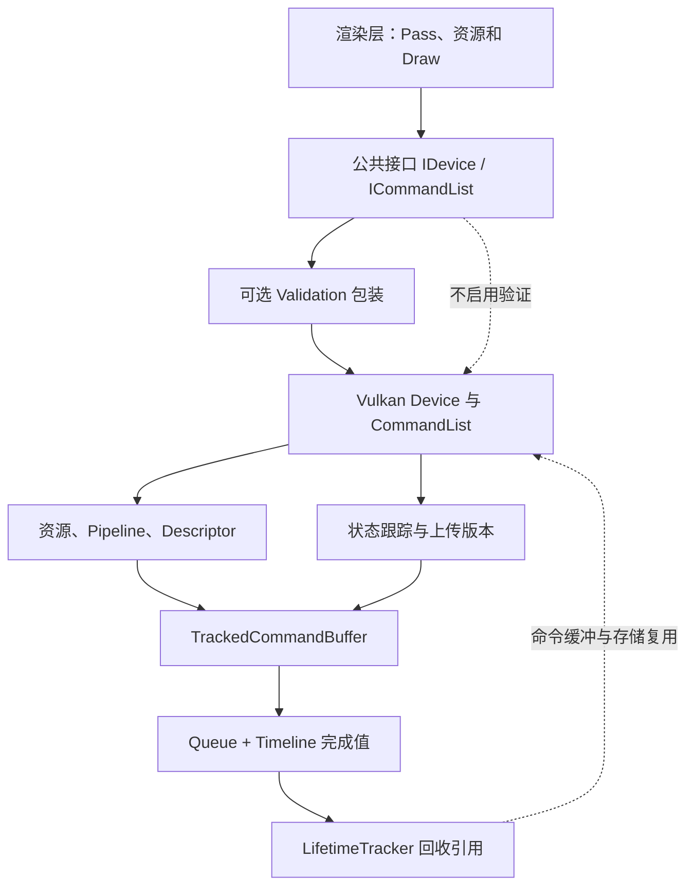

# NVRHI · 公共接口与 Vulkan 设备

[NVRHI 技术目录](../NVRHI_RHI_Vulkan_Analysis.md) · [源码索引](SourceIndex.md#na)

<a id="n0"></a>
## 0. 整体架构：RHI 如何接住渲染管线的执行需求

### 0.1 先明确顶层的执行边界

渲染前端已经确定几何、Shader、目标附件、资源绑定和执行顺序。NVRHI 把这些要求组织成公共对象及命令接口，并处理状态转换、上传存储、在途引用和原生命令提交。它包含 D3D11、D3D12、Vulkan 后端；本文后端部分聚焦 Vulkan。[N01](SourceIndex.md#n01) [N04](SourceIndex.md#n04)

| 渲染层交给 RHI 的内容 | 公共表达 | Vulkan 继续完成的工作 |
|---|---|---|
| 几何、常量、图像 | BufferDesc / TextureDesc | VkBuffer / VkImage、内存和视图 |
| 已编译 Shader 与固定状态 | ShaderDesc / GraphicsPipelineDesc | ShaderModule、PipelineLayout、VkPipeline |
| Shader 要读写哪些资源 | BindingLayout / BindingSet | DescriptorSetLayout / DescriptorSet |
| 写哪些颜色、深度目标 | Framebuffer / FramebufferInfo | 附件视图和 dynamic rendering |
| 本次 Draw 的全部输入 | GraphicsState + DrawArguments | 资源状态、绑定缓存、vkCmdDraw* |
| 哪些工作必须先完成 | ResourceStates、queue wait | Barrier、semaphore、queue submit |
| 何时允许释放或重写 | Handle、提交 ID、lifetime tracker | 在途保活、版本复用和命令缓冲回收 |

NVRHI 不构造 Scene/View、材质 BRDF、灯光剔除或 FrameGraph，也不创建窗口和 SwapChain。应用负责创建原生设备/队列，并把原生对象交给 Vulkan DeviceDesc。这个边界使执行层既可服务复杂渲染图，也可直接服务一个手工组织的 Pass。[N02](SourceIndex.md#n02) [N03](SourceIndex.md#n03)

### 0.2 总体分层与对象依赖



Validation 负责检查公共 API 使用约束，并转发到被包装 Device。通用状态跟踪器保存抽象 ResourceStates；Vulkan 模块把它转换为 layout、stage、access；Queue 和 LifetimeTracker 处理提交后的生存期。这些是协同工作的部件，不是彼此独立的功能清单。[N06](SourceIndex.md#n06) [N11](SourceIndex.md#n11) [N12](SourceIndex.md#n12) [N19](SourceIndex.md#n19)

### 0.3 一次工作有三个彼此关联的状态机

| 状态机 | 主要状态 | 管理者 | 与其他状态机的联系 |
|---|---|---|---|
| 命令执行 | 空闲、记录、关闭、提交、完成 | CommandList / Queue | 提交时产生 GPU 完成值 |
| 资源用途 | CopyDest、ShaderResource、RenderTarget、UAV 等 | CommandListResourceStateTracker | 用途变化生成命令；不负责完成等待 |
| 内存/对象生存期 | 空闲、记录占用、在途、可复用 | Upload/Volatile/LifetimeTracker | 使用记录 ID 和提交 ID 标记归属 |

```cpp
// 公共架构的逻辑骨架，不含窗口系统和呈现。
resources = device.createResources(...);
bindings  = device.createBindingSet(...);
pipeline  = device.createGraphicsPipeline(...);

cmd.open();                          // 取得一个可记录原生命令缓冲
cmd.writeBuffer(...);               // 上传、用途转换、引用保活
cmd.setGraphicsState(...);          // 推导用途、提交 barrier、设置执行状态
cmd.drawIndexed(...);               // 原生绘制命令
cmd.close();                         // 恢复受协议管理的初始状态并结束记录
ticket = device.executeCommandList(cmd); // 转为提交 ID

// CPU 可继续准备后续工作；完成后才能重用对应在途存储。
device.runGarbageCollection();
```

这里的 RHI CommandList 不是 Filament 的 CPU CommandStream。Vulkan 的 NVRHI 方法通常直接向当前 VkCommandBuffer 记录；它仍是 GPU 延迟执行，但没有先把每个 API 调用包装成 Filament 那样的第二层 CPU 命令流。[N06](SourceIndex.md#n06)

<a id="n1"></a>
## 1. 顶层接口：对象、状态、命令和所有权

### 1.1 模块架构：Device 创建对象，CommandList 引用对象

| 公共对象 | 主要承载内容 | 后续消费者 |
|---|---|---|
| IDevice | 创建对象、执行命令、查询能力与完成 | 所有上层模块 |
| IBuffer / ITexture / ISampler | 描述、原生资源、状态元数据 | BindingSet、Framebuffer、复制/绘制命令 |
| IShader / IInputLayout | Shader 字节码、顶点属性格式 | Pipeline 创建 |
| IBindingLayout | 槽位类型、数量、stage visibility | BindingSet 与 PipelineLayout |
| IBindingSet / IDescriptorTable | 实际资源集合/可变索引表 | Graphics/Compute/RT 状态 |
| IGraphicsPipeline 等 | Shader、布局、固定管线状态 | CommandList 状态设置 |
| IFramebuffer | 附件及其兼容信息 | GraphicsState |
| ICommandList | 当前记录上下文与缓存状态 | Device::executeCommandLists |
| EventQuery / TimerQuery | 队列完成位置或 GPU 时间 | CPU 同步/性能读取 |

公共层采用描述结构体构造对象，使用 RefCountPtr/Handle 管理引用。GraphicsState 组合已有对象；DrawArguments 提供本次计数和起点。因此“创建 Pipeline”“绑定资源”“修改每 Draw 参数”不需要每次都重新构造全部对象。[N04](SourceIndex.md#n04) [N05](SourceIndex.md#n05)

### 1.2 不可变对象与可变记录上下文的配合

```cpp
// 仅示意数据关系。
struct PipelineContract {
    Shaders shaders;
    BindingLayouts layouts;
    InputLayout input;
    RenderState rasterDepthBlend;
    FramebufferInfo targetCompatibility;
};

struct DrawState {
    PipelineHandle pipeline;       // 固定功能与 Shader
    FramebufferHandle framebuffer; // 本次实际附件
    BindingSetHandles bindings;    // 本次资源
    VertexIndexBindings geometry;
    ViewportScissor viewport;
};

cmd.setGraphicsState(drawState);
cmd.setPushConstants(&smallData, sizeof(smallData));
cmd.drawIndexed(drawArgs);
```

Pipeline 的兼容性信息只包含格式、样本等要求，不把某一帧的具体颜色纹理固化进 Pipeline。相同 BindingLayout 可配多份 BindingSet；相同 Pipeline 可配兼容的不同 Framebuffer。这是对象复用和运行时状态切换的主要支点。[N04](SourceIndex.md#n04) [N09](SourceIndex.md#n09) [N10](SourceIndex.md#n10)

### 1.3 引用计数解决 CPU 所有权，在途引用补上 GPU 生存期

```text
ApplicationHandle -> Resource
BindingSetHandle  -> referenced Resources
PipelineHandle    -> Shader / Layout / other dependent objects
FramebufferHandle -> Attachment Textures

TrackedCommandBuffer -> used Resources / BindingSets / Pipelines / CommandList
QueueLifetimeTracker -> submitted TrackedCommandBuffers
```

上述箭头表示持有引用的逻辑关系，不是类继承。默认路径中，应用释放自己的 Handle 后，只要在途命令还保留相关对象，它就不会立即析构。完成后 LifetimeTracker 清理在途引用，才可能触发资源析构和原生释放。[N05](SourceIndex.md#n05) [N07](SourceIndex.md#n07) [N30](SourceIndex.md#n30)

BindingSet 等对象的 `trackLiveness=false` 是明确的责任转移：调用者必须保证所依赖对象在 GPU 完成前不被释放。它不是关闭状态跟踪；状态跟踪与生存期跟踪控制的是不同问题。[N04](SourceIndex.md#n04) [N09](SourceIndex.md#n09)

### 1.4 状态协议是 RHI 与调用者的契约

调用者需要让 RHI 知道资源进入命令列表时处于什么状态。典型途径包括：
- `keepInitialState`：命令列表局部从约定状态进入，并在 close 时恢复；新纹理首次初始化有专门处理。
- `beginTrackingTextureState / beginTrackingBufferState`：调用者显式声明当前状态。
- permanent state：在提交协议中将资源约束为一个长期状态，并限制后续不兼容使用。

这些方式在第 7 节展开。它们说明自动 barrier 不是全局 FrameGraph：NVRHI 不会凭空推断多个独立命令列表之间的全部先后关系，更不会从 Shader 任意数组索引恢复 bindless 访问集合。[N02](SourceIndex.md#n02) [N11](SourceIndex.md#n11)

<a id="n2"></a>
## 2. Vulkan 入口：把外部原生设备接入公共架构

### 2.1 模块架构

Vulkan Device 包含共享 VulkanContext、VulkanAllocator、各 CommandQueue 的 Queue 包装和公共对象创建入口。CommandList 保存对 Device/Context 的联系；资源对象使用同一个 Context 与 allocator，以保证函数分发、分配回调和原生设备一致。[N03](SourceIndex.md#n03) [N20](SourceIndex.md#n20) [N30](SourceIndex.md#n30)

```cpp
// 外部创建原生 instance / physicalDevice / device / queues。
nvrhi::vulkan::DeviceDesc desc = {};
desc.instance = instance;
desc.physicalDevice = physicalDevice;
desc.device = vkDevice;
desc.graphicsQueue = graphicsQueue;
desc.graphicsQueueIndex = graphicsFamily; // 此字段用于 queue family index
desc.computeQueue = computeQueueOrNull;
desc.computeQueueIndex = computeFamily;
desc.deviceExtensions = enabledExtensionNames;
desc.numDeviceExtensions = enabledExtensionCount;
desc.bufferDeviceAddressSupported = enabledFeatures.bufferDeviceAddress;
desc.errorCB = messageCallback;

DeviceHandle nativeRhi = nvrhi::vulkan::createDevice(desc);
DeviceHandle rhi = optionallyWrapWithValidation(nativeRhi);
```

这里交付的是**创建时实际启用**的信息。物理设备支持某个扩展，不等于外部 VkDevice 已启用对应 feature。NVRHI 需要以这些信息选择 descriptor、buffer address、ray tracing 等分支；不能在包装已创建的 Device 时补启用缺失 feature。[N03](SourceIndex.md#n03) [N20](SourceIndex.md#n20)

### 2.2 设备能力如何进入对象和命令

```cpp
Device::Device(desc) {
    context = initializeDispatchAndContext(desc);
    context.properties = queryPhysicalDeviceProperties();
    context.extensions = interpretEnabledExtensions(desc);
    context.features = queryRelevantFeatureStructures();

    for (QueueType q : graphicsComputeCopy) {
        if (desc.nativeQueue(q))
            queues[q] = Queue(context, q, desc.nativeQueue(q), desc.family(q));
    }
    initializeSharedLayoutsAndQueryStorage(...);
}
```

这是初始化职责概要。能力数据并不只用于返回 queryFeatureSupport：资源创建选择 usage/allocate flags，BindingLayout 选择 update-after-bind，Pipeline 选择扩展结构，执行命令选择扩展入口，都读取同一上下文中的条件。[N20](SourceIndex.md#n20) [N30](SourceIndex.md#n30)

Vulkan 1.3 是仓库说明的基础 API 目标，但 Timeline、dynamic rendering、synchronization2、descriptor indexing、RT 等仍须按具体入口和已启用能力理解。接口存在不表示当前设备具备其所有扩展能力。[N01](SourceIndex.md#n01) [N03](SourceIndex.md#n03)

### 2.3 原生对象归属

外部 VkDevice/VkQueue 不是由这层新建的窗口设备系统。包装原生 Texture 时，NVRHI 设置 `managed=false`，管理自己的视图等包装数据，但不销毁传入的 VkImage/内存。TextureDesc 必须如实描述格式、维度和用途，状态入口也要与真实状态一致。[N22](SourceIndex.md#n22)

这个归属规则直接进入第 3 节：创建原生资源和包装外部原生资源共享上层接口，但析构行为不同。
