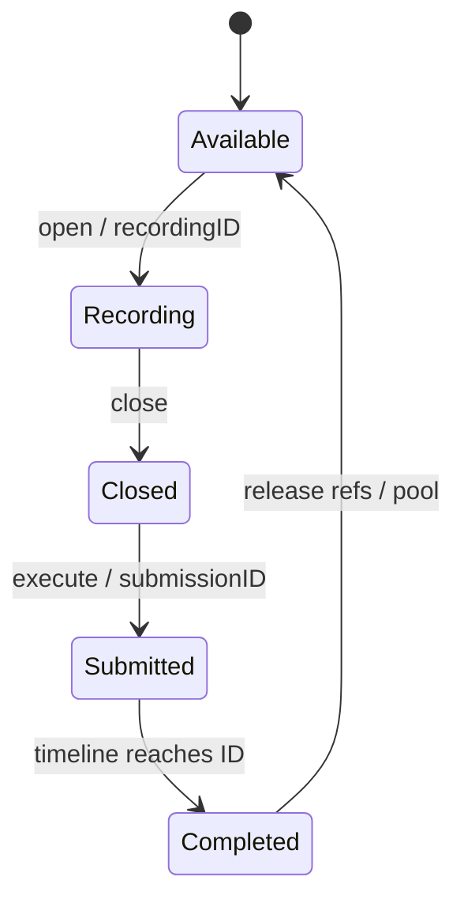

# NVRHI · 命令记录、上传与资源状态

[NVRHI 技术目录](../NVRHI_RHI_Vulkan_Analysis.md) · [源码索引](SourceIndex.md#na)

<a id="n6"></a>
## 6. 记录与上传：CommandList、UploadManager 和常量版本

### 6.1 模块架构：逻辑列表可以复用，物理记录实例需要完成追踪



图中描述的是一个物理 TrackedCommandBuffer 实例的路径。逻辑 ICommandList 在 execute 后可继续 open 取得另一实例；它自己的 UploadManager 和缓存对象仍可复用。不能在 GPU 在途期间把同一个物理命令缓冲当作已空闲。[N06](SourceIndex.md#n06) [N07](SourceIndex.md#n07) [N30](SourceIndex.md#n30)

```cpp
CommandList::open() {
    current = queue.getOrCreateCommandBuffer(); // 分配 recordingID
    vkBeginCommandBuffer(current, ONE_TIME_SUBMIT);
    current.referencedResources += strongRef(this);
    clearCachedExecutionState();
}

CommandList::close() {
    endRenderPass();
    stateTracker.keepBufferInitialStates();
    stateTracker.keepTextureInitialStates();
    commitBarriers();
    vkEndCommandBuffer(current);
    clearCachedExecutionState();
    flushVolatileBufferWrites();
}
```

每个新物理实例拥有自己的 CommandPool 和 primary CommandBuffer；池带 reset/transient 标志。记录期引用 CommandList 自身，是为了让其上传管理器等依赖不会在 GPU 使用前提前销毁。[N06](SourceIndex.md#n06) [N07](SourceIndex.md#n07)

### 6.2 普通 Buffer 写入：小更新与 staging 复制两条路径

```cpp
CommandList::writeBuffer(B, data, size, offset) {
    retain(B);
    if (B.isVolatile) {
        assert(offset == 0);
        writeVolatileBuffer(B, data, size);
        return; // 不要求结束 rendering
    }

    endRenderPass();
    if (size <= 65536 && offset % 4 == 0) {
        if (autoBarriers) requireBufferState(B, CopyDest);
        commitBarriers();
        vkCmdUpdateBuffer(B, offset, alignUp(size, 4), data);
    } else {
        assert(B.cpuAccess != Write);
        slice = uploadManager.suballocate(size, currentPendingVersion);
        memcpy(slice.cpuAddress, data, size);
        copyBuffer(B, offset, slice.buffer, slice.offset, size);
    }
}
```

小更新利用原生命令内联数据，大小按 4 字节补齐；因此接口使用者须注意末端补齐字节的可读/可写范围，不能把它当成任意 byte-offset 的原生 update。大更新先写上传 chunk，再复制到目标。两条路径都需要 CopyDest 用途，后续顶点读取或 Shader 读取再转换。[N14](SourceIndex.md#n14)

### 6.3 UploadManager：按命令记录实例标记 chunk

```cpp
suballocate(size, alignment, pendingVersion) {
    if (currentChunk && fitsAligned(currentChunk, size, alignment))
        return bumpAllocate(currentChunk, size, alignment);

    retireCurrentChunkToPool();
    completed = device.queueGetCompletedInstance(versionQueue(pendingVersion));

    for (chunk : pool) {
        if (chunk.version.isSubmitted && chunk.version.id <= completed)
            chunk.version = 0;
        if (chunk.version == 0 && chunk.capacity >= size) {
            currentChunk = take(chunk);
            break;
        }
    }
    if (!currentChunk)
        currentChunk = createChunk(alignedMax(size, defaultChunkSize));

    currentChunk.version = pendingVersion;
    return allocateFromStart(currentChunk, size);
}

submitChunks(pendingVersion, submittedVersion) {
    retireCurrentChunkToPool();
    for (chunk : pool)
        if (chunk.version == pendingVersion) chunk.version = submittedVersion;
}
```

UploadManager 属于逻辑 CommandList，使用持久映射的 BufferChunk；ScratchManager 使用同一管理框架但为 device-local scratch。默认 upload/scratch chunk 最小值由 CommandListParameters 提供，通常为 64 KiB；池的工作集可随逻辑列表持续保留，不是每帧提交后立刻释放。[N04](SourceIndex.md#n04) [N15](SourceIndex.md#n15)

### 6.4 统一 version word：记录中占用与已提交占用不能混淆

| 位段 | 内容 | 作用 |
|---|---|---|
| bit 63 | submitted | 区分 recordingID 与 submissionID |
| bits 60–62 | queue | 指定比较哪个队列完成值 |
| bits 0–59 | ID | recordingID 或 submissionID |
| 全零 | available | 允许复用 |

```cpp
bool reusable(version, completedByQueue) {
    if (version == 0) return true;
    if (!version.submitted) return false; // 还没提交，不能按 GPU 完成值判断
    return version.id <= completedByQueue[version.queue];
}
```

记录期 pending 占用即使存在很久也不能被当作“GPU 没在用所以可重写”。只有提交动作把 recordingID 改为 submissionID，之后才可以和 Timeline 完成值比较。Upload、Scratch 和 Volatile ConstantBuffer 共用这个基本协议。[N16](SourceIndex.md#n16)

### 6.5 Volatile ConstantBuffer：一次对象，多份内容版本

创建时令：

$$
A=\max(\mathrm{minUniformBufferOffsetAlignment},\mathrm{nonCoherentAtomSize}),\quad
stride=\mathrm{alignUp}(requestedSize,A),\quad
allocationSize=stride\cdot maxVersions.
$$

BindingSet 写的是该 Buffer 的动态 UBO descriptor；每次写入占一份 stride，之后绑定通过 dynamic offset 选中该版本。于是 descriptor set 可以复用，数据内容持续变化。[N09](SourceIndex.md#n09) [N14](SourceIndex.md#n14)

```cpp
writeVolatileBuffer(B, data, size) {
    completed = getAllQueueCompletionValues();
    do {
        candidate = scanForUnusedOrCompletedVersion(B.versionTracking, completed);
        if (!candidate.has_value()) { reportInsufficientMaxVersions(); return; }
        v = candidate.value(); // 版本 0 是合法槽位
        old = B.versionTracking[v];
        pending = MakeVersion(current.recordingID, queueType, false);
    } while (!CAS(B.versionTracking[v], old, pending));

    state[B].latestVersion = v;
    expandMinMaxWrittenRange(state[B], v);
    memcpy(B.mapped + v * B.stride, data, size);
    anyVolatileBufferWrites = true;
}

bindBindingSets(...) {
    for (volatileCB : boundSets) {
        latest = state[volatileCB].latestVersion;
        dynamicOffsets += latest * volatileCB.stride;
    }
    vkCmdBindDescriptorSets(..., dynamicOffsets);
}
```

原子 CAS 防止多个 CPU 记录线程认领同一版本，但这个保证只覆盖槽位认领。固定源码的 Buffer::versionSearchStart 是普通 uint32_t，writeVolatileBuffer 在不同 CommandList 间无共同锁地读取、更新该游标；上游同时声明支持并行列表写同一 VCB，因此该条件下仍有 C++ 数据竞争，不能据 CAS 推断整个共享 Buffer 写路径线程安全。单记录线程不触发这一条件；并行移植应采用线程独立 VCB，或使搜索游标原子化并继续审查其余共享字段。[N14](SourceIndex.md#n14) [N30](SourceIndex.md#n30)

maxVersions 不足时报告错误，不能静默覆盖 GPU 在途或尚未提交的内容。Set 未变但常量刚被写入时仍需更新动态偏移，这是 setGraphicsState/setComputeState 绑定条件中 volatile-write 标志存在的原因。[N09](SourceIndex.md#n09) [N14](SourceIndex.md#n14)

关闭命令列表时，flushVolatileBufferWrites 对每个常量缓冲的最小到最大写入版本范围调用 flushMappedMemoryRanges，避免非 coherent 映射的数据不可见。提交时仅将匹配本 recordingID 的版本 CAS 成 submitted token，不会把其他线程占用的版本一起改写。[N06](SourceIndex.md#n06) [N14](SourceIndex.md#n14)

### 6.6 Texture 上传和 Readback：复制布局属于 CPU/GPU 交界

Texture 写入根据 mip/layer、块压缩格式和 row pitch，把源数据整理到上传存储，再记录 buffer→image 复制。StagingTexture 将可复制的 mip/array footprint 放进映射 Buffer；readback 则 image→buffer，CPU map 返回相应行跨度。[N17](SourceIndex.md#n17) [N22](SourceIndex.md#n22)

```cpp
// 数据路径概要。
cpuPixels -> uploadSlice -> vkCmdCopyBufferToImage -> texture
texture   -> vkCmdCopyImageToBuffer -> stagingBuffer -> mapTexture(rowPitch)
```

mapBuffer 会等待该 staging buffer 记录的最后使用队列/提交 ID，但“GPU 完成”与“Host cache 可见”是两层问题。固定源码为 Read 请求 HOST_VISIBLE|HOST_CACHED，为 Write 请求 HOST_VISIBLE；均不保证 HOST_COHERENT。普通 map/unmap 没有 invalidate/flush，且保留 Host barrier TODO；UploadChunk 也使用这一普通映射路径，不能把 Volatile 的显式 flush 泛化为所有上传/映射都完整。[N14](SourceIndex.md#n14) [N15](SourceIndex.md#n15) [N17](SourceIndex.md#n17) [N21](SourceIndex.md#n21)

在实际选中非 coherent 内存时，上传须在设备消费前 flush CPU 写入；读回须建立设备写入到 Host 读取的内存依赖，等待对应工作完成，再 invalidate 后读取。范围按 nonCoherentAtomSize 和分配边界合法对齐，分配共享 atom 时还须避免另一在途区段被误触。coherent 内存可省缓存维护调用，不能省访问顺序与寿命协议。Vulkan 规范明确 map/unmap 不隐式替代这些操作；这是移植需要修补的条件性缺口，而不是所有设备必现的故障。[VK01] [VK02]

复制命令还有独立的原生 scope 条件：固定 copyBuffer 只调用 commitBarriers，后者在无 pending barrier 时直接返回。若 A/B 已处于复制状态，之后对另一目标开始 rendering，再复制 A→B，可能在 rendering 内记录 vkCmdCopyBuffer。该命令必须在 render pass instance 外；后端应在复制入口独立结束 rendering，同类复制路径逐一核对，不能依赖“恰好有 barrier”退出。[N12](SourceIndex.md#n12) [N14](SourceIndex.md#n14) [VK03]

至此，命令缓冲有了，资源内容也有上传方案。下一步要解决这些写入与后续 Shader/附件访问之间的实际依赖。

<a id="n7"></a>
## 7. 资源状态：从用途推导到 Vulkan Barrier

### 7.1 模块架构：用途收集、抽象比较、原生发射三步分开

| 阶段 | 主要入口 | 产生什么 |
|---|---|---|
| 根据操作收集用途 | insertGraphicsResourceBarriers、复制命令等 | requireTexture/BufferState 请求 |
| 与本列表状态比较 | CommandListResourceStateTracker | TextureBarrier / BufferBarrier 记录 |
| 提交 barrier | commitBarriers / commitBarriersInternal | Vulkan stage/access/layout 与 pipelineBarrier2 |

setTextureState/setBufferState 通常只更新跟踪并积累 barrier，还会保活对象；commitBarriers 才把积累结果记录进当前 VkCommandBuffer。这个分离让一次状态设置可以收集多个资源，再批量提交。[N11](SourceIndex.md#n11) [N12](SourceIndex.md#n12)

### 7.2 如何得到进入列表时的状态

```cpp
initialLocalTextureState(T) {
    if (T.desc.keepInitialState)
        return T.stateInitialized ? T.desc.initialState : Common;
    return Unknown;
}
initialLocalBufferState(B) {
    if (B.desc.keepInitialState) return B.desc.initialState;
    return Unknown;
}

beginTrackingTextureState(T, range, knownState) {
    // 声明已知状态，不发出“转换到 knownState”的 GPU 命令。
    localTracking[T, range] = knownState;
}
```

新建纹理 keepInitialState 的首次 Common 对应尚未初始化的原生布局；提交之后 stateInitialized 才被标记。close 时根据 keepInitialState 协议恢复到约定状态。Buffer 没有 image layout，采用自己的初始状态逻辑。[N11](SourceIndex.md#n11) [N24](SourceIndex.md#n24)

若前态 Unknown，requireState 会报告需要 beginTracking 或 initial/keepInitialState。盲目把 Unknown 改成 Common 不等于正确接管一个已有内容的外部 Image；对于 Image，Common 的原生映射含 Undefined，可能意味着丢弃既有内容的入口。[N11](SourceIndex.md#n11) [N24](SourceIndex.md#n24)

Permanent state 调用先请求转换，再把待提交的永久状态加入列表；commandListSubmitted 才更新资源元数据。元数据提交不表示 GPU 已完成转换，只表示后续使用必须遵守该提交顺序与永久状态约束。[N11](SourceIndex.md#n11)

### 7.3 Texture 跟踪：优先整图，必要时展开到 mip × array

```cpp
requireTextureState(T, range, wanted) {
    if (T.permanentState) {
        verifyWantedIsCompatible(T.permanentState, wanted);
        return;
    }
    range = resolve(range, T.desc);
    S = getOrCreateLocalTracking(T);

    if (range.isEntire && S.hasSingleState) {
        needTransition = S.state != wanted;
        needUav = wanted.contains(UAV) &&
                  (S.enableUavBarriers || !S.firstUavBarrierPlaced);
        if (needTransition || needUav)
            pending += TextureBarrier(T, all, S.state, wanted);
        updateUavTrackingAndState(S, wanted, ...);
    } else {
        if (S.hasSingleState)
            S.subresources = repeat(S.state, T.mipLevels * T.arraySize);
        for (mip, layer : range)
            compareAndQueuePerSubresourceBarrier(T, S, mip, layer, wanted);
    }
}
```

整图表示减少常规纹理的跟踪存储；对 mip 渲染、分层目标和局部复制，则展开细分。跟踪粒度是 mip/array，不能自动解释成每个 texel 或任意图像矩形的独立状态。[N11](SourceIndex.md#n11)

Buffer 状态按整个 Buffer 追踪，同一待提交 barrier 批次里若一个 Buffer 同时用作 vertex+index 或 SRV+indirect，可合并 stateAfter 位。原生 BufferBarrier 覆盖 offset=0、size=desc.byteSize，并不是任意细粒度 byte-range hazard tracker。[N11](SourceIndex.md#n11) [N12](SourceIndex.md#n12)

### 7.4 自动用途推导究竟看哪些输入

```cpp
insertGraphicsResourceBarriers(newState) {
    insertResourceBarriersForBindingSets(newState.bindings, oldState.bindings);
    if (indexBindingNeedsUpdate) require(indexBuffer, IndexBuffer);
    if (vertexBindingsNeedUpdate)
        for (VB : newState.vertexBuffers) require(VB.buffer, VertexBuffer);
    if (framebufferNeedsUpdate)
        requireAttachments(newState.framebuffer); // RT / DepthRead / DepthWrite / VRS
    if (indirectBindingNeedsUpdate) require(indirectBuffer, IndirectArgument);
    bindingStatesDirty = false;
}

statesForOrdinaryBindingSet(set) {
    srv = layoutIncludesPixelStage ? ShaderResource : NonPixelShaderResource;
    for (binding : set.bindingsThatNeedTransitions) {
        switch (binding.type) {
        case TextureSRV:
            requireTexture(binding, isDepthOrStencil ? srv|DepthRead : srv); break;
        case BufferSRV: requireBuffer(binding, srv); break;
        case TextureUAV: case BufferUAV: require(binding, UnorderedAccess); break;
        case ConstantBuffer: requireBuffer(binding, ConstantBuffer); break;
        case AccelStruct: requireBuffer(binding.storage, AccelStructRead); break;
        }
    }
}
```

ShaderResource 包含 Pixel 与 NonPixel 语义；含 Pixel 的布局用较广组合，其他布局使用 NonPixel。深度 SRV 增加 DepthRead 后，原生 layout 与第 4 节 descriptor 中写的只读深度 layout 保持一致。[N09](SourceIndex.md#n09) [N12](SourceIndex.md#n12)

绑定集合的重新检查受 arrayDifferenceMask、m_BindingStatesDirty 等条件控制。当前 insertResourceBarriersForBindingSets 先判断 mask 非零，再处理 changed sets 或其中带 UAV 的 set。因此不能把“带 UAV”扩张成任何相同状态的重复 draw/dispatch 都自动发一条 barrier。[N12](SourceIndex.md#n12)

### 7.5 抽象状态怎样映射到原生同步字段

以下省略 `VK_` 前缀，保留当前源码的主要映射；组合状态会组合 stage/access，Image layout 还需按兼容规则选取。[N24](SourceIndex.md#n24)

| ResourceStates | stage 的主要值 | access 的主要值 | Image layout |
|---|---|---|---|
| Common | TOP_OF_PIPE | 无 | UNDEFINED |
| ConstantBuffer | ALL_COMMANDS | UNIFORM_READ | 不适用 |
| VertexBuffer / IndexBuffer | VERTEX_INPUT | VERTEX_ATTRIBUTE_READ / INDEX_READ | 不适用 |
| IndirectArgument | DRAW_INDIRECT | INDIRECT_COMMAND_READ | 不适用 |
| PixelShaderResource | FRAGMENT_SHADER | SHADER_READ | SHADER_READ_ONLY_OPTIMAL |
| NonPixelShaderResource | ALL_COMMANDS | SHADER_READ | SHADER_READ_ONLY_OPTIMAL |
| UnorderedAccess | ALL_COMMANDS | SHADER_READ + SHADER_WRITE | GENERAL |
| RenderTarget | COLOR_ATTACHMENT_OUTPUT | COLOR_ATTACHMENT_READ + WRITE | COLOR_ATTACHMENT_OPTIMAL |
| DepthWrite | EARLY + LATE_FRAGMENT_TESTS | DEPTH_STENCIL_ATTACHMENT_READ + WRITE | DEPTH_STENCIL_ATTACHMENT_OPTIMAL |
| DepthRead | EARLY + LATE_FRAGMENT_TESTS | DEPTH_STENCIL_ATTACHMENT_READ | DEPTH_STENCIL_READ_ONLY_OPTIMAL |
| CopySource / CopyDest | TRANSFER | TRANSFER_READ / WRITE | TRANSFER_SRC / DST_OPTIMAL |
| Present | ALL_COMMANDS | MEMORY_READ | PRESENT_SRC_KHR |
| AccelStructRead | RAY_TRACING_SHADER + COMPUTE_SHADER | ACCELERATION_STRUCTURE_READ | 不适用 |
| AccelStructWrite | ACCELERATION_STRUCTURE_BUILD | ACCELERATION_STRUCTURE_WRITE | 不适用 |

NonPixel 和 UAV 的映射比较保守，并非按实际某个 Shader stage 做最窄分析。布局可见性和资源状态映射也是不同层次；不能因为某个布局只供 Compute 使用就把源码中的 ALL_COMMANDS 叙述成 COMPUTE_SHADER。[N24](SourceIndex.md#n24)

### 7.6 Barrier2 的发射顺序

```cpp
commitBarriers() {
    if (pending.empty()) return;
    endRenderPass(); // 当前实现将 barrier 放在 rendering scope 外
    commitBarriersInternal();
}

commitBarriersInternal() {
    for (B : textureBarriers) {
        before = convertResourceState(B.before, image=true);
        after  = convertResourceState(B.after, image=true);
        imageBarriers += ImageMemoryBarrier2(
            before.stage, before.access, after.stage, after.access,
            before.layout, after.layout,
            queueFamilyIgnored, queueFamilyIgnored,
            B.texture.image, deriveAspectMipLayerRange(B));
    }
    if (!imageBarriers.empty()) vkCmdPipelineBarrier2(imageBarriers);

    for (B : bufferBarriers)
        bufferBarriersNative += BufferMemoryBarrier2(
            convert(B.before), convert(B.after),
            queueFamilyIgnored, queueFamilyIgnored,
            B.buffer, offset=0, size=B.buffer.desc.byteSize);
    if (!bufferBarriersNative.empty()) vkCmdPipelineBarrier2(bufferBarriersNative);

    clearPendingBarriers();
}
```

当前实现分别发 Image 和 Buffer 的 DependencyInfo。queue family 均为 IGNORED，因此这条路径解决同一所有权范围内的访问/layout 依赖，不会自动实现跨 queue family 的 release/acquire ownership transfer。[N12](SourceIndex.md#n12)

### 7.7 UAV：状态相同也可能存在读写依赖

两次 dispatch 都使用同一 UAV，资源用途虽然没变，第一次写入仍可能需要在第二次读/写之前可见。requireState 中的 UAV 分支可以生成 before=after=UAV 的 barrier；但调用者必须保证在正确位置触发并提交该请求。[N11](SourceIndex.md#n11) [N13](SourceIndex.md#n13)

```cpp
cmd.setComputeState(stateWritingB);
cmd.dispatch(...);

// 需要在此保证第一次访问完成并对第二次访问可见。
nvrhi::utils::BufferUavBarrier(cmd, B); // 实际辅助函数调用 setBufferState(UAV)
cmd.commitBarriers();                 // 辅助函数本身不负责这一步

cmd.dispatch(...);
```

draw/dispatch 的主要职责是原生命令发射和 volatile 偏移更新，不会每次重新运行全部资源推导。若关闭 UAV 自动 barrier 或完全关闭自动状态处理，上层必须按真实依赖显式控制；这是库的可控同步接口的一部分。[N10](SourceIndex.md#n10) [N11](SourceIndex.md#n11) [N26](SourceIndex.md#n26)
