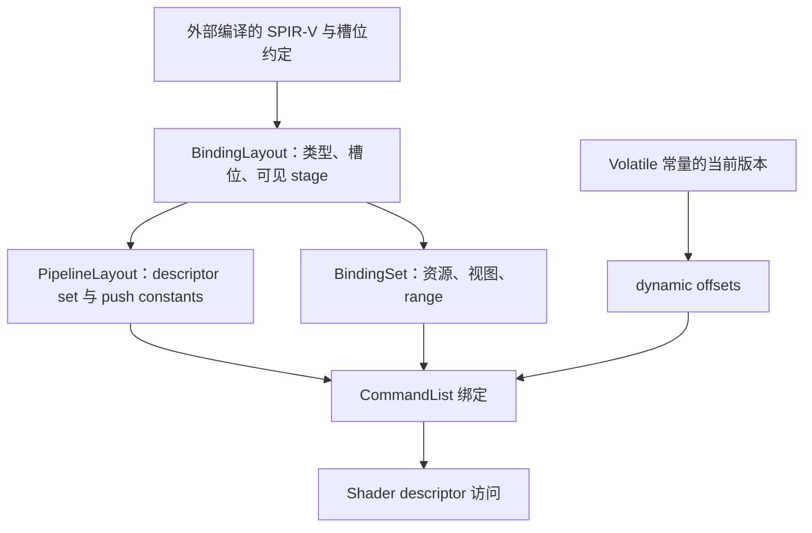

# NVRHI · 资源、绑定与 Pipeline

[NVRHI 技术目录](../NVRHI_RHI_Vulkan_Analysis.md) · [源码索引](SourceIndex.md#na)

<a id="n3"></a>
## 3. 资源实现：从描述到内存、视图和状态元数据

### 3.1 模块架构：一个资源不是只有一个 Vulkan Handle

| 对象内部组成 | 用途 | 谁使用 |
|---|---|---|
| 公共 Desc | 字节数、格式、维度、用途、初始状态等 | 验证与所有后续操作 |
| VkBuffer / VkImage | 原生资源 | 命令记录与视图创建 |
| MemoryResource | 内存、managed 归属 | allocator / 析构 |
| 状态扩展数据 | permanent state、纹理首次初始化等 | 通用状态跟踪器 |
| 视图缓存 | typed buffer view、image subresource view | BindingSet / Framebuffer |
| 可选附加数据 | device address、共享句柄、volatile versions | RT、共享、上传/绑定 |

因此内存大小、逻辑 byteSize、descriptor range 和视图覆盖范围不能混为一项。Volatile Buffer 的物理分配尤其可能远大于其一次写入的逻辑常量大小。[N14](SourceIndex.md#n14) [N21](SourceIndex.md#n21) [N22](SourceIndex.md#n22) [N30](SourceIndex.md#n30)

### 3.2 Buffer：Desc 的用途位决定原生 usage

```cpp
createBuffer(D) {
    validateBasicConstraints(D); // 如 volatile 必须为常量且 maxVersions>0
    usage = TRANSFER_SRC | TRANSFER_DST;

    if (D.isVertexBuffer) usage |= VERTEX_BUFFER;
    if (D.isIndexBuffer) usage |= INDEX_BUFFER;
    if (D.isDrawIndirectArgs) usage |= INDIRECT_BUFFER;
    if (D.isConstantBuffer) usage |= UNIFORM_BUFFER;
    if (D.structStride || D.canHaveUAVs || D.canHaveRawViews)
        usage |= STORAGE_BUFFER;
    if (D.canHaveTypedViews) usage |= UNIFORM_TEXEL_BUFFER;
    if (D.canHaveTypedViews && D.canHaveUAVs) usage |= STORAGE_TEXEL_BUFFER;
    usage |= optionalAccelerationStructureSbtAndDeviceAddressFlags(D);

    physicalSize = computeActualSize(D); // volatile 多版本；小普通 buffer 4 字节补齐
    buffer = vkCreateBuffer(physicalSize, usage, EXCLUSIVE);
    if (!D.isVirtual) {
        memory = allocator.allocateBufferMemory(buffer, D.cpuAccess, ...);
        vkBindBufferMemory(buffer, memory, 0);
    }
    if (D.isVolatile) persistentlyMapAndInitializeVersions(...);
    return wrapper(D, buffer, memory, ...);
}
```

UAV、typed view、raw view 对应不同 descriptor/usage 路径。仅把字节数组创建成功，不意味着之后可以任意换成另一种原生用途。Buffer 的 device address 也同时依赖 usage 和 allocation flags。[N14](SourceIndex.md#n14)

### 3.3 Texture：格式、类型、样本、视图和布局是协同关系

```cpp
createTexture(D) {
    native = fillTextureInfo(D); // image type、extent、layers、mips、format、samples
    usage = TRANSFER_SRC | TRANSFER_DST;
    if (D.isShaderResource) usage |= SAMPLED;
    if (D.isRenderTarget)
        usage |= isDepth(D.format) ? DEPTH_STENCIL_ATTACHMENT : COLOR_ATTACHMENT;
    if (D.isUAV) usage |= STORAGE;
    if (D.isShadingRateSurface) usage |= FRAGMENT_SHADING_RATE_ATTACHMENT;

    flags = dimensionAndMutableFormatFlags(D);
    if (D.isTiled) flags |= sparseFlags;
    image = vkCreateImage(native, usage, flags, ...);
    if (!D.isVirtual && !D.isTiled)
        allocateAndBindDeviceLocalMemory(image);

    return Texture(D, image, stateInitialized=false, ...);
}

getSubresourceView(range, dimension, format, viewType, componentMapping) {
    key = normalizeViewRequest(...);
    if (!views.contains(key))
        views[key] = vkCreateImageView(image, key);
    return views[key];
}
```

同一 VkImage 可以在一个 mip 上当 RenderTarget、在另一组 mip 上作为 SRV；视图描述“看哪一部分”，状态跟踪描述“这些部分当前怎样被访问”。两者必须覆盖一致的 subresource 范围。[N22](SourceIndex.md#n22)

### 3.4 默认分配器：按资源分配，不要假设已经全局子分配

当前 VulkanAllocator 的普通 Buffer/Image 路径查询 MemoryRequirements，寻找满足 memoryTypeBits 与属性的 memory type，调用 allocateMemory，再以 offset=0 绑定。对这类普通资源还带 dedicated allocation 信息。[N21](SourceIndex.md#n21)

| CpuAccess | 选择的内存属性 | 直接意义 |
|---|---|---|
| None | DEVICE_LOCAL | 通常由 GPU 使用，CPU 通过上传路径写入 |
| Read | HOST_VISIBLE + HOST_CACHED | CPU 可读映射存储；缓存可见性仍须看实际实现 |
| Write | HOST_VISIBLE | CPU 可写映射存储；不保证 HOST_COHERENT |
| Texture 默认 | DEVICE_LOCAL | 图像内存由复制/渲染更新 |

```cpp
allocateMemory(req, wantedFlags, optionalAddressOrExport, dedicatedResource) {
    type = firstMemoryType(
        bitIsSet(req.memoryTypeBits) &&
        containsAll(memoryType.properties, wantedFlags));
    info.size = req.size;
    info.typeIndex = type;
    appendAllocationFlagsAndDedicatedOrExportInfo(info, ...);
    return vkAllocateMemory(info);
}
```

所以应区分三件事：普通资源的默认独立分配，虚拟资源+Heap 的显式绑定，以及 UploadManager 在自己管理的 BufferChunk 内子分配。不能因为 NVRHI 有 upload suballocation 就推断所有 device-local 资源都由 VMA 式全局池管理。[N15](SourceIndex.md#n15) [N21](SourceIndex.md#n21)

创建完成的资源还不能直接被 Shader 正确读取：接下来先建立资源槽位 ABI，再在命令记录阶段准备其内容和用途状态。

<a id="n4"></a>
## 4. Shader 与绑定：建立跨 API 的资源 ABI

### 4.1 模块架构：四个对象共同描述一次 Shader 访问



Shader、Layout、Set、PipelineLayout 和 dynamic offsets 构成同一 ABI。只核对 Shader 里的 register 名称，而不核对其 Vulkan binding/set 映射，不能保证实际绑定正确。[N08](SourceIndex.md#n08) [N09](SourceIndex.md#n09) [N25](SourceIndex.md#n25)

### 4.2 Shader：接收字节码，不承担材质或 HLSL 编译

Vulkan createShader 接收已经编译的 SPIR-V，创建 VkShaderModule，并保存入口与 stage 等信息。Shader specialization 复用基础 ShaderModule，通过父对象强引用保证其存活；常量值在创建 Pipeline 时放入 specialization info。ShaderLibrary 则可承载多个入口共享的模块。[N25](SourceIndex.md#n25)

```cpp
createShader(desc, spirv) {
    module = vkCreateShaderModule(spirv);
    return Shader(desc, module);
}

createShaderSpecialization(base, constants) {
    derived.baseShader = base.rootOrSelf(); // 持有强引用
    derived.module = base.module;          // 不重复创建模块
    derived.specializationConstants = constants;
    return derived;
}
```

NVRHI 不在这里做 Filament 的材质模板拼接、变体生成和 BRDF 注入。Shader 的 descriptor decorations、常量内存布局、矩阵约定由外部编译结果与公共接口共同约定；RHI 不会替调用者修复错误的结构体偏移。[N02](SourceIndex.md#n02) [N25](SourceIndex.md#n25)

### 4.3 BindingLayout：寄存器命名空间转为 Vulkan binding

默认 VulkanBindingOffsets 为 SRV=0、Sampler=128、CBV=256、UAV=384。常规布局中，实际 binding=该类型偏移+slot，以避免 HLSL 的 t0、s0、b0、u0 落在同一 Vulkan binding。[N08](SourceIndex.md#n08) [N09](SourceIndex.md#n09)

| 上层槽位示例 | 原生 binding 默认值 | 常见 descriptor type |
|---|---:|---|
| Texture SRV t3 | 3 | SAMPLED_IMAGE |
| Sampler s2 | 130 | SAMPLER |
| ConstantBuffer b0 | 256 | UNIFORM_BUFFER |
| VolatileConstantBuffer b1 | 257 | UNIFORM_BUFFER_DYNAMIC |
| Texture UAV u4 | 388 | STORAGE_IMAGE |
| Structured/Raw Buffer SRV | 0+slot | STORAGE_BUFFER |
| Typed Buffer SRV/UAV | 类型偏移+slot | UNIFORM_TEXEL_BUFFER / STORAGE_TEXEL_BUFFER |
| PushConstants | 不生成 descriptor | PipelineLayout 中的 range |

```cpp
BindingLayout::construct(desc) {
    for (item : desc.bindings) {
        if (item.type == PushConstants) continue;
        nativeBindings += {
            binding: offsetForType(desc.bindingOffsets, item.type) + item.slot,
            type: convertResourceType(item.type),
            count: item.size,
            stages: convertVisibility(desc.visibility)
        };
    }
    descriptorSetLayout = vkCreateDescriptorSetLayout(nativeBindings, flags);
}
```

这些偏移必须和 SPIR-V 的生成规则一致，并不是 Vulkan 自动理解 HLSL 寄存器的机制。

默认多布局路径按 Pipeline 的布局顺序组织 descriptor set。启用 `registerSpaceIsDescriptorSet` 时，则按 registerSpace 建立 set-index→binding-index 映射，并为未占用的 set 位置提供布局占位。该开关必须在同一 Pipeline 的所有常规布局中一致，且不能重复占同一 registerSpace。[N08](SourceIndex.md#n08) [N09](SourceIndex.md#n09)

### 4.4 BindingSet：创建时写 descriptor，执行时处理资源状态

```cpp
createBindingSet(desc, layout) {
    set.layout = layout;
    set.pool = vkCreateDescriptorPool(layout.poolSizes, maxSets=1);
    set.native = vkAllocateDescriptorSet(set.pool, layout.native);

    for (item : desc.bindings) {
        if (!item.resource) continue;
        set.resources.pushStrongRef(item.resource);

        viewOrRange = resolveTextureViewOrBufferRange(item);
        write = buildDescriptorWrite(item, layout.offsets, viewOrRange);
        writes.push(write);

        if (resourceNeedsTransitions(item))
            set.transitionBindings.push(item.index);
        recordVolatileConstantBufferAndUavMetadata(item, set);
    }
    vkUpdateDescriptorSets(writes);
    return set;
}
```

当前常规 BindingSet 每个对象创建一个 maxSets=1 的 DescriptorPool；这不能被描述成全局批量池。创建 Set 时缓存资源引用和需转换的 binding 索引，是为了让后续 setGraphicsState/setComputeState 不必每次重新解释完整描述。[N09](SourceIndex.md#n09)

Descriptor 里写的 imageLayout 不是转换命令。Texture SRV 通常写 ShaderReadOnlyOptimal，深度/模板 SRV 则写 DepthStencilReadOnlyOptimal，以兼容只读深度附件和采样的共同用途；UAV 写 General。第 7 节必须实际转换到与 descriptor 一致的状态。[N09](SourceIndex.md#n09) [N12](SourceIndex.md#n12)

### 4.5 Bindless：描述符表可变，访问集合由上层提供

BindlessLayout 生成数组布局，DescriptorTable 管理容量和元素写入；Immutable、Mutable 等布局类型走不同 descriptor 类型/扩展分支。相关 layout/pool 使用 partially-bound、update-after-bind 等条件标志，Uniform Buffer 的 update-after-bind 还受单独 feature 控制。[N03](SourceIndex.md#n03) [N09](SourceIndex.md#n09)

```cpp
table = createDescriptorTable(bindlessLayout);
resizeDescriptorTable(table, capacity);
writeDescriptorTable(table, elementIndex, textureView);
// 后续 Graphics/Compute/RT state 把 table 当作相应布局的绑定对象。
```

普通 BindingSet 的状态转换可以遍历其确定的资源；bindless 的索引可能在 Shader 运行时才决定，当前自动状态推导跳过这种访问集合。调用者要显式准备实际可访问资源的状态，并遵守描述符更新与在途使用的 Vulkan 约束。Update-after-bind 也不等于任意时刻覆盖 GPU 正在读取的同一元素都正确。[N09](SourceIndex.md#n09) [N12](SourceIndex.md#n12)

<a id="n5"></a>
## 5. Pipeline 与附件：将不可变状态和可变目标分开

### 5.1 模块架构：两个创建结果在 setGraphicsState 汇合

| 创建结果 | 固化内容 | 保留到执行时的变量 |
|---|---|---|
| PipelineLayout | Set layouts、映射、PushConstant range | 实际 descriptor set / 动态偏移 / push constant 值 |
| GraphicsPipeline | Shader stages、顶点输入、光栅/混合/深度状态、附件格式与样本 | Vertex/IndexBuffer、viewport/scissor、FrameBuffer |
| Framebuffer | 具体附件 Texture/View、尺寸、层数、只读深度标志 | 何时开始/结束 rendering、何时 clear |
| ComputePipeline | CS、布局、specialization | 绑定资源、dispatch 维度 |

这种分离允许 Pipeline 根据兼容信息创建，无需提前知道每一帧 SwapChain image 的 VkImageView。[N10](SourceIndex.md#n10) [N26](SourceIndex.md#n26)

### 5.2 GraphicsPipeline 的 Vulkan 创建链

```cpp
createGraphicsPipeline(desc, framebufferInfo) {
    pso.layout = createPipelineLayout(desc.bindingLayouts, pushConstantRanges);
    stages = translateShaderStagesAndSpecialization(desc.shaders);
    vertexInput = translateInputLayout(desc.inputLayout);
    raster = translateRasterizer(desc.renderState);
    depthStencil = translateDepthStencil(desc.renderState);
    blend = translateBlendState(desc.renderState, framebufferInfo.colorFormats);
    multisample = translateSamples(framebufferInfo);

    renderingInfo = PipelineRenderingCreateInfo(
        framebufferInfo.colorFormats,
        framebufferInfo.depthStencilFormat);

    pso.native = vkCreateGraphicsPipelines(
        stages, vertexInput, raster, depthStencil, blend, multisample,
        dynamicViewportScissorAndOtherStates, pso.layout, renderingInfo);
    return pso;
}
```

当前 Vulkan 使用 VkPipelineRenderingCreateInfo 与 dynamic rendering，不在这一步创建一个 VkRenderPass 再绑定 VkFramebuffer。成员名 beginRenderPass/endRenderPass 是库内部名称，实际调用为 beginRendering/endRendering。[N10](SourceIndex.md#n10)

### 5.3 Framebuffer 实际存的是附件描述和引用

```cpp
createFramebuffer(desc) {
    fb.info = deriveFormatsSamplesDimensions(desc);
    for (attachment : desc.colors) {
        view = attachment.texture.getSubresourceView(attachment.range, ...);
        fb.colors += RenderingAttachmentInfo(
            view, ColorAttachmentOptimal, LOAD, STORE);
        fb.resources += strongRef(attachment.texture);
    }
    if (desc.depth.valid)
        fb.depth = depthAttachmentInfo(
            desc.depth.isReadOnly ? DepthStencilReadOnlyOptimal
                                  : DepthStencilAttachmentOptimal,
            LOAD, STORE);
    return fb; // 没有在这里创建 VkFramebuffer
}

beginRenderPass(fb) {
    endRenderPass();
    vkCmdBeginRendering(fb.area, fb.layers, fb.colors, fb.depth, fb.stencil, ...);
    retain(fb);
}
```

当前附件使用 LOAD/STORE。Clear 通过显式 clearTexture 等命令路径处理，不能把一份通用渲染图的 load/store 优化方案当作 NVRHI 已有的 FrameGraph 编译行为。若内容没有初始化，LOAD 也不会使其自动变成指定背景色。[N10](SourceIndex.md#n10) [N22](SourceIndex.md#n22)

### 5.4 Pipeline 切换不等于每次 Draw 重建 Pipeline

资源、Shader、Layout 和 Pipeline 由 Device 创建后复用。CommandList 缓存当前绑定，setGraphicsState 比较相关对象/状态，按实现条件发出必要 vkCmdBind*。PSO 创建成本与每 Draw 的绑定成本因此处在不同时间点。接下来需要一个记录上下文，容纳这些状态变化和上传命令。[N06](SourceIndex.md#n06) [N10](SourceIndex.md#n10)
