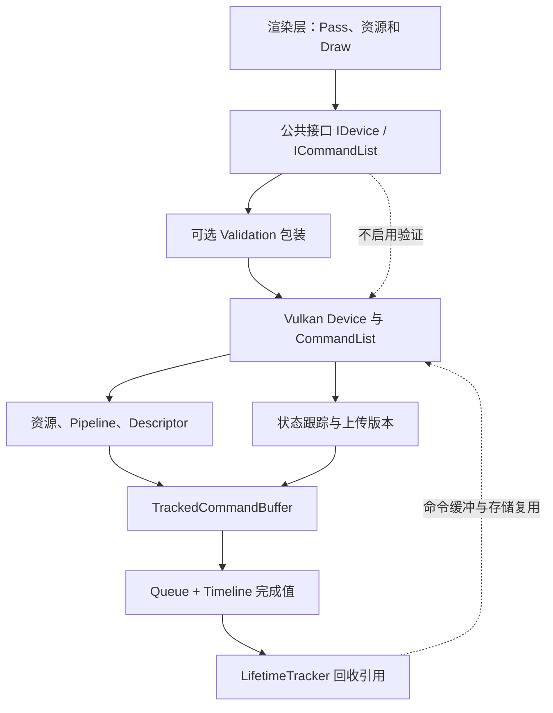
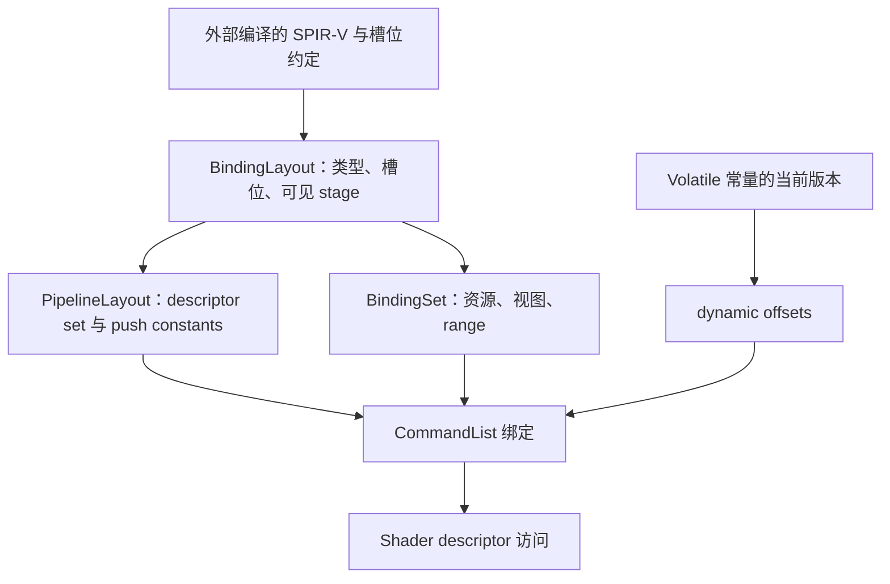
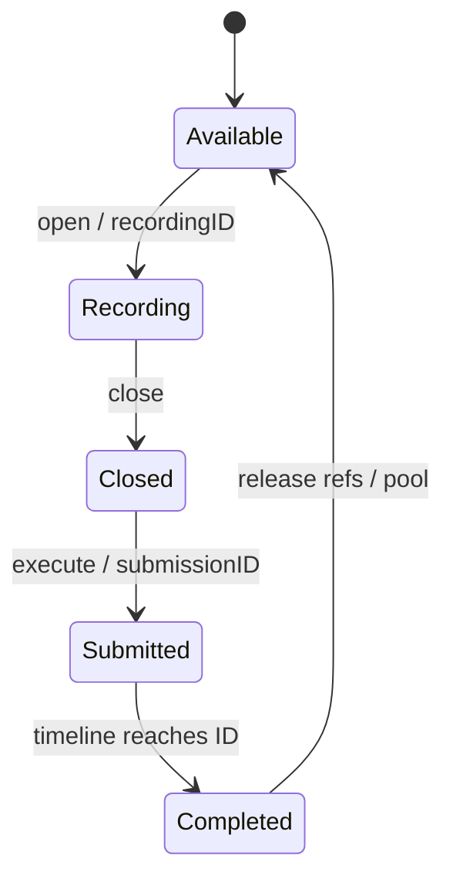
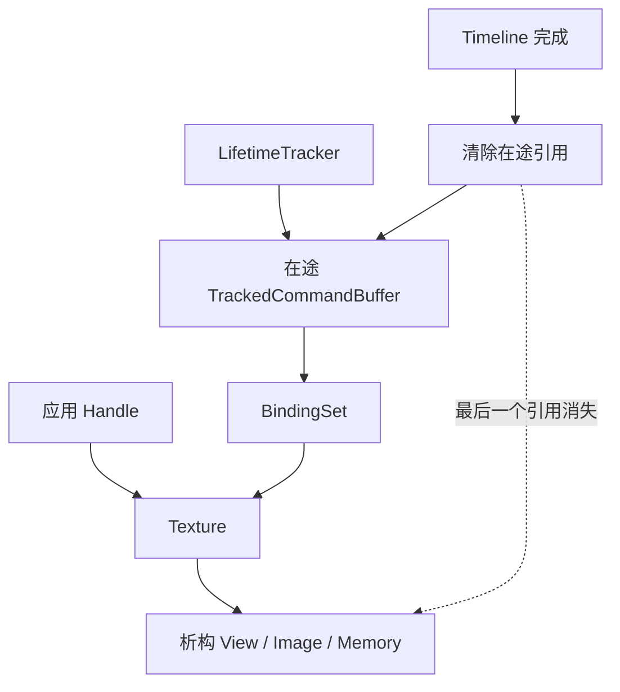

# NVRHI：顶层架构与 Vulkan 执行链技术分析

> 分析基线：[NVIDIA-RTX/NVRHI @ 6b96fb03e07539f08327aea76c56d55f1de9d906](https://github.com/NVIDIA-RTX/NVRHI/tree/6b96fb03e07539f08327aea76c56d55f1de9d906)。
>
> 本文先建立 RHI 的对象、状态和生存期架构，再沿 Vulkan 的“创建 → 绑定 → 记录 → 同步 → 提交 → 回收”展开。伪代码用于还原程序逻辑，省略模板、错误传播和部分扩展条件；概念辅助函数不代表实际 API。接口和行为以本固定版本源码为准。
>
> 配套文档：[Filament_Rendering_Pipeline_Analysis.md](Filament_Rendering_Pipeline_Analysis.md)。Filament 分析说明渲染层如何决定一帧的工作；本文说明同一类绘制需求进入 RHI 后如何成为可执行、可同步、可回收的 Vulkan 工作。Filament 实际使用自己的 backend，不依赖 NVRHI。

## 目录

- [0. 整体架构：RHI 如何接住渲染管线的执行需求](#n0)
- [1. 顶层接口：对象、状态、命令和所有权](#n1)
- [2. Vulkan 入口：把外部原生设备接入公共架构](#n2)
- [3. 资源实现：从描述到内存、视图和状态元数据](#n3)
- [4. Shader 与绑定：建立跨 API 的资源 ABI](#n4)
- [5. Pipeline 与附件：将不可变状态和可变目标分开](#n5)
- [6. 记录与上传：CommandList、UploadManager 和常量版本](#n6)
- [7. 资源状态：从用途推导到 Vulkan Barrier](#n7)
- [8. 执行状态：Graphics、Compute 与原生 Draw](#n8)
- [9. 队列提交：完成值、跨队列等待和线程关系](#n9)
- [10. 完成与回收：让 GPU 生存期闭环](#n10)
- [11. 扩展路径：原生互操作、稀疏资源和光线追踪](#n11)
- [12. 完整例程：把一次上传、绘制和采样贯穿起来](#n12)
- [A. 源码索引](#na)

<a id="n0"></a>
## 0. 整体架构：RHI 如何接住渲染管线的执行需求

### 0.1 先明确顶层的执行边界

渲染前端已经确定几何、Shader、目标附件、资源绑定和执行顺序。NVRHI 把这些要求组织成公共对象及命令接口，并处理状态转换、上传存储、在途引用和原生命令提交。它包含 D3D11、D3D12、Vulkan 后端；本文后端部分聚焦 Vulkan。[N01] [N04]

| 渲染层交给 RHI 的内容 | 公共表达 | Vulkan 继续完成的工作 |
|---|---|---|
| 几何、常量、图像 | BufferDesc / TextureDesc | VkBuffer / VkImage、内存和视图 |
| 已编译 Shader 与固定状态 | ShaderDesc / GraphicsPipelineDesc | ShaderModule、PipelineLayout、VkPipeline |
| Shader 要读写哪些资源 | BindingLayout / BindingSet | DescriptorSetLayout / DescriptorSet |
| 写哪些颜色、深度目标 | Framebuffer / FramebufferInfo | 附件视图和 dynamic rendering |
| 本次 Draw 的全部输入 | GraphicsState + DrawArguments | 资源状态、绑定缓存、vkCmdDraw* |
| 哪些工作必须先完成 | ResourceStates、queue wait | Barrier、semaphore、queue submit |
| 何时允许释放或重写 | Handle、提交 ID、lifetime tracker | 在途保活、版本复用和命令缓冲回收 |

NVRHI 不构造 Scene/View、材质 BRDF、灯光剔除或 FrameGraph，也不创建窗口和 SwapChain。应用负责创建原生设备/队列，并把原生对象交给 Vulkan DeviceDesc。这个边界使执行层既可服务复杂渲染图，也可直接服务一个手工组织的 Pass。[N02] [N03]

### 0.2 总体分层与对象依赖



Validation 负责检查公共 API 使用约束，并转发到被包装 Device。通用状态跟踪器保存抽象 ResourceStates；Vulkan 模块把它转换为 layout、stage、access；Queue 和 LifetimeTracker 处理提交后的生存期。这些是协同工作的部件，不是彼此独立的功能清单。[N06] [N11] [N12] [N19]

### 0.3 一次工作有三个彼此关联的状态机

| 状态机 | 主要状态 | 管理者 | 与其他状态机的联系 |
|---|---|---|---|
| 命令执行 | 空闲、记录、关闭、提交、完成 | CommandList / Queue | 提交时产生 GPU 完成值 |
| 资源用途 | CopyDest、ShaderResource、RenderTarget、UAV 等 | CommandListResourceStateTracker | 用途变化生成命令；不负责完成等待 |
| 内存/对象生存期 | 空闲、记录占用、在途、可复用 | Upload/Volatile/LifetimeTracker | 使用记录 ID 和提交 ID 标记归属 |

```cpp
// 公共架构的逻辑骨架，不含窗口系统和呈现。
resources = device.createResources(...);
bindings  = device.createBindingSet(...);
pipeline  = device.createGraphicsPipeline(...);

cmd.open();                          // 取得一个可记录原生命令缓冲
cmd.writeBuffer(...);               // 上传、用途转换、引用保活
cmd.setGraphicsState(...);          // 推导用途、提交 barrier、设置执行状态
cmd.drawIndexed(...);               // 原生绘制命令
cmd.close();                         // 恢复受协议管理的初始状态并结束记录
ticket = device.executeCommandList(cmd); // 转为提交 ID

// CPU 可继续准备后续工作；完成后才能重用对应在途存储。
device.runGarbageCollection();
```

这里的 RHI CommandList 不是 Filament 的 CPU CommandStream。Vulkan 的 NVRHI 方法通常直接向当前 VkCommandBuffer 记录；它仍是 GPU 延迟执行，但没有先把每个 API 调用包装成 Filament 那样的第二层 CPU 命令流。[N06]

<a id="n1"></a>
## 1. 顶层接口：对象、状态、命令和所有权

### 1.1 模块架构：Device 创建对象，CommandList 引用对象

| 公共对象 | 主要承载内容 | 后续消费者 |
|---|---|---|
| IDevice | 创建对象、执行命令、查询能力与完成 | 所有上层模块 |
| IBuffer / ITexture / ISampler | 描述、原生资源、状态元数据 | BindingSet、Framebuffer、复制/绘制命令 |
| IShader / IInputLayout | Shader 字节码、顶点属性格式 | Pipeline 创建 |
| IBindingLayout | 槽位类型、数量、stage visibility | BindingSet 与 PipelineLayout |
| IBindingSet / IDescriptorTable | 实际资源集合/可变索引表 | Graphics/Compute/RT 状态 |
| IGraphicsPipeline 等 | Shader、布局、固定管线状态 | CommandList 状态设置 |
| IFramebuffer | 附件及其兼容信息 | GraphicsState |
| ICommandList | 当前记录上下文与缓存状态 | Device::executeCommandLists |
| EventQuery / TimerQuery | 队列完成位置或 GPU 时间 | CPU 同步/性能读取 |

公共层采用描述结构体构造对象，使用 RefCountPtr/Handle 管理引用。GraphicsState 组合已有对象；DrawArguments 提供本次计数和起点。因此“创建 Pipeline”“绑定资源”“修改每 Draw 参数”不需要每次都重新构造全部对象。[N04] [N05]

### 1.2 不可变对象与可变记录上下文的配合

```cpp
// 仅示意数据关系。
struct PipelineContract {
    Shaders shaders;
    BindingLayouts layouts;
    InputLayout input;
    RenderState rasterDepthBlend;
    FramebufferInfo targetCompatibility;
};

struct DrawState {
    PipelineHandle pipeline;       // 固定功能与 Shader
    FramebufferHandle framebuffer; // 本次实际附件
    BindingSetHandles bindings;    // 本次资源
    VertexIndexBindings geometry;
    ViewportScissor viewport;
};

cmd.setGraphicsState(drawState);
cmd.setPushConstants(&smallData, sizeof(smallData));
cmd.drawIndexed(drawArgs);
```

Pipeline 的兼容性信息只包含格式、样本等要求，不把某一帧的具体颜色纹理固化进 Pipeline。相同 BindingLayout 可配多份 BindingSet；相同 Pipeline 可配兼容的不同 Framebuffer。这是对象复用和运行时状态切换的主要支点。[N04] [N09] [N10]

### 1.3 引用计数解决 CPU 所有权，在途引用补上 GPU 生存期

```text
ApplicationHandle -> Resource
BindingSetHandle  -> referenced Resources
PipelineHandle    -> Shader / Layout / other dependent objects
FramebufferHandle -> Attachment Textures

TrackedCommandBuffer -> used Resources / BindingSets / Pipelines / CommandList
QueueLifetimeTracker -> submitted TrackedCommandBuffers
```

上述箭头表示持有引用的逻辑关系，不是类继承。默认路径中，应用释放自己的 Handle 后，只要在途命令还保留相关对象，它就不会立即析构。完成后 LifetimeTracker 清理在途引用，才可能触发资源析构和原生释放。[N05] [N07] [N30]

BindingSet 等对象的 `trackLiveness=false` 是明确的责任转移：调用者必须保证所依赖对象在 GPU 完成前不被释放。它不是关闭状态跟踪；状态跟踪与生存期跟踪控制的是不同问题。[N04] [N09]

### 1.4 状态协议是 RHI 与调用者的契约

调用者需要让 RHI 知道资源进入命令列表时处于什么状态。典型途径包括：
- `keepInitialState`：命令列表局部从约定状态进入，并在 close 时恢复；新纹理首次初始化有专门处理。
- `beginTrackingTextureState / beginTrackingBufferState`：调用者显式声明当前状态。
- permanent state：在提交协议中将资源约束为一个长期状态，并限制后续不兼容使用。

这些方式在第 7 节展开。它们说明自动 barrier 不是全局 FrameGraph：NVRHI 不会凭空推断多个独立命令列表之间的全部先后关系，更不会从 Shader 任意数组索引恢复 bindless 访问集合。[N02] [N11]

<a id="n2"></a>
## 2. Vulkan 入口：把外部原生设备接入公共架构

### 2.1 模块架构

Vulkan Device 包含共享 VulkanContext、VulkanAllocator、各 CommandQueue 的 Queue 包装和公共对象创建入口。CommandList 保存对 Device/Context 的联系；资源对象使用同一个 Context 与 allocator，以保证函数分发、分配回调和原生设备一致。[N03] [N20] [N30]

```cpp
// 外部创建原生 instance / physicalDevice / device / queues。
nvrhi::vulkan::DeviceDesc desc = {};
desc.instance = instance;
desc.physicalDevice = physicalDevice;
desc.device = vkDevice;
desc.graphicsQueue = graphicsQueue;
desc.graphicsQueueIndex = graphicsFamily; // 此字段用于 queue family index
desc.computeQueue = computeQueueOrNull;
desc.computeQueueIndex = computeFamily;
desc.deviceExtensions = enabledExtensionNames;
desc.numDeviceExtensions = enabledExtensionCount;
desc.bufferDeviceAddressSupported = enabledFeatures.bufferDeviceAddress;
desc.errorCB = messageCallback;

DeviceHandle nativeRhi = nvrhi::vulkan::createDevice(desc);
DeviceHandle rhi = optionallyWrapWithValidation(nativeRhi);
```

这里交付的是**创建时实际启用**的信息。物理设备支持某个扩展，不等于外部 VkDevice 已启用对应 feature。NVRHI 需要以这些信息选择 descriptor、buffer address、ray tracing 等分支；不能在包装已创建的 Device 时补启用缺失 feature。[N03] [N20]

### 2.2 设备能力如何进入对象和命令

```cpp
Device::Device(desc) {
    context = initializeDispatchAndContext(desc);
    context.properties = queryPhysicalDeviceProperties();
    context.extensions = interpretEnabledExtensions(desc);
    context.features = queryRelevantFeatureStructures();

    for (QueueType q : graphicsComputeCopy) {
        if (desc.nativeQueue(q))
            queues[q] = Queue(context, q, desc.nativeQueue(q), desc.family(q));
    }
    initializeSharedLayoutsAndQueryStorage(...);
}
```

这是初始化职责概要。能力数据并不只用于返回 queryFeatureSupport：资源创建选择 usage/allocate flags，BindingLayout 选择 update-after-bind，Pipeline 选择扩展结构，执行命令选择扩展入口，都读取同一上下文中的条件。[N20] [N30]

Vulkan 1.3 是仓库说明的基础 API 目标，但 Timeline、dynamic rendering、synchronization2、descriptor indexing、RT 等仍须按具体入口和已启用能力理解。接口存在不表示当前设备具备其所有扩展能力。[N01] [N03]

### 2.3 原生对象归属

外部 VkDevice/VkQueue 不是由这层新建的窗口设备系统。包装原生 Texture 时，NVRHI 设置 `managed=false`，管理自己的视图等包装数据，但不销毁传入的 VkImage/内存。TextureDesc 必须如实描述格式、维度和用途，状态入口也要与真实状态一致。[N22]

这个归属规则直接进入第 3 节：创建原生资源和包装外部原生资源共享上层接口，但析构行为不同。

<a id="n3"></a>
## 3. 资源实现：从描述到内存、视图和状态元数据

### 3.1 模块架构：一个资源不是只有一个 Vulkan Handle

| 对象内部组成 | 用途 | 谁使用 |
|---|---|---|
| 公共 Desc | 字节数、格式、维度、用途、初始状态等 | 验证与所有后续操作 |
| VkBuffer / VkImage | 原生资源 | 命令记录与视图创建 |
| MemoryResource | 内存、managed 归属 | allocator / 析构 |
| 状态扩展数据 | permanent state、纹理首次初始化等 | 通用状态跟踪器 |
| 视图缓存 | typed buffer view、image subresource view | BindingSet / Framebuffer |
| 可选附加数据 | device address、共享句柄、volatile versions | RT、共享、上传/绑定 |

因此内存大小、逻辑 byteSize、descriptor range 和视图覆盖范围不能混为一项。Volatile Buffer 的物理分配尤其可能远大于其一次写入的逻辑常量大小。[N14] [N21] [N22] [N30]

### 3.2 Buffer：Desc 的用途位决定原生 usage

```cpp
createBuffer(D) {
    validateBasicConstraints(D); // 如 volatile 必须为常量且 maxVersions>0
    usage = TRANSFER_SRC | TRANSFER_DST;

    if (D.isVertexBuffer) usage |= VERTEX_BUFFER;
    if (D.isIndexBuffer) usage |= INDEX_BUFFER;
    if (D.isDrawIndirectArgs) usage |= INDIRECT_BUFFER;
    if (D.isConstantBuffer) usage |= UNIFORM_BUFFER;
    if (D.structStride || D.canHaveUAVs || D.canHaveRawViews)
        usage |= STORAGE_BUFFER;
    if (D.canHaveTypedViews) usage |= UNIFORM_TEXEL_BUFFER;
    if (D.canHaveTypedViews && D.canHaveUAVs) usage |= STORAGE_TEXEL_BUFFER;
    usage |= optionalAccelerationStructureSbtAndDeviceAddressFlags(D);

    physicalSize = computeActualSize(D); // volatile 多版本；小普通 buffer 4 字节补齐
    buffer = vkCreateBuffer(physicalSize, usage, EXCLUSIVE);
    if (!D.isVirtual) {
        memory = allocator.allocateBufferMemory(buffer, D.cpuAccess, ...);
        vkBindBufferMemory(buffer, memory, 0);
    }
    if (D.isVolatile) persistentlyMapAndInitializeVersions(...);
    return wrapper(D, buffer, memory, ...);
}
```

UAV、typed view、raw view 对应不同 descriptor/usage 路径。仅把字节数组创建成功，不意味着之后可以任意换成另一种原生用途。Buffer 的 device address 也同时依赖 usage 和 allocation flags。[N14]

### 3.3 Texture：格式、类型、样本、视图和布局是协同关系

```cpp
createTexture(D) {
    native = fillTextureInfo(D); // image type、extent、layers、mips、format、samples
    usage = TRANSFER_SRC | TRANSFER_DST;
    if (D.isShaderResource) usage |= SAMPLED;
    if (D.isRenderTarget)
        usage |= isDepth(D.format) ? DEPTH_STENCIL_ATTACHMENT : COLOR_ATTACHMENT;
    if (D.isUAV) usage |= STORAGE;
    if (D.isShadingRateSurface) usage |= FRAGMENT_SHADING_RATE_ATTACHMENT;

    flags = dimensionAndMutableFormatFlags(D);
    if (D.isTiled) flags |= sparseFlags;
    image = vkCreateImage(native, usage, flags, ...);
    if (!D.isVirtual && !D.isTiled)
        allocateAndBindDeviceLocalMemory(image);

    return Texture(D, image, stateInitialized=false, ...);
}

getSubresourceView(range, dimension, format, viewType, componentMapping) {
    key = normalizeViewRequest(...);
    if (!views.contains(key))
        views[key] = vkCreateImageView(image, key);
    return views[key];
}
```

同一 VkImage 可以在一个 mip 上当 RenderTarget、在另一组 mip 上作为 SRV；视图描述“看哪一部分”，状态跟踪描述“这些部分当前怎样被访问”。两者必须覆盖一致的 subresource 范围。[N22]

### 3.4 默认分配器：按资源分配，不要假设已经全局子分配

当前 VulkanAllocator 的普通 Buffer/Image 路径查询 MemoryRequirements，寻找满足 memoryTypeBits 与属性的 memory type，调用 allocateMemory，再以 offset=0 绑定。对这类普通资源还带 dedicated allocation 信息。[N21]

| CpuAccess | 选择的内存属性 | 直接意义 |
|---|---|---|
| None | DEVICE_LOCAL | 通常由 GPU 使用，CPU 通过上传路径写入 |
| Read | HOST_VISIBLE + HOST_CACHED | CPU 可读映射存储；缓存可见性仍须看实际实现 |
| Write | HOST_VISIBLE | CPU 可写映射存储；不保证 HOST_COHERENT |
| Texture 默认 | DEVICE_LOCAL | 图像内存由复制/渲染更新 |

```cpp
allocateMemory(req, wantedFlags, optionalAddressOrExport, dedicatedResource) {
    type = firstMemoryType(
        bitIsSet(req.memoryTypeBits) &&
        containsAll(memoryType.properties, wantedFlags));
    info.size = req.size;
    info.typeIndex = type;
    appendAllocationFlagsAndDedicatedOrExportInfo(info, ...);
    return vkAllocateMemory(info);
}
```

所以应区分三件事：普通资源的默认独立分配，虚拟资源+Heap 的显式绑定，以及 UploadManager 在自己管理的 BufferChunk 内子分配。不能因为 NVRHI 有 upload suballocation 就推断所有 device-local 资源都由 VMA 式全局池管理。[N15] [N21]

创建完成的资源还不能直接被 Shader 正确读取：接下来先建立资源槽位 ABI，再在命令记录阶段准备其内容和用途状态。

<a id="n4"></a>
## 4. Shader 与绑定：建立跨 API 的资源 ABI

### 4.1 模块架构：四个对象共同描述一次 Shader 访问



Shader、Layout、Set、PipelineLayout 和 dynamic offsets 构成同一 ABI。只核对 Shader 里的 register 名称，而不核对其 Vulkan binding/set 映射，不能保证实际绑定正确。[N08] [N09] [N25]

### 4.2 Shader：接收字节码，不承担材质或 HLSL 编译

Vulkan createShader 接收已经编译的 SPIR-V，创建 VkShaderModule，并保存入口与 stage 等信息。Shader specialization 复用基础 ShaderModule，通过父对象强引用保证其存活；常量值在创建 Pipeline 时放入 specialization info。ShaderLibrary 则可承载多个入口共享的模块。[N25]

```cpp
createShader(desc, spirv) {
    module = vkCreateShaderModule(spirv);
    return Shader(desc, module);
}

createShaderSpecialization(base, constants) {
    derived.baseShader = base.rootOrSelf(); // 持有强引用
    derived.module = base.module;          // 不重复创建模块
    derived.specializationConstants = constants;
    return derived;
}
```

NVRHI 不在这里做 Filament 的材质模板拼接、变体生成和 BRDF 注入。Shader 的 descriptor decorations、常量内存布局、矩阵约定由外部编译结果与公共接口共同约定；RHI 不会替调用者修复错误的结构体偏移。[N02] [N25]

### 4.3 BindingLayout：寄存器命名空间转为 Vulkan binding

默认 VulkanBindingOffsets 为 SRV=0、Sampler=128、CBV=256、UAV=384。常规布局中，实际 binding=该类型偏移+slot，以避免 HLSL 的 t0、s0、b0、u0 落在同一 Vulkan binding。[N08] [N09]

| 上层槽位示例 | 原生 binding 默认值 | 常见 descriptor type |
|---|---:|---|
| Texture SRV t3 | 3 | SAMPLED_IMAGE |
| Sampler s2 | 130 | SAMPLER |
| ConstantBuffer b0 | 256 | UNIFORM_BUFFER |
| VolatileConstantBuffer b1 | 257 | UNIFORM_BUFFER_DYNAMIC |
| Texture UAV u4 | 388 | STORAGE_IMAGE |
| Structured/Raw Buffer SRV | 0+slot | STORAGE_BUFFER |
| Typed Buffer SRV/UAV | 类型偏移+slot | UNIFORM_TEXEL_BUFFER / STORAGE_TEXEL_BUFFER |
| PushConstants | 不生成 descriptor | PipelineLayout 中的 range |

```cpp
BindingLayout::construct(desc) {
    for (item : desc.bindings) {
        if (item.type == PushConstants) continue;
        nativeBindings += {
            binding: offsetForType(desc.bindingOffsets, item.type) + item.slot,
            type: convertResourceType(item.type),
            count: item.size,
            stages: convertVisibility(desc.visibility)
        };
    }
    descriptorSetLayout = vkCreateDescriptorSetLayout(nativeBindings, flags);
}
```

这些偏移必须和 SPIR-V 的生成规则一致，并不是 Vulkan 自动理解 HLSL 寄存器的机制。

默认多布局路径按 Pipeline 的布局顺序组织 descriptor set。启用 `registerSpaceIsDescriptorSet` 时，则按 registerSpace 建立 set-index→binding-index 映射，并为未占用的 set 位置提供布局占位。该开关必须在同一 Pipeline 的所有常规布局中一致，且不能重复占同一 registerSpace。[N08] [N09]

### 4.4 BindingSet：创建时写 descriptor，执行时处理资源状态

```cpp
createBindingSet(desc, layout) {
    set.layout = layout;
    set.pool = vkCreateDescriptorPool(layout.poolSizes, maxSets=1);
    set.native = vkAllocateDescriptorSet(set.pool, layout.native);

    for (item : desc.bindings) {
        if (!item.resource) continue;
        set.resources.pushStrongRef(item.resource);

        viewOrRange = resolveTextureViewOrBufferRange(item);
        write = buildDescriptorWrite(item, layout.offsets, viewOrRange);
        writes.push(write);

        if (resourceNeedsTransitions(item))
            set.transitionBindings.push(item.index);
        recordVolatileConstantBufferAndUavMetadata(item, set);
    }
    vkUpdateDescriptorSets(writes);
    return set;
}
```

当前常规 BindingSet 每个对象创建一个 maxSets=1 的 DescriptorPool；这不能被描述成全局批量池。创建 Set 时缓存资源引用和需转换的 binding 索引，是为了让后续 setGraphicsState/setComputeState 不必每次重新解释完整描述。[N09]

Descriptor 里写的 imageLayout 不是转换命令。Texture SRV 通常写 ShaderReadOnlyOptimal，深度/模板 SRV 则写 DepthStencilReadOnlyOptimal，以兼容只读深度附件和采样的共同用途；UAV 写 General。第 7 节必须实际转换到与 descriptor 一致的状态。[N09] [N12]

### 4.5 Bindless：描述符表可变，访问集合由上层提供

BindlessLayout 生成数组布局，DescriptorTable 管理容量和元素写入；Immutable、Mutable 等布局类型走不同 descriptor 类型/扩展分支。相关 layout/pool 使用 partially-bound、update-after-bind 等条件标志，Uniform Buffer 的 update-after-bind 还受单独 feature 控制。[N03] [N09]

```cpp
table = createDescriptorTable(bindlessLayout);
resizeDescriptorTable(table, capacity);
writeDescriptorTable(table, elementIndex, textureView);
// 后续 Graphics/Compute/RT state 把 table 当作相应布局的绑定对象。
```

普通 BindingSet 的状态转换可以遍历其确定的资源；bindless 的索引可能在 Shader 运行时才决定，当前自动状态推导跳过这种访问集合。调用者要显式准备实际可访问资源的状态，并遵守描述符更新与在途使用的 Vulkan 约束。Update-after-bind 也不等于任意时刻覆盖 GPU 正在读取的同一元素都正确。[N09] [N12]

<a id="n5"></a>
## 5. Pipeline 与附件：将不可变状态和可变目标分开

### 5.1 模块架构：两个创建结果在 setGraphicsState 汇合

| 创建结果 | 固化内容 | 保留到执行时的变量 |
|---|---|---|
| PipelineLayout | Set layouts、映射、PushConstant range | 实际 descriptor set / 动态偏移 / push constant 值 |
| GraphicsPipeline | Shader stages、顶点输入、光栅/混合/深度状态、附件格式与样本 | Vertex/IndexBuffer、viewport/scissor、FrameBuffer |
| Framebuffer | 具体附件 Texture/View、尺寸、层数、只读深度标志 | 何时开始/结束 rendering、何时 clear |
| ComputePipeline | CS、布局、specialization | 绑定资源、dispatch 维度 |

这种分离允许 Pipeline 根据兼容信息创建，无需提前知道每一帧 SwapChain image 的 VkImageView。[N10] [N26]

### 5.2 GraphicsPipeline 的 Vulkan 创建链

```cpp
createGraphicsPipeline(desc, framebufferInfo) {
    pso.layout = createPipelineLayout(desc.bindingLayouts, pushConstantRanges);
    stages = translateShaderStagesAndSpecialization(desc.shaders);
    vertexInput = translateInputLayout(desc.inputLayout);
    raster = translateRasterizer(desc.renderState);
    depthStencil = translateDepthStencil(desc.renderState);
    blend = translateBlendState(desc.renderState, framebufferInfo.colorFormats);
    multisample = translateSamples(framebufferInfo);

    renderingInfo = PipelineRenderingCreateInfo(
        framebufferInfo.colorFormats,
        framebufferInfo.depthStencilFormat);

    pso.native = vkCreateGraphicsPipelines(
        stages, vertexInput, raster, depthStencil, blend, multisample,
        dynamicViewportScissorAndOtherStates, pso.layout, renderingInfo);
    return pso;
}
```

当前 Vulkan 使用 VkPipelineRenderingCreateInfo 与 dynamic rendering，不在这一步创建一个 VkRenderPass 再绑定 VkFramebuffer。成员名 beginRenderPass/endRenderPass 是库内部名称，实际调用为 beginRendering/endRendering。[N10]

### 5.3 Framebuffer 实际存的是附件描述和引用

```cpp
createFramebuffer(desc) {
    fb.info = deriveFormatsSamplesDimensions(desc);
    for (attachment : desc.colors) {
        view = attachment.texture.getSubresourceView(attachment.range, ...);
        fb.colors += RenderingAttachmentInfo(
            view, ColorAttachmentOptimal, LOAD, STORE);
        fb.resources += strongRef(attachment.texture);
    }
    if (desc.depth.valid)
        fb.depth = depthAttachmentInfo(
            desc.depth.isReadOnly ? DepthStencilReadOnlyOptimal
                                  : DepthStencilAttachmentOptimal,
            LOAD, STORE);
    return fb; // 没有在这里创建 VkFramebuffer
}

beginRenderPass(fb) {
    endRenderPass();
    vkCmdBeginRendering(fb.area, fb.layers, fb.colors, fb.depth, fb.stencil, ...);
    retain(fb);
}
```

当前附件使用 LOAD/STORE。Clear 通过显式 clearTexture 等命令路径处理，不能把一份通用渲染图的 load/store 优化方案当作 NVRHI 已有的 FrameGraph 编译行为。若内容没有初始化，LOAD 也不会使其自动变成指定背景色。[N10] [N22]

### 5.4 Pipeline 切换不等于每次 Draw 重建 Pipeline

资源、Shader、Layout 和 Pipeline 由 Device 创建后复用。CommandList 缓存当前绑定，setGraphicsState 比较相关对象/状态，按实现条件发出必要 vkCmdBind*。PSO 创建成本与每 Draw 的绑定成本因此处在不同时间点。接下来需要一个记录上下文，容纳这些状态变化和上传命令。[N06] [N10]

<a id="n6"></a>
## 6. 记录与上传：CommandList、UploadManager 和常量版本

### 6.1 模块架构：逻辑列表可以复用，物理记录实例需要完成追踪



图中描述的是一个物理 TrackedCommandBuffer 实例的路径。逻辑 ICommandList 在 execute 后可继续 open 取得另一实例；它自己的 UploadManager 和缓存对象仍可复用。不能在 GPU 在途期间把同一个物理命令缓冲当作已空闲。[N06] [N07] [N30]

```cpp
CommandList::open() {
    current = queue.getOrCreateCommandBuffer(); // 分配 recordingID
    vkBeginCommandBuffer(current, ONE_TIME_SUBMIT);
    current.referencedResources += strongRef(this);
    clearCachedExecutionState();
}

CommandList::close() {
    endRenderPass();
    stateTracker.keepBufferInitialStates();
    stateTracker.keepTextureInitialStates();
    commitBarriers();
    vkEndCommandBuffer(current);
    clearCachedExecutionState();
    flushVolatileBufferWrites();
}
```

每个新物理实例拥有自己的 CommandPool 和 primary CommandBuffer；池带 reset/transient 标志。记录期引用 CommandList 自身，是为了让其上传管理器等依赖不会在 GPU 使用前提前销毁。[N06] [N07]

### 6.2 普通 Buffer 写入：小更新与 staging 复制两条路径

```cpp
CommandList::writeBuffer(B, data, size, offset) {
    retain(B);
    if (B.isVolatile) {
        assert(offset == 0);
        writeVolatileBuffer(B, data, size);
        return; // 不要求结束 rendering
    }

    endRenderPass();
    if (size <= 65536 && offset % 4 == 0) {
        if (autoBarriers) requireBufferState(B, CopyDest);
        commitBarriers();
        vkCmdUpdateBuffer(B, offset, alignUp(size, 4), data);
    } else {
        assert(B.cpuAccess != Write);
        slice = uploadManager.suballocate(size, currentPendingVersion);
        memcpy(slice.cpuAddress, data, size);
        copyBuffer(B, offset, slice.buffer, slice.offset, size);
    }
}
```

小更新利用原生命令内联数据，大小按 4 字节补齐；因此接口使用者须注意末端补齐字节的可读/可写范围，不能把它当成任意 byte-offset 的原生 update。大更新先写上传 chunk，再复制到目标。两条路径都需要 CopyDest 用途，后续顶点读取或 Shader 读取再转换。[N14]

### 6.3 UploadManager：按命令记录实例标记 chunk

```cpp
suballocate(size, alignment, pendingVersion) {
    if (currentChunk && fitsAligned(currentChunk, size, alignment))
        return bumpAllocate(currentChunk, size, alignment);

    retireCurrentChunkToPool();
    completed = device.queueGetCompletedInstance(versionQueue(pendingVersion));

    for (chunk : pool) {
        if (chunk.version.isSubmitted && chunk.version.id <= completed)
            chunk.version = 0;
        if (chunk.version == 0 && chunk.capacity >= size) {
            currentChunk = take(chunk);
            break;
        }
    }
    if (!currentChunk)
        currentChunk = createChunk(alignedMax(size, defaultChunkSize));

    currentChunk.version = pendingVersion;
    return allocateFromStart(currentChunk, size);
}

submitChunks(pendingVersion, submittedVersion) {
    retireCurrentChunkToPool();
    for (chunk : pool)
        if (chunk.version == pendingVersion) chunk.version = submittedVersion;
}
```

UploadManager 属于逻辑 CommandList，使用持久映射的 BufferChunk；ScratchManager 使用同一管理框架但为 device-local scratch。默认 upload/scratch chunk 最小值由 CommandListParameters 提供，通常为 64 KiB；池的工作集可随逻辑列表持续保留，不是每帧提交后立刻释放。[N04] [N15]

### 6.4 统一 version word：记录中占用与已提交占用不能混淆

| 位段 | 内容 | 作用 |
|---|---|---|
| bit 63 | submitted | 区分 recordingID 与 submissionID |
| bits 60–62 | queue | 指定比较哪个队列完成值 |
| bits 0–59 | ID | recordingID 或 submissionID |
| 全零 | available | 允许复用 |

```cpp
bool reusable(version, completedByQueue) {
    if (version == 0) return true;
    if (!version.submitted) return false; // 还没提交，不能按 GPU 完成值判断
    return version.id <= completedByQueue[version.queue];
}
```

记录期 pending 占用即使存在很久也不能被当作“GPU 没在用所以可重写”。只有提交动作把 recordingID 改为 submissionID，之后才可以和 Timeline 完成值比较。Upload、Scratch 和 Volatile ConstantBuffer 共用这个基本协议。[N16]

### 6.5 Volatile ConstantBuffer：一次对象，多份内容版本

创建时令：

$$
A=\max(\mathrm{minUniformBufferOffsetAlignment},\mathrm{nonCoherentAtomSize}),\quad
stride=\mathrm{alignUp}(requestedSize,A),\quad
allocationSize=stride\cdot maxVersions.
$$

BindingSet 写的是该 Buffer 的动态 UBO descriptor；每次写入占一份 stride，之后绑定通过 dynamic offset 选中该版本。于是 descriptor set 可以复用，数据内容持续变化。[N09] [N14]

```cpp
writeVolatileBuffer(B, data, size) {
    completed = getAllQueueCompletionValues();
    do {
        candidate = scanForUnusedOrCompletedVersion(B.versionTracking, completed);
        if (!candidate.has_value()) { reportInsufficientMaxVersions(); return; }
        v = candidate.value(); // 版本 0 是合法槽位
        old = B.versionTracking[v];
        pending = MakeVersion(current.recordingID, queueType, false);
    } while (!CAS(B.versionTracking[v], old, pending));

    state[B].latestVersion = v;
    expandMinMaxWrittenRange(state[B], v);
    memcpy(B.mapped + v * B.stride, data, size);
    anyVolatileBufferWrites = true;
}

bindBindingSets(...) {
    for (volatileCB : boundSets) {
        latest = state[volatileCB].latestVersion;
        dynamicOffsets += latest * volatileCB.stride;
    }
    vkCmdBindDescriptorSets(..., dynamicOffsets);
}
```

原子 CAS 防止多个 CPU 记录线程抢到同一版本。maxVersions 不足时报告错误，不能静默覆盖 GPU 在途或尚未提交的内容。Set 未变但常量刚被写入时仍需更新动态偏移，这是 setGraphicsState/setComputeState 绑定条件中 volatile-write 标志存在的原因。[N09] [N14]

关闭命令列表时，flushVolatileBufferWrites 对每个常量缓冲的最小到最大写入版本范围调用 flushMappedMemoryRanges，避免非 coherent 映射的数据不可见。提交时仅将匹配本 recordingID 的版本 CAS 成 submitted token，不会把其他线程占用的版本一起改写。[N06] [N14]

### 6.6 Texture 上传和 Readback：复制布局属于 CPU/GPU 交界

Texture 写入根据 mip/layer、块压缩格式和 row pitch，把源数据整理到上传存储，再记录 buffer→image 复制。StagingTexture 将可复制的 mip/array footprint 放进映射 Buffer；readback 则 image→buffer，CPU map 返回相应行跨度。[N17] [N22]

```cpp
// 数据路径概要。
cpuPixels -> uploadSlice -> vkCmdCopyBufferToImage -> texture
texture   -> vkCmdCopyImageToBuffer -> stagingBuffer -> mapTexture(rowPitch)
```

mapBuffer 会等待该 staging buffer 记录的最后使用队列/提交 ID，但“GPU 完成”与“Host cache 可见”是两层问题。当前通用 map/unmap 实现仍有 Host barrier TODO，且不能从 HOST_VISIBLE 推断 HOST_COHERENT；也不能把 Volatile 路径的显式 flush 泛化为所有上传/映射路径都做了同样处理。对非 coherent 内存的完整 flush/invalidate 行为须逐路径核实。[N14] [N15] [N17] [N21]

至此，命令缓冲有了，资源内容也有上传方案。下一步要解决这些写入与后续 Shader/附件访问之间的实际依赖。

<a id="n7"></a>
## 7. 资源状态：从用途推导到 Vulkan Barrier

### 7.1 模块架构：用途收集、抽象比较、原生发射三步分开

| 阶段 | 主要入口 | 产生什么 |
|---|---|---|
| 根据操作收集用途 | insertGraphicsResourceBarriers、复制命令等 | requireTexture/BufferState 请求 |
| 与本列表状态比较 | CommandListResourceStateTracker | TextureBarrier / BufferBarrier 记录 |
| 提交 barrier | commitBarriers / commitBarriersInternal | Vulkan stage/access/layout 与 pipelineBarrier2 |

setTextureState/setBufferState 通常只更新跟踪并积累 barrier，还会保活对象；commitBarriers 才把积累结果记录进当前 VkCommandBuffer。这个分离让一次状态设置可以收集多个资源，再批量提交。[N11] [N12]

### 7.2 如何得到进入列表时的状态

```cpp
initialLocalTextureState(T) {
    if (T.desc.keepInitialState)
        return T.stateInitialized ? T.desc.initialState : Common;
    return Unknown;
}
initialLocalBufferState(B) {
    if (B.desc.keepInitialState) return B.desc.initialState;
    return Unknown;
}

beginTrackingTextureState(T, range, knownState) {
    // 声明已知状态，不发出“转换到 knownState”的 GPU 命令。
    localTracking[T, range] = knownState;
}
```

新建纹理 keepInitialState 的首次 Common 对应尚未初始化的原生布局；提交之后 stateInitialized 才被标记。close 时根据 keepInitialState 协议恢复到约定状态。Buffer 没有 image layout，采用自己的初始状态逻辑。[N11] [N24]

若前态 Unknown，requireState 会报告需要 beginTracking 或 initial/keepInitialState。盲目把 Unknown 改成 Common 不等于正确接管一个已有内容的外部 Image；对于 Image，Common 的原生映射含 Undefined，可能意味着丢弃既有内容的入口。[N11] [N24]

Permanent state 调用先请求转换，再把待提交的永久状态加入列表；commandListSubmitted 才更新资源元数据。元数据提交不表示 GPU 已完成转换，只表示后续使用必须遵守该提交顺序与永久状态约束。[N11]

### 7.3 Texture 跟踪：优先整图，必要时展开到 mip × array

```cpp
requireTextureState(T, range, wanted) {
    if (T.permanentState) {
        verifyWantedIsCompatible(T.permanentState, wanted);
        return;
    }
    range = resolve(range, T.desc);
    S = getOrCreateLocalTracking(T);

    if (range.isEntire && S.hasSingleState) {
        needTransition = S.state != wanted;
        needUav = wanted.contains(UAV) &&
                  (S.enableUavBarriers || !S.firstUavBarrierPlaced);
        if (needTransition || needUav)
            pending += TextureBarrier(T, all, S.state, wanted);
        updateUavTrackingAndState(S, wanted, ...);
    } else {
        if (S.hasSingleState)
            S.subresources = repeat(S.state, T.mipLevels * T.arraySize);
        for (mip, layer : range)
            compareAndQueuePerSubresourceBarrier(T, S, mip, layer, wanted);
    }
}
```

整图表示减少常规纹理的跟踪存储；对 mip 渲染、分层目标和局部复制，则展开细分。跟踪粒度是 mip/array，不能自动解释成每个 texel 或任意图像矩形的独立状态。[N11]

Buffer 状态按整个 Buffer 追踪，同一待提交 barrier 批次里若一个 Buffer 同时用作 vertex+index 或 SRV+indirect，可合并 stateAfter 位。原生 BufferBarrier 覆盖 offset=0、size=desc.byteSize，并不是任意细粒度 byte-range hazard tracker。[N11] [N12]

### 7.4 自动用途推导究竟看哪些输入

```cpp
insertGraphicsResourceBarriers(newState) {
    insertResourceBarriersForBindingSets(newState.bindings, oldState.bindings);
    if (indexBindingNeedsUpdate) require(indexBuffer, IndexBuffer);
    if (vertexBindingsNeedUpdate)
        for (VB : newState.vertexBuffers) require(VB.buffer, VertexBuffer);
    if (framebufferNeedsUpdate)
        requireAttachments(newState.framebuffer); // RT / DepthRead / DepthWrite / VRS
    if (indirectBindingNeedsUpdate) require(indirectBuffer, IndirectArgument);
    bindingStatesDirty = false;
}

statesForOrdinaryBindingSet(set) {
    srv = layoutIncludesPixelStage ? ShaderResource : NonPixelShaderResource;
    for (binding : set.bindingsThatNeedTransitions) {
        switch (binding.type) {
        case TextureSRV:
            requireTexture(binding, isDepthOrStencil ? srv|DepthRead : srv); break;
        case BufferSRV: requireBuffer(binding, srv); break;
        case TextureUAV: case BufferUAV: require(binding, UnorderedAccess); break;
        case ConstantBuffer: requireBuffer(binding, ConstantBuffer); break;
        case AccelStruct: requireBuffer(binding.storage, AccelStructRead); break;
        }
    }
}
```

ShaderResource 包含 Pixel 与 NonPixel 语义；含 Pixel 的布局用较广组合，其他布局使用 NonPixel。深度 SRV 增加 DepthRead 后，原生 layout 与第 4 节 descriptor 中写的只读深度 layout 保持一致。[N09] [N12]

绑定集合的重新检查受 arrayDifferenceMask、m_BindingStatesDirty 等条件控制。当前 insertResourceBarriersForBindingSets 先判断 mask 非零，再处理 changed sets 或其中带 UAV 的 set。因此不能把“带 UAV”扩张成任何相同状态的重复 draw/dispatch 都自动发一条 barrier。[N12]

### 7.5 抽象状态怎样映射到原生同步字段

以下省略 `VK_` 前缀，保留当前源码的主要映射；组合状态会组合 stage/access，Image layout 还需按兼容规则选取。[N24]

| ResourceStates | stage 的主要值 | access 的主要值 | Image layout |
|---|---|---|---|
| Common | TOP_OF_PIPE | 无 | UNDEFINED |
| ConstantBuffer | ALL_COMMANDS | UNIFORM_READ | 不适用 |
| VertexBuffer / IndexBuffer | VERTEX_INPUT | VERTEX_ATTRIBUTE_READ / INDEX_READ | 不适用 |
| IndirectArgument | DRAW_INDIRECT | INDIRECT_COMMAND_READ | 不适用 |
| PixelShaderResource | FRAGMENT_SHADER | SHADER_READ | SHADER_READ_ONLY_OPTIMAL |
| NonPixelShaderResource | ALL_COMMANDS | SHADER_READ | SHADER_READ_ONLY_OPTIMAL |
| UnorderedAccess | ALL_COMMANDS | SHADER_READ + SHADER_WRITE | GENERAL |
| RenderTarget | COLOR_ATTACHMENT_OUTPUT | COLOR_ATTACHMENT_READ + WRITE | COLOR_ATTACHMENT_OPTIMAL |
| DepthWrite | EARLY + LATE_FRAGMENT_TESTS | DEPTH_STENCIL_ATTACHMENT_READ + WRITE | DEPTH_STENCIL_ATTACHMENT_OPTIMAL |
| DepthRead | EARLY + LATE_FRAGMENT_TESTS | DEPTH_STENCIL_ATTACHMENT_READ | DEPTH_STENCIL_READ_ONLY_OPTIMAL |
| CopySource / CopyDest | TRANSFER | TRANSFER_READ / WRITE | TRANSFER_SRC / DST_OPTIMAL |
| Present | ALL_COMMANDS | MEMORY_READ | PRESENT_SRC_KHR |
| AccelStructRead | RAY_TRACING_SHADER + COMPUTE_SHADER | ACCELERATION_STRUCTURE_READ | 不适用 |
| AccelStructWrite | ACCELERATION_STRUCTURE_BUILD | ACCELERATION_STRUCTURE_WRITE | 不适用 |

NonPixel 和 UAV 的映射比较保守，并非按实际某个 Shader stage 做最窄分析。布局可见性和资源状态映射也是不同层次；不能因为某个布局只供 Compute 使用就把源码中的 ALL_COMMANDS 叙述成 COMPUTE_SHADER。[N24]

### 7.6 Barrier2 的发射顺序

```cpp
commitBarriers() {
    if (pending.empty()) return;
    endRenderPass(); // 当前实现将 barrier 放在 rendering scope 外
    commitBarriersInternal();
}

commitBarriersInternal() {
    for (B : textureBarriers) {
        before = convertResourceState(B.before, image=true);
        after  = convertResourceState(B.after, image=true);
        imageBarriers += ImageMemoryBarrier2(
            before.stage, before.access, after.stage, after.access,
            before.layout, after.layout,
            queueFamilyIgnored, queueFamilyIgnored,
            B.texture.image, deriveAspectMipLayerRange(B));
    }
    if (!imageBarriers.empty()) vkCmdPipelineBarrier2(imageBarriers);

    for (B : bufferBarriers)
        bufferBarriersNative += BufferMemoryBarrier2(
            convert(B.before), convert(B.after),
            queueFamilyIgnored, queueFamilyIgnored,
            B.buffer, offset=0, size=B.buffer.desc.byteSize);
    if (!bufferBarriersNative.empty()) vkCmdPipelineBarrier2(bufferBarriersNative);

    clearPendingBarriers();
}
```

当前实现分别发 Image 和 Buffer 的 DependencyInfo。queue family 均为 IGNORED，因此这条路径解决同一所有权范围内的访问/layout 依赖，不会自动实现跨 queue family 的 release/acquire ownership transfer。[N12]

### 7.7 UAV：状态相同也可能存在读写依赖

两次 dispatch 都使用同一 UAV，资源用途虽然没变，第一次写入仍可能需要在第二次读/写之前可见。requireState 中的 UAV 分支可以生成 before=after=UAV 的 barrier；但调用者必须保证在正确位置触发并提交该请求。[N11] [N13]

```cpp
cmd.setComputeState(stateWritingB);
cmd.dispatch(...);

// 需要在此保证第一次访问完成并对第二次访问可见。
nvrhi::utils::BufferUavBarrier(cmd, B); // 实际辅助函数调用 setBufferState(UAV)
cmd.commitBarriers();                 // 辅助函数本身不负责这一步

cmd.dispatch(...);
```

draw/dispatch 的主要职责是原生命令发射和 volatile 偏移更新，不会每次重新运行全部资源推导。若关闭 UAV 自动 barrier 或完全关闭自动状态处理，上层必须按真实依赖显式控制；这是库的可控同步接口的一部分。[N10] [N11] [N26]

<a id="n8"></a>
## 8. 执行状态：Graphics、Compute 与原生 Draw

### 8.1 Graphics 模块架构：先准备可执行状态，再发出绘制

```cpp
CommandList::setGraphicsState(S) {
    if (autoBarriers) insertGraphicsResourceBarriers(S);
    bool hasPending = anyBarriers();

    if (current.pipeline != S.pipeline) {
        vkCmdBindPipeline(GRAPHICS, S.pipeline.native);
        retain(S.pipeline);
        pipelineChanged = true;
    }

    if (current.framebuffer != S.framebuffer || hasPending)
        endRenderPass();
    commitBarriers();
    if (!current.framebuffer) beginRenderPass(S.framebuffer);

    currentPipelineLayout = S.pipeline.layout;
    currentPushConstantVisibility = S.pipeline.pushStages;
    if (bindingArraysDiffer || anyVolatileBufferWrites)
        bindBindingSets(GRAPHICS, S.pipeline.layout, S.bindings, setIndexMap);

    updateViewportScissorIfChanged(S); // Vulkan viewport 用负 height 对应公共坐标约定
    updateDynamicStencilAndBlendConstants(S, pipelineChanged);
    bindIndexVertexAndRetainResourcesIfChanged(S);
    retainIndirectInputs(S);

    currentGraphics = S;
    clearOtherPipelineTypeCaches();
    anyVolatileBufferWrites = false;
}
```

这是当前源文件的顺序概要，Pipeline bind 可以早于 barrier；关键是 Draw 前相关资源依赖已提交且 rendering 已开始。状态缓存比较的粒度由实现定义，不能把一个“理想状态机”代入源码，假定每次 Pipeline 变化都强制重新绑定所有其他状态。[N10]

### 8.2 DrawArguments 到 vkCmdDraw* 的直接映射

```cpp
drawIndexed(A) {
    updateGraphicsVolatileBuffers(); // 若在上一次 state 设置之后又写了常量，重绑偏移
    vkCmdDrawIndexed(
        indexCount   = A.vertexCount,
        instanceCount= A.instanceCount,
        firstIndex   = A.startIndexLocation,
        vertexOffset = A.startVertexLocation,
        firstInstance= A.startInstanceLocation);
}
```

drawIndexed 仍使用字段名 vertexCount 作为 indexCount，这属于公共结构复用的命名约定。普通 draw 使用 vertexCount/startVertexLocation；indirect 读取预先在 GraphicsState 指定的参数 Buffer；indirect-count 还读取 count Buffer。RHI 不在这里做场景裁剪和排序。[N04] [N10]

一个常见细节是：可以在 setGraphicsState 之后再次 writeBuffer 到 volatile constant buffer，随后 draw 会通过 updateGraphicsVolatileBuffers 更新 descriptor dynamic offset。因此“每次写常量之后必须再调用 setGraphicsState”不是当前 Vulkan 路径的必需行为。[N10] [N14]

### 8.3 Compute：共享资源模型，切换独立原生 bind point

```cpp
setComputeState(S) {
    endRenderPass();
    if (autoBarriers) insertComputeResourceBarriers(S);

    if (currentCompute.pipeline != S.pipeline) {
        vkCmdBindPipeline(COMPUTE, S.pipeline.native);
        retain(S.pipeline);
    }
    retainIndirectInputIfNeeded(S);
    if (bindingArraysDiffer || anyVolatileBufferWrites)
        bindBindingSets(COMPUTE, S.pipeline.layout, S.bindings, setIndexMap);

    currentPipelineLayout = S.pipeline.layout;
    currentPushConstantVisibility = S.pipeline.pushStages;
    commitBarriers();
    currentCompute = S;
    clearOtherPipelineTypeCaches();
    anyVolatileBufferWrites = false;
}
dispatch(x,y,z) {
    updateComputeVolatileBuffers();
    vkCmdDispatch(x,y,z);
}
```

Compute 没有颜色/深度附件；其输入输出由 BindingSet 和 indirect 参数表达。CS 写 UAV 后，后续 Graphics 作为 SRV/顶点/indirect 使用，会经相应状态设置形成状态转换；相同 UAV 连续 dispatch 的依赖则按第 7.7 节处理。[N12] [N26]

### 8.4 Meshlet、RT 与 PushConstants 如何加入执行框架

Meshlet Pipeline 使用 Mesh/Amplification 等 Shader stage 和对应 mesh draw 命令，仍共享 BindingLayout、Framebuffer、状态跟踪和在途引用。Ray tracing 使用独立 bind point 和 SBT，但沿用相同资源/队列生命周期。扩展方法不需要另建一套对象所有权机制。[N27] [N28]

setPushConstants 根据当前 PipelineLayout 和允许的 stage flags 调用 vkCmdPushConstants。因此必须先设置兼容的 Pipeline 状态，再写 push constants，大小和 visibility 需落在创建时的 range 内。[N06] [N09]

Draw/Dispatch 到这里只是完成了**记录**。下一阶段才把关闭的命令缓冲提交到 GPU，并让上传版本与对象引用获得可比较的完成标记。

<a id="n9"></a>
## 9. 队列提交：完成值、跨队列等待和线程关系

### 9.1 模块架构：每个 Queue 有自己的 Timeline 和编号

Queue 包装 VkQueue，保存 queue family、可复用命令缓冲池、recordingID/submissionID/lastFinishedID、待提交 wait/signal semaphore 列表，以及默认 LifetimeTracker。Timeline semaphore 计数值对应该 Queue 的 submissionID。[N07] [N30]

```cpp
Device::executeCommandLists(lists, queueType) {
    Queue& Q = queues[queueType];
    uint64_t submittedID = Q.submit(lists);
    for (CommandList C : lists)
        C.executed(Q, submittedID);
    return submittedID;
}

Queue::submit(lists) {
    lock(queueMutex);
    id = ++lastSubmittedID;

    for (C : lists) {
        T = C.currentTrackedBuffer;
        T.submissionID = id;
        chosenLifetimeTracker(C).push(T);
        markStagingLastUse(T.stagingBuffers, queueType, id);
        nativeBuffers += T.cmdBuf;
    }
    signals += { trackingTimeline, id };

    // 当前实现使用 SubmitInfo + TimelineSemaphoreSubmitInfo。
    vkQueueSubmit(nativeBuffers,
                  queuedWaitsWithTopOfPipeStages,
                  queuedSignalsAndTimelineValues);
    clearQueuedWaitsAndSignals();
    return id;
}
```

使用 synchronization2 发 barrier，不代表 submit 也使用 vkQueueSubmit2；该版本 Queue 的提交结构仍是上面这条路径。[N07]

### 9.2 提交动作怎样传回上传与状态模块

```cpp
CommandList::executed(Q, submittedID) {
    recordingID = current.recordingID;
    current = nullptr; // 之后 open 可取得另一个物理记录实例

    submitVolatileBuffers(recordingID, submittedID);
    stateTracker.commandListSubmitted(); // permanent 元数据、首次纹理初始化标记
    uploadManager.submitChunks(
        MakeVersion(recordingID, Q.type, false),
        MakeVersion(submittedID, Q.type, true));
    scratchManager.submitChunks(...);
    volatileBufferStates.clear();
}
```

这里把三条线合起来：命令缓冲变成在途实例，上传/常量槽变成 submitted token，状态跟踪完成提交协议更新。后两者都不等于 GPU 已完成，只是终于拥有能与 Timeline 比较的编号。[N06] [N07] [N16]

### 9.3 跨队列：等待完成值与资源所有权是两件事

```cpp
copyID = device.executeCommandList(copyCmd, Copy);
device.queueWaitForCommandList(Graphics, Copy, copyID);
graphicsID = device.executeCommandList(graphicsCmd, Graphics);
```

queueWaitForCommandList 将 Copy 队列的 tracking semaphore 和值加入 Graphics 下一次提交的等待列表。CPU 不必先等待 Copy 完成，GPU 队列间建立执行依赖。[N07]

但普通资源创建使用 EXCLUSIVE，通用 barrier 的 queue family 为 IGNORED。由这些源码可以推得：**不同 queue family 共享资源时，不能仅凭上述 wait 调用认为 ownership transfer 已处理。** 同一 family 的不同 queue 不要求这种 family ownership 转移；跨 family 的完整方案需要上层/原生互操作补足 release/acquire 和匹配状态。这是当前实现边界的推论，不是 Vulkan semaphore 的附带功能。[N12] [N14] [N22]

### 9.4 多线程边界：独立记录与共享提交状态

多个逻辑 CommandList 可各自 open/record，Queue 在获取/回收物理命令缓冲和 submit 时用锁保护自己的成员。Volatile version 的 CAS 解决跨记录线程的存储竞争。可选外部 LifetimeTracker 支持按线程/队列分担在途管理。[N04] [N07] [N14]

待提交 semaphore 列表却是 Queue 的共享可变状态。源码明确指出，queueWaitForSemaphore/queueSignalSemaphore 与同一 Queue 上多线程提交的组合并不理想：submit 内部有锁，也不自动把“设置等待 + 提交某一批列表”变成一个调用者可识别的原子事务。若不同 Queue 包装实际指向同一 VkQueue，独立包装上的锁也不能替代对同一原生 Queue 的整体外部同步。这一后者是从锁的归属得到的架构推论。[N07] [N30]

<a id="n10"></a>
## 10. 完成与回收：让 GPU 生存期闭环

### 10.1 模块架构：Timeline 是不同回收路径的共同证据

Queue 的 Timeline 完成值同时支撑命令缓冲回收、上传 chunk 重用、volatile 常量版本重用、staging map 等待和 EventQuery。它们共享完成证据，但各自管理不同存储/引用，不能用一个笼统的“删帧缓存”代替。[N07] [N14] [N15] [N18]

```cpp
CommandListLifetimeTracker::runGarbageCollection() {
    completed = queue.updateLastFinishedID(); // vkGetSemaphoreCounterValue
    released = [];
    for (T : inFlightInSubmissionOrder) {
        if (T.submissionID > completed) break;

        T.referencedResources.clear();
        T.referencedStagingBuffers.clear();
        T.submissionID = 0;
        releaseOptionalRtCompactionTracking(T);
        released += T;
    }
    eraseCompletedPrefix(inFlight);
    queue.returnCommandBuffersToPool(released);
}
```

清除资源引用后，若应用与其他对象也不再持有它，才进入资源析构；析构再销毁 View、Buffer/Image、内存等原生对象。命令缓冲则回到池，以后再次 open 时赋予新的 recordingID。[N07] [N14] [N22]

### 10.2 对象链怎样避免“应用已经释放，GPU 仍在访问”

以材质纹理为例：



图表达持有关系和释放条件，不是 GPU 执行顺序。BindingSet 的默认资源引用、CommandBuffer 对 Set 的保活、Queue 对 CommandBuffer 的持有构成完整链。应用销毁一个 Pass 时可以释放自身的对象成员，但仍需持续运行相应 GC，才能清掉已完成的在途引用。[N02] [N07] [N09]

外部 LifetimeTracker 的工作由调用者定期推进；只调用 Device 的默认 GC 不能被当作对任意外部 tracker 的自动管理。自定义 tracker 也需要与提交线程的所有权/同步安排一致。[N04] [N07]

### 10.3 CPU 等待、EventQuery 和计时查询

| 接口/机制 | 捕获或等待什么 | 适合回答的问题 |
|---|---|---|
| queueGetCompletedInstance | 指定 Queue 当前 Timeline 值 | 某个已提交 ID 是否完成 |
| queueWaitForCommandList | GPU 提交间 semaphore 等待 | 一个队列如何依赖另一个队列 |
| EventQuery | set 时该队列最后已提交 ID | CPU 是否可以继续使用相应结果 |
| TimerQuery | 命令缓冲内的两个 GPU timestamp | 两个计时点之间的 GPU 时间 |
| mapBuffer(staging) | 记录在 staging 的最后使用 ID | CPU 映射前是否需要等复制完成 |

```cpp
event = device.createEventQuery();
device.executeCommandList(cmd, Graphics);
device.setEventQuery(event, Graphics);  // 捕获当前 lastSubmittedID
while (!device.pollEventQuery(event)) {
    doOtherCpuWork();
}
device.resetEventQuery(event);
```

setEventQuery 不在未来插入一个任意位置的 GPU marker，也不包含调用之后才提交的列表。TimerQuery 从按 maxTimerQueries 配置的池分配两个 timestamp，按 timestampPeriod 转成秒；getTimerQueryTime 在结果未就绪时会等待/轮询，所以读数本身可能阻塞 CPU。[N18]

### 10.4 三种复用不能混用判据

| 被复用的内容 | 分配/占用单位 | 何时可复用 |
|---|---|---|
| 原生命令缓冲 | TrackedCommandBuffer | 完成后清理引用并回池 |
| Upload / Scratch chunk | 带 version 的 BufferChunk | submitted token 对应队列已完成 |
| Volatile 常量版本 | Buffer 内一段 stride | 原子占用前观察到空闲或已完成版本 |

CPU Handle 归零不证明 GPU 完成；ResourceStates 正确不证明内存段可重写；Timeline 完成也不会自动更新所有调用者手中的 descriptor。三个状态机的责任在这里才完整闭合。

<a id="n11"></a>
## 11. 扩展路径：原生互操作、稀疏资源和光线追踪

### 11.1 模块架构：扩展对象接入同一创建、记录和回收体系

| 路径 | 增加的对象/数据 | 接入既有链路的位置 |
|---|---|---|
| 原生互操作 | native handles、外部 Texture/Buffer | Device 包装、当前 CmdBuf、外部同步 |
| 虚拟资源与 Heap | 未绑定资源、显式内存要求/偏移 | 资源创建后、第一次 GPU 使用前 |
| Tiled Texture | tile 坐标、mip tail、SparseMemoryBind | Queue 的 bindSparse |
| Ray tracing | AS、RT Pipeline、ShaderTable/SBT | Build / 状态跟踪 / dispatchRays |
| Meshlet / VRS | Mesh stage、shading-rate 状态与附件 | Graphics 类 Pipeline 与命令 |
| Cooperative Vector / 厂商几何扩展 | 矩阵布局、扩展几何数据/命令 | Device capability + 专用命令 |

扩展能力不会自动产生上层算法。RT 接口可以执行相交和命中 Shader，但是否用它做阴影、反射或路径追踪由渲染层的 Shader 与 Pass 组织决定。[N20] [N27] [N28] [N29]

### 11.2 原生互操作：操作真实对象也要维护 RHI 状态

getNativeObject 可以获取 Device、Queue、Buffer、Image、Pipeline、DescriptorSet 等原生对象；记录中的 CommandList 也能暴露当前 CommandBuffer。应用可对接外部库，但直接记录命令后应使 NVRHI 对资源状态和执行状态的认知重新一致。[N03] [N06] [N22]

```cpp
cmd.open();
cmd.setTextureState(T, range, externalOperationRequiredState);
cmd.commitBarriers();

VkCommandBuffer native = getCurrentNativeCommandBuffer(cmd);
recordExternalCommands(native, ...);

// 若外部操作改变了 T 的状态，声明其真实结束状态。
// 这是更新跟踪认知，不是补做外部命令的同步。
cmd.beginTrackingTextureState(T, range, actualExternalEndState);
cmd.clearState(); // 按互操作契约重新建立后续所需绑定状态
cmd.setGraphicsState(nextState);
cmd.draw(...);
cmd.close();
```

这个概要要求外部工作遵守同一命令缓冲的合法 scope、资源归属和同步约束。原生 State 与 RHI 缓存若被外部更改，不能只调用下一个 draw 然后期待缓存自动察觉。包装外部 Image 的 managed=false 也只改变销毁归属，不负责 acquire/present semaphore 与外部 ownership 协议。[N06] [N12] [N22]

### 11.3 Virtual、Heap、Tiled 和内存查询是不同能力

普通 isVirtual 资源先创建原生对象，再以 getBuffer/TextureMemoryRequirements 查询大小/对齐，并显式 bind 到 Heap 的合法偏移。Tiled Texture 则使用 sparse flags，由 tile mappings 区分普通图块和 mip tail，通过 Queue::updateTextureTileMappings 生成 bindSparse 工作。[N07] [N14] [N22]

```cpp
resource = createVirtualResource(desc);
requirements = queryRequirements(resource);
heap = createHeap(compatibleHeapDesc);
bindResourceMemory(resource, heap, alignedOffset);

// Tiled Texture 的另一条路径：
tiling = getTextureTiling(tiledTexture);
mappings = translateRequestedTilesToHeapOffsets(tiling, ...);
device.updateTextureTileMappings(tiledTexture, mappings, queue);
```

Feature::VirtualResources 返回真不等于已验证设备具备某种纹理格式的全部 sparse residency 条件；tiled 路径仍受外部启用 feature、队列 sparse 能力和格式要求约束。[N20] [N22]

IResource::queryMemoryRequirements 是可选成员查询，主要针对 Buffer、AS 和 OMM 的 backing buffer。Texture 的此成员查询不支持，Texture 可使用对应 Device 查询；失败时不能把输出当作零。Volatile Vulkan Buffer 返回多版本 backing storage 的需求，结果是 allocation requirements，不是实际驻留、驱动预算或所有池的独占占用。TLAS prebuild 查询则在不分配资源、不提交工作时返回构建需求。[N23]

### 11.4 AS 构建：几何描述先决定容量和存储

```cpp
createAccelStruct(D) {
    sizes = queryBuildSizes(D.geometriesOrMaxInstances, D.buildFlags);
    AS.data = createBuffer(
        sizes.resultBytes, accelStructStorage=true, virtual=D.isVirtual, ...);
    AS.native = vkCreateAccelerationStructureKHR(AS.data, sizes.resultBytes);
    AS.allowUpdate = D.buildFlags.contains(AllowUpdate);
    return AS;
}

buildBlas(AS, geometries, flags) {
    if (flags.contains(PerformUpdate)) assert(AS.allowUpdate);
    nativeGeometry = translateGeometriesAndDeviceAddresses(geometries);
    requireGeometryBuffers(AccelStructBuildInput);
    requireStorageForBuild(AS);
    scratch = scratchManager.suballocate(requiredScratch, currentPendingVersion);
    commitBarriers();
    vkCmdBuildAccelerationStructuresKHR(nativeGeometry, AS, scratch.address, flags);
    retainBuildObjectsAndInputsAccordingToLivenessPolicy(...);
}
```

以上为未走 RTXMU 的主要逻辑概要；RTXMU 构建/压缩走条件分支。BLAS/TLAS backing buffer、scratch 和几何输入的用途不同。TLAS 实例数据可由 UploadManager 写入，也可来自已有 Buffer；BLAS 构建结果再成为 TLAS build 的输入，最终 TLAS 以 AccelStructRead 供 Shader 使用。[N28]

允许 update 与执行 update 分开：创建时容量/flags 必须支持预期操作，执行时不能无限增长几何或实例计数。查询构建需求、分配 AS 和记录构建也处于三个不同阶段。[N23] [N28]

### 11.5 RT Pipeline 与 SBT：从 Shader 组名到设备地址区间

RT Pipeline 由 RayGen/Miss/Callable 等 Shader 和 HitGroup 组合构成。ShaderTable 把逻辑条目关联到 Pipeline 里的 Shader group；Vulkan 后端获取原生 group handle，将其写入满足 shaderGroupBaseAlignment 等要求的 SBT 记录，并填出 rayGen/miss/hit/callable 的 address、stride、size。[N28]

```cpp
setRayTracingState(S) {
    pso = S.shaderTable.pipeline;
    inferBindingResourceStatesIfEnabled(S);
    bindRtPipelineAndDescriptorSetsIfRequired(pso, S);

    tableState = getPerCommandListShaderTableState(S.shaderTable);
    if (tableState.version != S.shaderTable.version) {
        upload = uploadManager.suballocate(
            S.shaderTable.uploadSize, pendingVersion, shaderGroupBaseAlignment);
        S.shaderTable.bake(upload.cpu, effectiveSbtAddress, tableState);
        if (S.shaderTable.isCached)
            copyBuffer(S.shaderTable.cache, upload);
    }
    if (S.shaderTable.isCached)
        prepareInternalCacheForShaderRead();
    retain(S.shaderTable);
    commitBarriers();
}
dispatchRays(width, height, depth) {
    updateRayTracingVolatileBuffers();
    vkCmdTraceRaysKHR(tableState.rayGen, tableState.miss,
                     tableState.hitGroups, tableState.callable,
                     width, height, depth);
}
```

未缓存 SBT 至少按命令列表实例准备；缓存 SBT 允许复制进持久 Buffer，容量受 ShaderTableDesc::maxEntries 约束。它们仍复用 UploadManager 的记录/提交版本和 in-flight 引用。[N28]

Vulkan 路径不支持 DXR 式 local binding layouts/sets；不能把通用接口里可见的 local root signature 能力直接投射成已完成的 Vulkan Shader Record Buffer 数据设计。[N02]

### 11.6 能力枚举还需要落到具体命令路径核实

OMM 在普通 Vulkan 条件分支中有创建/构建；启用 RTXMU 的构建配置会把其 feature support 返回 false。Meshlet 依赖 EXT_mesh_shader，VRS 依赖对应扩展及 attachment feature，SER/cluster/position fetch/cooperative vector 走各自能力条件。[N20] [N27] [N28] [N29]

还存在“可查询到的硬件能力”和“当前每条几何执行分支均已实现”不完全一致的情况：例如 Spheres 有能力查询，但 buildBottomLevelAccelStruct 的 GeometryType::Spheres 分支仍调用 NotImplemented。技术分析应同时追踪 queryFeatureSupport、对象创建和实际命令入口，而不能仅按 Feature 枚举列一份完成度清单。[N20] [N28]

<a id="n12"></a>
## 12. 完整例程：把一次上传、绘制和采样贯穿起来

### 12.1 场景：先画到 A，再把 A 作为纹理画到 B

这个例程只说明已有接口与实际内部行为，不规定上层渲染器采用何种框架。为突出执行链，两个 Pass 都在 Graphics 同一队列，输出为离屏 B；原生 SwapChain 的 acquire/present 由外部系统负责。

| 对象 | 创建约定 | 在本例中的用途 |
|---|---|---|
| VB / IB | device-local；keepInitialState=Vertex/Index | 先上传，再绘制 |
| PerDraw | volatile ConstantBuffer；足够 maxVersions | 连续多个 Draw 的不同参数 |
| A | 可 RT、可 SRV；keepInitialState=ShaderResource | Pass 1 写，Pass 2 读 |
| B | 可 RT、可 SRV；keepInitialState=ShaderResource | Pass 2 写，结束后可采样 |
| Set1 | PerDraw 与 Pass 1 所需纹理/采样器 | 第一遍 Shader 输入 |
| Set2 | PerDraw、A 的 SRV、采样器 | 第二遍 Shader 输入 |
| PSO1 / PSO2 | 各自 Shader/Layout、A/B 兼容信息 | 固定管线执行状态 |
| FB1 / FB2 | A/B 的附件视图 | 本次 dynamic rendering 目标 |

所有未显式省略的资源必须具有与实际使用一致的用途/布局；本例涉及的清除和 Draw 不会替代对布局与数据结构 ABI 的正确配置。

### 12.2 公共调用和内部动作逐行对齐

```cpp
// 对象创建阶段。以下函数名简写代表相应公共 create* 调用。
VB = createBuffer(vertexDescWithKeepInitialVertexState);
IB = createBuffer(indexDescWithKeepInitialIndexState);
PerDraw = createVolatileConstantBuffer(size, maxVersions);
A = createTexture(rtSrvDescWithKeepInitialShaderReadState);
B = createTexture(rtSrvDescWithKeepInitialShaderReadState);
FB1 = createFramebuffer(colorAttachment=A);
FB2 = createFramebuffer(colorAttachment=B);
layout = createBindingLayout(volatileCB_b0, texture_t0, sampler_s0);
Set1 = createBindingSet(layout, PerDraw, sourceTexture, sampler);
Set2 = createBindingSet(layout, PerDraw, A, sampler);
PSO1 = createGraphicsPipeline(shader1, layout, FB1.info);
PSO2 = createGraphicsPipeline(shader2, layout, FB2.info);

// 第一次内容准备与两个 Pass。
cmd.open();                              // 新 recordingID + 物理命令缓冲
cmd.writeBuffer(VB, vertices);            // CopyDest + update/copy
cmd.writeBuffer(IB, indices);

cmd.clearTextureFloat(A, all, clearA);    // 初始化 A 的内容
cmd.writeBuffer(PerDraw, object0);        // 占用常量版本 v0
cmd.setGraphicsState({PSO1, FB1, Set1, VB, IB, viewport});
    // VB/IB: CopyDest -> Vertex/Index
    // A: CopyDest(清除) -> RenderTarget
    // beginRendering(FB1)，绑定 descriptor + offset(v0)
cmd.drawIndexed(draw0);

cmd.writeBuffer(PerDraw, object1);        // 占用 v1；允许在 rendering 中
cmd.drawIndexed(draw1);
    // updateGraphicsVolatileBuffers 自动绑定 offset(v1)

cmd.clearTextureFloat(B, all, clearB);    // 结束现有 rendering，准备 B
cmd.writeBuffer(PerDraw, fullscreenData);
cmd.setGraphicsState({PSO2, FB2, Set2, fullscreenGeometry, viewport});
    // A: RenderTarget -> ShaderResource
    // B: CopyDest -> RenderTarget
    // 依赖提交后 beginRendering(FB2)
cmd.draw(fullscreenArgs);

cmd.close();
    // endRendering
    // A/B 恢复 ShaderResource（若已经符合则不需状态变更）
    // flush 所写 volatile 版本范围；结束原生记录

id = device.executeCommandList(cmd, Graphics);
    // Queue Timeline signal=id
    // pending upload/volatile/scratch token -> submitted token
    // 引用进入 in-flight tracker

// CPU 可以准备后续工作。
device.runGarbageCollection();
    // 只有 Timeline>=id 才清除该提交的在途引用、回收物理列表。
```

结构体组合、清除参数和资源创建的部分样板被简写；这里的目的在于对应公共调用与第 3—10 节的真实动作，不是可直接编译的完整示例。

### 12.3 同一资源的状态线与生存期线

| 时间点 | A 的用途/布局变化 | A 的生存期证据 | 常量版本的归属 |
|---|---|---|---|
| 创建后 | 首次未初始化；keepInitialState 有约定 | 应用/Framebuffer/BindingSet 引用 | 全部可用 |
| Clear A | Common → CopyDest | 命令记录开始持有引用 | v0 被 recordingID 占用 |
| Pass 1 | CopyDest → RenderTarget | 当前物理 CmdBuf 保活依赖 | v0/v1 都不能重写 |
| Pass 2 | RenderTarget → ShaderResource | Set2 与当前记录持有依赖 | fullscreen 版本也占用 |
| close | 回到约定初始状态 | 关闭的记录仍保有引用 | pending，未提交也不可复用 |
| execute | 工作进入队列 | LifetimeTracker 持有物理 CmdBuf | 改为 queue+submissionID |
| GPU 完成/GC | 图像已可按结束状态使用 | 清除该提交的在途引用 | 完成值满足后允许再次占用 |

Barrier 决定“这个访问如何看见前一个访问”；Timeline 决定“这批访问是否已经执行完成”；Handle/引用决定“原生对象能否被销毁”。上述例子让三者共享一条时间线，同时保持各自责任清楚。

### 12.4 与 Filament 分析的衔接位置

| Filament 渲染链产物 | NVRHI 公共层的同类输入 | 本文向下追踪到的实现 |
|---|---|---|
| 已排好序的 Draw 与变体 | Pipeline + GraphicsState + DrawArguments | PipelineLayout、绑定缓存、vkCmdDraw* |
| PerView/Material/Renderable 数据 | 常量 Buffer / BindingSet / 动态偏移 | 上传 chunk、volatile 版本、descriptor |
| FrameGraph Pass 的目标与读写 | Framebuffer、SRV/UAV、状态请求 | dynamic rendering、Barrier2 |
| 帧结束后的资源复用需求 | execute 返回 ID、GC、query | Timeline、在途引用、版本回收 |

这两份源码的分界能解释一帧中的连续因果关系：渲染层先组织工作与数据，RHI 将其变为原生命令和依赖，GPU 执行后产生的完成值再驱动 CPU 资源复用。具体项目各有自己的接口和实现，阅读时以这里的职责关系连接，以各自源码验证细节。

<a id="na"></a>
## A. 源码索引

所有链接固定到本文分析的 commit；行号定位主要入口，相关分支位于同一文件中。正文的代码为结构化伪代码，准确签名、平台条件和异常处理以链接源码为准。

| 引用 | 文件 | 阅读主题 |
|---|---|---|
| [N01] | `README.md` | 支持后端与特性 |
| [N02] | `doc/ProgrammingGuide.md` | 编程模型与边界 |
| [N03] | `include/nvrhi/vulkan.h` | Vulkan 后端入口 |
| [N04] | `include/nvrhi/nvrhi.h` | 公共对象、描述、命令与能力 |
| [N05] | `include/nvrhi/common/resource.h` | 引用计数实现 |
| [N06] | `src/vulkan/vulkan-commandlist.cpp` | 命令录制实例与提交通知 |
| [N07] | `src/vulkan/vulkan-queue.cpp` | 队列、Timeline、pool 和回收 |
| [N08] | `include/nvrhi/nvrhi.h` | Layout/Set/VCB/Push ABI |
| [N09] | `src/vulkan/vulkan-resource-bindings.cpp` | Descriptor、Bindless 和动态偏移 |
| [N10] | `src/vulkan/vulkan-graphics.cpp` | Framebuffer、dynamic rendering 与图形 Pipeline |
| [N11] | `src/common/state-tracking.cpp` | 通用状态追踪 |
| [N12] | `src/vulkan/vulkan-state-tracking.cpp` | Barrier2 与状态要求 |
| [N13] | `src/common/utils.cpp` | 显式 UAV barrier helper |
| [N14] | `src/vulkan/vulkan-buffer.cpp` | Buffer、VCB、map/write/copy |
| [N15] | `src/vulkan/vulkan-upload.cpp` | 上传和 scratch chunk 分配 |
| [N16] | `src/common/versioning.h` | pending/submitted 编码 |
| [N17] | `src/vulkan/vulkan-staging-texture.cpp` | Texture staging 与 footprint |
| [N18] | `src/vulkan/vulkan-queries.cpp` | Event/Timer Query |
| [N19] | `src/validation/validation-device.cpp` | 验证层 |
| [N20] | `src/vulkan/vulkan-device.cpp` | 设备、能力和扩展 |
| [N21] | `src/vulkan/vulkan-allocator.cpp` | 默认内存分配 |
| [N22] | `src/vulkan/vulkan-texture.cpp` | Texture/ImageView/上传 |
| [N23] | `doc/memory-queries.md` | 内存与 TLAS 查询支持矩阵 |
| [N24] | `src/vulkan/vulkan-constants.cpp` | 状态/阶段/access/layout 转换 |
| [N25] | `src/vulkan/vulkan-shader.cpp` | SPIR-V 与 specialization |
| [N26] | `src/vulkan/vulkan-compute.cpp` | Compute Pipeline 和 Dispatch |
| [N27] | `src/vulkan/vulkan-meshlets.cpp` | Mesh Shader 后端 |
| [N28] | `src/vulkan/vulkan-raytracing.cpp` | AS、RT、SBT 和高级几何 |
| [N29] | `include/nvrhi/nvrhi.h` | 高级功能公共接口 |
| [N30] | `src/vulkan/vulkan-backend.h` | Vulkan 内部类、引用、Queue 与命令列表数据结构 |

[N01]: https://github.com/NVIDIA-RTX/NVRHI/blob/6b96fb03e07539f08327aea76c56d55f1de9d906/README.md#L5
[N02]: https://github.com/NVIDIA-RTX/NVRHI/blob/6b96fb03e07539f08327aea76c56d55f1de9d906/doc/ProgrammingGuide.md#L7
[N03]: https://github.com/NVIDIA-RTX/NVRHI/blob/6b96fb03e07539f08327aea76c56d55f1de9d906/include/nvrhi/vulkan.h#L50
[N04]: https://github.com/NVIDIA-RTX/NVRHI/blob/6b96fb03e07539f08327aea76c56d55f1de9d906/include/nvrhi/nvrhi.h#L154
[N05]: https://github.com/NVIDIA-RTX/NVRHI/blob/6b96fb03e07539f08327aea76c56d55f1de9d906/include/nvrhi/common/resource.h#L135
[N06]: https://github.com/NVIDIA-RTX/NVRHI/blob/6b96fb03e07539f08327aea76c56d55f1de9d906/src/vulkan/vulkan-commandlist.cpp#L61
[N07]: https://github.com/NVIDIA-RTX/NVRHI/blob/6b96fb03e07539f08327aea76c56d55f1de9d906/src/vulkan/vulkan-queue.cpp#L122
[N08]: https://github.com/NVIDIA-RTX/NVRHI/blob/6b96fb03e07539f08327aea76c56d55f1de9d906/include/nvrhi/nvrhi.h#L2068
[N09]: https://github.com/NVIDIA-RTX/NVRHI/blob/6b96fb03e07539f08327aea76c56d55f1de9d906/src/vulkan/vulkan-resource-bindings.cpp#L316
[N10]: https://github.com/NVIDIA-RTX/NVRHI/blob/6b96fb03e07539f08327aea76c56d55f1de9d906/src/vulkan/vulkan-graphics.cpp#L492
[N11]: https://github.com/NVIDIA-RTX/NVRHI/blob/6b96fb03e07539f08327aea76c56d55f1de9d906/src/common/state-tracking.cpp#L163
[N12]: https://github.com/NVIDIA-RTX/NVRHI/blob/6b96fb03e07539f08327aea76c56d55f1de9d906/src/vulkan/vulkan-state-tracking.cpp#L214
[N13]: https://github.com/NVIDIA-RTX/NVRHI/blob/6b96fb03e07539f08327aea76c56d55f1de9d906/src/common/utils.cpp#L149
[N14]: https://github.com/NVIDIA-RTX/NVRHI/blob/6b96fb03e07539f08327aea76c56d55f1de9d906/src/vulkan/vulkan-buffer.cpp#L271
[N15]: https://github.com/NVIDIA-RTX/NVRHI/blob/6b96fb03e07539f08327aea76c56d55f1de9d906/src/vulkan/vulkan-upload.cpp#L64
[N16]: https://github.com/NVIDIA-RTX/NVRHI/blob/6b96fb03e07539f08327aea76c56d55f1de9d906/src/common/versioning.h#L36
[N17]: https://github.com/NVIDIA-RTX/NVRHI/blob/6b96fb03e07539f08327aea76c56d55f1de9d906/src/vulkan/vulkan-staging-texture.cpp#L48
[N18]: https://github.com/NVIDIA-RTX/NVRHI/blob/6b96fb03e07539f08327aea76c56d55f1de9d906/src/vulkan/vulkan-queries.cpp#L35
[N19]: https://github.com/NVIDIA-RTX/NVRHI/blob/6b96fb03e07539f08327aea76c56d55f1de9d906/src/validation/validation-device.cpp#L662
[N20]: https://github.com/NVIDIA-RTX/NVRHI/blob/6b96fb03e07539f08327aea76c56d55f1de9d906/src/vulkan/vulkan-device.cpp#L349
[N21]: https://github.com/NVIDIA-RTX/NVRHI/blob/6b96fb03e07539f08327aea76c56d55f1de9d906/src/vulkan/vulkan-allocator.cpp#L92
[N22]: https://github.com/NVIDIA-RTX/NVRHI/blob/6b96fb03e07539f08327aea76c56d55f1de9d906/src/vulkan/vulkan-texture.cpp#L250
[N23]: https://github.com/NVIDIA-RTX/NVRHI/blob/6b96fb03e07539f08327aea76c56d55f1de9d906/doc/memory-queries.md#L1
[N24]: https://github.com/NVIDIA-RTX/NVRHI/blob/6b96fb03e07539f08327aea76c56d55f1de9d906/src/vulkan/vulkan-constants.cpp#L320
[N25]: https://github.com/NVIDIA-RTX/NVRHI/blob/6b96fb03e07539f08327aea76c56d55f1de9d906/src/vulkan/vulkan-shader.cpp#L29
[N26]: https://github.com/NVIDIA-RTX/NVRHI/blob/6b96fb03e07539f08327aea76c56d55f1de9d906/src/vulkan/vulkan-compute.cpp#L112
[N27]: https://github.com/NVIDIA-RTX/NVRHI/blob/6b96fb03e07539f08327aea76c56d55f1de9d906/src/vulkan/vulkan-meshlets.cpp#L28
[N28]: https://github.com/NVIDIA-RTX/NVRHI/blob/6b96fb03e07539f08327aea76c56d55f1de9d906/src/vulkan/vulkan-raytracing.cpp#L341
[N29]: https://github.com/NVIDIA-RTX/NVRHI/blob/6b96fb03e07539f08327aea76c56d55f1de9d906/include/nvrhi/nvrhi.h#L3038
[N30]: https://github.com/NVIDIA-RTX/NVRHI/blob/6b96fb03e07539f08327aea76c56d55f1de9d906/src/vulkan/vulkan-backend.h#L195
