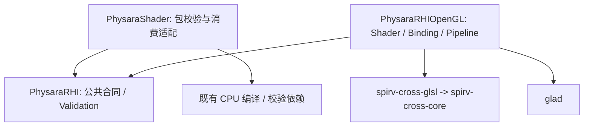

# Design

## Context

动机与范围见 [proposal](proposal.md); 行为见 [新能力 spec](specs/opengl-shader-pipelines/spec.md) 与 [既有可用范围 delta](specs/opengl-device-resources/spec.md). 本设计落实 [D03-T02](../../../../Docs/Developments/D03-D05-FramePipeline.md#d03-t02), 不修改长期架构.

2026-11-05 规划基准为 `2ae2f10a9694f3d045717049b1938160ad8c466b`. D02 出口和 D03-T01 已通过并归档, 无活动 change. 开始时工作树已有 `Docs/CodeReview.md` 的维护者改动, 本轮保留原样, 不把空问题单当作新能力已获 B 验收.

已核对的直接输入与限制:

| 现有位置 | 当前事实与本次影响 |
|---|---|
| `Engine/Shader/Types.hpp`、`Package.hpp`、`Spirv.cpp` | 自持 VS/FS 包, `ReadPackage` 核对完整性/ABI/最终 IR; `GraphicsBaselineV1` 不含 compute、image/UAV、push、descriptor 数组或写 SSBO |
| `Engine/Shader/Interface.cpp`、`RHI/RHI.hpp` | 已有生成 BindingLayoutDesc 与 NVRHI 的 set/bindingOffsets、独立 Texture/Sampler、InputLayout、FramebufferInfo 合同 |
| `RHI/OpenGL/Unsupported.cpp` | Shader、InputLayout、绑定和 Pipeline 创建为桩; 尚无 Program owner 或 lowering 实现 |
| `RHI/OpenGL/Framebuffer.cpp`、`Device.cpp`、`Backend.hpp` | 已有完整 FBO 创建、设备归属检查、预分配删除节点及 context owner 回收; DeviceCaps 尚无完整 Shader 绑定限制 |
| `RHI/Validation/ValidationDevice.cpp` | 已校验普通 Shader/布局/图形描述并委托, 仅排除扩展; 不需要为本次新增另一份通用 Validation 系统 |
| `ThirdParty/ShaderToolchain/CMakeLists.txt` | `spirv-cross-core` 只有四个 core 实现, 已保留 `GLSL.std.450.h`; 尚无 `spirv_glsl.cpp/.hpp` 或 GLSL target |

已采纳的 `shader-build`、`rhi-public-contract`、`rhi-common-validation` 与 `opengl-device-resources` 已按完整场景核对. 后端准备属于新 capability, unavailable 操作总述随实际能力更新; 实施中获维护者批准的 samplerless 源扩展另修订 shader-build, 见决策 11. 历史阶段/前置记录仍是当时事实, 不追改归档.

## Goals / Non-Goals

**Goals:**

- 使已有 canonical 包经公共 RHI 进入唯一 GL 准备链, 输出真实 Program、不可变绑定计划和可供后续列表消费的固定对象.
- 在原生准备边界解决逻辑集合展平、pair、设备限制和对象寿命, 不让 Renderer 或业务 Shader 补偿 GL 细节.
- 通过有限的真实创建/link/反射证据交付 D03-T02, 公开接口、包 ABI 及无原生依赖的 RHI 消费边界不分叉.

**Non-Goals:**

- 不接入 SetGraphicsState/Draw/Dispatch、barrier、窗口呈现、产品画面或 Renderer; 命令与在途绘制验收仍在 D03-T03/T04/T05.
- 不扩展 canonical 资源/IR 能力子集、包格式或权威声明语言. samplerless 源扩展的窄例外见决策 11. 不新增 watcher、异步准备队列、program binary cache、全局 PSO cache 或工具模块.
- 不借资源分配或 link 成功启用尚无执行消费者的 feature 位.

## Decisions

### 1. 按现有 profile 完整承接准备职责, 显式对齐后续扩展

本次的首个可验收 profile 为 `GraphicsBaselineV1` 在 GL 4.6 的单样本准备子集. 此处是工作包的实现范围说明, 不是另一份包 profile 或新的序列化版本.

| 资源/行为 | 本次准备 | 后续归属 |
|---|---|---|
| 普通 ConstantBuffer | std140 UBO range, 按活动块分配 | 实际写入后消费/同步见 D03-T03 |
| 只读 StructuredBuffer_SRV | std430 定长 record 数组的 SSBO range | 写 SSBO 与多消费域见 D08-T04 |
| 独立 float Texture2D/Sampler | 合法 2D 采样视图与 pair, 含 texture-only fetch | 更多维度/类型按实际消费者扩展合同 |
| image/UAV、typed/raw、descriptor 数组 | 明确拒绝, 当前 image 活动数为零, 不占 image units | image/compute 见 [D08-T04](../../../../Docs/Developments/D08-D11-RenderPaths.md#d08-t04); 其它类型另按真实需求扩展 |
| VolatileConstantBuffer / PushConstants | 不作为当前 Shader 绑定消费; 不预占 UBO | [D08-T02](../../../../Docs/Developments/D08-D11-RenderPaths.md#d08-t02) 扩充准备和消费 |
| 非零 instance/vertex builtin | 本次确定 lowering 语义并编译/link | D03-T03/T05 以实际 Draw 数值/像素验收 |

同步细化开发计划 D03-T02 的 image/绑定表述, 保留其余工作包的 ID、前置和未完成状态. 不为得到空 image plan 编写未用的写入器, 也不让首次原生绘制先承担 D08 的完整资源族. 替代方案是现在扩展 schema 与完整执行 profile; 它会扩大 ABI、同步及消费者范围, 不符合当前单目标.

### 2. 保持依赖单向, 只补两个同版本的上游 GLSL 文件

从当前固定 commit `f11ba9f0b21ba8fc15153d50a2a1ae31ab1cf8f7` 补入 [spirv_glsl.cpp](https://github.com/KhronosGroup/SPIRV-Cross/blob/f11ba9f0b21ba8fc15153d50a2a1ae31ab1cf8f7/spirv_glsl.cpp) 与 [spirv_glsl.hpp](https://github.com/KhronosGroup/SPIRV-Cross/blob/f11ba9f0b21ba8fc15153d50a2a1ae31ab1cf8f7/spirv_glsl.hpp). 直接依赖的 core/标准库头和 GLSL 枚举头已保留; 实施时核对实际 include 闭包、原始字节摘要与许可, 不复制其它语言 backend、上游 CMake、CLI、样例、测试或仓库维护文件. 本轮只查阅了固定上游源码, 尚未下载入库或编译这两个文件.

在 `ThirdParty/ShaderToolchain/CMakeLists.txt` 显式增加 `spirv-cross-glsl` 静态库, 只编译新增 GLSL 实现并链接现有 core, 延用第三方局部诊断隔离. `PhysaraRHIOpenGL` PRIVATE 使用该 target, 不经 `PhysaraShader` 间接拉入 glslang/JSON/Core. 包消费适配若在公开声明中返回 RHI handles, `PhysaraShader` PUBLIC 链接 `PhysaraRHI`; 通用 RHI 不反向依赖任何 Engine 或原生库.

来源与精简摘要更新到 `ThirdParty/README.md`; 上游文件保持原样, builtin 的项目规则放第一方适配中. 替代方案是复用上游工程或升级整个工具链, 都没有当前消费者需要, 也会扩大来源和构建面.

### 3. 文件/ABI 校验与原生模块准备分别留在自己的边界

在 Engine/Shader 增加薄的 `RhiProgram.hpp/.cpp` 消费入口, 接受 Device、包路径和 required ABI, 复用 `ReadPackage`; 返回拥有 VS/PS handles、ABI/content 身份的值或既有 Shader Failure. 只有两阶段都创建成功才交付完整结果, 中途失败释放已创建的本轮对象. 实际命名按 C++ 技能统一, 不向公共 RHI 添加 package、ABI 字符串或 Engine 指针字段.

OpenGL Shader 对象复制字节到对齐的 words 存储, 保存 ShaderDesc 和从所选入口得到的资源/IO 反射. 裸字节入口检查长度、头、可解析性、受限资源/能力、main 和执行模型; 原始输入按公共字节借用合同仅在调用期间有效, 不要求调用者恰好提供 uint32_t 对齐地址. 只在这个原始模块边界检查本层所需事实, 不重新解析包或计算 schema ABI, 不在每个 Pipeline/Draw 重复扫描已有不可变 Shader.

包层已有完整 SPIR-V validator 与声明核对. 后端使用自己的 IR/GLSL parser 与 profile 检查, 不因新增薄入口复制一套编译、源 include 或序列化系统. 直接调用 CreateShader 的调用者仍须提供有效 canonical 模块, 本次不把任意字节 fuzz 或工具链自身正确性纳入工作包.

### 4. 逻辑布局不拥有原生单元, Pipeline 统一拥有绑定计划

新增私有 Shader、Bindings 和 Pipeline 文件, 按 owner 分开 CPU 模块、布局/资源记录与原生程序准备. `PipelineBindingPlan` 由 Pipeline 拥有并只读, 作为 lowering 和下一工作包命令执行的共同输入, 不能散落为多份可修改的全局表.

布局记录完整公开描述. 每项只允许数量一; 顺序模式 set=布局位置, registerSpace 必须为零; descriptor-set 模式 set=registerSpace, 同一 Pipeline 不混用策略、不重复 set. b/t/s 类别始终独立, `bindingOffsets + slot` 受检并与 IR 的 descriptor binding 核对, 自定义 offset 若不能与活动 IR 唯一匹配即失败. 不按固定 set 步长计算 GL 单元.

Pipeline 按活动 IR 做以下准备: 解析逻辑身份, 合并跨 stage 使用, 核对布局类型/可见性及块布局, 得到采样 pair, 再按完整逻辑 key 的稳定顺序分配各原生命名空间. 共享资源跨阶段使用同一原生绑定. 资源与块类型的 GLSL 名称须避免不同 set 同名冲突, 同一逻辑资源的跨 stage 接口保持一致; 业务名字不代替 set/binding 身份. 不活动但合法的布局项保留描述, 不分配 GL 单元.

DeviceCaps 在 owner context 上查询并保存 UBO/SSBO binding 数、block 最大字节数与 offset alignment、VS/FS 每阶段资源数、combined block/texture 限制及顶点/输出限制. 验证物理 binding-index 范围、每阶段数量与 combined 数量是不同检查; combined 按规范中的 stage 贡献计算, 不能只数去重后的物理单元. 原生阶段某类限额为零时, 只拒绝实际使用该类资源的程序. link 后核对原生仍活动接口与计划相符; 原生进一步优化掉的资源不制造假引用或导致合法程序失败.

使用可接受 DeviceCaps 值的纯计划计算, Pipeline 生产路径输入真实查询结果. 本地检查可传入受控的小限额观察同一算法的边界, 不增加产品 caps override、故障宏或特殊设备. 替代方案是把所有 layout 声明直接分配成固定 GL 区段; 它既丢失跨 set 身份, 也会使合法程序虚报超限.

### 5. BindingSet 保留逻辑资源, 采样对由活动 IR 确定

BindingSet 不因创建时尚不知道完整 Pipeline 而写全局单元. 它拥有布局、资源强引用和预解析 range/view. 普通常量/结构化 buffer 的用途、显式范围、native alignment 和 block 限额在创建时检查; 与某 Shader 所需 extent/record stride 的对应在消费该布局的准备/后续状态组合处检查, 不把一个资源标志当作 ABI 证明. 不在不可变内部记录的每次读取重新校验同一范围.

Texture SRV 沿已有 storage/view 兼容规则增加采样用途的 view 准备, 保留 format、二维维度、mip/layer 选择和 component mapping. 支持从合法 storage 选择兼容 2D 单层视图, 不把整个数组/cube 作为当前 Shader 的二维资源. 需要 view 时由 BindingSet 明确拥有并退休, 不扩大为全局 view cache. 不支持的整数/比较采样等形状与基线浮点非 depth 图像不匹配时拒绝.

用 SPIRV-Cross 的 dummy/combined image-sampler 分析取得实际 pair, key 含 texture 与 sampler 双方的 set/binding, 再对应布局中的类别/slot. 同一 texture 配两个 sampler 产生两个 unit; 同一 pair 跨 stage 复用 unit, 阶段计数仍单独统计. 对可以跨 BindingSet, 后续列表按计划从各 set 取对应 view/sampler, 不让两个 set 的相同 slot 自动成对.

Texture-only fetch 的 dummy sampler 是后端固定 nearest/clamp 的有界依赖, 最多一份设备内实例, 事件阶段按需创建并在设备退出前退休. 若由 Device 保存自有 native sampler, 不使用会反向强持有 Device 的 wrapper 构成引用环. 它不进入 schema、ABI 或调用方布局. 替代方案是修改 Texture 参数或要求公共 combined 类型, 都违反现有资源与 API 合同.

### 6. 通过第一方 GLSL 适配表达 GL 4.6 builtin, 不做文本替换

固定 desktop GLSL 460、非 Vulkan GLSL 语义. 关闭旧式 clip-space 深度修正和额外 vertex-Y flip, 配合现有 `glClipControl(GL_UPPER_LEFT, GL_ZERO_TO_ONE)`; Reverse-Z 比较/clear 仍是 Pass/状态合同, 不在 Shader 重写一次. 上游选项对深度与 Y 的作用见 [固定 Options](https://github.com/KhronosGroup/SPIRV-Cross/blob/f11ba9f0b21ba8fc15153d50a2a1ae31ab1cf8f7/spirv_glsl.hpp#L156-L171), clip-control 的几何映射见 [Khronos 规范](https://registry.khronos.org/OpenGL/extensions/ARB/ARB_clip_control.txt). 本包仅证明所选配置/生成表达式和 native link, 非对称像素、FragCoord、winding/scissor 和驱动行为继续在 D03-T03 验收.

固定上游的非 Vulkan InstanceIndex 默认生成 ARB draw-parameter 分支, 还保留模拟 uniform 回退, VertexIndex 已映射到包含 baseVertex 的 gl_VertexID, 见 [固定实现](https://github.com/KhronosGroup/SPIRV-Cross/blob/f11ba9f0b21ba8fc15153d50a2a1ae31ab1cf8f7/spirv_glsl.cpp#L9793-L9815). 因而只设置 version=460 不足以表达本项目的无逐 Draw uniform 合同.

在第一方实现中派生窄的 CompilerGLSL 适配, 仅覆盖受支持 InstanceIndex 的 builtin emission, 直接输出 GL 4.6 `gl_InstanceID + gl_BaseInstance`, 其它 builtin 委托上游. 将上游 `support_nonzero_base_instance` 设为 false 仅用于抑制它的额外模拟 uniform 声明, 并由该覆盖显式保留非零 base-instance 语义. 这是已核对的 virtual emission 扩展点, 不改上游源码或替换生成字符串. override 的 `builtin_to_glsl` 保留协议拼写, 声明旁必须注释来源、例外原因及该选项与覆盖的配合.

lowering 通过 decoration/name/资源合并接口设置计划, 保留 block offset/stride、location 和插值. 原始 Shader words 仍保持 canonical 内容. 原生编译日志关联 debug/source 身份、stage、entry 和本次生成 GLSL; 有 IR 源行信息时使用可用映射, 没有时报告生成 GLSL 位置, 不伪造原始 include 行号. 不将完整包/source map 塞进公共 RHI descriptor.

CR-004 的具体诊断流为本次栈上保留两阶段生成字符串至 link 返回, 失败先发送实际参与阶段的身份, 再发送最多 2047-byte driver log 与完整 GLSL 的固定大小片段. 每条 callback 消息最多 511 bytes, 片段标注生成 byte/line/column 并保持 UTF-8 边界; 不依赖 driver 特有的行号语法, 不经通用 Report 二次截断. 成功后文本随本次准备释放, 没有持久缓存、公共包字段或产品故障入口.

### 7. Pipeline 固定状态与具体 framebuffer/动态状态保持分离

InputLayout 保存属性描述, 按公开数组顺序及 arraySize 展开 locations, 核对实际顶点格式支持、bufferIndex、offset、stride、共享 buffer 的频率及原生限制. Pipeline 与活动 VS 输入匹配数值类型和 location; 只用 builtin 的 VS 接受空布局, attribute name 不成为另一个 location 协议. VAO/VB/IB 的执行绑定由 D03-T03 接入, 本次不发 Draw.

GraphicsPipeline 要求 VS, PS 用于普通有色输出; depth-only 目标允许不带 PS. 接受普通非 patch 图元、单样本和已有普通 raster/depth/stencil/blend 描述, 固化为后续执行记录. 无 HS/DS/GS、VRS、conservative 等扩展, sampleQuality=0. 用实际格式/用途与样本支持检查 FramebufferInfo, 核对片元输出位置、数值类型与目标, 不把 sRGB 与整数输出混为同类. 不支持的状态在准备阶段拒绝, 不留到 Draw 静默忽略.

兼容 identity 直接沿 `FramebufferInfo` 的全部字段, 包含 colorFormats 顺序、depthFormat、sampleCount/sampleQuality; 不增加 texture 指针、framebuffer 名字或尺寸. `CreateGraphicsPipeline(desc, framebuffer)` 的保留重载先检查对象归属再取兼容信息. 本次可检查两个实际 FBO 的兼容 identity 与 Pipeline 保存值, 实际 SetGraphicsState 的匹配拒绝及状态发射留在下一工作包.

Program 是 Pipeline 拥有的原生依赖, 临时 GL Shader 在 link 后解除/删除. 同一 Pipeline 复用已准备 Program, 不在执行时编译. 当前不建立另一份无实际淘汰消费者的全局 program/PSO registry; 将来确有 cache 时另定义 key、容量、淘汰与 driver/ABI/binding-plan 身份. 与本包无关的持久 binary cache 不作为退出条件.

第 1 轮 CR-003 补足 Validation 的保留重载: 两种入口共用描述校验, framebuffer 入口完成校验后把实际对象一次委托到底层对应重载, 不先转换成纯兼容值. 公开方法仍带 upstream deprecated 属性; MSVC /WX 会对包装内部这一次必要兼容调用报告 C4996, 因而仅在该调用旁 push/disable/pop 此警告并注释原因. 不改变公共属性或 target 警告选项, 也不新增对象 registry. 通过实际 Validation 的外来 FBO 拒绝与同设备兼容 FBO 接受核对.

### 8. 新对象复用已有失败和退休 owner

创建顺序是公共描述/原生前置检查、CPU owner 与删除节点准备、native 编译/视图/link、接口核对、最终发布. 输入非法或普通编译/link 失败返回空 handle 并由 MessageCallback 报告; 捕获本层可传播的准备异常并回滚本次未发布对象. 普通 Validation CPU 异常继续保留既有传播合同, 不改公共 noexcept 或把所有 STL/第三方致命 OOM 宣称为可恢复.

Pipeline 强持有 Shader、InputLayout、BindingLayout 和 Program; BindingSet 强持有布局、资源及自有 view. `trackLiveness=false` 仍仅把未来列表的自动保活责任交给调用者, 不取消 BindingSet 的依赖所有权. 新对象持有 Device 的做法与既有资源一致, 不新增全局地址 registry.

Program 的发布前清理在当前 owner context 完成; 发布后最终 Release 复用预分配 `NativeDeletion` 队列, 必要时增加 Program kind, 更新该 kind 的原生删除与诊断, worker 不发 GL. 自有 view 在依赖 storage 释放前退休, dummy sampler 在设备退出时有唯一 owner. 沿现有 Host 关闭预检、可用/失效 context 分支和主要错误保留规则处理, 不另建 shutdown 通道.

这些是本包新建对象的 CPU/原生退休, 不是 D03-T04 的 Draw in-flight 验收. 替代方案是 final Release 直接 glDeleteProgram 或缓存永不释放的程序, 分别破坏 context 前提和退出可收拢性.

### 9. 校验分层与注释按实际改动推进

沿用通用 Validation 的描述语义, 只补本次 profile 真实需要的拒绝/委托分支; backend 在裸 Device 边界仍负责实现类型、设备/context、原生 limits 与可发布性. 不在合法不可变内部记录间复制校验层. Feature 查询只按实际消费者开放: ConstantBufferRanges 随 BindingSet 范围准备实现而返回 true, 使已有 Validation 能委托合法子范围; 其它 Feature 继续拒绝. 这不把 link 成功解释为 Draw/Dispatch/volatile 等完整能力支持.

新增函数/类型按 PascalCase, 参数/字段按 camelCase, 成员按 `m_PascalCase`; 默认不使用匿名 namespace. 第一方 C++ 声明写紧凑中文 Doxygen `///`, 实现写中文 `//` 说明阶段、不变量和失败后状态, 使用英文标点. CMake 说明 target 源码与依赖可见性; 所有外部协议命名例外在声明旁解释. 上游原注释和许可保留, 不做无关格式化.

B 通读并补齐本轮涉及的完整第一方文件, 不只检查新增行; 对职责、公开借用/拥有合同、准备和退休流程分别给出注释结论. 按 [审查技能](../../../../.agents/skills/physara-review/SKILL.md) 由维护者调度独立会话, A 不签 B 的项.

### 10. 验证与停止条件集中在 tasks, 准备证据不跨越执行边界

按 [验证技能](../../../../.agents/skills/physara-verification/SKILL.md) 选择最小检查, 具体风险/代表性输入/停止条件见 [tasks 的验证预算](tasks.md#verification-budget). 同一正常原生程序承接常量、只读结构化 buffer、跨 set pair、两个 sampler 及布局观察, 不为每个字段或每个 spec 场景生成一个测试.

开发材料只写 `build/d03-t02/`, 可由维护者删除, 正式 CMake 不注册 fixture、恢复步骤或故障开关. fixture 可以只读后端正常内部准备记录并用 GL 查询观察实际 Program, 不添加 test friend、测试专用 public accessor 或绕过正式 lowering 的另一条产品实现. 无需为了验收本包抢先实现 Draw/像素链. 正式干净构建只依赖仓库输入.

### 11. 已批准的 samplerless 源扩展衔接

2026-11-06 实测正式包编译拒绝无 sampler 的 `texelFetch(texture2D, ...)`, glslang 要求源显式请求 `GL_EXT_samplerless_texture_functions`, 原 D03-T01 白名单只允许 include. 维护者明确选择补充该源扩展并同步 shader-build delta. 因此 SourceGraph 仅接受该项的 enable/require, 不开放其它扩展; 最终 IR 仍经原 validator、Shader/Matrix capability、资源/布局/IO 核对, Vulkan 1.1/SPIR-V 1.3、包格式和 ABI 均不改变. 源检查代码进入既有工具输入指纹, 旧包身份失效.

正式 fixture 将通过同一包编译链生成不含该 fetch 逻辑 Sampler 的 IR, 检查实际 dummy pair、固定 sampler owner 与 native link. 不采用生产源/IR 文本修补、绕开包编译器或增加另一套业务编译规则. 已有独立 Texture/Sampler 配对行为继续保留, 其它未交付 profile 仍拒绝.

## Risks / Trade-offs

- [GL 优化进一步移除跨阶段未消费的资源] → 区分 IR 活动集与 link 后活动集, 允许后者为合法子集, 对仍活动的资源检查一致性, 不把成功日志当作绑定正确证据.
- [阶段/combined 限额与物理绑定点混计] → 使用真实 DeviceCaps 与确定计划, 以一个能区分两者的代表性共享资源场景核对, 不扫描所有设备上限组合.
- [instance builtin 的上游回退路径被误用] → 明确第一方 virtual emission 配置, 检查生成表达式和 native Program 无模拟 uniform; 实际非零索引数值验收留 D03-T03/T05.
- [依赖扩张或重复编译] → 只增加两个固定上游文件与一个 GLSL target, 编译在事件准备阶段, 公共 RHI 独立 consumer 核对依赖闭包.
- [对 link 能力作出过大的完成声明] → tasks 明确准备级观察与未运行项; Intel 驱动下 upper-left 区域 depth clear 的既有待定位项仍归 D03-T03, 不用本次创建/link 结果关闭.

## Migration Plan

1. 先加入固定精简 GLSL 依赖, 再接 Shader 消费与后端模块、Binding/计划、InputLayout/Pipeline 和删除协议, 仅移除这些已实现入口对应的 Unsupported 定义.
2. 更新 `RHI/README.md`、`Docs/Build.md` 与依赖来源, 记录实际支持的准备 profile. Runtime 不新增绘制消费; 开发计划维持 D03-T03 及后续门槛未完成.
3. A 完成本地最小检查后交接 B; 处理问题并复核注释, B 验收最终代码与证据后才进行 native verify、同步三份 delta、归档与问题单重置.
4. 未交付新包格式, 无资产数据迁移. 实施失败时保持该 change 未完成, 修复当前实现或按维护者指示回退本包代码/依赖; 不改写已归档 D03-T01 或伪造新的成功输出.
