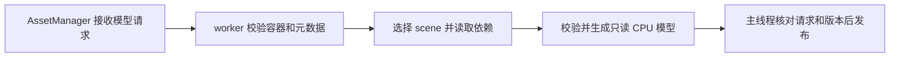

# Design

## Context

[AssetManager](../../../../Engine/Asset/AssetManager.hpp) 目前发布 PNG/JPEG 的 `ImageVersion`，队列在运行和等待取结果期间都占用同一额度。[Core I/O](../../../../Engine/Core/ResourceIO.hpp) 以实际打开的文件校验所属目录，对同一份快照计算 SHA-256。[D06-T02](../../../../Docs/Developments/D06-D07-SceneAndForward.md#d06-t02) 的第一个消费者是静态模型 CPU 请求，后续 Scene 依赖所选源 scene 和可重现的节点／Primitive 引用。

仓库固定的 TinyGLTF C11 默认解析入口会在处理 scene 表之前打开 buffer URI，并在回调前拒绝所有父目录段。图像解析函数只填充引用字段。固定数组转换可能截断长数组或留下缺省值，透视 zfar 和灯 range 的数值字段也不能单独证明源字段是否缺席。这些边界决定选定依赖、原始字段校验和解码应由 Asset 控制。 [默认解析入口](../../../../ThirdParty/tinygltf/tiny_gltf_v3.c#L1252) · [图像入口](../../../../ThirdParty/tinygltf/tiny_gltf_v3.c#L1379) · [固定数组转换](../../../../ThirdParty/tinygltf/tiny_gltf_v3.c#L870) · [图像资产语义](../../../../Docs/Architecture.md#asset-images)

## Goals / Non-Goals

### Goals

- 让同一资产服务交付可用于后续实例化的拥有型静态模型，验证输入的结构、范围、格式语义及实际消耗。
- 保留所选层级、源标识及标准参数，形成有界支持报告。数据可脱离解析器、源文件和 worker 保活。
- 用同一套代表性 CPU 输入验证成功、拒绝、源变化和取消。将已有图片行为和正式产品构建作为直接回归面。

### Non-Goals

- Scene 实例、编辑和 JSON 文件读写由 T03 持有。T04/T05 消费相机、几何和材质，决定具体投影、驻留、mip、绑定和绘制。D16 再处理交互式重导入和实例迁移。
- 本 change 的运行期结果为静态数据。动画、Skin/Morph、后续材质扩展和其它图像编码由支持报告体现当前能力。 [架构 3.2](../../../../Docs/Architecture.md#asset-import) · [阶段工作包](../../../../Docs/Developments/D06-D07-SceneAndForward.md#dev-d06)

## Decisions

### 1. 沿用一个 AssetManager 和帧边界

`AssetManager` 仍持有路径表、请求与发布。把既有作业输入和完成结果扩展为按资产种类区分的值，模型入口提供有类型的 scene 选项和模型版本访问，图片的已发布类型和现有请求入口继续使用。逻辑 key 由模型种类、Core 规范路径和请求选择组成，源代、请求号和基准 ContentRevision 沿 D06-T01 校验。默认与显式选择即使同指一个 scene，也可在接单前保留不同 key。解析后的实际 scene 编号和 `sourceVersion` 一致表达相同输入。

同一队列继续覆盖提交、运行和待取；一个模型完整导入作为一个拥有型 worker 作业，解析期间直接读取其依赖，避免在已占用的队列上同步等待子作业。沿现有继续输入轮次、取消和关闭入口处理完成。状态字段互斥地标识图片或模型，同一个 owner 检查绑定的资源类型和当时的请求、源代、基准版本，不根据就绪结果的到达顺序选择内容。 [发布规范](../../../specs/cpu-asset-publication/spec.md) · [Runtime 合同](../../../specs/runtime-lifecycle/spec.md)

### 2. 用单一受控读链取得所选 scene 的依赖

- 用 Core 读取模型快照，以实际容器及 `asset.version`／`minVersion` 确定兼容性。GLB 校验 magic、版本、总长度、块对齐和合法顺序，JSON 首块、BIN 如存在为第二块且单份。按 GLB 约定跳过可忽略的未知块。首 buffer 使用 BIN 时，校验声明长度及最多 3 字节的零值填充，切片只覆盖声明可用字节。容器校验放在固定解析器的导入适配路径，只有一次 GLB 块解释。 [Khronos glTF 2.0](https://registry.khronos.org/glTF/specs/2.0/glTF-2.0.html)
- 在固定 TinyGLTF C11 增加项目私有的 opt-in 元数据模式。保留 buffer 的 URI 和声明长度，延后读取、base64 解码与分配，GLB BIN 可以在作业寿命内借用已校验快照，图像走已有元数据路径。保留默认 C 入口的行为和原许可。在同一次有界 JSON 解析中提供原字段仍有效的私有校验入口，核对本 profile 使用的必要字段、类型、数组长度、互斥和带缺省的显式值。默认转换后的 C 数值不能替代这些证据，尤其是 matrix/TRS、相机可选远面、光源 range 和扩展字段。此接口只在 Asset 的 C/C++ 适配中使用，项目公开头不导出 C 解析类型。实际改动记录在 ThirdParty/README。
- 本地路径交给 Core 之前先按 URI 处理。模型目录相对解析，按 UTF-8 和原 URI 段语义解码一次，再限制在 `Assets/Models`。允许规范化后仍在该目录内的相对引用。对远程、绝对、驱动器／流、查询／片段、非法转义及不合规字符给出定位。拒绝在 URI 的单段解码中生成路径分隔符。导入外部文件只使用 [ReadResourceFile](../../../../Engine/Core/ResourceIO.hpp)，词法允许后仍检查同一打开对象。固定解析器的提前读取回调无法同时提供 scene 选择、同级目录的合法引用及一致的依赖记账。
- 内嵌 `data:` 对支持的标准 MIME 做校验后有界解码。buffer 采用 `application/octet-stream` 或 `application/gltf-buffer`，图像采用 PNG/JPEG MIME；有声明的图像格式与实际字节一致。图像的 URI 与 bufferView 二选一，bufferView 图像保留必需的 MIME。投影到实际 Buffer span 时校验 `byteLength` 和真实字节，既有整缓冲文件大于声明长度时使用声明范围。按 scene 的实际引用选择 buffer、图像和全部有效内容，合法但未使用的其它资源不进入像素或几何解码。
- 每次作业对实际读取的规范外部路径记住一次拥有的字节快照。同一依赖用到多处，所有消费者和指纹都使用这份字节。`sourceVersion` 根据模型快照 SHA-256、实际 scene 编号和按规范相对路径排序的外部依赖 SHA-256 计算，使用固定版本标签及无歧义边界。容器内字节已计入模型哈希。外部文件变更通过现有显式刷新重新核对，模型正文 SHA-256 相同也须重新了解参与导入的依赖。此模型版本只描述该次读取的快照集合。 [身份与重导入](../../../../Docs/Architecture.md#asset-persistence)

### 3. 有限预算和明确所有权

入参确定有限作业数、单个文件、累计输入、解析内存、几何输出及图片解码/保有额度。文件 API 在分配前检查字节，data URI 在解码前检查预计大小。C11 的 JSON 树和元数据 arena 各有上限，记录同时驻留的内存；选择结果和外部资源表也受界。校验后的 span 在 worker 中借用，给下游的记录只拥有经过转换的数据。典型预算以仓库中的小型模型和实际展开成本核对，保留低限额 fixture 用于确定性检查。

C11 适配将 JSON 分配失败和元数据 arena 分配失败归入 `ModelByteLimit`。两阶段成功后才把完整元数据及原字段交给 Asset，原字段下标和元数据表来自同一次解析。

按 count/stride、有效输出字节、三角角点和索引类型检查范围，生成法线、切线与拆顶点前考虑最坏扩展量。纹理共用 T01 的像素预算，几何的额度随拥有型模型记录保活，读者释放后才能回用。解析器返回后的内部对象和源快照在 job 作用域内销毁。作业在阶段之间、累计读取／遍历和消费点检查取消，已进入底层库调用的完成仍由 owner 的版本门控裁决。

固定 MikkTSpace 会在焊接扇区内递归，并按组申请子组索引。进入该库前按焊接键计量角点和组内最坏空间，单个焊接顶点最多 1024 个面角点，以限制 Windows worker 的递归栈。超过工作上限返回 `ModelByteLimit` 并定位法线纹理槽。保留有效源切线的路径直接使用原框架。

### 4. 静态输出保留源定位，下游无须读取模型文件

| CPU 数据 | 本包提供的事实 | 直接消费者 |
|---|---|---|
| GltfDocument／模型版本 | 规范源位置、所选源 scene 编号、源 node 标识、根／父子次序、局部变换、版本、诊断 | D06-T03 实例化和 SourceRef |
| MeshAsset／Primitive | 局部 CPU 顶点、重建后的三角形索引、局部 bounds、原 mesh 和 Primitive 槽、材质索引 | D06-T04 提取及 D06-T05 驻留 |
| MaterialAsset／图像、纹理、sampler | 标准因子与缺省、用途和通道、alpha、UV/transform、sampling 参数、有效单层像素与支持标志 | D06-T03 实例覆盖和 D06-T05 材质准备 |
| Camera／Light | 原投影可选参数、节点关联、灯类型、颜色、强度单位、可选 range 和锥角 | D06-T03/T04、D07 的灯光准备 |

显式选择优先，其后是文件默认、无默认时唯一 scene。保留显式声明的空 scene，无法确定采用哪个 scene 时返回可定位原因。对所选层级遍历并校验无环、有效索引、根及父子关系，同一 mesh 可以被不同节点引用一次资产。源 TRS 的有限数值和旋转须合法。源矩阵须有限、仿射且能表达为 TRS，保留局部变换，包括可表示的负缩放。模型空间几何沿同一右手约定，镜像实例在下游处理 determinant。Skin/Morph 判定按真正被所选层级引用的节点或 mesh，动画曲线只用于支持报告的存在说明。 [Scene 数据合同](../../../../Docs/Architecture.md#asset-persistence)

透视记录 glTF yfov、near、可选 far 与 aspect；未提供 far 仍保留标准无限远语义，显式无效值在入口拒绝。正交保留 magnification 与有限裁剪区间，不把本 profile 不支持的符号当作绝对值。灯保留 glTF 线性颜色与默认值，方向灯 lux、点及聚光灯 candela，局部灯省略 range 表示无显式截断。投影或强度未准备成 GPU 参数。 [投影 profile](../../../../Docs/Architecture.md#camera) · [物理参数](../../../../Docs/Architecture.md#physical-inputs)

### 5. 先验证 accessor，再在局部空间展开几何

以选定读视图核对 declared/actual buffer、bufferView、accessor 的完整范围及角色。开始读前建立可被安全切片的 span，按 glTF 小端解码，不以指针强转赌对齐和布局。检查 vertex 对齐/stride、语义和组件类型、attribute count、一切窄化、源索引边界和非法索引哨兵。sparse 的 indices/values 分别检查其 bufferView、对齐和长度，按严格递增、索引小于 accessor.count 的顺序叠加，normalized 在取逻辑元素时应用。POSITION 的必需 extrema 与有效源数据核对，输出的 bounds 由实际几何确定。额外、未消费的 UV/属性不自动变为当前 profile 的必需输入。 [核心 accessor](https://registry.khronos.org/glTF/specs/2.0/glTF-2.0.html)

几何准备期间，`Resources` 在单次导入范围内为紧密排列的顶点 bufferView 登记源 accessor 下标。同一 accessor 跨 Primitive 复用时沿用登记结果。不同 accessor 共用一个视图时，步长由显式 `byteStride` 提供。 [glTF 数据对齐](https://registry.khronos.org/glTF/specs/2.0/glTF-2.0.html#data-alignment)

将三角形、三角带和三角扇收敛到三角形索引。条带的奇偶按源三角位置计，保留绕序。剔除退化面并保留源 Primitive 槽身份与条带奇偶。全部退化时保留空表面，无有效索引、表面 bounds 或切线。缺 NORMAL 的面在拆分后保留逐面法线，丢弃同一 Primitive 的源切线。保留有合法法线时的合法源 TANGENT 和 `w`。需要生成时，以 normal 槽的有效 UV 集、局部位置和法线输入 [固定 MikkTSpace](../../../../ThirdParty/mikktspace/mikktspace.h#L80)，先收集逐角点结果，再按兼容法线、切线和 handedness 拆顶点并重建索引。复制所有仍有效的顶点属性。UV 变换仍作为每槽元数据保留，模型导入不改原 UV，也不提前折叠实例 determinant。 [架构几何](../../../../Docs/Architecture.md#geometry)

### 6. 材质数据、支持状态和图像解释分开

- 材质中保留 metallic-roughness 的标准因子和缺省、normal scale、遮蔽 strength、emissive、alpha mode/cutoff、double-sided，以及本阶段支持的 unlit、emissive strength 和每槽纹理变换。每槽由当前材质语义决定有效采样集，`KHR_texture_transform` 覆盖声明的 texCoord 时采用覆盖后的集合。保留 offset/rotation/scale。有效槽需要 UV2 或更高集合时给出准确的槽位诊断。glTF sampler 的规范 wrap 默认值与未指定 filter 可选状态分别保留。
- `KHR_materials_unlit` 的有效图像依赖来自基础颜色纹理，PBR 专用纹理不参与该材质的采样、切线生成或依赖指纹。
- 图像来源无论 URI、data URI 或 bufferView 均复用 [现有解码器](../../../../Engine/Asset/ImageDecode.hpp#L24) 与实际保有额度。首版 RGBA8 使用至多 8 位样本的标准 PNG 与 8 位 JPEG，沿 T01 的 CgBI 和其它不支持格式分类。以源 image 引用统一像素，每个纹理／材质槽独立描述用途、sampler 与 UV。颜色 RGB 用 sRGB 解释，normal/ORM 保持线性和源通道，alpha 采用既有覆盖率合同。
- 对 `extensionsRequired` 文档级拒绝未支持成员。当前支持列表仅含 `KHR_lights_punctual`、`KHR_materials_unlit`、`KHR_materials_emissive_strength`、`KHR_texture_transform` 的约定输入。按文件、必要时加源节点／Primitive／槽位（或 accessor/URI 索引）提供有界诊断。optional 扩展的活动内容依真实核心回退是否完整决定结果，报告所用回退。把“未播放动画”“可选扩展降级”“无有效核心内容”与路径、数据和预算错误区分开。 [标准材质](../../../../Docs/Architecture.md#materials) · [纹理和图像](../../../../Docs/Architecture.md#asset-images)

## Risks / Trade-offs

| 失效方式 | 处理和证据 |
|---|---|
| 固定 parser 在 scene 选择前读取 payload 或在转换时丢掉字段存在性 | opt-in 元数据入口、不配置隐式 I/O、保留单次 JSON 树上的必要校验。少量变体核对合法 in-root 相对引用、缺省和显式非法参数。 |
| 引用复用造成重复读取、版本只跟踪主文件或旧借用失效 | 为本次 worker 固定实际依赖快照，以完整 fingerprint 比较新旧。通过“只改外部 buffer／图像”和旧引用保活检查。 |
| 正常和稀疏数据混用后读错范围，或拆顶点超出容量 | 在字节读取与角点生成前做已检查的范围和上界。使用有已知顶点、镜像 UV 和绕序的有限输入。 |
| 可选扩展被报告为已支持，或使无有效核心数据的几何发布 | 对已验证的核心回退生成可读降级报告。将 required、optional 合法／不完整回退和所选节点变形分开检验。 |
| C11 或 MikkTSpace 接入泄露到公共头／默认构建 | 私有 target 依赖和保留来源说明，以 CPU 消费者及 Windows x64 正式构建验证。 |
